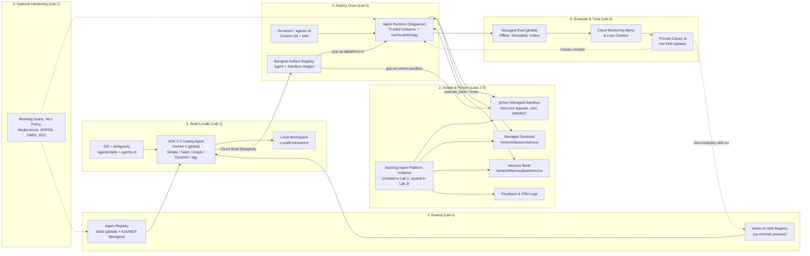

# Enterprise Coding Agent Workshop on Google Cloud

Build a Python coding agent with **Google ADK 2.0** and **Gemini 4** that runs untrusted tests, linters, and shell commands inside isolated gVisor sandboxes and deploys to Google Cloud with **zero local Docker**.

Designed for software engineers, cloud architects, and platform engineers who want a real look at how **Gemini Enterprise Agent Platform** handles sandboxed execution, sessions, memory, registries, Terraform deploys, evaluation, and observability.

---

## Workshop Labs

Work through the labs in order. Every hands-on lab edits specific `# TODO(lab-N)` markers inside [`starter/`](starter/), while [`solution/`](solution/) holds the finished reference code.

| Lab | What You Build | Full-Day | Half-Day | Track |
|---|---|---:|---:|---|
| [Lab 0: Workshop Overview](workshop/00-WORKSHOP-OVERVIEW.md) | Architecture, starter file map, GCP APIs, service agents, pre-flight check | 20 min | 10 min | Core |
| [Lab 1: Build the ADK Agent](workshop/01-LAB-SETUP-AND-BUILD-ADK.md) | **Part A:** Gemini 4 model factory, `LlmAgent`, `EnvironmentToolset(LocalEnvironment)`. **Part B:** Collaborative, Graph, Dynamic, and `agy` CLI harness workflows | 60 min | 35 min | Part A Core / Part B Optional |
| [Lab 2: Custom BYOC Sandbox](workshop/02-LAB-CUSTOM-SANDBOX-BYOC.md) | Backing Agent Platform instance, non-root Debian BYOC sandbox image, Cloud Build push, sandbox lifecycle (create/pause/resume/snapshot), shell & code execution | 60 min | 40 min | Core |
| [Lab 3: Sessions, Memory & Feedback](workshop/03-LAB-SESSIONS-MEMORY-FEEDBACK.md) | Managed Sessions, Memory Bank (topics, TTL, retrieval), Feedback API, OTel traces, and parent sandbox logs | 40 min | 15 min (demo) | Core |
| [Lab 4: Skill & Agent Registries](workshop/04-LAB-SKILLS-AND-AGENT-REGISTRY.md) | 16-check `SKILL.md` packaging, Vertex AI Skill Registry upload, `GCPSkillRegistry` + `SkillToolset`, and `AgentRegistry` A2A/MCP discovery | 40 min | 30 min | Core |
| [Lab 5: Deploy Once (CLI & Terraform)](workshop/05-LAB-DEPLOY-RUNTIME-TERRAFORM.md) | Package and deploy the finished Labs 1–4 agent once via `agents-cli` and Terraform (`google_vertex_ai_reasoning_engine`), custom SA, revisions, and emergency stop | 45 min | 30 min | Core |
| [Lab 6: Eval, Alerts & Optimization](workshop/06-LAB-OPTIMIZE-EVAL-AND-ALERTS.md) | Split single/multi-turn offline eval, simulated user eval, failure clustering, online monitors, Cloud Monitoring alerts, and prompt/skill tuning | 40 min | 15 min (demo) | Core |
| [Lab 7: Security & Governance](workshop/07-LAB-OPTIONAL-SECURITY-AND-GOVERNANCE.md) | `ENABLED_BLOCKING` skill scanning, NLC Semantic Governance, Model Armor, SPIFFE `AGENT_IDENTITY`, IAM conditions, CMEK/VPC-SC, WORM/SIEM/SCC | 35 min | Skipped | Optional |
| [Lab 8: Agent Runtime vs. GKE](workshop/08-ARCHITECTURE-AGENT-RUNTIME-VS-GKE.md) | 14-dimension comparison of Agent Runtime + Managed Sandboxes vs. self-hosted GKE + `kubernetes-sigs/agent-sandbox` | 30 min | 25 min (Q&A) | Core |

Running an instructor-led session? See [FACILITATOR-GUIDE.md](workshop/FACILITATOR-GUIDE.md) for T-7d/T-1d/T-0 checklists, shared-project quota math, pacing cutoffs, and troubleshooting.

Stuck on a lab or short on time? Run `make fast-forward LAB=N` to copy only Lab `N`'s completed code from `solution/` into `starter/` without touching later labs' TODOs. When you finish the workshop, run `make cleanup` to tear down cloud resources cleanly.

---

## How It Fits Together

One rule shapes the whole architecture: **never run untrusted LLM-generated commands inside the same container that holds your cloud credentials.**



- **Trusted runtime vs. untrusted sandbox:** Agent Runtime holds your custom service account (`coding-agent-runtime-sa`), calls Gemini 4, reads/writes Sessions and Memory Bank, and invokes `/usr/local/bin/agy` with `AGY_ADC_AUTH=true` + string `AGY_PROJECT_ID`. Managed Sandboxes run untrusted code in gVisor as `appuser` with zero IAM roles, no ADC, and no metadata server access.
- **Build everything before deploying once:** Labs 2 and 3 use a lightweight standalone backing instance (`client.runtimes.create()`), and Lab 4 wires skills and registries into `coding_agent/` before Lab 5 builds and deploys the container once.
- **Optional modules skip cleanly:** Skipping Lab 7 keeps `make verify-lab LAB=all` 100% green, and skipping Lab 1 Part B leaves Labs 2–6 working cleanly (run `make fast-forward LAB=1` if you also want `make verify-lab LAB=1` and `LAB=all` 100% green).

---

## Regional Setup (Bangkok First)

Every service defaults to **Bangkok (`asia-southeast3`)**. We only fall back to **Singapore (`asia-southeast1`)**, **`global`**, or **`us-central1`** where Google Cloud requires it:

| Scope | Region & Env Vars | Services Hosted Here |
|---|---|---|
| **Default (Bangkok)** | `asia-southeast3` (`PRIMARY_REGION`, `AR_LOCATION`, `BUILD_LOCATION`, `AGENT_REGISTRY_LOCATION`, `GKE_LOCATION`) | Artifact Registry, Cloud Build, Secret Manager, Agent Registry A2A/MCP discovery, and Lab 8 GKE. One Bangkok Artifact Registry repo pulls directly into both Singapore Agent Runtime and Singapore BYOC Sandboxes, so you never need a second repo. |
| **Fallback (Singapore)** | `asia-southeast1` (`GOOGLE_CLOUD_LOCATION`) | Agent Runtime (`ReasoningEngine`), Managed Sandboxes, Managed Sessions, Memory Bank, Agent Gateway, and optional `gemini-4-argon` (`MODEL_LOCATION=asia-southeast1`) if you need regional model inference. Used only because these services are not yet launched in Bangkok. |
| **Global (GCP-Mandated)** | `global` (`MODEL_LOCATION`, `EVAL_LOCATION`, `AGENT_REGISTRY_SKILLS_LOCATION`) | Gemini 4 (`gemini-4-hydrogen` for fast coding, `gemini-4-neon` for deeper planning/review via `google-genai>=2.34.0`), Gen AI Evaluation Service (including failure clustering), and `gcloud alpha agent-registry skills`. |
| **Preview (GCP-Mandated)** | `us-central1` (`SKILL_REGISTRY_LOCATION`) | Vertex AI Skill Registry (`v1beta1` preview, available only in `us-central1`, `europe-west4`, and `us-east5`). |

For full regional caveats and single-region US/EMEA overrides, see [Regional Availability](workshop/00-WORKSHOP-OVERVIEW.md#regional-availability).

---

## 5-Minute Quickstart

> [!TIP]
> **No local Docker needed.** Local smoke tests run in pure Python, container builds run remotely on Cloud Build in Bangkok (`--region=asia-southeast3`), and Lab 5 also supports zero-Docker, zero-AR deploys via `make pack-agent-source` and Terraform `source_code_spec`.

### Prerequisites

- **Python 3.11+** and **[`uv`](https://docs.astral.sh/uv/)** (standalone binary works even without `python3-venv` or Docker).
- **`gcloud` CLI + `alpha` component** authenticated to a **standard billing-enabled GCP project** (do not use Express Mode for Labs 2–8; see [Express Mode caveats](workshop/00-WORKSHOP-OVERVIEW.md#optional-reference-details)).
- **Terraform >= 1.5.0** for Lab 5.
- **Optional locally:** `google/agents-cli` (`uvx google-agents-cli setup`) and the `agy` headless CLI. Cloud Build bakes `/usr/local/bin/agy` into the Lab 2 and Lab 5 images automatically, and `make test-agy-harness` runs offline via `--dry-run`.

### 1. Install Tools & Authenticate GCP

```bash
# Install standalone uv if you don't already have it
curl -LsSf https://astral.sh/uv/install.sh -o /tmp/uv_install.sh \
  && sh /tmp/uv_install.sh \
  && rm -f /tmp/uv_install.sh

# Required for Agent Registry standalone skills (Labs 4, 6, 7)
gcloud components install alpha --quiet

# Optional: install google/agents-cli and its 7 global IDE skills
uvx google-agents-cli setup

# Authenticate your user account and Application Default Credentials (ADC)
gcloud auth login
gcloud auth application-default login
```

### 2. Configure `.env`, Check Pre-Flight & Install Dependencies

```bash
cp .env.example .env
# Edit .env and fill in GOOGLE_CLOUD_PROJECT and GOOGLE_CLOUD_PROJECT_NUMBER

make preflight        # Checks gcloud, ADC, APIs, uv, and regional env vars
make install          # Syncs starter/ and solution/ Python deps with uv
make validate-skills  # Checks the 6 bundled .agents/skills/ definitions
```

### 3. Open in Antigravity

Open this repository root in **Antigravity** (or any IDE supporting `.agents/skills/`). Six bundled workshop skills auto-load alongside the `google-agents-cli-*` skills:

- [`adk-coding-agent-build`](.agents/skills/adk-coding-agent-build/SKILL.md) (Lab 1)
- [`agent-platform-sandbox-byoc`](.agents/skills/agent-platform-sandbox-byoc/SKILL.md) (Lab 2)
- [`agent-platform-runtime-and-state`](.agents/skills/agent-platform-runtime-and-state/SKILL.md) (Labs 3 & 5)
- [`agent-platform-governance-and-registries`](.agents/skills/agent-platform-governance-and-registries/SKILL.md) (Lab 4 & Optional Lab 7)
- [`agent-platform-optimize-and-eval`](.agents/skills/agent-platform-optimize-and-eval/SKILL.md) (Lab 6)
- [`agent-runtime-vs-gke-architecture`](.agents/skills/agent-runtime-vs-gke-architecture/SKILL.md) (Lab 8)

---

## Common `make` Targets

Run `make help` for the full list. Pass `TRACK=solution` to run any command against the finished reference code instead of `starter/`.

| Command | What It Does | Lab |
|---|---|---|
| `make preflight` | Verifies `gcloud`, ADC, APIs, `uv`, and regional variables (supports `PREFLIGHT_ARGS=--offline`) | Lab 0 |
| `make install` / `make install-pip` | Installs Python dependencies with `uv` (or `venv` + `pip` fallback) | Lab 1 |
| `make test-agy-harness` | Runs offline `--dry-run` checks on the `agy` CLI harness | Lab 1B |
| `make test-sandbox-local` | Pure-Python localhost smoke test of `sandbox_image/runner.py` | Lab 2 |
| `make push-sandbox` | Builds and pushes the BYOC sandbox image via Bangkok Cloud Build | Lab 2 |
| `make package-skill` | Checks all 16 Skill Registry rules and packages `dist/secure-code-review.zip` | Lab 4 |
| `make test-agent-local` | Pure-Python localhost smoke test of `main.py` (`GET /` and `POST /api/reasoning_engine`) | Lab 5 |
| `make push-agent` / `make pack-agent-source` | Builds runtime image via Bangkok Cloud Build, or packs a `<= 8 MB` tarball for `source_code_spec` | Lab 5 |
| `make tf-plan` / `make tf-apply` | Plans and applies Terraform for Agent Runtime + IAM | Lab 5 |
| `make eval-offline` / `make eval-simulated` | Runs offline split-JSON and simulated user evaluations (`global`) | Lab 6 |
| `make verify-lab LAB=N` | Runs local checkpoint checks for Lab `1`–`8` or `all` (core Labs 1–6) | Labs 1–8 |
| `make fast-forward LAB=N` | Syncs only Lab `N` from `solution/` into `starter/` without spoiling later TODOs | Labs 1–6, 8 |
| `make cleanup` | Safely deletes workshop sandboxes, templates, alert policies, and runtimes (`CLEANUP_ARGS=--dry-run`) | Teardown |

---

## Next Step

Start with **[00-WORKSHOP-OVERVIEW.md](workshop/00-WORKSHOP-OVERVIEW.md)** to see the starter file map, enable your GCP APIs, and pre-provision the required service agents.
