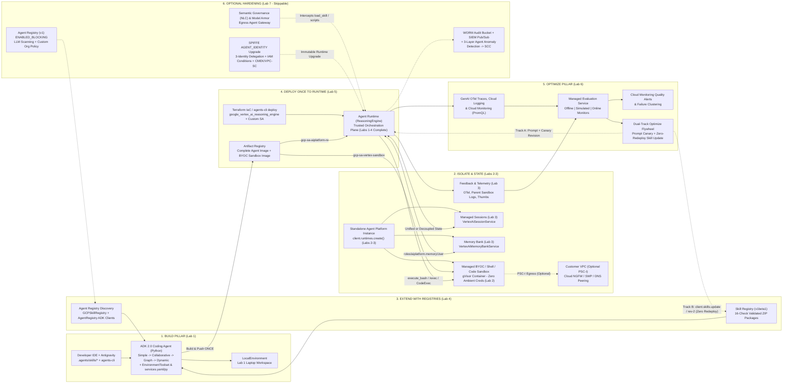

# Enterprise Coding Agent Workshop on Gemini Enterprise Agent Platform

Build, isolate, deploy, govern, and continuously optimize a production-grade **Enterprise Coding Agent** on **Google Cloud's Gemini Enterprise Agent Platform** using **Google ADK (Python)**, **`google/agents-cli`**, **Managed BYOC Sandboxes**, **Terraform**, **Managed Sessions & Memory Bank**, **Skill & Agent Registries**, and **Managed Evaluation & Quality Alerts**.

> **Who this workshop is for:** Principal/Staff Software Engineers, Cloud Architects, Platform Engineers, and AI/ML Engineers designing autonomous coding or developer-productivity agents that execute untrusted code safely at enterprise scale.

---

## What You Will Build

Over the course of this hands-on workshop, you evolve a single ADK Coding Agent (`coding_agent`) from a local prototype into an enterprise-governed, self-improving cloud service across all four pillars of the **Gemini Enterprise Agent Platform**:

| Pillar | Hands-On Labs | Key Platform Capabilities |
|---|---|---|
| **1. Build** | [Lab 1: Setup & Build ADK Agent](workshop/01-LAB-SETUP-AND-BUILD-ADK.md) | `google/agents-cli`, Google ADK 2.0 architectures (Simple `LlmAgent` → Collaborative Team → Graph `Workflow` → Dynamic `@node`), `EnvironmentToolset(LocalEnvironment)`, `ManagedAgent` trade-offs, Service Registration (`services.yaml`/`services.py`), Antigravity `.agents/skills/` |
| **2. Scale** | [Lab 2: Custom Sandbox (BYOC), Lifecycle & Execution](workshop/02-LAB-CUSTOM-SANDBOX-BYOC.md) | Standalone Agent Platform instance (`client.runtimes.create()`), Non-root Debian BYOC container, `SandboxEnvironmentTemplate`, Sandbox CRUD/Pause/Resume/Snapshot, Shell `execute_bash()`, Code Execution (`AgentEngineSandboxCodeExecutor`), custom `BaseEnvironment`, PSC-I/NGFW egress |
| **2. Scale** | [Lab 3: Managed Sessions, Memory Bank, Telemetry & Feedback](workshop/03-LAB-SESSIONS-MEMORY-FEEDBACK.md) | Reuses Lab 2 standalone instance: `VertexAiSessionService` & Sessions API, `VertexAiMemoryBankService` (topics, TTL, similarity retrieval), Feedback Service, GenAI OTel Tracing, parent sandbox `stdout`/`stderr` Cloud Logging & PromQL Monitoring |
| **3. Extend** | [Lab 4: Skill Registry & Agent Registry Discovery](workshop/04-LAB-SKILLS-AND-AGENT-REGISTRY.md) | Skill Registry 16-check ZIP/`SKILL.md` packaging, Vertex AI Skill Registry upload, `GCPSkillRegistry` + `SkillToolset`, `AgentRegistry` (`google-adk[a2a,agent-identity,mcp]`) wired into `coding_agent` before deployment |
| **2. Scale** | [Lab 5: Deploy Complete Agent ONCE (CLI & Terraform)](workshop/05-LAB-DEPLOY-RUNTIME-TERRAFORM.md) | Build & deploy the 100% feature-complete Labs 1–4 agent **once** via `agents-cli deploy` & declarative `google_vertex_ai_reasoning_engine` (`container_spec` & `source_code_spec`), Custom SA + `roles/aiplatform.memoryUser`, dual service-agent IAM `depends_on`, unified vs. decoupled `REASONING_ENGINE_NAME`, revisions, traffic splitting, emergency stop |
| **4. Optimize** | [Lab 6: Observability, Evaluation, Alerts & Optimize](workshop/06-LAB-OPTIMIZE-EVAL-AND-ALERTS.md) | Offline Eval (traces vs. sessions), 2-Step Simulated User Eval, Failure Clustering (`vertexai.evals`), Online Evaluation Monitors, Cloud Monitoring Quality Alerts (`monitoring_v3`), Dual-Track Optimization Flywheel: Root Prompt Canary (`agents-cli eval optimize` + `trafficSplitManual`) **and** Zero-Redeploy Skill Updates (`GEPARootAgentOptimizer` → Skill Registry `client.skills.update` / Agent Registry `rev-2` revision rollout & `rev-1` rollback) |
| **3. Govern (Optional)** | [Lab 7 (Optional / Skippable): Enterprise Security & Governance Hardening](workshop/07-LAB-OPTIONAL-SECURITY-AND-GOVERNANCE.md) | Agent Registry `ENABLED_BLOCKING` LLM scanning & lifecycle, Semantic Governance Policies (NLC) & Model Armor, SPIFFE `AGENT_IDENTITY` + Agent Gateway Terraform upgrade path, Multi-Tenant Session/Memory IAM Conditions, Memory Poisoning audit, CMEK/VPC-SC, WORM Audit Buckets + SIEM Pub/Sub + 3-Layer Agent Anomaly Detection → SCC *(skipping Lab 7 leaves Labs 1–6 100% green!)* |
| **Architecture** | [Lab 8: Agent Runtime vs. Self-Hosted GKE](workshop/08-ARCHITECTURE-AGENT-RUNTIME-VS-GKE.md) | 14-Dimension Limitations & Trade-Off Matrix comparing Agent Runtime + Managed Sandbox vs. Self-Hosted GKE + `kubernetes-sigs/agent-sandbox` + GKE Agent Substrate |

---

## Reference Architecture

The workshop follows a **Build → Isolate → Persist → Extend → Deploy ONCE → Optimize → (Optional Harden)** lifecycle built around one core security boundary: **never execute untrusted LLM-generated commands inside your trusted Agent Runtime**.



### Key Architectural Highlights

- **Trusted Orchestration vs. Untrusted Execution:** **Agent Runtime (`ReasoningEngine`)** holds the runtime identity, calls Gemini models, reads/writes Managed Sessions & Memory Bank, and emits OTel telemetry; **Managed Sandboxes (`SandboxEnvironment`)** execute LLM-generated shell/test commands inside a **gVisor-isolated container** (`appuser`) with **zero IAM roles**, **no ADC**, and **no metadata server access (`169.254.169.254`)**.
- **Build Complete Before Deploying Once:** Labs 2 & 3 run against a lightweight standalone Agent Platform backing instance (`client.runtimes.create()`, ~3 seconds), and Lab 4 wires Skill Registry + Agent Registry directly into `coding_agent/` — so Lab 5 containerizes and deploys the **100% feature-complete** agent **once** via `agents-cli` & Terraform.
- **Portable ADK 2.0 Architectures:** Toggle `AGENT_ARCHITECTURE` across `simple` (default), `collaborative` (`single_turn`/`task` subagents + `GlobalInstructionPlugin`), `graph` (deterministic `Workflow`, `JoinNode`, `RetryConfig`, `RequestInput`), and `dynamic` (`@node(rerun_on_resume=True)`, `asyncio.gather(..., use_sub_branch=True)`) with zero changes to your sandbox or container contract.
- **Dual-Track Optimization Flywheel:** Root-prompt fixes roll out safely via Agent Runtime `v1beta1` `trafficSplitManual` canaries, while domain skill improvements (`GEPARootAgentOptimizer`) hot-update live via `client.skills.update(...)` or immutable Agent Registry `rev-2` revisions (with 1-command rollback to `rev-1`) and **zero agent container rebuild**.
- **Cleanly Skippable Security & Governance (Lab 7):** Enterprise hardening (Agent Registry `ENABLED_BLOCKING` scanning, NLC Semantic Governance, Model Armor, SPIFFE `AGENT_IDENTITY`, IAM Conditions, CMEK/VPC-SC, WORM/SIEM/SCC) is isolated in [Optional Lab 7](workshop/07-LAB-OPTIONAL-SECURITY-AND-GOVERNANCE.md) so time-constrained workshops can skip directly from Lab 6 to [Lab 8 (Agent Runtime vs. GKE)](workshop/08-ARCHITECTURE-AGENT-RUNTIME-VS-GKE.md) with zero broken checkpoints.

*(For full executive narrative, GCP quota math, and detailed prerequisites, see [workshop/00-WORKSHOP-OVERVIEW.md](workshop/00-WORKSHOP-OVERVIEW.md).)*

---

## Quickstart (5 Minutes)

> [!TIP]
> **No Local Docker Required!** Every lab in this workshop runs **100% cleanly without a local Docker daemon** (`docker` CLI is strictly optional). Local smoke tests (`make test-sandbox-local`, `make test-agent-local`) run pure Python on localhost, container builds run remotely on **Cloud Build in Bangkok (`--region=asia-southeast3`)**, and Lab 5 also supports **zero-Docker, zero-Artifact-Registry** deploys via `make pack-agent-source` + Terraform `source_code_spec`.

### Regional Strategy: Bangkok (`asia-southeast3`) First — Fall Back to Singapore (`asia-southeast1`) Only Where Unavailable

Every service defaults to **Bangkok (`asia-southeast3`)** first. We only fall back to **Singapore (`asia-southeast1`)** for Agent Platform / Gemini services not yet launched in Bangkok, and to **`us-central1` / `global`** where Google Cloud mandates it:

| Priority / Scope | Region / Env Var | Workshop Services Hosted Here |
|---|---|---|
| **1. Default (Bangkok)** | `PRIMARY_REGION=asia-southeast3` (`AR_LOCATION`, `BUILD_LOCATION`, `AGENT_REGISTRY_LOCATION`, `GKE_LOCATION`) | **Artifact Registry** (`asia-southeast3-docker.pkg.dev`), **Cloud Build** (`--region=asia-southeast3`), **Secret Manager**, **Agent Registry A2A/MCP Discovery** (`gcloud agent-registry agents` / ADK `AgentRegistry`), and **Lab 8 Self-Hosted GKE** *(Thailand PDPA / BoT compute residency)*. **Empirically verified:** a single Bangkok Artifact Registry repo (`asia-southeast3-docker.pkg.dev`) pulls cleanly into **both** Singapore Agent Runtime and Singapore BYOC Sandboxes — **no second Singapore AR repo is needed**. |
| **2. Fallback Only Where Unavailable (Singapore)** | `GOOGLE_CLOUD_LOCATION=asia-southeast1` | **Agent Runtime** (`ReasoningEngine`), **Managed Sandboxes** (Shell / BYOC / Code Exec), **Managed Sessions**, **Memory Bank**, **Agent Gateway**, and **Gemini 2.5 Flash** *(nearest supported Agent Platform region — used only because these services are not yet available in `asia-southeast3`)*. |
| **3. GCP-Mandated Preview (`us-central1`)** | `SKILL_REGISTRY_LOCATION=us-central1` | **Vertex AI Skill Registry** (`v1beta1` Preview — strictly limited to `us-central1`, `europe-west4`, `us-east5`). |
| **4. GCP-Mandated Global (`global`)** | `EVAL_LOCATION=global` · `AGENT_REGISTRY_SKILLS_LOCATION=global` | **Gen AI Evaluation Service** (`global` is APAC-ready and supports `generate_loss_clusters`) & **Agent Registry Standalone Skills** (`gcloud alpha agent-registry skills --location=global`; standalone skills currently time out in `asia-southeast3`, while A2A/MCP discovery stays in Bangkok `asia-southeast3`). |

*(See the full verified Regional Availability Matrix and single-region US/EMEA alternatives in [00-WORKSHOP-OVERVIEW.md](workshop/00-WORKSHOP-OVERVIEW.md#regional-availability-matrix-bangkok-first-with-minimal-fallbacks).)*

### Prerequisites

- **Python 3.11+** (required by ADK 2.0 and `google/agents-cli`)
- **[`uv`](https://docs.astral.sh/uv/)** (fast Python package & virtualenv manager — install standalone via `curl -LsSf https://astral.sh/uv/install.sh | sh`; works even on fresh Debian/Linux workstations without `python3-venv` or `docker`!)
- **Google Cloud CLI (`gcloud`) + `alpha` component** (`gcloud components install alpha`, needed for `gcloud alpha agent-registry skills` in Labs 4, 6 & 7) authenticated against a **Standard billing-enabled GCP project** (see [Express Mode vs. Standard GCP caveats](workshop/00-WORKSHOP-OVERVIEW.md#express-mode-vs-standard-gcp-project-important))
- **Cloud Build** (zero local Docker required — local `docker` CLI is strictly optional), **Terraform >= 1.5.0** (Lab 5), **Node.js** (optional, for `npx skills add`)
- **`google/agents-cli` (Optional):** Recommended for rapid scaffolding, interactive playground, and `agents-cli deploy` / `eval`, installed via `uvx google-agents-cli setup` (or `uv tool install google-agents-cli`). Every lab works end-to-end with pure `uv`, `gcloud`, and Terraform even if `agents-cli` is not on your `PATH`.

### 1. Install `uv`, `gcloud alpha`, (Optional) `google/agents-cli` & Authenticate GCP

```bash
# Install standalone uv if not present (works even without python3-venv or docker!)
curl -LsSf https://astral.sh/uv/install.sh | sh

# Ensure gcloud alpha component is installed (required for Agent Registry standalone skills)
gcloud components install alpha --quiet

# Optional: Install google/agents-cli and its 7 global IDE workflow skills
uvx google-agents-cli setup
agents-cli info   # optional check if agents-cli is on PATH

# Authenticate Application Default Credentials (ADC) for your GCP project
gcloud auth login
gcloud auth application-default login
```

### 2. Configure Workshop Environment, Run Pre-Flight & Sync `starter/`

```bash
# Copy environment template and fill in GOOGLE_CLOUD_PROJECT and GOOGLE_CLOUD_PROJECT_NUMBER
# (Bangkok asia-southeast3 first, falling back to Singapore asia-southeast1 only for Agent Platform/Gemini,
#  plus us-central1 Skill Registry Preview and global Eval / Agent Registry standalone skills)
cp .env.example .env

# Run automated pre-flight checks (gcloud, ADC, APIs, uv, regions — confirms zero Docker needed!)
make preflight

# Install Python dependencies for starter/ and solution/ via uv
make install

# Run pre-flight skill and repo validation
make validate-skills
```

*(After completing the workshop, tear down all temporary sandboxes, templates, runtimes, and alert policies safely with **`make cleanup`**.)*

### 3. Open in Antigravity (Automatic `.agents/skills/` Discovery)

Open this repository folder in **Antigravity** (or any IDE supporting the open Agent Skills `.agents/skills/` standard). Antigravity automatically discovers all **6 modular workshop skills** bundled under [`.agents/skills/`](.agents/skills/) alongside the 7 global `google-agents-cli-*` skills installed by `uvx google-agents-cli setup`:

| Bundled Workshop Skill | Workshop Coverage |
|---|---|
| [`adk-coding-agent-build`](.agents/skills/adk-coding-agent-build/SKILL.md) | Lab 1 — ADK 2.0 Agent Architectures (Simple, Collaborative, Graph & Dynamic Workflows, `ManagedAgent`, `services.yaml`/`services.py`), `EnvironmentToolset`, `BaseEnvironment`, `LocalEnvironment`, `ExecuteBashTool`, `agents-cli` |
| [`agent-platform-sandbox-byoc`](.agents/skills/agent-platform-sandbox-byoc/SKILL.md) | Lab 2 — BYOC Dockerfile contract, Sandbox/Template/Snapshot lifecycle, Shell & Code Execution, PSC-I/NGFW/VPC-SC/CMEK |
| [`agent-platform-runtime-and-state`](.agents/skills/agent-platform-runtime-and-state/SKILL.md) | Labs 3 & 5 — Managed Sessions, Memory Bank, Feedback, Telemetry, Terraform `google_vertex_ai_reasoning_engine`, quotas & deploy-once patterns |
| [`agent-platform-governance-and-registries`](.agents/skills/agent-platform-governance-and-registries/SKILL.md) | Lab 4 & Optional Lab 7 — Skill Registry (16 atomic ZIP/`SKILL.md` checks), Agent Registry, `GCPSkillRegistry`/`AgentRegistry` ADK clients, `ENABLED_BLOCKING` scanning, Semantic Governance (NLC) & SPIFFE |
| [`agent-platform-optimize-and-eval`](.agents/skills/agent-platform-optimize-and-eval/SKILL.md) | Lab 6 — GenAI OTel Observability, Offline/Simulated/Online Eval, Failure Clustering, Quality Alerts, Optimize Flywheel |
| [`agent-runtime-vs-gke-architecture`](.agents/skills/agent-runtime-vs-gke-architecture/SKILL.md) | Lab 8 — 14-Dimension Agent Runtime vs. Self-Hosted GKE Agent Sandbox & Agent Substrate decision guide |

> **Zero Co-Trigger Shadowing:** Every workshop skill declares explicit `Don't use for:` boundaries so it complements—rather than collides with—the 7 built-in `google-agents-cli-*` skills.

---

## Delivery Tracks: Full-Day vs. Half-Day Fast-Track

Choose the track that matches your session schedule (detailed time-boxed schedule in [00-WORKSHOP-OVERVIEW.md](workshop/00-WORKSHOP-OVERVIEW.md#workshop-schedules-full-day-vs-half-day-fast-track)):

| Track | Duration | Format & Scope |
|---|---|---|
| **Full-Day Deep-Dive** | **7 hours** *(6h 10m labs + 50m breaks; or 6h 25m skipping Optional Lab 7)* | Complete hands-on implementation across **Labs 1–8** (`starter/` → Lab 1 Parts A & B across all 4 ADK architectures, Lab 2 BYOC sandbox + standalone instance, Lab 3 Sessions + Memory Bank + Telemetry/Feedback, Lab 4 Skill/Agent Registry discovery, Lab 5 **Deploy ONCE** via `agents-cli` & Terraform, Lab 6 Offline/Simulated/Online Eval + Quality Alerts, **Optional / Skippable Lab 7** Security & Governance Hardening, and Lab 8 GKE Architecture Review). |
| **Half-Day Fast-Track** | **3.5 hours** *(210 min)* | High-velocity executive + engineering track (**Labs 1–6 + Lab 8**, cleanly skipping **Optional Lab 7** with zero broken checkpoints): **Lab 1 (Part A hands-on + 5m Part B walkthrough), Labs 2, 4, and 5** hands-on (using pre-pushed sandbox/runtime images or `solution/` checkpoints where needed), instructor-led live demos of **Labs 3 (15m) & 6 (15m)**, and a **25-minute** architecture Q&A on **Lab 8 (Agent Runtime vs. GKE)**. |

> [!TIP]
> **Two Classroom Modes: Focused Manual Coding vs. Antigravity AI-Assisted Mode**
> - **Focused Manual Coding Mode:** Repetitive CRUD, schemas, sanitizers, and auth plumbing are **pre-filled** across [`starter/`](starter/) so every lab focuses strictly on **4–8 high-signal architectural `# TODO(lab-N)` functions** (listed at the top of each lab's **Quick-Run TL;DR** block).
> - **Antigravity AI-Assisted Mode:** Open the repository in Antigravity so all 6 [`.agents/skills/`](.agents/skills/) auto-load, then run each lab's TL;DR prompt to pair-program, debug, and verify `# TODO(lab-N)` interactively against verified Google Cloud and ADK 2.0 conventions.
> - **Stay Perfectly on Schedule:** Mix modes freely — and if any lab runs tight on time, run **`make fast-forward LAB=N`** (`scripts/fast_forward_lab.sh`) to catch up instantly without spoiling downstream labs.

> **Stuck on a Lab?** Run **`make fast-forward LAB=N`** (e.g., `make fast-forward LAB=2`) from the repository root to sync **only** Lab `N`'s verified code from [`solution/`](solution/) into [`starter/`](starter/) without spoiling later labs' `# TODO(lab-*)` exercises. *(Optional Lab 7 has `0` starter TODOs and can be skipped cleanly; [`solution/`](solution/) also remains a full 1-to-1 reference mirror for diffing at any time.)*

---

## Repository Map

```text
gemini-coding-agent-workshop/
├── README.md                                   # You are here
├── .env.example                                # Environment variables template (GCP, Sandbox, Registries, Model)
├── Makefile                                    # Single-command runner for install, build, deploy, eval & verify
├── workshop/                                       # Step-by-step customer lab guides & facilitator runbook
│   ├── 00-WORKSHOP-OVERVIEW.md                     # Executive narrative, architecture diagram, prereqs & quotas
│   ├── 01-LAB-SETUP-AND-BUILD-ADK.md               # Lab 1 (Build): agents-cli + ADK 2.0 Architectures + EnvironmentToolset
│   ├── 02-LAB-CUSTOM-SANDBOX-BYOC.md               # Lab 2 (Scale): Standalone instance, BYOC Dockerfile, Sandbox Lifecycle & Egress
│   ├── 03-LAB-SESSIONS-MEMORY-FEEDBACK.md          # Lab 3 (Scale): Managed Sessions, Memory Bank, Feedback & Telemetry
│   ├── 04-LAB-SKILLS-AND-AGENT-REGISTRY.md         # Lab 4 (Extend): Skill Registry 16-check packaging & Agent Registry Discovery
│   ├── 05-LAB-DEPLOY-RUNTIME-TERRAFORM.md          # Lab 5 (Scale): Deploy Complete Coding Agent ONCE (agents-cli + Terraform IaC)
│   ├── 06-LAB-OPTIMIZE-EVAL-AND-ALERTS.md          # Lab 6 (Optimize): Offline/Simulated/Online Eval, Alerts & Prompt Tuning
│   ├── 07-LAB-OPTIONAL-SECURITY-AND-GOVERNANCE.md  # Lab 7 (Optional / Skippable): Scanning, NLC, Model Armor, SPIFFE, CMEK/VPC-SC, WORM/SIEM/SCC
│   ├── 08-ARCHITECTURE-AGENT-RUNTIME-VS-GKE.md     # Lab 8 (Architecture): Agent Runtime vs. Self-Hosted GKE & Agent Substrate
│   └── FACILITATOR-GUIDE.md                        # Instructor checklist, skip-Lab-7 guide, quota math & Top-23 troubleshooting
├── starter/                                        # Hands-on participant workspace with # TODO(lab-N) markers
│   ├── pyproject.toml                              # Python >=3.11 uv dependencies (ADK >=2.0, Agent Platform, Eval, OTel)
│   ├── agents-cli-manifest.yaml                    # Lab 1: agents-cli config (agent_directory: coding_agent, target: agent_runtime)
│   ├── services.yaml                               # Lab 1 Part B: Declarative ADK 2.0+ custom service registration
│   ├── services.py                                 # Lab 1 Part B: Programmatic ADK 2.0+ service registration (precedence over YAML)
│   ├── Dockerfile                                  # Lab 5: Trusted Agent Runtime BYOC image (0.0.0.0:8080, non-root)
│   ├── main.py                                     # Lab 5: FastAPI/ADK HTTP server (GET /, /api/reasoning_engine, /api/stream_reasoning_engine)
│   ├── requirements.txt                            # Lab 5: Agent Runtime container deps (for container_spec & source_code_spec)
│   ├── coding_agent/
│   │   ├── __init__.py
│   │   ├── config.py                               # Typed environment settings loader (incl. AGENT_ARCHITECTURE, MAX_FIX_ROUNDS, ENABLE_HITL_APPROVAL)
│   │   ├── agent.py                                # Root ADK LlmAgent + architecture dispatcher (Lab 1 -> Lab 2 sandbox -> Lab 3/4 wired -> Lab 5 deployed)
│   │   ├── architectures.py                        # Lab 1 Part B: Collaborative Team, Declarative Graph, Dynamic Workflow & ManagedAgent builders
│   │   ├── train_eval_set.evalset.json             # Lab 6: Minimal ADK eval set consumed by `adk optimize`
│   │   ├── tools/
│   │   │   ├── sandbox_lifecycle.py                # Lab 2: Template, Sandbox & Snapshot CRUD + Pause/Resume CLI
│   │   │   ├── sandbox_execution.py                # Lab 2: Shell, BYOC /exec, Code Exec & BaseEnvironment adapter
│   │   │   └── registry_loader.py                  # Lab 4: GCPSkillRegistry, SkillToolset & AgentRegistry loader
│   │   ├── memory/
│   │   │   ├── session_manager.py                  # Lab 3: VertexAiSessionService & direct Sessions API manager
│   │   │   └── memory_bank_manager.py              # Lab 3 (+ Lab 7 audit): VertexAiMemoryBankService, generate/retrieve & hygiene
│   │   └── callbacks/
│   │       └── telemetry_and_feedback.py           # Lab 3: OTel spans, parent sandbox stdout logging & Feedback API
│   ├── sandbox_image/                              # Lab 2: Non-root Debian BYOC coding sandbox (untrusted /exec plane)
│   │   ├── Dockerfile                              # USER appuser, Python 3.11+, Node.js, pytest, ruff, bandit
│   │   ├── runner.py                               # Lightweight /health & /exec HTTP runner on port 8080
│   │   └── requirements.txt
│   ├── skills_to_register/                         # Lab 4: Enterprise skill package passing all 16 atomic checks
│   │   └── secure-code-review/
│   │       ├── SKILL.md
│   │       └── references/owasp-checklist.md
│   ├── terraform/                                  # Lab 5 (+ Lab 7 SPIFFE upgrade path): google_vertex_ai_reasoning_engine + dual SA IAM
│   │   ├── versions.tf
│   │   ├── variables.tf
│   │   ├── main.tf
│   │   ├── outputs.tf
│   │   └── terraform.tfvars.example
│   ├── eval/                                       # Lab 6: Split JSON datasets, eval/sampler configs, eval scripts & alerts
│   │   ├── datasets/
│   │   │   ├── coding_agent_eval.jsonl             # Combined 8-case JSONL (auto-split by --jsonl-dataset)
│   │   │   ├── coding_agent_single_turn.json       # Single-turn canonical {"eval_cases": [...]} dataset
│   │   │   └── coding_agent_multi_turn.json        # Multi-turn agent_data dataset (split to prevent HTTP 400)
│   │   ├── eval_config.yaml                        # Declarative agents-cli eval --config metrics configuration
│   │   ├── sampler_config.json                     # ADK `adk optimize` LocalEvalSampler config (train_eval_set)
│   │   ├── run_offline_eval.py
│   │   ├── run_simulated_eval.py
│   │   ├── setup_online_monitor.py
│   │   ├── setup_quality_alerts.py
│   │   └── optimize_prompt.py
│   └── gke_reference/                              # Lab 8: Self-hosted GKE Agent Sandbox CRD reference overlay
│       ├── sandbox_template.yaml
│       ├── sandbox_warmpool.yaml
│       ├── rbac.yaml
│       └── gke_agent_example.py
├── solution/                                       # Complete reference mirror of starter/ (0 TODO markers, incl. architectures.py, services.yaml/py, Dockerfile, main.py)
├── .agents/skills/                                 # 6 modular production Antigravity skills (auto-discovered)
│   └── adk-coding-agent-build/references/          # Modular ADK build refs (incl. agent-architectures-and-workflows.md & graph-and-dynamic-workflows.md)
├── scripts/                                        # Pre-flight, verification, fast-forward, packaging, E2E validation & teardown tooling
│   ├── preflight_check.sh                          # Attendee pre-flight validator (gcloud, ADC, APIs, uv, regions; zero Docker!)
│   ├── verify_lab.sh                               # Attendee checkpoint verifier (./scripts/verify_lab.sh <1..8|all>)
│   ├── fast_forward_lab.sh                         # Instant per-lab catch-up (make fast-forward LAB=N; never spoils later labs' TODOs)
│   ├── validate_skills.py                          # Validates .agents/skills/ frontmatter, line limits & links
│   ├── package_registry_skill.py                   # Packages & checks all 16 atomic Skill Registry ZIP/SKILL.md rules
│   ├── live_gcp_e2e_validate.sh                    # Instructor live GCP E2E dry-run rehearsal validator
│   └── cleanup_workshop.sh                         # Safe post-workshop teardown for sandboxes, templates, runtimes & alerts
└── automation/                                 # Reproducible corpus harvest & provenance manifest
    ├── harvest_corpus.py
    ├── run_workshop_builder.py
    ├── corpus_manifest.json
    └── workflow_round_ledger.json
```

---

## `Makefile` Quick Reference

Run `make help` at any time from the repository root to list available targets. Override `TRACK=solution` (default: `starter`) to run any command against the reference solution:

| Target | Purpose | Lab |
|---|---|---|
| `make help` | Print all available targets and usage notes | All |
| `make preflight` | Run `scripts/preflight_check.sh` (verifies `gcloud`, ADC, APIs, `uv`, Bangkok/Singapore regions; zero Docker needed) | Lab 0 / Lab 1 |
| `make install` | Sync Python 3.11+ dependencies via `uv` (`starter/` and `solution/`) | Lab 1 |
| `make install-pip` | Pure `python3 -m venv` + `pip` dependency install fallback (zero `uv` required) | Lab 1 |
| `make lint` | Run `ruff check` across `starter/`, `solution/`, and `scripts/` | All |
| `make test-sandbox-local` | Pure-Python `runner.py` localhost smoke test (`/health` + `/exec`) — **zero Docker!** | Lab 2 |
| `make push-sandbox` | Build/push the BYOC sandbox image (`SANDBOX_IMAGE_URI`) via Cloud Build (`--region=asia-southeast3`) — **zero Docker!** | Lab 2 |
| `make build-sandbox` | *(Optional)* Build the non-root BYOC coding sandbox image locally if Docker is installed | Lab 2 |
| `make sandbox-lifecycle-demo` | Run the Sandbox Template -> Create -> Exec -> Pause -> Resume -> Snapshot -> Delete demo in Singapore (`asia-southeast1`) | Lab 2 |
| `make package-skill` | Validate all 16 atomic Skill Registry ZIP/`SKILL.md` checks and build the `.zip` archive | Lab 4 |
| `make test-agent-local` | Pure-Python `uvicorn main:app` localhost smoke test (verifies both `GET /` -> `200 {"status":"ok"}` and `POST /api/reasoning_engine` with and without `Content-Type: application/json`) — **zero Docker!** | Lab 5 |
| `make push-agent` | Build/push the complete Labs 1–4 Agent Runtime BYOC image (`AGENT_IMAGE_URI`) via Cloud Build (`--region=asia-southeast3`) — **zero Docker!** | Lab 5 |
| `make pack-agent-source` | Package root-level `coding_agent_source.tar.gz` (<= 8 MB) for zero-Docker, zero-AR Terraform `source_code_spec` deploy | Lab 5 |
| `make tf-plan` | Initialize and run `terraform plan` in `$(TRACK)/terraform` | Lab 5 |
| `make tf-apply` | Apply Terraform configuration for Agent Runtime (Singapore `asia-southeast1`) + IAM bindings | Lab 5 |
| `make eval-offline` | Run offline evaluation (`EVAL_LOCATION=global`) over split JSON datasets (`eval/datasets/coding_agent_{single,multi}_turn.json`) | Lab 6 |
| `make eval-simulated` | Run 2-step simulated user evaluation personas (`EVAL_LOCATION=global`) | Lab 6 |
| `make validate-skills` | Run `scripts/validate_skills.py` on `.agents/skills/` | Lab 1 / All |
| `make verify-lab LAB=1` | Run `./scripts/verify_lab.sh <1..8\|all>` checkpoint verification (`all` checks core Labs 1–6; `7` Optional Hardening; `8` GKE Overlay) | Labs 1–8 |
| `make fast-forward LAB=1` | Run `./scripts/fast_forward_lab.sh <1..6\|8>` to sync **only** Lab `N` from `solution/` into `starter/` without spoiling later labs' TODOs | Labs 1–6, 8 |
| `make cleanup` | Run `scripts/cleanup_workshop.sh` to safely delete workshop sandboxes, templates, alert policies, and runtimes *(supports `CLEANUP_ARGS=--dry-run`)* | Post-Workshop |

---

## Next Step

Start with **[00-WORKSHOP-OVERVIEW.md](workshop/00-WORKSHOP-OVERVIEW.md)** to review the end-to-end architecture, enable required GCP APIs, configure the required service agents, and run your pre-flight quota check.

---

## Official Documentation References

- **Google ADK Documentation:** https://adk.dev/get-started/
- **Google ADK 2.0 Workflows & Graphs:** https://adk.dev/2.0/ · https://adk.dev/workflows/ · https://adk.dev/graphs/
- **`google/agents-cli` Repository:** https://github.com/google/agents-cli
- **Gemini Enterprise Agent Platform — Scale & Sandboxes:** https://docs.cloud.google.com/gemini-enterprise-agent-platform/scale/sandbox
- **Gemini Enterprise Agent Platform — Runtime Setup:** https://docs.cloud.google.com/gemini-enterprise-agent-platform/build/runtime/setup
- **Gemini Enterprise Agent Platform — Quotas & Locations:** https://docs.cloud.google.com/gemini-enterprise-agent-platform/resources/agent-quotas
