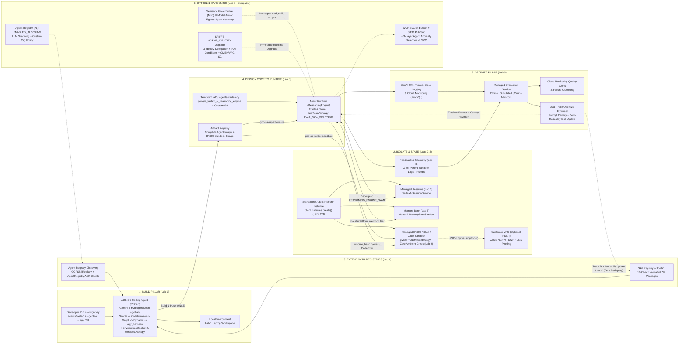

# 00 — Workshop Overview: Building a Production Enterprise Coding Agent on Gemini Enterprise Agent Platform

> **Estimated Reading & Setup Time:** 20 minutes (Full-Day) / 10 minutes (Half-Day Fast-Track) — complete the GCP prerequisites and pre-flight checks before starting [Lab 1](01-LAB-SETUP-AND-BUILD-ADK.md).

---

## Executive Narrative: Why an Enterprise Coding Agent?

Autonomous coding agents are among the highest-value—and highest-risk—AI workloads an enterprise can deploy. Unlike read-only Q&A chatbots, a real coding agent must:

1. **Read, edit, and write multi-file repositories** deterministically.
2. **Execute arbitrary, LLM-generated shell commands and test suites** (`pytest`, `ruff`, `bandit`, build tools) without compromising the host network, cloud credentials, or neighboring tenants.
3. **Retain multi-turn task state and long-term engineering conventions** across sessions while defending against memory poisoning and prompt injection.
4. **Consume approved organizational skills and internal tools dynamically** from centralized registries under enforceable natural-language and identity policies.
5. **Prove and continuously improve engineering quality** through automated traces, offline/simulated/online evaluations, quality alerting, and closed-loop prompt optimization.

Solving all five requirements with ad-hoc containers and scripts creates brittle security boundaries and months of platform toil. **Google Cloud's Gemini Enterprise Agent Platform** provides the integrated control plane and managed runtime primitives—paired with **Google ADK (Agent Development Kit)** and **`google/agents-cli`**—to take a coding agent from laptop prototype to production governance across four pillars: **Build -> Scale -> Govern -> Optimize**.

---

## End-to-End Reference Architecture



### Architectural Separation of Concerns

One design principle anchors the entire workshop: **never run untrusted LLM-generated commands inside your trusted Agent Runtime.**

- **Agent Runtime (`ReasoningEngine`)** is the **trusted orchestration plane**. It holds the agent's identity (SPIFFE `AGENT_IDENTITY` or dedicated custom service account), invokes Gemini models, reads/writes Managed Sessions and Memory Bank, calls authenticated Google Cloud APIs, and records structured logs and OpenTelemetry traces.
- **Managed Sandboxes (`SandboxEnvironment`)** are the **untrusted execution plane**. Each sandbox runs in a Google-managed tenant project inside a **gVisor-isolated container** under an unprivileged user (`appuser` / tenant identity `sandbox-untrusted`) with **zero IAM roles**, **no Application Default Credentials (ADC)**, and **no access to the metadata server (`169.254.169.254:80`)**.

### ADK Agent Architecture Progression (`Build Pillar` — Lab 1)

Real enterprise coding workloads rarely stay a single monolithic prompt forever. Before scaling execution to remote BYOC Sandboxes in Lab 2, **[Lab 1](01-LAB-SETUP-AND-BUILD-ADK.md)** establishes the full **Google ADK 2.0** architectural progression — powered by **Frontier Gemini 4 Hydrogen (`gemini-4-hydrogen`) & Neon (`gemini-4-neon`)** on `MODEL_LOCATION=global` and controlled via a single `AGENT_ARCHITECTURE` environment variable (`simple` default so Labs 2–8 remain 100% backward compatible):

1. **Simple Agent (`AGENT_ARCHITECTURE=simple` — Part A):** A single `LlmAgent` wired with `EnvironmentToolset(LocalEnvironment)` and ADK 2.0 `Gemini(model=..., client_kwargs=...)`. Fast to iterate, ideal until prompt complexity, context limits, code modularity, or deterministic test/lint gates justify splitting responsibilities. *(We also contrast `LlmAgent` with ADK Python v2.4.0 Preview [`ManagedAgent`](https://adk.dev/agents/managed-agents/) and introduce ADK 2.0+ [`services.yaml` / `services.py`](https://adk.dev/agents/service-registration/) custom backend registration.)*
2. **Collaborative Agent Team (`AGENT_ARCHITECTURE=collaborative` — Part B):** Coordinator `LlmAgent` delegating across isolated session branches to mode-scoped subagents (`mode="single_turn"` for `code_implementer` on `gemini-4-hydrogen` / `code_reviewer` on `gemini-4-neon`, and leaf-only `mode="task"` for `requirements_clarifier`), governed by `GlobalInstructionPlugin`.
3. **Declarative Graph Workflow (`AGENT_ARCHITECTURE=graph` — Part B):** Deterministic ADK 2.0 `Workflow(edges=...)` combining LLM reasoning with parallel `@node` `pytest`/`ruff` checks (`RetryConfig` + per-attempt timeout), `JoinNode` fan-in, bounded `Event(route=...)` fix loops, and `RequestInput` HITL pauses.
4. **Dynamic Checkpointed Workflow (`AGENT_ARCHITECTURE=dynamic` — Part B):** Programmatic `@node(rerun_on_resume=True)` async Python orchestration (`for` loops, `asyncio.gather(..., use_sub_branch=True)`, and automatic checkpoint replay across HITL pauses).
5. **Antigravity Headless CLI Harness (`AGENT_ARCHITECTURE=agy_harness` — Part B):** Implements the **"Outer ADK Factory + Inner `agy` Headless Harness"** architecture (`build_agy_harness_workflow()`): a `gemini-4-neon` planner node sets acceptance criteria, an inner coding `@node` delegates implementation to `AgyHeadlessHarness` (`auto | local | sandbox` mode with NDJSON OTel spans, 4-tier exit codes `0/1/2/3`, and `--conversation <id>` multi-round continuity), independent parallel `pytest` + `ruff` gates verify edits, and an independent `gemini-4-neon` `code_reviewer` (+ optional `RequestInput` HITL gate) signs off!

Because all five architectures share the **exact same `EnvironmentToolset` and Gemini 4 model factory**, moving from `LocalEnvironment` (Lab 1) to `AgentPlatformSandboxEnvironment` (Lab 2), wiring Sessions/Memory (Lab 3) and Registries (Lab 4), and deploying **once** to Agent Runtime (Lab 5) requires **zero changes** to your workflow graph or container contract!

---

## Workshop Schedules: Full-Day vs. Half-Day Fast-Track

This workshop follows a **Build → Isolate → Persist → Extend → Deploy ONCE → Optimize → (Optional Harden)** flow: Labs 1–4 iteratively build and test the complete Coding Agent against managed cloud primitives (using a lightweight standalone Agent Platform instance created in Lab 2) so **[Lab 5](05-LAB-DEPLOY-RUNTIME-TERRAFORM.md)** builds and deploys the **100% feature-complete** container **once**. **[Lab 7](07-LAB-OPTIONAL-SECURITY-AND-GOVERNANCE.md)** is a self-contained **Optional / Skippable** enterprise security & governance module—skipping it leaves Labs 1–6 100% green (`make verify-lab LAB=all`).

| Module | Topic & Hands-On Deliverable | Full-Day (7h 00m) | Half-Day Fast-Track (3h 30m) |
|---|---|---:|---:|
| **Lab 0** | Overview, Pre-Workshop Checklist, GCP APIs, Service Agents, Pre-Flight Check (`00-WORKSHOP-OVERVIEW.md`) | 20 min | 10 min |
| **[Lab 1](01-LAB-SETUP-AND-BUILD-ADK.md)** | **Build:** **Part A (Core):** Gemini 4 `client_kwargs` model factory (`gemini-4-hydrogen`/`gemini-4-neon` on `global`), `agents-cli` (optional), Antigravity skills, Simple `LlmAgent` + `EnvironmentToolset`; **Part B (Optional / Stretch):** Collaborative, Graph, Dynamic Workflows, **`agy` Headless CLI Harness (`agy_harness`)** & Service Registration | 60 min *(30m Part A Core + 30m Part B Optional/Stretch)* | 35 min *(30m Part A hands-on + 5m Part B overview — skip Part B coding)* |
| **[Lab 2](02-LAB-CUSTOM-SANDBOX-BYOC.md)** | **Scale (Sandboxes):** Standalone Agent Platform instance (`client.runtimes.create()`), Non-root BYOC Dockerfile with baked `/usr/local/bin/agy` & allowlisted `/exec` `env`, Bangkok Cloud Build + AR → Singapore Sandbox Lifecycle, Shell vs. BYOC vs. Code Exec, `AgentPlatformSandboxEnvironment`, Egress & Security | 60 min | 40 min *(use pre-pushed image or `SANDBOX_MODE=shell` if tight)* |
| *Break* | *Morning Coffee / Stretch Break* | *10 min* | *10 min* |
| **[Lab 3](03-LAB-SESSIONS-MEMORY-FEEDBACK.md)** | **Scale (State & Telemetry):** Reuses Lab 2 standalone instance for Managed Sessions, Memory Bank (topics/TTL/retrieval), Feedback Service, OTel Tracing, Logging & PromQL Monitoring | 40 min | 15 min *(instructor live demo + code walkthrough)* |
| **[Lab 4](04-LAB-SKILLS-AND-AGENT-REGISTRY.md)** | **Extend (Registries):** Skill Registry 16-check ZIP/`SKILL.md` packaging, publish directory to Vertex AI Skill Registry (`us-central1`), wire `GCPSkillRegistry` + `SkillToolset` & Bangkok `AgentRegistry` A2A/MCP discovery (+ optional `global` standalone skills) | 40 min | 30 min *(Parts A, B & C hands-on)* |
| *Break* | *Lunch Break (Full-Day only)* | *40 min* | *—* |
| **[Lab 5](05-LAB-DEPLOY-RUNTIME-TERRAFORM.md)** | **Scale (Deploy ONCE via Runtime & Terraform):** Build & push complete Labs 1–4 Coding Agent image **once** to Bangkok AR, `agents-cli deploy --dry-run` + Terraform `google_vertex_ai_reasoning_engine` in Singapore (`dynamic "env"` + Custom SA + `roles/aiplatform.memoryUser` + dual service-agent `depends_on`), Revisions & Emergency Stop | 45 min | 30 min |
| **[Lab 6](06-LAB-OPTIMIZE-EVAL-AND-ALERTS.md)** | **Optimize:** GenAI Observability, Split Offline/Simulated/Online Eval (`global`), Failure Clustering, Quality Alerts (`monitoring_v3`), Dual-Track Prompt & Skill Optimization Flywheel | 40 min | 15 min *(instructor live demo + walkthrough)* |
| **[Lab 7](07-LAB-OPTIONAL-SECURITY-AND-GOVERNANCE.md)** *(Optional / Stretch)* | **Govern & SecOps Hardening (Optional / Skippable):** Agent Registry `ENABLED_BLOCKING` scanning (`global`), Semantic Governance (NLC) & Model Armor, SPIFFE `AGENT_IDENTITY` + Agent Gateway Terraform upgrade, Multi-Tenant IAM Conditions, Memory Poisoning audit, CMEK/VPC-SC, WORM Audit + SIEM + Agent Anomaly Detection → SCC | 35 min *(optional/stretch — skip cleanly to finish at 6h 25m)* | *— (Skipped — self-paced)* |
| **[Lab 8](08-ARCHITECTURE-AGENT-RUNTIME-VS-GKE.md)** | **Architecture Decision:** Agent Runtime + Managed Sandbox vs. Self-Hosted GKE in Bangkok (`asia-southeast3`) + `kubernetes-sigs/agent-sandbox` + Agent Substrate (14-Dimension Matrix) | 30 min | 25 min *(executive + engineering Q&A)* |
| **Total** | | **420 min (7h 00m)** *(Core Labs 1A–6 + 8: 5h 05m labs + 50m breaks = 5h 55m; add Lab 1B +30m and Lab 7 +35m as time permits)* | **210 min (3h 30m)** *(Cut line: Lab 1 Part A + Labs 2, 4, 5 hands-on; Labs 3 & 6 live demos; Lab 1B & Lab 7 skipped cleanly; Lab 8 Q&A)* |

> [!IMPORTANT]
> **Clear Cut Lines for Tight Schedules (Full-Day vs. Half-Day):**
> - **Core Path (Never Skip):** Lab 1 **Part A**, Lab 2, Lab 3 *(hands-on or live demo)*, Lab 4, Lab 5, Lab 6 *(hands-on or live demo)*, and Lab 8.
> - **Optional / Stretch Modules (Zero Downstream Breakage):** **Lab 1 Part B** (Collaborative, Graph, Dynamic & `agy_harness` ADK 2.0 architectures — reset `AGENT_ARCHITECTURE=simple` before Lab 2 anyway) and **Lab 7** (Security & Governance Hardening — `0` starter TODOs). Skipping either or both leaves Labs 1–6 and `make verify-lab LAB=all` **100% green**.

> [!TIP]
> **Two Classroom Modes: Focused Manual Coding vs. Antigravity AI-Assisted Mode**
> - **Focused Manual Coding Mode:** Repetitive boilerplate CRUD (`get`/`list`/`delete`), schemas, sanitizers, and auth helpers are **pre-filled** across `starter/`, leaving only **4–8 high-signal architectural `# TODO(lab-N)` functions** per lab (summarized in every lab's top **Quick-Run TL;DR** block).
> - **Antigravity AI-Assisted Mode:** Open this repository in Antigravity to auto-discover all 6 modular `.agents/skills/`, and paste each lab's TL;DR prompt to implement, verify, or debug `# TODO(lab-N)` with source-verified ADK 2.0 and Agent Platform patterns.
> - **Instant Zero-Spoil Catch-Up:** Falling behind the time-box? Run **`make fast-forward LAB=N`** (`scripts/fast_forward_lab.sh`) to sync *only* Lab `N` from `solution/` into `starter/` while keeping all subsequent labs' `# TODO` exercises untouched.

> **Fast-Forward Rule:** Every lab in `starter/` has a 1-to-1 mirror in `solution/`. If a build, TODO, or Terraform apply runs behind schedule, run **`make fast-forward LAB=N`** (or `bash scripts/fast_forward_lab.sh <1..6|8>`) to catch up on Lab `N` cleanly without spoiling later labs' TODOs. See [FACILITATOR-GUIDE.md](FACILITATOR-GUIDE.md) for exact checkpoint cutoffs and emergency pacing playbooks.

---

## GCP Prerequisites & Environment Setup

### Pre-Workshop Checklist (Run Before Lab 1)

Complete these four quick steps before starting Lab 1 so downloads and CLI components never eat into lab time:

- [ ] **Authenticate GCP + ADC** against a **Standard billing-enabled GCP project** (`gcloud auth login && gcloud auth application-default login && gcloud config set project YOUR_PROJECT_ID`).
- [ ] **Install `gcloud alpha` component:** Run `gcloud components install alpha --quiet` *(required for `gcloud alpha agent-registry skills` in Labs 4, 6 & 7)*.
- [ ] **Pre-sync Python dependencies (`make install`):** Run `cp .env.example .env`, set `GOOGLE_CLOUD_PROJECT` and `GOOGLE_CLOUD_PROJECT_NUMBER`, then run **`make install`** (`uv sync --dev` across `starter/` and `solution/`, installing `google-adk>=2.0.0` and `google-genai>=2.34.0` for Gemini 4 automatic long decodes).
- [ ] **Optional `google/agents-cli` & `agy` Headless CLI:** Run `uvx google-agents-cli setup` for playground/deploy/eval shortcuts, and optionally install the static Go `agy` CLI (`curl -fsSL https://antigravity.google/cli/install.sh | bash`) for live local runs of Lab 1 Part B `agy_harness`. *(All labs run cleanly via `uv`, `gcloud`, and Terraform even without either CLI installed locally; `make test-agy-harness` validates the `agy` harness via `--dry-run`, and Cloud Build bakes `/usr/local/bin/agy` into Lab 2 & Lab 5 containers automatically!)*

> [!TIP]
> **No Local Docker Required!** Every lab in this workshop is designed for **100% zero-Docker attendee execution** (`docker` CLI is strictly optional):
> - **Standalone `uv` without `python3-venv` or Docker:** Install `uv` with `curl -LsSf https://astral.sh/uv/install.sh | sh` — works out of the box even on fresh Debian/Linux workstations or cloud dev environments without `python3-venv` or `docker`.
> - **Lab 2 (Sandboxes):** Verify your BYOC runner locally via pure Python (`make test-sandbox-local`), build and push remotely via Cloud Build in Bangkok (`make push-sandbox` → `gcloud builds submit --region=asia-southeast3`), or use the zero-build `SANDBOX_MODE=shell` fast-track.
> - **Lab 5 (Agent Runtime):** Smoke-test `main.py` locally via pure Python (`make test-agent-local`), then deploy via (1) `make push-agent` (Cloud Build `--region=asia-southeast3`) + Terraform `container_spec`, (2) `make pack-agent-source` + Terraform `source_code_spec` + empty `image_spec {}` (zero Docker AND zero Artifact Registry push!), or (3) `agents-cli deploy`.

### Express Mode vs. Standard GCP Project (Important!)

Gemini Enterprise Agent Platform offers an **Express Mode** free tier (`GOOGLE_GENAI_API_KEY` + `GOOGLE_GENAI_USE_ENTERPRISE=TRUE`), as well as AI Studio (`GEMINI_API_KEY`). **Do NOT use Express Mode for Labs 2–8.**

| Capability / Quota | Express Mode (Free Tier) | Standard Billing-Enabled GCP Project |
|---|---|---|
| Agent Platform resources (max) | **10** | **100** per region (and non-regional) |
| Write requests / min | **10/min** | **10/min** (Reasoning Engine) / **500/min** (Sandboxes) |
| Query / StreamQuery requests / min | **10/min** | **90/min** (adjustable) |
| Concurrent `BidiStreamQuery` / min | **1/min** | **10/min** |
| Session writes / event appends per min | **10/min** / **30/min** | **100/min** / **300/min** |
| Memory Bank writes / reads per min | **10/min** / **10/min** | **100/min** / **300/min** |
| Artifact Registry BYOC Sandboxes, Terraform IAM, PSC-I/NGFW, Cloud Monitoring Alerts | **Not supported** | **Fully supported** |

- **Lab 1 only:** You may use AI Studio (`GEMINI_API_KEY`) or Express Mode strictly for local ADK prototyping if your GCP project is still provisioning.
- **Labs 2–8:** Require a **Standard GCP project with billing enabled** and Application Default Credentials (`gcloud auth application-default login`).

### Regional Availability Matrix (Bangkok First with Minimal Fallbacks)

This workshop aims for **Bangkok (`asia-southeast3`) first** for every service that supports it — **not** an intentional multi-region split. We only fall back to **Singapore (`asia-southeast1`)** for Agent Platform / Gemini services not yet launched in Bangkok, and to **`us-central1` / `global`** strictly where Google Cloud mandates it:

| Priority / Scope | Region & Env Var | Services Hosted Here | Verified Availability & Live Rehearsal Notes |
|---|---|---|---|
| **1. Default (Bangkok)** | **`asia-southeast3`**<br/>`PRIMARY_REGION=asia-southeast3`<br/>`AR_LOCATION=asia-southeast3`<br/>`BUILD_LOCATION=asia-southeast3`<br/>`AGENT_REGISTRY_LOCATION=asia-southeast3`<br/>`GKE_LOCATION=asia-southeast3` | • **Artifact Registry** (`asia-southeast3-docker.pkg.dev`)<br/>• **Cloud Build** (`--region=asia-southeast3`, zero local Docker)<br/>• **Secret Manager** (`asia-southeast3` / automatic)<br/>• **Agent Registry A2A/MCP Discovery** (`gcloud agent-registry agents` / ADK `AgentRegistry`)<br/>• **Lab 8 Self-Hosted GKE + GKE Agent Sandbox** | Keeps builds, images, secrets, A2A/MCP catalog discovery, and self-hosted GKE in Bangkok (Thailand PDPA / BoT compute residency). **Empirically verified:** Bangkok Artifact Registry (`asia-southeast3-docker.pkg.dev`) pulls cleanly into **both** Singapore Agent Runtime and Singapore BYOC Sandboxes — **no second AR repo is needed**. |
| **2. Fallback Where Unavailable (Singapore)** | **`asia-southeast1`**<br/>`GOOGLE_CLOUD_LOCATION=asia-southeast1` | • **Agent Runtime** (`ReasoningEngine`)<br/>• **Managed Sandboxes** (Shell, BYOC, Code Exec)<br/>• **Managed Sessions** (`VertexAiSessionService`)<br/>• **Memory Bank** (`VertexAiMemoryBankService`)<br/>• **Agent Gateway**<br/>• *(Optional strict regional residency)* **Gemini 4 Argon** (`gemini-4-argon`, `MODEL_LOCATION=asia-southeast1`) | Used **only because** Agent Platform Runtime, Sandboxes, Sessions, Memory Bank, and Agent Gateway are not yet launched in `asia-southeast3`. All of them are officially live in `asia-southeast1` with zero restrictions. `gemini-4-argon` is empirically verified HTTP 200 in both `asia-southeast1` and `global`. *(Replaces retired `gemini-2.5-flash`, retired Oct 20, 2026.)* |
| **3. GCP-Mandated Preview (`us-central1`)** | **`us-central1`**<br/>`SKILL_REGISTRY_LOCATION=us-central1` | • **Vertex AI Skill Registry** (`aiplatform.googleapis.com/v1beta1`, Lab 4) | Preview is strictly limited to **3 regions**: `us-central1`, `europe-west4`, and `us-east5`. Keeping `SKILL_REGISTRY_LOCATION=us-central1` ensures Lab 4 succeeds cleanly from APAC. |
| **4. GCP-Mandated Global (`global`)** | **`global`**<br/>`MODEL_LOCATION=global`<br/>`EVAL_LOCATION=global`<br/>`AGENT_REGISTRY_SKILLS_LOCATION=global` | • **Frontier Gemini 4 Inference** (`MODEL_NAME=gemini-4-hydrogen` fast coding/tool-calling; `REASONING_MODEL_NAME=gemini-4-neon` deep reasoning/architecture/review)<br/>• **Gen AI Evaluation Service** (Lab 6: offline, simulated, `generate_loss_clusters`)<br/>• **Agent Registry Standalone Skills** (`gcloud alpha agent-registry skills`, Labs 4, 6 & 7) | **Empirically verified on GCP:** `gemini-4-hydrogen` and `gemini-4-neon` return **HTTP 200 on `global`**, HTTP 404 on `asia-southeast1`, and HTTP 501 on `asia-southeast3`. Decouple `MODEL_LOCATION=global` from `GOOGLE_CLOUD_LOCATION=asia-southeast1` via ADK 2.0 `Gemini(model=..., client_kwargs=...)`! Managed Evaluation supports 14 US/EU regions + `global` (`global` runs `generate_loss_clusters` in the same client), and Agent Registry standalone skills work end-to-end in `global` while A2A/MCP stays in Bangkok `asia-southeast3`. |

> [!IMPORTANT]
> **Frontier Gemini 4 API Rules (Replacing Retired `gemini-2.5-flash`, Retired Oct 20, 2026):**
> - **Dual-Model Defaults:** **`MODEL_NAME=gemini-4-hydrogen`** (fast coding & tool-calling) + **`REASONING_MODEL_NAME=gemini-4-neon`** (planning, architecture & code review) on **`MODEL_LOCATION=global`**. For strict Singapore regional inference residency, switch to **`gemini-4-argon`** (`MODEL_LOCATION=asia-southeast1`).
> - **Thinking Config (`THINKING_LEVEL`):** Strictly **`LOW`**, **`MEDIUM`** *(default)*, **`HIGH`**, or **`XHIGH`** via `types.ThinkingConfig(thinking_level=...)`. Passing `MINIMAL` or legacy `thinking_budget` returns **HTTP 400**.
> - **Sampling & Caching:** Custom `temperature`, `top_p`, and `top_k` are **ignored** on Gemini 4; durable implicit caching is automatic.
> - **SDK Floor (`google-genai>=2.34.0`):** Required for Gemini 4 automatic `continuation_token` long decodes (up to **1M unified context+output tokens**).

Additional verified regional boundaries to keep in mind:
- **Memory Bank is NOT available** in `asia-southeast2`, `australia-southeast2`, or `northamerica-northeast2` (fully supported in **`asia-southeast1`**).
- **Agent Gateway is NOT available** in `asia-east2`, `asia-northeast3`, or `asia-southeast2` (fully supported in **`asia-southeast1`**).
- **Semantic Governance Policy Engine (Optional Lab 7 NLC)** is currently available in 8 US/EU regions (`us-central1`, `us-east1`, `us-east4`, `us-west1`, `europe-southwest1`, `europe-west1`, `europe-west4`, `europe-west8`).
- **`global`** supports Frontier Gemini 4 (`gemini-4-hydrogen`, `gemini-4-neon`), Memory Bank, Sessions, Gen AI Evaluation (`generate_loss_clusters` / `agents-cli eval analyze` are **`global`-only**), and Agent Registry standalone skills, but does **not** support `client.runtimes.create()` deployment or CMEK.
- *(Running a cohort in Americas or EMEA instead of APAC? You can optionally set all regional env vars to a single golden region — `us-central1` or `europe-west4` — while keeping `MODEL_LOCATION=global` for Gemini 4 Hydrogen/Neon, `EVAL_LOCATION=global` for `generate_loss_clusters`, and `AGENT_REGISTRY_SKILLS_LOCATION=global` for standalone skills.)*
- See [Supported locations](https://docs.cloud.google.com/gemini-enterprise-agent-platform/resources/agent-locations) for the full 23-region matrix.

### 1. Set Core Environment Variables

```bash
export GOOGLE_CLOUD_PROJECT="YOUR_PROJECT_ID"
export GOOGLE_CLOUD_PROJECT_NUMBER="$(gcloud projects describe "$GOOGLE_CLOUD_PROJECT" --format='value(projectNumber)')"

# Bangkok (asia-southeast3) default: Artifact Registry (verified with SG Runtime & Sandboxes!), Cloud Build, Secret Manager, Agent Registry A2A/MCP, Lab 8 GKE
export PRIMARY_REGION="asia-southeast3"
export AR_LOCATION="asia-southeast3"
export BUILD_LOCATION="asia-southeast3"
export AGENT_REGISTRY_LOCATION="asia-southeast3"
export GKE_LOCATION="asia-southeast3"

# Singapore (asia-southeast1) fallback ONLY for Agent Platform services not yet in Bangkok: Agent Runtime, Sandboxes, Sessions, Memory Bank, Gateway
export GOOGLE_CLOUD_LOCATION="asia-southeast1"

# Frontier Gemini 4 inference (global — replacing retired gemini-2.5-flash; for strict SG regional inference use MODEL_NAME=gemini-4-argon + MODEL_LOCATION=asia-southeast1)
export MODEL_NAME="gemini-4-hydrogen"
export REASONING_MODEL_NAME="gemini-4-neon"
export MODEL_LOCATION="global"
export THINKING_LEVEL="MEDIUM"
export AGY_EXECUTION_MODE="auto"

# GCP-mandated overrides: Vertex AI Skill Registry (3-region Preview), Gen AI Evaluation (global), Agent Registry standalone skills (global)
export SKILL_REGISTRY_LOCATION="us-central1"
export EVAL_LOCATION="global"
export AGENT_REGISTRY_SKILLS_LOCATION="global"

gcloud config set project "$GOOGLE_CLOUD_PROJECT"
echo "Project: $GOOGLE_CLOUD_PROJECT (#${GOOGLE_CLOUD_PROJECT_NUMBER}) | Bangkok Default: $PRIMARY_REGION | Agent Platform Fallback: $GOOGLE_CLOUD_LOCATION | Gemini 4: $MODEL_NAME/$REASONING_MODEL_NAME@$MODEL_LOCATION | Skill Registry: $SKILL_REGISTRY_LOCATION | Eval & Standalone Skills: $EVAL_LOCATION"
```

### 2. Enable Required Google Cloud APIs

Requires `serviceusage.services.enable` (included in `roles/serviceusage.serviceUsageAdmin`):

```bash
gcloud services enable \
  aiplatform.googleapis.com \
  artifactregistry.googleapis.com \
  cloudbuild.googleapis.com \
  secretmanager.googleapis.com \
  logging.googleapis.com \
  monitoring.googleapis.com \
  telemetry.googleapis.com \
  cloudtrace.googleapis.com \
  agentregistry.googleapis.com \
  storage-component.googleapis.com \
  pubsub.googleapis.com \
  --project="$GOOGLE_CLOUD_PROJECT"
```

*(Optional APIs for advanced networking/encryption exercises: `compute.googleapis.com` for PSC-I/Cloud NGFW, `cloudkms.googleapis.com` for CMEK, `run.googleapis.com` if testing Cloud Run via `agents-cli`.)*

### 3. Verify Your User / Deployer IAM Roles

Ensure your user principal has the following roles on `$GOOGLE_CLOUD_PROJECT` (see [Runtime Setup](https://docs.cloud.google.com/gemini-enterprise-agent-platform/build/runtime/setup)):

| Role | Why It Is Needed |
|---|---|
| `roles/aiplatform.user` *(or `roles/aiplatform.admin`)* | Create/manage Agent Runtime instances, Managed Sandboxes, Templates, Snapshots, Sessions, Memory Bank, Feedback, Evaluation, and Skill Registry (`roles/aiplatform.admin` recommended for Terraform IAM/control-plane work). |
| `roles/serviceusage.serviceUsageAdmin` | Enable GCP APIs and provision service identities. |
| `roles/artifactregistry.writer` *(or `admin`)* | Create Artifact Registry repositories and push BYOC sandbox/agent container images. |
| `roles/cloudbuild.builds.editor` | Build container images remotely with Cloud Build (if not pushing locally with Docker). |
| `roles/iam.serviceAccountUser` *(and `roles/iam.serviceAccountAdmin` for Lab 5 TF)* | Create and attach the dedicated custom runtime service account in Terraform. |
| `roles/secretmanager.admin` | Create and bind workshop Secret Manager secrets in Lab 5. |
| `roles/logging.viewer` & `roles/monitoring.viewer` *(+ `monitoring.alertPolicyEditor` for Lab 6)* | Inspect Agent Runtime logs, PromQL metrics, and create Quality Alert policies. |

### 4. Understand and Pre-Provision Google-Managed Service Agents (CRITICAL!)

> [!CAUTION]
> **The #1 cause of `IMAGE_PULL_BACKOFF` failures in workshops is confusing Google Cloud's Agent Runtime Service Agent with the Agent Sandbox Service Agent.** They are **two completely separate identities**!

| Service Agent | Exact Email Format | What It Does in This Workshop | Required Grant |
|---|---|---|---|
| **Agent Runtime Service Agent** | `service-PROJECT_NUMBER@gcp-sa-aiplatform-re.iam.gserviceaccount.com` | Pulls **Agent Runtime** BYOC container images from same-project Artifact Registry; accesses Runtime CMEK keys; fetches secrets in `agents-cli deploy`. | `roles/artifactregistry.reader` (Lab 5), `roles/secretmanager.secretAccessor` (if using default SA) |
| **Agent Sandbox Service Agent** | `service-PROJECT_NUMBER@gcp-sa-vertex-sandbox.iam.gserviceaccount.com` | Pulls **BYOC Sandbox** custom container images from Artifact Registry into the isolated gVisor tenant project. Never accessible to code inside the sandbox. | `roles/artifactregistry.reader` on the sandbox Artifact Registry repo (Lab 2) |
| **Agent Platform Service Agent** | `service-PROJECT_NUMBER@gcp-sa-aiplatform.iam.gserviceaccount.com` | Fetches `secret_env` at deploy time when using `AGENT_IDENTITY`; handles cross-project Artifact Registry / GCS / Agent Gateway / Shared VPC PSC-I (`roles/compute.networkUser`). | `roles/secretmanager.secretAccessor` (Lab 5 / Optional Lab 7 with `AGENT_IDENTITY`) |

Manually trigger service identity creation upfront so IAM bindings never race ahead of identity provisioning:

```bash
# Triggers provisioning of Vertex AI & Reasoning Engine Service Agents
# (Uses `gcloud alpha`, already verified by `make preflight`; CLI output may display
#  only the Vertex AI Service Agent, but gcp-sa-aiplatform-re is also created)
gcloud alpha services identity create \
  --service=aiplatform.googleapis.com \
  --project="$GOOGLE_CLOUD_PROJECT"
```

*(Note: `service-PROJECT_NUMBER@gcp-sa-vertex-sandbox.iam.gserviceaccount.com` is granted `roles/artifactregistry.reader` on your Artifact Registry repo in Lab 2—if IAM rejects the principal on a brand-new project before the first sandbox API call, creating one temporary empty Agent Platform instance initializes the sandbox service identity.)*

### 5. Pre-Flight Quota Check & Multi-Attendee Sizing Math

Before running a live workshop (especially if multiple attendees share one GCP project!), inspect your project's active quotas against the defaults documented in [Agent Platform Quotas](https://docs.cloud.google.com/gemini-enterprise-agent-platform/resources/agent-quotas):

| Quota / System Limit | Default (Standard GCP) | Adjustable? | Metric Identifier |
|---|---:|:---:|---|
| Reasoning Engine create/update/delete per min | **10/min** | Yes | `aiplatform.googleapis.com/reasoning_engine_service_write_requests` |
| Max Reasoning Engine entities per region | **100** | Yes | `aiplatform.googleapis.com/reasoning_engine_service_entities` |
| `Query` / `StreamQuery` requests per min | **90/min** | Yes | `aiplatform.googleapis.com/reasoning_engine_service_query_requests` |
| Concurrent `BidiStreamQuery` connections / min | **10/min** | Yes | `aiplatform.googleapis.com/reasoning_engine_service_concurrent_query_requests` |
| Session create/update/delete per min | **100/min** | Yes | `aiplatform.googleapis.com/session_write_requests` |
| Session event appends per min | **300/min** | Yes | `aiplatform.googleapis.com/session_event_append_requests` |
| Memory Bank writes / reads per min | **100/min** / **300/min** | Yes | `memory_bank_{write,read}_requests` |
| Code Execution sandbox execute / write per min | **1,000/min** / **500/min** | Yes | `sandbox_environment_{execute,write}_requests` |
| Code Execution sandbox entities per region | **1,000** | Yes | `sandbox_environment_entities` |
| Max revisions per project per region | **6,000** | **No (Hard)** | `agent_engine_revisions_per_project_per_region` |
| Max revisions per agent | **950** | **No (Hard)** | `agent_engine_revisions_per_agent` |

**Quick Quota Sizing Formula (Shared Workshop Project):**
- Suppose **U** attendees each send **X** queries/min (typical lab burst: `X = 4` QPM) and each turn appends **Y** session events (typical coding agent with 2 tool calls: `Y = 6` events):
  - `Required Query QPM = U * X * 1.5` (50% headroom buffer against `429 RESOURCE_EXHAUSTED`)
  - `Required Session Event Appends/min = (U * X) * Y * 1.5`
- For **15+ concurrent attendees** in a single project, request increases on `reasoning_engine_service_query_requests` (from 90 to >= 150 QPM) and `reasoning_engine_service_write_requests` (from 10 to >= 30/min) at least 48 hours ahead—or assign **1 dedicated GCP project per attendee**.

Quick pre-flight command to verify authentication, enabled services, regional overrides, and local toolchain (zero Docker required!):

```bash
# Recommended automated pre-flight check (runs scripts/preflight_check.sh)
make preflight

# Or inspect individual components manually:
gcloud auth list --filter=status:ACTIVE --format="value(account)"
gcloud services list --enabled --project="$GOOGLE_CLOUD_PROJECT" \
  --filter="config.name:(aiplatform|artifactregistry|cloudbuild|secretmanager|logging|monitoring|telemetry|cloudtrace|agentregistry|storage-component|pubsub)" \
  --format="table(config.name)"
python3 --version && uv --version && terraform version | head -n 1
```

*(When you finish the workshop, run **`make cleanup`** — backed by `scripts/cleanup_workshop.sh` — to safely delete sandboxes, templates, alert policies, and runtimes.)*

---

## Using the Bundled Antigravity `.agents/skills/` During the Workshop

This repository ships with **6 modular, production-tested Antigravity skills** under `.agents/skills/`. Rather than copy-pasting boilerplate or searching scattered docs mid-lab, ask Antigravity directly—it automatically loads the matching skill's `SKILL.md` cheatsheet and on-demand `references/*.md` files:

| Skill Auto-Triggered | When You Need Help With... | Example Prompt to Antigravity |
|---|---|---|
| `adk-coding-agent-build` | Lab 1 — Frontier Gemini 4 `client_kwargs` + `ThinkingConfig`, ADK `EnvironmentToolset`, `BaseEnvironment`, **5** ADK 2.0 agent architectures (`collaborative`/`graph`/`dynamic`/`agy_harness`), `agy` Headless CLI Harness, `ManagedAgent`, or `services.yaml`/`services.py` | *"Show me the version-safe Gemini 4 `client_kwargs` factory, `agy` 4-tier exit-code handling, and why `BaseEnvironment` requires keyword-only `ctx`."* |
| `agent-platform-sandbox-byoc` | Lab 2 — BYOC sandbox Dockerfile rules, `SandboxEnvironmentTemplate` CRUD, `execute_bash()` vs. `execute_code()`, or PSC-I egress | *"Help me configure a BYOC sandbox template with default-deny egress and check which service agent pulls the image."* |
| `agent-platform-runtime-and-state` | Labs 3 & 5 — Managed Sessions, Memory Bank, Feedback, Telemetry, Terraform `google_vertex_ai_reasoning_engine`, `depends_on` IAM ordering, or PromQL | *"Check my Terraform `depends_on` block for `IMAGE_PULL_BACKOFF` and show me Memory Bank similarity retrieval."* |
| `agent-platform-governance-and-registries` | Lab 4 & Optional Lab 7 — Skill Registry 16 atomic ZIP/`SKILL.md` checks, `GCPSkillRegistry`, `AgentRegistry` auth, `ENABLED_BLOCKING` scanning, Semantic Governance NLC, or SPIFFE | *"Why did my Skill Registry ZIP fail validation, and how do I wire `AgentRegistry` with `httpx.Auth`?"* |
| `agent-platform-optimize-and-eval` | Lab 6 — Offline/Simulated/Online Evaluation, failure clustering, `monitoring_v3` Quality Alerts, or prompt tuning | *"Write a `monitoring_v3` quality alert policy for evaluation score drops and explain the 2-step user simulator."* |
| `agent-runtime-vs-gke-architecture` | Lab 8 — Deciding between Agent Runtime + Managed Sandbox vs. GKE + `kubernetes-sigs/agent-sandbox` + Agent Substrate | *"Compare Agent Runtime Managed Sandbox vs. GKE Agent Sandbox when we need GPUs and sub-second warm pools."* |

> **Co-Existence with `google/agents-cli` Built-In Skills:** Running `uvx google-agents-cli setup` installs 7 general lifecycle skills (`google-agents-cli-workflow`, `google-agents-cli-adk-code`, `google-agents-cli-scaffold`, `google-agents-cli-eval`, `google-agents-cli-deploy`, `google-agents-cli-publish`, `google-agents-cli-observability`). Use those for generic scaffolding (`agents-cli create`) and imperative deploys (`agents-cli deploy`); our 6 workspace skills handle the deeper enterprise platform surfaces (BYOC sandboxes, Terraform IaC, Skill/Agent Registries, Semantic Governance, Managed Evaluation/Alerts, and GKE comparisons).

---

## SDK Namespace Note (`agentplatform` vs. `vertexai`)

Gemini Enterprise Agent Platform documentation is transitioning from the legacy Vertex AI Python SDK namespace (`vertexai.Client` in `google-cloud-aiplatform[agent_engines]`) to the dedicated Agent Platform namespace (`agentplatform.Client` in `google-cloud-agentplatform>=2.0.1`, also re-exported by `google-cloud-aiplatform>=1.154.0`).

- **Environment variable:** Set `GOOGLE_GENAI_USE_ENTERPRISE=TRUE` as the standard enterprise environment configuration for Agent Platform and ADK 2.0+.
- **Starter & Solution compatibility:** Our workshop modules default to `agentplatform.Client` with a clean compatibility fallback to `vertexai.Client` so your code runs reliably across SDK versions.

---

## Proceed to Lab 1

Ready to write your first ADK Coding Agent? Continue to **[Lab 1: Setup & Build ADK Coding Agent](01-LAB-SETUP-AND-BUILD-ADK.md)**.

---

## Canonical References

- [Gemini Enterprise Agent Platform — Runtime Setup](https://docs.cloud.google.com/gemini-enterprise-agent-platform/build/runtime/setup)
- [Gemini Enterprise Agent Platform — Supported Locations](https://docs.cloud.google.com/gemini-enterprise-agent-platform/resources/agent-locations)
- [Gemini Enterprise Agent Platform — Quotas and System Limits](https://docs.cloud.google.com/gemini-enterprise-agent-platform/resources/agent-quotas)
- [Google ADK — Get Started](https://adk.dev/get-started/)
- [`google/agents-cli` — Official CLI & Workflow Skills](https://github.com/google/agents-cli)
- [Gemini Enterprise Agent Platform — Scale Sandboxes](https://docs.cloud.google.com/gemini-enterprise-agent-platform/scale/sandbox)
