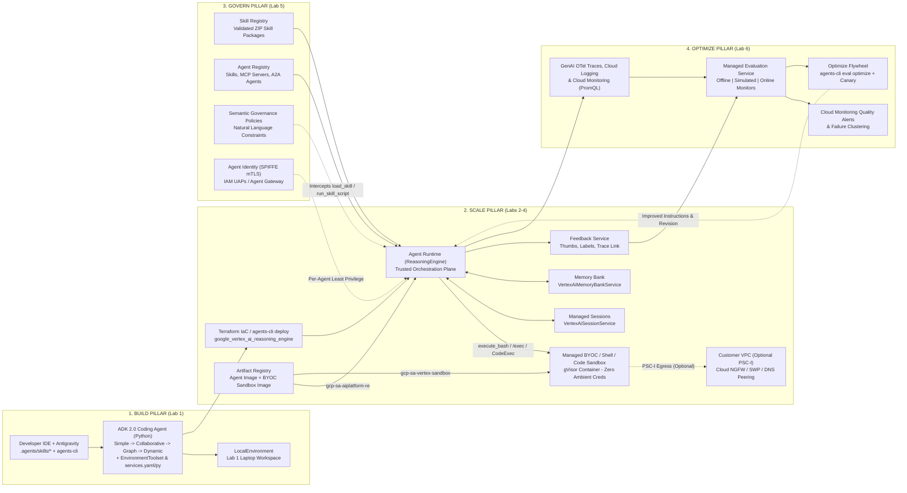

# 00 — Workshop Overview: Building a Production Enterprise Coding Agent on Gemini Enterprise Agent Platform

> **Estimated Reading & Setup Time:** 20 minutes (Full-Day) / 10 minutes (Half-Day Fast-Track) — complete the GCP prerequisites and pre-flight checks before starting [Lab 1](01-LAB-SETUP-AND-BUILD-ADK.md).

---

## Executive Narrative: Why an Enterprise Coding Agent?

Autonomous coding agents are among the highest-value—and highest-risk—AI workloads an enterprise can deploy. Unlike read-only Q&A chatbots, a real coding agent must:

1. **Read, edit, and write multi-file repositories** deterministically.
2. **Execute arbitrary, LLM-generated shell commands and test suites** (`pytest`, `ruff`, `bandit`, build tools) without compromising the host network, cloud credentials, or neighboring tenants.
3. **Retain multi-turn task state and long-term engineering conventions** across sessions while defending against memory poisoning and prompt injection.
4. **Consume approved organizational skills and internal tools dynamically** from centralized registries under enforceable natural-language and identity policies.
5. **Prove and continuously improve engineering quality** through automated traces, offline/simulated/online evaluations, quality alerting, and closed-loop prompt optimization.

Solving all five requirements with ad-hoc containers and scripts creates brittle security boundaries and months of platform toil. **Google Cloud's Gemini Enterprise Agent Platform** provides the integrated control plane and managed runtime primitives—paired with **Google ADK (Agent Development Kit)** and **`google/agents-cli`**—to take a coding agent from laptop prototype to production governance across four pillars: **Build -> Scale -> Govern -> Optimize**.

---

## End-to-End Reference Architecture



### Architectural Separation of Concerns

One design principle anchors the entire workshop: **never run untrusted LLM-generated commands inside your trusted Agent Runtime.**

- **Agent Runtime (`ReasoningEngine`)** is the **trusted orchestration plane**. It holds the agent's identity (SPIFFE `AGENT_IDENTITY` or dedicated custom service account), invokes Gemini models, reads/writes Managed Sessions and Memory Bank, calls authenticated Google Cloud APIs, and records structured logs and OpenTelemetry traces.
- **Managed Sandboxes (`SandboxEnvironment`)** are the **untrusted execution plane**. Each sandbox runs in a Google-managed tenant project inside a **gVisor-isolated container** under an unprivileged user (`appuser` / tenant identity `sandbox-untrusted`) with **zero IAM roles**, **no Application Default Credentials (ADC)**, and **no access to the metadata server (`169.254.169.254:80`)**.

### ADK Agent Architecture Progression (`Build Pillar` — Lab 1)

Real enterprise coding workloads rarely stay a single monolithic prompt forever. Before scaling execution to remote BYOC Sandboxes in Lab 2, **[Lab 1](01-LAB-SETUP-AND-BUILD-ADK.md)** establishes the full **Google ADK 2.0** architectural progression — controlled via a single `AGENT_ARCHITECTURE` environment variable (`simple` default so Labs 2–7 remain 100% backward compatible):

1. **Simple Agent (`AGENT_ARCHITECTURE=simple` — Part A):** A single `LlmAgent` wired with `EnvironmentToolset(LocalEnvironment)`. Fast to iterate, ideal until prompt complexity, context limits, code modularity, or deterministic test/lint gates justify splitting responsibilities. *(We also contrast `LlmAgent` with ADK Python v2.4.0 Preview [`ManagedAgent`](https://adk.dev/agents/managed-agents/) and introduce ADK v1.34.0 [`services.yaml` / `services.py`](https://adk.dev/agents/service-registration/) custom backend registration.)*
2. **Collaborative Agent Team (`AGENT_ARCHITECTURE=collaborative` — Part B):** Coordinator `LlmAgent` delegating across isolated session branches to mode-scoped subagents (`mode="single_turn"` for `code_implementer`/`code_reviewer` and leaf-only `mode="task"` for `requirements_clarifier`), governed by `GlobalInstructionPlugin`.
3. **Declarative Graph Workflow (`AGENT_ARCHITECTURE=graph` — Part B):** Deterministic ADK 2.0 `Workflow(edges=...)` combining LLM reasoning with parallel `@node` `pytest`/`ruff` checks (`RetryConfig` + per-attempt timeout), `JoinNode` fan-in, bounded `Event(route=...)` fix loops, and `RequestInput` HITL pauses — replacing deprecated `SequentialAgent`/`ParallelAgent`/`LoopAgent`.
4. **Dynamic Checkpointed Workflow (`AGENT_ARCHITECTURE=dynamic` — Part B):** Programmatic `@node(rerun_on_resume=True)` async Python orchestration (`for` loops, `asyncio.gather(..., use_sub_branch=True)`, and automatic checkpoint replay across HITL pauses).

Because all four architectures share the **exact same `EnvironmentToolset`**, moving from `LocalEnvironment` (Lab 1) to `AgentPlatformSandboxEnvironment` (Lab 2) and deploying to Agent Runtime (Lab 3) requires **zero changes** to your workflow graph or container contract!

---

## Workshop Schedules: Full-Day vs. Half-Day Fast-Track

| Module | Topic & Hands-On Deliverable | Full-Day (7h 00m) | Half-Day Fast-Track (3h 30m) |
|---|---|---:|---:|
| **Lab 0** | Overview, GCP APIs, Service Agents, Pre-Flight Quota Check (`00-WORKSHOP-OVERVIEW.md`) | 20 min | 10 min |
| **Lab 1** | **Build:** Part A — `agents-cli`, Antigravity skills, ADK Architecture Spectrum, Simple `LlmAgent` + `EnvironmentToolset`; Part B — Collaborative, Graph & Dynamic Workflows + Service Registration | 60 min *(30m Part A + 30m Part B)* | 35 min *(30m Part A hands-on + 5m Part B walkthrough)* |
| **Lab 2** | **Scale (Sandboxes):** Non-root BYOC Dockerfile, Template/Sandbox/Snapshot Lifecycle, Shell vs. BYOC vs. Code Exec, `AgentPlatformSandboxEnvironment`, Egress & Security | 65 min | 40 min *(use pre-pushed image or `solution/` checkpoint if tight)* |
| *Break* | *Morning Coffee / Stretch Break* | *10 min* | *10 min* |
| **Lab 3** | **Scale (Runtime & IaC):** Push Agent Runtime image, `agents-cli deploy --dry-run` + Terraform `google_vertex_ai_reasoning_engine` + Dual Service-Agent `depends_on` + Revisions/Emergency Stop | 50 min | 30 min |
| **Lab 4** | **Scale (State & Telemetry):** Managed Sessions, Memory Bank (topics/TTL/prompt-injection), Feedback Service, OTel Tracing, Logging & PromQL Monitoring | 45 min | 10 min *(instructor live demo + code walkthrough)* |
| *Break* | *Lunch Break (Full-Day only)* | *40 min* | *—* |
| **Lab 5** | **Govern:** Skill Registry 16-check ZIP/`SKILL.md` packaging, Skill Registry (Part B1) & Agent Registry (Part B2), `GCPSkillRegistry` + `AgentRegistry` ADK wiring, Semantic Governance Policies & SPIFFE Identity | 50 min | 35 min *(Parts A, B1, B2 & C hands-on; walkthrough Part D)* |
| **Lab 6** | **Optimize:** GenAI Observability, Split Offline/Simulated/Online Eval, Failure Clustering, Quality Alerts (`monitoring_v3`), Prompt Optimization Flywheel | 45 min | 15 min *(instructor live demo + walkthrough)* |
| **Lab 7** | **Architecture Decision:** Agent Runtime + Managed Sandbox vs. Self-Hosted GKE + `kubernetes-sigs/agent-sandbox` + Agent Substrate (14-Dimension Matrix) | 35 min | 25 min *(executive + engineering Q&A)* |
| **Total** | | **420 min (7h 00m)** *(370m labs + 50m breaks)* | **210 min (3h 30m)** *(200m labs/demos + 10m break)* |

> **Fast-Forward Rule:** Every lab in `starter/` has a 1-to-1 mirror in `solution/`. If a build or Terraform apply runs behind schedule, copy the target module from `solution/` into `starter/` and continue without losing momentum. See [FACILITATOR-GUIDE.md](FACILITATOR-GUIDE.md) for exact checkpoint cutoffs.

---

## GCP Prerequisites & Environment Setup

### Express Mode vs. Standard GCP Project (Important!)

Gemini Enterprise Agent Platform offers an **Express Mode** free tier (`GOOGLE_GENAI_API_KEY` + `GOOGLE_GENAI_USE_ENTERPRISE=TRUE`), as well as AI Studio (`GEMINI_API_KEY`). **Do NOT use Express Mode for Labs 2–7.**

| Capability / Quota | Express Mode (Free Tier) | Standard Billing-Enabled GCP Project |
|---|---|---|
| Agent Platform resources (max) | **10** | **100** per region (and non-regional) |
| Write requests / min | **10/min** | **10/min** (Reasoning Engine) / **500/min** (Sandboxes) |
| Query / StreamQuery requests / min | **10/min** | **90/min** (adjustable) |
| Concurrent `BidiStreamQuery` / min | **1/min** | **10/min** |
| Session writes / event appends per min | **10/min** / **30/min** | **100/min** / **300/min** |
| Memory Bank writes / reads per min | **10/min** / **10/min** | **100/min** / **300/min** |
| Artifact Registry BYOC Sandboxes, Terraform IAM, PSC-I/NGFW, Cloud Monitoring Alerts | **Not supported** | **Fully supported** |

- **Lab 1 only:** You may use AI Studio (`GEMINI_API_KEY`) or Express Mode strictly for local ADK prototyping if your GCP project is still provisioning.
- **Labs 2–7:** Require a **Standard GCP project with billing enabled** and Application Default Credentials (`gcloud auth application-default login`).

### Recommended Region Selection

Standardize strictly on **`us-central1`** (Americas/Global) or **`europe-west4`** (EMEA) for this workshop. Both golden regions support **100% of Labs 1–7** without cross-region workarounds:
- **Vertex AI Skill Registry (`aiplatform.googleapis.com/v1beta1`, Lab 5 Part B1) is ONLY available** in `us-central1`, `europe-west4`, and `us-east5`. *(If your organization requires deploying Agent Runtime in another supported region such as `us-east1` or `europe-west1`, you MUST set `SKILL_REGISTRY_LOCATION=us-central1` or `europe-west4` in `.env` so Lab 5 Part B1 succeeds.)*
- **Memory Bank is NOT available** in `asia-southeast2`, `australia-southeast2`, or `northamerica-northeast2`.
- **Agent Gateway is NOT available** in `asia-east2`, `asia-northeast3`, or `asia-southeast2`.
- **`global`** supports Memory Bank, Sessions, and Gen AI Evaluation (`generate_loss_clusters` / `agents-cli eval analyze` are **`global`-only**), but does **not** support `client.runtimes.create()` deployment or CMEK.
- See [Supported locations](https://docs.cloud.google.com/gemini-enterprise-agent-platform/resources/agent-locations) for the full 23-region matrix.

### 1. Set Core Environment Variables

```bash
export GOOGLE_CLOUD_PROJECT="YOUR_PROJECT_ID"
export GOOGLE_CLOUD_LOCATION="us-central1"
export GOOGLE_CLOUD_PROJECT_NUMBER="$(gcloud projects describe "$GOOGLE_CLOUD_PROJECT" --format='value(projectNumber)')"

gcloud config set project "$GOOGLE_CLOUD_PROJECT"
echo "Project: $GOOGLE_CLOUD_PROJECT (#${GOOGLE_CLOUD_PROJECT_NUMBER}) in $GOOGLE_CLOUD_LOCATION"
```

### 2. Enable Required Google Cloud APIs

Requires `serviceusage.services.enable` (included in `roles/serviceusage.serviceUsageAdmin`):

```bash
gcloud services enable \
  aiplatform.googleapis.com \
  artifactregistry.googleapis.com \
  cloudbuild.googleapis.com \
  secretmanager.googleapis.com \
  logging.googleapis.com \
  monitoring.googleapis.com \
  telemetry.googleapis.com \
  cloudtrace.googleapis.com \
  agentregistry.googleapis.com \
  storage-component.googleapis.com \
  pubsub.googleapis.com \
  --project="$GOOGLE_CLOUD_PROJECT"
```

*(Optional APIs for advanced networking/encryption exercises: `compute.googleapis.com` for PSC-I/Cloud NGFW, `cloudkms.googleapis.com` for CMEK, `run.googleapis.com` if testing Cloud Run via `agents-cli`.)*

### 3. Verify Your User / Deployer IAM Roles

Ensure your user principal has the following roles on `$GOOGLE_CLOUD_PROJECT` (see [Runtime Setup](https://docs.cloud.google.com/gemini-enterprise-agent-platform/build/runtime/setup)):

| Role | Why It Is Needed |
|---|---|
| `roles/aiplatform.user` *(or `roles/aiplatform.admin`)* | Create/manage Agent Runtime instances, Managed Sandboxes, Templates, Snapshots, Sessions, Memory Bank, Feedback, Evaluation, and Skill Registry (`roles/aiplatform.admin` recommended for Terraform IAM/control-plane work). |
| `roles/serviceusage.serviceUsageAdmin` | Enable GCP APIs and provision service identities. |
| `roles/artifactregistry.writer` *(or `admin`)* | Create Artifact Registry repositories and push BYOC sandbox/agent container images. |
| `roles/cloudbuild.builds.editor` | Build container images remotely with Cloud Build (if not pushing locally with Docker). |
| `roles/iam.serviceAccountUser` *(and `roles/iam.serviceAccountAdmin` for Lab 3 TF)* | Create and attach the dedicated custom runtime service account in Terraform. |
| `roles/secretmanager.admin` | Create and bind workshop Secret Manager secrets in Lab 3. |
| `roles/logging.viewer` & `roles/monitoring.viewer` *(+ `monitoring.alertPolicyEditor` for Lab 6)* | Inspect Agent Runtime logs, PromQL metrics, and create Quality Alert policies. |

### 4. Understand and Pre-Provision Google-Managed Service Agents (CRITICAL!)

> [!CAUTION]
> **The #1 cause of `IMAGE_PULL_BACKOFF` failures in workshops is confusing Google Cloud's Agent Runtime Service Agent with the Agent Sandbox Service Agent.** They are **two completely separate identities**!

| Service Agent | Exact Email Format | What It Does in This Workshop | Required Grant |
|---|---|---|---|
| **Agent Runtime Service Agent** | `service-PROJECT_NUMBER@gcp-sa-aiplatform-re.iam.gserviceaccount.com` | Pulls **Agent Runtime** BYOC container images from same-project Artifact Registry; accesses Runtime CMEK keys; fetches secrets in `agents-cli deploy`. | `roles/artifactregistry.reader` (Lab 3), `roles/secretmanager.secretAccessor` (if using default SA) |
| **Agent Sandbox Service Agent** | `service-PROJECT_NUMBER@gcp-sa-vertex-sandbox.iam.gserviceaccount.com` | Pulls **BYOC Sandbox** custom container images from Artifact Registry into the isolated gVisor tenant project. Never accessible to code inside the sandbox. | `roles/artifactregistry.reader` on the sandbox Artifact Registry repo (Lab 2) |
| **Agent Platform Service Agent** | `service-PROJECT_NUMBER@gcp-sa-aiplatform.iam.gserviceaccount.com` | Fetches `secret_env` at deploy time when using `AGENT_IDENTITY`; handles cross-project Artifact Registry / GCS / Agent Gateway / Shared VPC PSC-I (`roles/compute.networkUser`). | `roles/secretmanager.secretAccessor` (Lab 3 with `AGENT_IDENTITY`) |

Manually trigger service identity creation upfront so IAM bindings never race ahead of identity provisioning:

```bash
# Triggers provisioning of Vertex AI & Reasoning Engine Service Agents
# (CLI output may display only the Vertex AI Service Agent, but gcp-sa-aiplatform-re is also created)
gcloud beta services identity create \
  --service=aiplatform.googleapis.com \
  --project="$GOOGLE_CLOUD_PROJECT"
```

*(Note: `service-PROJECT_NUMBER@gcp-sa-vertex-sandbox.iam.gserviceaccount.com` is granted `roles/artifactregistry.reader` on your Artifact Registry repo in Lab 2—if IAM rejects the principal on a brand-new project before the first sandbox API call, creating one temporary empty Agent Platform instance initializes the sandbox service identity.)*

### 5. Pre-Flight Quota Check & Multi-Attendee Sizing Math

Before running a live workshop (especially if multiple attendees share one GCP project!), inspect your project's active quotas against the defaults documented in [Agent Platform Quotas](https://docs.cloud.google.com/gemini-enterprise-agent-platform/resources/agent-quotas):

| Quota / System Limit | Default (Standard GCP) | Adjustable? | Metric Identifier |
|---|---:|:---:|---|
| Reasoning Engine create/update/delete per min | **10/min** | Yes | `aiplatform.googleapis.com/reasoning_engine_service_write_requests` |
| Max Reasoning Engine entities per region | **100** | Yes | `aiplatform.googleapis.com/reasoning_engine_service_entities` |
| `Query` / `StreamQuery` requests per min | **90/min** | Yes | `aiplatform.googleapis.com/reasoning_engine_service_query_requests` |
| Concurrent `BidiStreamQuery` connections / min | **10/min** | Yes | `aiplatform.googleapis.com/reasoning_engine_service_concurrent_query_requests` |
| Session create/update/delete per min | **100/min** | Yes | `aiplatform.googleapis.com/session_write_requests` |
| Session event appends per min | **300/min** | Yes | `aiplatform.googleapis.com/session_event_append_requests` |
| Memory Bank writes / reads per min | **100/min** / **300/min** | Yes | `memory_bank_{write,read}_requests` |
| Code Execution sandbox execute / write per min | **1,000/min** / **500/min** | Yes | `sandbox_environment_{execute,write}_requests` |
| Code Execution sandbox entities per region | **1,000** | Yes | `sandbox_environment_entities` |
| Max revisions per project per region | **6,000** | **No (Hard)** | `agent_engine_revisions_per_project_per_region` |
| Max revisions per agent | **950** | **No (Hard)** | `agent_engine_revisions_per_agent` |

**Quick Quota Sizing Formula (Shared Workshop Project):**
- Suppose **U** attendees each send **X** queries/min (typical lab burst: `X = 4` QPM) and each turn appends **Y** session events (typical coding agent with 2 tool calls: `Y = 6` events):
  - `Required Query QPM = U * X * 1.5` (50% headroom buffer against `429 RESOURCE_EXHAUSTED`)
  - `Required Session Event Appends/min = (U * X) * Y * 1.5`
- For **15+ concurrent attendees** in a single project, request increases on `reasoning_engine_service_query_requests` (from 90 to >= 150 QPM) and `reasoning_engine_service_write_requests` (from 10 to >= 30/min) at least 48 hours ahead—or assign **1 dedicated GCP project per attendee**.

Quick pre-flight command to verify authentication, enabled services, and local toolchain:

```bash
gcloud auth list --filter=status:ACTIVE --format="value(account)"
gcloud services list --enabled --project="$GOOGLE_CLOUD_PROJECT" \
  --filter="config.name:(aiplatform|artifactregistry|cloudbuild|secretmanager|logging|monitoring|telemetry|cloudtrace|agentregistry|storage-component|pubsub)" \
  --format="table(config.name)"
python3 --version && uv --version && terraform version | head -n 1
```

---

## Using the Bundled Antigravity `.agents/skills/` During the Workshop

This repository ships with **6 modular, production-tested Antigravity skills** under `.agents/skills/`. Rather than copy-pasting boilerplate or searching scattered docs mid-lab, ask Antigravity directly—it automatically loads the matching skill's `SKILL.md` cheatsheet and on-demand `references/*.md` files:

| When You Need Help With... | Example Prompt to Antigravity | Skill Auto-Triggered |
|---|---|---|
| ADK `EnvironmentToolset`, `BaseEnvironment`, ADK 2.0 agent architectures (`collaborative`/`graph`/`dynamic`), `ManagedAgent`, or `services.yaml`/`services.py` | *"Compare ADK 2.0 `JoinNode` vs. dynamic `ctx.run_node(use_sub_branch=True)` and verify `BaseEnvironment` keyword-only `ctx`."* | `adk-coding-agent-build` |
| BYOC sandbox Dockerfile rules, `SandboxEnvironmentTemplate` CRUD, `execute_bash()` vs. `execute_code()`, or PSC-I egress | *"Help me configure a BYOC sandbox template with default-deny egress and check which service agent pulls the image."* | `agent-platform-sandbox-byoc` |
| Terraform `google_vertex_ai_reasoning_engine`, `depends_on` IAM ordering, Sessions, Memory Bank, Feedback, or PromQL | *"Check my Terraform `depends_on` block for `IMAGE_PULL_BACKOFF` and show me Memory Bank similarity retrieval."* | `agent-platform-runtime-and-state` |
| Skill Registry 16 atomic ZIP/`SKILL.md` checks, `GCPSkillRegistry`, `AgentRegistry` auth, or Semantic Governance NLC | *"Why did my Skill Registry ZIP fail validation, and how do I wire `AgentRegistry` with `httpx.Auth`?"* | `agent-platform-governance-and-registries` |
| Offline/Simulated/Online Evaluation, failure clustering, `monitoring_v3` Quality Alerts, or prompt tuning | *"Write a `monitoring_v3` quality alert policy for evaluation score drops and explain the 2-step user simulator."* | `agent-platform-optimize-and-eval` |
| Deciding between Agent Runtime + Managed Sandbox vs. GKE + `kubernetes-sigs/agent-sandbox` | *"Compare Agent Runtime Managed Sandbox vs. GKE Agent Sandbox when we need GPUs and sub-second warm pools."* | `agent-runtime-vs-gke-architecture` |

> **Co-Existence with `google/agents-cli` Built-In Skills:** Running `uvx google-agents-cli setup` installs 7 general lifecycle skills (`google-agents-cli-workflow`, `google-agents-cli-adk-code`, `google-agents-cli-scaffold`, `google-agents-cli-eval`, `google-agents-cli-deploy`, `google-agents-cli-publish`, `google-agents-cli-observability`). Use those for generic scaffolding (`agents-cli create`) and imperative deploys (`agents-cli deploy`); our 6 workspace skills handle the deeper enterprise platform surfaces (BYOC sandboxes, Terraform IaC, Skill/Agent Registries, Semantic Governance, Managed Evaluation/Alerts, and GKE comparisons).

---

## SDK Namespace Note (`agentplatform` vs. `vertexai`)

Gemini Enterprise Agent Platform documentation is transitioning from the legacy Vertex AI Python SDK namespace (`vertexai.Client` in `google-cloud-aiplatform[agent_engines]`) to the dedicated Agent Platform namespace (`agentplatform.Client` in `google-cloud-agentplatform>=2.0.1`, also re-exported by `google-cloud-aiplatform>=1.154.0`).

- **Environment variable:** Set `GOOGLE_GENAI_USE_ENTERPRISE=TRUE` (replaces legacy `GOOGLE_GENAI_USE_VERTEXAI=TRUE`; older ADK versions recognize the legacy variable).
- **Starter & Solution compatibility:** Our workshop modules default to `agentplatform.Client` with a clean compatibility fallback to `vertexai.Client` so your code runs reliably across SDK versions.

---

## Proceed to Lab 1

Ready to write your first ADK Coding Agent? Continue to **[Lab 1: Setup & Build ADK Coding Agent](01-LAB-SETUP-AND-BUILD-ADK.md)**.

---

## Canonical References

- [Gemini Enterprise Agent Platform — Runtime Setup](https://docs.cloud.google.com/gemini-enterprise-agent-platform/build/runtime/setup)
- [Gemini Enterprise Agent Platform — Supported Locations](https://docs.cloud.google.com/gemini-enterprise-agent-platform/resources/agent-locations)
- [Gemini Enterprise Agent Platform — Quotas and System Limits](https://docs.cloud.google.com/gemini-enterprise-agent-platform/resources/agent-quotas)
- [Google ADK — Get Started](https://adk.dev/get-started/)
- [`google/agents-cli` — Official CLI & Workflow Skills](https://github.com/google/agents-cli)
- [Gemini Enterprise Agent Platform — Scale Sandboxes](https://docs.cloud.google.com/gemini-enterprise-agent-platform/scale/sandbox)
