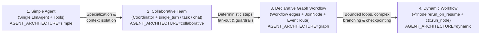
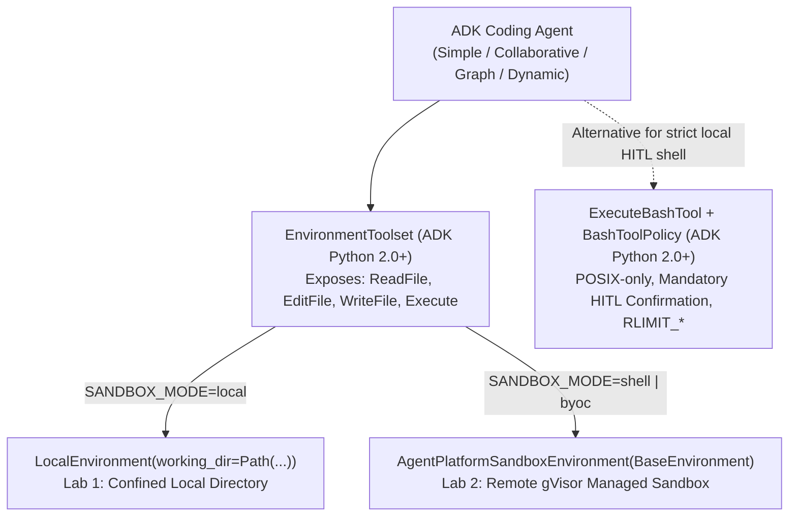
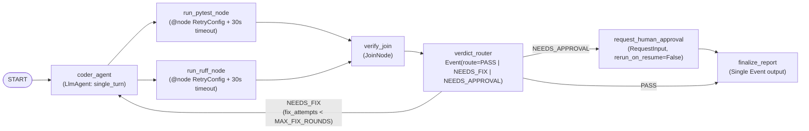

# Lab 1 — Setup & Build the ADK Coding Agent (`Build Pillar`)

> **Pillar:** Build (`google/agents-cli`, Google ADK 2.0 Python Agent Architectures — Simple, Collaborative, Graph & Dynamic Workflows, `EnvironmentToolset`, Service Registration, Antigravity `.agents/skills/`)  
> **Duration:** 60 minutes (Full-Day Track — Part A 30 min, Part B 30 min) | 35 minutes (Half-Day Fast-Track — Part A 30 min hands-on, Part B 5 min walkthrough)  
> **Antigravity Skill Companion:** [`.agents/skills/adk-coding-agent-build/SKILL.md`](../.agents/skills/adk-coding-agent-build/SKILL.md) *(with modular references [`agent-architectures-and-workflows.md`](../.agents/skills/adk-coding-agent-build/references/agent-architectures-and-workflows.md) & [`graph-and-dynamic-workflows.md`](../.agents/skills/adk-coding-agent-build/references/graph-and-dynamic-workflows.md); complements the built-in `google-agents-cli-adk-code` & `google-agents-cli-scaffold` skills)*  
> **Previous:** [00 — Workshop Overview](./00-WORKSHOP-OVERVIEW.md) | **Next Lab:** [Lab 2: Custom Sandbox (BYOC), Lifecycle & Execution](./02-LAB-CUSTOM-SANDBOX-BYOC.md)  
> **Files You Will Inspect & Edit:** `.env`, `starter/agents-cli-manifest.yaml`, `starter/coding_agent/config.py`, `starter/coding_agent/agent.py`, `starter/coding_agent/architectures.py`, `starter/services.yaml`, `starter/services.py`

---

## Learning Objectives

By the end of Lab 1, you will:

1. Install and configure **`google/agents-cli`** alongside its 7 global IDE workflow skills and verify **Antigravity `.agents/skills/`** auto-discovery (with zero co-trigger shadowing).
2. Choose the right **Google ADK 2.0 agent architecture** for an enterprise coding workload across the full spectrum: **Simple `LlmAgent` → Collaborative Agent Team → Declarative Graph `Workflow` → Dynamic Workflow**, plus evaluate **`ManagedAgent`** (Preview) and **Service Registration** (`services.yaml` / `services.py`).
3. Implement `TODO(lab-1)` in [`starter/coding_agent/agent.py`](../starter/coding_agent/agent.py) (`AGENT_ARCHITECTURE=simple`) using **`LlmAgent`** and **`EnvironmentToolset(LocalEnvironment)`** while avoiding verified `Path`, `App.name`, and regional model-ID pitfalls.
4. Evolve your Coding Agent in **Part B** by implementing `TODO(lab-1)` in [`starter/coding_agent/architectures.py`](../starter/coding_agent/architectures.py) across `collaborative`, `graph`, and `dynamic` modes — including `JoinNode` fan-in, `RetryConfig`/timeouts, `RequestInput` HITL pauses, and automatic dynamic checkpointing — and inspecting [`starter/services.yaml`](../starter/services.yaml) / [`starter/services.py`](../starter/services.py).
5. Run and interactively test your Coding Agent locally via **`adk web`** and **`agents-cli run`**, verify why `LocalEnvironment` is not yet production-safe, and pass Checkpoint 1 with `./scripts/verify_lab.sh 1`.

---

## Part A — Setup, Antigravity Skills, ADK Architecture Spectrum & Simple Agent (30 min)

### Step 1: Install Standalone `uv`, `google/agents-cli` & Run Pre-Flight

[`google/agents-cli`](https://github.com/google/agents-cli) is Google's official lifecycle CLI for scaffolding, locally running, evaluating, deploying, and publishing ADK agents (requires **Python 3.11+** and **`uv`**).

> [!TIP]
> **Standalone `uv` — Zero `python3-venv` or Docker Required!** Installing `uv` via its standalone installer (`curl -LsSf https://astral.sh/uv/install.sh | sh`) bundles its own Python environment management and works cleanly even on fresh Debian/Linux workstations or cloud dev environments without `python3-venv` or local `docker`.

```bash
# 0. Install standalone uv if not already available (works without python3-venv or docker!)
command -v uv >/dev/null 2>&1 || curl -LsSf https://astral.sh/uv/install.sh | sh

# 1. Install google-agents-cli and register its 7 built-in IDE workflow skills
uvx google-agents-cli setup

# 2. Verify CLI path, version, active extensions, and telemetry status
agents-cli info

# 3. Verify GCP authentication (or run `agents-cli login` if not yet authenticated)
agents-cli login --status

# 4. Run the workshop pre-flight validator (checks gcloud, ADC, APIs, uv, and Bangkok/Singapore regions; zero Docker needed!)
make preflight
```

> **Optional Telemetry Opt-Out:** To disable anonymous CLI usage metrics in enterprise environments, export `AGENTS_CLI_TELEMETRY=0` (or `DO_NOT_TRACK=1`) in your shell profile.

#### How `agents-cli` Fits Into This Workshop (Greenfield vs. Existing Repo)

In a greenfield project, you scaffold a new ADK repository with:

```bash
# Example only (do NOT run inside this workshop repo):
# agents-cli create my-coding-agent --agent adk_python -d agent_runtime -y
# Or quickstart prototype shortcut:
# agents-cli create my-coding-agent --adk
```

Keep these verified `agents-cli` scaffolding rules in mind for your own production projects:
- Project `<name>` must be **<= 26 characters**, lowercase `a-z`, `0-9`, and `-` only.
- **Never `mkdir <name>`** before running `agents-cli create` (the CLI creates the folder itself).
- For an **existing** ADK project whose agent package lives outside the default `app/` directory (like `starter/coding_agent/`), you MUST pass `--agent-directory` when adopting `agents-cli`:
  ```bash
  # Example (already pre-configured in starter/agents-cli-manifest.yaml and solution/agents-cli-manifest.yaml):
  # cd starter && agents-cli scaffold enhance . --from-adk-project --agent-directory coding_agent
  ```
  `agents-cli` reads `agent_directory`, `framework`, and `deployment_target` from `agents-cli-manifest.yaml` (defaulting `agent_directory` to `app/` if absent). This workshop ships pre-configured [`starter/agents-cli-manifest.yaml`](../starter/agents-cli-manifest.yaml) and [`solution/agents-cli-manifest.yaml`](../solution/agents-cli-manifest.yaml) pointing at `coding_agent` and `agent_runtime` so `agents-cli playground`, `agents-cli run`, `agents-cli deploy`, and `agents-cli eval` discover your agent immediately.

---

### Step 2: Inspect Bundled Antigravity `.agents/skills/`

When you open this repository in **Antigravity**, the IDE automatically discovers every skill folder matching `.agents/skills/<skill-name>/SKILL.md`.

Validate all 6 bundled workshop skills right now from the repository root:

```bash
# Run the standalone frontmatter, line-limit, and link validator
make validate-skills
# Equivalent direct command:
# python3 scripts/validate_skills.py .agents/skills
```

Verify that all 6 skills report `PASS` and inspect [`adk-coding-agent-build/SKILL.md`](../.agents/skills/adk-coding-agent-build/SKILL.md):

```bash
ls -1 .agents/skills/
```

Expected output:

```text
adk-coding-agent-build
agent-platform-governance-and-registries
agent-platform-optimize-and-eval
agent-platform-runtime-and-state
agent-platform-sandbox-byoc
agent-runtime-vs-gke-architecture
```

> **Why Anti-Shadowing Matters:** Because `uvx google-agents-cli setup` already installed 7 global skills (`google-agents-cli-workflow`, `google-agents-cli-adk-code`, `google-agents-cli-scaffold`, `google-agents-cli-eval`, `google-agents-cli-deploy`, `google-agents-cli-publish`, `google-agents-cli-observability`), every custom skill under `.agents/skills/` declares strict `Use when:` and `Don't use for:` clauses in its YAML frontmatter. Try asking Antigravity:
> - *"What are the exact abstract methods on ADK `BaseEnvironment`, and why must `LocalEnvironment.working_dir` be a `Path`?"* -> triggers **`adk-coding-agent-build`**.
> - *"Compare ADK 2.0 collaborative `task` vs `single_turn` modes and explain why `JoinNode` prevents `ValueError` in parallel workflows."* -> loads **`adk-coding-agent-build`** modular references ([`agent-architectures-and-workflows.md`](../.agents/skills/adk-coding-agent-build/references/agent-architectures-and-workflows.md) and [`graph-and-dynamic-workflows.md`](../.agents/skills/adk-coding-agent-build/references/graph-and-dynamic-workflows.md)).

---

### Step 3: Configure `.env` and Explore `starter/coding_agent/`

#### 3.1 Create and Populate `.env`

From the repository root:

```bash
cp .env.example .env
```

Edit `.env` with your GCP project values (do **not** commit `.env` to Git):

```dotenv
# Agent Platform / Vertex AI ADC mode (recommended for Labs 1-8)
GOOGLE_GENAI_USE_ENTERPRISE=TRUE
GOOGLE_CLOUD_PROJECT=YOUR_PROJECT_ID
GOOGLE_CLOUD_PROJECT_NUMBER=YOUR_PROJECT_NUMBER

# Bangkok (asia-southeast3) Primary: Artifact Registry, Cloud Build, Secret Manager, Agent Registry, Lab 8 GKE
PRIMARY_REGION=asia-southeast3
AR_LOCATION=asia-southeast3           # Optional: set asia-southeast1 for strict same-region AR pulls
BUILD_LOCATION=asia-southeast3        # Remote Cloud Build region (zero local Docker!)
AGENT_REGISTRY_LOCATION=asia-southeast3
GKE_LOCATION=asia-southeast3

# Singapore (asia-southeast1) Secondary: Nearest supported Agent Platform region
# (Agent Runtime, Managed Sandboxes, Sessions, Memory Bank, Agent Gateway & Gemini 2.5 Flash)
GOOGLE_CLOUD_LOCATION=asia-southeast1

# Service-mandated multi-region overrides:
# - Vertex AI Skill Registry (Lab 4) is 3-region Preview: us-central1, europe-west4, us-east5
# - Gen AI Evaluation Service (Lab 6) supports 14 US/EU regions + global (APAC-ready + loss clustering)
SKILL_REGISTRY_LOCATION=us-central1
EVAL_LOCATION=global

# Explicit versioned model ID (do NOT use `gemini-flash-latest` on regional endpoints!)
MODEL_NAME=gemini-2.5-flash

# Lab 1 ADK Architecture mode: simple (default) | collaborative | graph | dynamic
# Keep `simple` as the default so Labs 2-8 stay 100% backward compatible.
AGENT_ARCHITECTURE=simple
MAX_FIX_ROUNDS=3
ENABLE_HITL_APPROVAL=false
# Optional ADK Python v2.4.0 Preview ManagedAgent ID (global-only backend):
# MANAGED_AGENT_ID=antigravity-preview-05-2026
# Optional ADK Python 2.0+ programmatic Service Registration (`services.py` overrides `services.yaml`):
# ENABLE_CUSTOM_SERVICE_REGISTRY=false

# Lab 1 starts in local mode; Lab 2 switches this to `shell` (zero-build fast-track) or `byoc`
SANDBOX_MODE=local

# Populated progressively across Labs 2-5:
# - Lab 2: Standalone backing instance (`REASONING_ENGINE_NAME` in asia-southeast1), BYOC sandbox image (asia-southeast3 AR) & template
# - Lab 3: Reuses Lab 2's standalone `REASONING_ENGINE_NAME` (asia-southeast1) for Managed Sessions & Memory Bank
# - Lab 4: Vertex AI Skill Registry (`SKILL_REGISTRY_LOCATION=us-central1`) & Agent Registry (`AGENT_REGISTRY_LOCATION=asia-southeast3`)
# - Lab 5: Build `AGENT_IMAGE_URI` (Cloud Build asia-southeast3) & deploy ONCE to Singapore (asia-southeast1) via Terraform
# - Lab 6: Optimize (`EVAL_LOCATION=global` + Singapore runtime) | Optional Lab 7: Hardening | Lab 8: Bangkok GKE Deep-Dive
REASONING_ENGINE_NAME=
SANDBOX_TEMPLATE_NAME=
SANDBOX_IMAGE_URI=
AGENT_IMAGE_URI=
ENABLE_TELEMETRY_CALLBACKS=true
ENABLE_MEMORY_BANK=false
ENABLE_SKILL_REGISTRY=false
```

> [!IMPORTANT]
> **Regional Model ID Gotcha:** Per the [ADK Gemini Model docs](https://adk.dev/agents/models/google-gemini/), the alias `gemini-flash-latest` may **not** work on regional Agent Platform / Vertex AI endpoints such as `asia-southeast1` (Singapore) or `us-central1`. Always use an explicit versioned model ID (such as `gemini-2.5-flash`) when targeting a regional endpoint.

#### 3.2 Install Dependencies & Explore the Starter Layout

```bash
# Sync dependencies in starter/ (and solution/) using standalone uv (no python3-venv or Docker required!)
make install
```

Explore the core starter package under `starter/`:

| File | Role Across the Workshop |
|---|---|
| [`starter/pyproject.toml`](../starter/pyproject.toml) | Python `>=3.11` package manifest (`google-adk[a2a,agent-identity,mcp]>=2.0.0`, `google-cloud-aiplatform[agent_engines,evaluation]`, OTel, `ruff`, `pytest`) |
| [`starter/agents-cli-manifest.yaml`](../starter/agents-cli-manifest.yaml) | **Lab 1:** `agents-cli` manifest setting `agent_directory: coding_agent` and `deployment_target: agent_runtime` (required for `agents-cli playground/run/deploy/eval`) |
| [`starter/services.yaml`](../starter/services.yaml) | **Lab 1 Part B:** Declarative ADK Python 2.0+ custom service registration (`scheme`, `type: session\|artifact\|memory\|task_store`, `class`) for `adk web` / `adk api_server` |
| [`starter/services.py`](../starter/services.py) | **Lab 1 Part B:** Programmatic ADK Python 2.0+ service registration via `get_service_registry()` (takes precedence over `services.yaml` on duplicate schemes) |
| [`starter/Dockerfile`](../starter/Dockerfile) | **Lab 5:** Trusted Agent Runtime BYOC container image (non-root, listening on `0.0.0.0:8080`, distinct from Lab 2's untrusted `sandbox_image/Dockerfile`) |
| [`starter/main.py`](../starter/main.py) | **Lab 5:** FastAPI/ADK HTTP server implementing the Agent Runtime contract (`GET /`, `POST /api/reasoning_engine`, `POST /api/stream_reasoning_engine`) |
| [`starter/requirements.txt`](../starter/requirements.txt) | **Lab 5:** Runtime container dependencies for `container_spec` builds and `source_code_spec` Dockerfile archives |
| [`starter/coding_agent/config.py`](../starter/coding_agent/config.py) | Typed settings loader reading `.env` (`Settings` including `agent_architecture`, `max_fix_rounds`, `enable_hitl_approval`, `sandbox_mode`) |
| [`starter/coding_agent/agent.py`](../starter/coding_agent/agent.py) | **Lab 1 Part A target:** Root ADK `LlmAgent` + `EnvironmentToolset` + `build_root_agent()` dispatcher + resumable `App` entrypoint |
| [`starter/coding_agent/architectures.py`](../starter/coding_agent/architectures.py) | **Lab 1 Part B target:** ADK 2.0 Collaborative Team, Declarative Graph `Workflow`, Dynamic `@node(rerun_on_resume=True)` Workflow & optional `ManagedAgent` reference builder |
| [`starter/coding_agent/tools/sandbox_lifecycle.py`](../starter/coding_agent/tools/sandbox_lifecycle.py) | **Lab 2:** Managed Sandbox, Template & Snapshot lifecycle manager |
| [`starter/coding_agent/tools/sandbox_execution.py`](../starter/coding_agent/tools/sandbox_execution.py) | **Lab 2:** Shell `execute_bash`, BYOC `/exec`, Code Execution & `AgentPlatformSandboxEnvironment` |
| [`starter/coding_agent/memory/`](../starter/coding_agent/memory/) | **Lab 3:** Managed Sessions & Memory Bank managers |
| [`starter/coding_agent/callbacks/telemetry_and_feedback.py`](../starter/coding_agent/callbacks/telemetry_and_feedback.py) | **Lab 3:** OTel tracing, parent runtime sandbox logging & Feedback Service client |
| [`starter/coding_agent/tools/registry_loader.py`](../starter/coding_agent/tools/registry_loader.py) | **Lab 4:** `GCPSkillRegistry` + `SkillToolset` & `AgentRegistry` loader |

---

### Step 4: ADK Agent Architecture Spectrum & Design Decisions

Before writing code, understand **how Google ADK 2.0 structures agents** — and **when** to stay on a single `LlmAgent` versus evolving into multi-agent teams, declarative graphs, or programmatic dynamic workflows.



#### 4.1 Simple Agents (`LlmAgent`), `ManagedAgent` & Service Registration

Start with a **Simple Agent (`LlmAgent`)** — an AI model, task instructions, and tools (extendable with custom/pre-built tools, Artifacts, Agent Skills, Plugins, Callbacks, and Service Registration). ADK imposes no hard requirement to split a working single agent, but per the [ADK Agents guide](https://adk.dev/agents/), **four concrete triggers** signal when to evolve into a workflow:

1. **Instruction-following degradation:** Long multi-step prompts cause a single LLM to skip steps or lose reliability.
2. **Context window limits:** Data required for the task exceeds what fits cleanly inside one agent's context window.
3. **Code modularity & reuse:** Separating specialized capabilities (e.g., implementation vs. code review) improves maintainability and cross-project reuse.
4. **Mixing deterministic & non-deterministic tasks:** You want guaranteed code execution (running `pytest`, `ruff`, approval gates) interleaved with AI reasoning rather than hoping the LLM follows prose instructions.

##### `ManagedAgent` (ADK Python v2.4.0 Preview) vs. Custom `LlmAgent` / Workflows

ADK Python v2.4.0 Preview adds [`ManagedAgent`](https://adk.dev/agents/managed-agents/), which implements `BaseAgent` and connects over the **Interactions API** (data plane) to Google's first-party server-hosted agents (such as `antigravity-preview-05-2026`, `environment={"type": "remote"}`). Rather than storing full history locally, ADK persists only `interaction_id` and `environment_id` on local events while Google's managed backend owns the remote interaction state and sandbox.

| Dimension | `ManagedAgent` (ADK Python v2.4.0 Preview) | Custom `LlmAgent` / ADK 2.0 Workflows *(This Workshop)* |
|---|---|---|
| **Tools & Execution** | **Server-side tools only** (`google_search`, `types.Tool(code_execution=...)`, `google.adk.tools.RemoteMcpServer`). Client Python callables & raw `types.Tool.mcp_servers` raise `NotImplementedError`. | Full control over custom Python tools, **`EnvironmentToolset`**, **BYOC gVisor sandboxes (Lab 2)**, MCP, `SkillToolset` (Lab 4), and callbacks (Lab 3). |
| **Agent Platform Region** | **`global`-only** (regional endpoints raise an error). | Regional (`asia-southeast1`, `us-central1`, `europe-west4`, etc.) with CMEK, VPC-SC, PSC-I (Optional Lab 7), and Artifact Registry BYOC containers (Lab 5). |
| **Transport & State** | **Streaming only** (`stream=True`); server-owned interaction history & remote sandbox. | Unary, streaming, async jobs (up to 7d), Managed Sessions & Memory Bank (Lab 3). |
| **Composition Pattern** | Composable inline inside an `LlmAgent`'s `sub_agents` via **`mode="single_turn"`**. | Can compose `ManagedAgent(mode="single_turn")` as a grounded web-research helper while keeping code execution inside your enterprise BYOC sandbox! |

> **Why our Coding Agent uses `LlmAgent` / Workflows:** Enterprise coding teams need custom BYOC toolchains (`pytest`, `ruff`, `bandit`), customer VPC egress controls, regional compliance, and parent-runtime audit logging — all of which require `LlmAgent` + `EnvironmentToolset` (with optional `ManagedAgent` delegation for web research).

##### Service Registration (`services.yaml` / `services.py`, ADK Python 2.0+)

Need custom enterprise backends for sessions, artifacts, memory, or A2A task stores? ADK Python 2.0+ supports automatic [Service Registration](https://adk.dev/agents/service-registration/) across `adk run`, `adk web`, and `adk api_server`:
- **`services.yaml` / `services.yml`:** Declarative URI-scheme mapping (`scheme`, `type: session | artifact | memory | task_store`, `class`) for simple constructors (`MyService(uri="...")`).
- **`services.py`:** Programmatic factory registration via `from google.adk.cli.service_registry import get_service_registry` (`register_session_service`, `register_artifact_service`, `register_memory_service`).
- **Discovery & Precedence:** `adk run` discovers files in the **agent directory** (`coding_agent/`); `adk web` and `adk api_server` discover them in the **agents root directory** (`starter/`). When both exist, ADK loads `services.yaml` first and `services.py` second — **`services.py` overrides `services.yaml`** on duplicate schemes. We inspect working workshop templates in Part B (Step 8) and connect them to Managed Sessions & Memory Bank in Lab 3!

#### 4.2 Multi-Agent Workflows: Collaborative Teams, Routing & 7 Patterns

##### Collaborative Agent Teams (ADK Python 2.0+)

In a [collaborative workflow](https://adk.dev/workflows/collaboration/), a coordinator `LlmAgent` declares `sub_agents=[...]` and ADK auto-injects delegation tools named after each subagent. Each subagent runs with an explicit `mode`:

| Collaboration `mode` | Human-in-the-Loop | User Interaction | Control Flow | Parallel Execution | Return to Parent |
|---|---|---|---|---|---|
| **`chat`** *(default)* | Full interaction | User chats freely with agent | Agent keeps control until manual handoff | Not supported | Manual (`transfer_to_agent`) |
| **`task`** | Clarification only | Agent asks clarifying questions as needed | Agent controls until task complete | Not supported | Automatic (`finish_task`) |
| **`single_turn`** | Disallowed | No user interaction | Returns immediately after task | **Supported** (parallel branches!) | Automatic (with result) |

> [!CAUTION]
> **Verified Collaborative Team Restrictions:**
> 1. **Never set `mode` on a root agent** — `mode` applies strictly to subagents invoked by a coordinator.
> 2. **`task`-mode agents MUST be leaf agents** (they cannot have `sub_agents`), and **`task` mode is disabled in graph-based workflows in ADK Python v2.0.0** (expected to be re-enabled in a future release).
> 3. **Context Isolation & Shared Guardrails:** `task` and `single_turn` subagents run in **isolated session branches** (parallel peers cannot see each other's events). Apply enterprise-wide rules across all subagents using **`GlobalInstructionPlugin`** on `App` (Python/TS/Java) or `GlobalInstruction` (Go).

##### ADK 2.0 Python Routing: Graph Conditional (`Event(route=...)`) & Dynamic Routing (`if`/`elif`)

ADK 2.0 Python provides two first-class routing primitives depending on whether your branching topology is declarative or computed dynamically at runtime:
- **Graph Conditional Routing (`Event(route=...)`):** A `@node` router function inspects structured outputs or check results and yields `Event(route="PASS")` (single branch) or `Event(route=["BUG", "SECURITY"])` (parallel multi-branch fan-out), with `DEFAULT_ROUTE` catching unmatched values. Use graph routing for inspectable, deterministic gates — such as switching between read-only planning vs. read-write execution agents, or routing `verdict_router` to `PASS`, `NEEDS_FIX`, or `NEEDS_APPROVAL`.
- **Dynamic Routing (`if`/`elif` inside `@node(rerun_on_resume=True)`):** When routing depends on runtime complexity classification, bounded iterative loops, or data-driven fan-out, write standard async Python `if`/`elif` logic and invoke the selected specialist via `await ctx.run_node(target_node, payload)` (passing `use_sub_branch=True` for concurrent branches).
- **Resilience & Failover:** Decorate unreliable specialist or check nodes with `@node(retry_config=RetryConfig(...), timeout=30.0)` so transient errors and `NodeTimeoutError` retry automatically, or catch expected failures inside a dynamic orchestrator to route cleanly to a fallback node.

##### Mapping All 7 Official Multi-Agent Patterns to ADK 2.0

| # | Pattern ([`workflows/patterns/`](https://adk.dev/workflows/patterns/)) | ADK 2.0 Python Primitive | Coding Agent Example |
|---|---|---|---|
| **1** | **Coordinator & Dispatcher** | Collaborative `LlmAgent` with `sub_agents` (`mode="single_turn"` / `mode="task"`) | `coding_lead` routing to `code_implementer`, `code_reviewer`, `requirements_clarifier` |
| **2** | **Sequential Pipeline** | `Workflow(edges=[("START", step1, step2, step3)])` | Write code → run checks → summarize report |
| **3** | **Parallel Fan-Out & Gather** | Graph fan-out + **`JoinNode`** OR Dynamic `@node(rerun_on_resume=True)` with `asyncio.gather(ctx.run_node(..., use_sub_branch=True))` | Run `pytest` and `ruff` concurrently, then merge results |
| **4** | **Hierarchical Task Decomposition** | Multi-level `LlmAgent` `sub_agents` (`mode="single_turn"`; leaf-only for `mode="task"`) or nested `Workflow`s | High-level planner delegating to specialist sub-teams |
| **5** | **Generate & Review** | `Workflow(edges=[("START", coder, reviewer)])` with typed `Event(output=...)` | Generate patch → automated static + LLM code review |
| **6** | **Iterative Refinement** | Dynamic `@node(rerun_on_resume=True)` bounded `for` loop (`ctx.run_node(...)`) OR Graph conditional `Event(route=...)` back-edge | Edit → test/lint → fix loop capped at `MAX_FIX_ROUNDS` |
| **7** | **Human-in-the-Loop (HITL)** | Graph/Dynamic **`RequestInput`** pause (`ResumabilityConfig(is_resumable=True)`) OR `FunctionTool(require_confirmation=True)` / `tool_context.request_confirmation()` | Pause for engineer sign-off before risky refactors or deploys |

#### 4.3 ADK 2.0 Graph-Based & Dynamic Workflows

ADK 2.0 (Python GA May 19, 2026; Go GA June 30, 2026; TypeScript GA Aug 21, 2026) replaces opaque prompt chaining with two composable execution engines:

1. **Declarative Graph Workflows ([`graphs/`](https://adk.dev/graphs/), [`graphs/routes/`](https://adk.dev/graphs/routes/)):**
   - Wire `LlmAgent`s, `@node` / `FunctionNode` Python functions, tools, HITL nodes, and nested `Workflow`s via `Workflow(name=..., edges=[...])`. *(Note: a `Workflow` can be nested inside another `Workflow`, though it cannot yet be added directly to `LlmAgent.sub_agents`.)*
   - Inside a graph, an `LlmAgent` defaults to **`single_turn` mode**; a `chat`-mode agent is **only allowed directly after `"START"`** (because it consumes conversation history instead of `node_input`). *(Note: some third-party integrations may not yet be compatible with graph-based workflows.)*
   - **Conditional routing:** Emit `Event(route="PASS")` (or a list `Event(route=["BUG", "SECURITY"])` for multi-branch dispatch; `DEFAULT_ROUTE` catches unmatched values).
   - **Fan-out & `JoinNode`:** `JoinNode(name="verify_join")` waits for all predecessor branches and passes a `dict` keyed by predecessor node name to the next node. **Every predecessor feeding a `JoinNode` MUST produce an output** — otherwise the join fails downstream!
   - **Single Terminal Output Rule:** A `Workflow` (including nested workflows, whose inner events bubble up to the parent) may have **at most ONE terminal node producing output**. Two parallel branches terminating with output raise a **`ValueError`** — always converge them with `JoinNode`!
   - **Unbounded Graph Cycles Caution:** A cycle in `edges` must contain **at least one conditional/routed edge** (unconditional cycles are rejected at build time), and **graph cycles are NOT bounded automatically** — track a counter in session state or move loops to a Dynamic Workflow!

2. **Dynamic Workflows ([`graphs/dynamic/`](https://adk.dev/graphs/dynamic/)):**
   - Write normal async Python (`for`, `while`, `if`, `asyncio.gather`) inside an orchestrator decorated with **`@node(rerun_on_resume=True)`**, calling child nodes/agents via **`await ctx.run_node(child, payload)`**.
   - **Automatic Checkpointing:** ADK records every child `ctx.run_node()` result deterministically. When resuming after a HITL pause or failure, already-completed children (including completed parallel workers!) are skipped and replayed from checkpoints — only failed or interrupted nodes re-run!
   - **Parallel isolation:** Pass **`use_sub_branch=True`** when launching concurrent tasks via `asyncio.gather(*tasks)`.
   - **Custom `run_id` Warning:** Avoid custom `run_id` unless processing reorderable collections; if required, every custom `run_id` **MUST contain at least one non-numeric character** (e.g., `run_id=f"check-{name}"`) so it never collides with auto-generated sequential IDs (`"1"`, `"2"`, ...).

3. **Data Handling ([`graphs/data-handling/`](https://adk.dev/graphs/data-handling/)):**
   - Python nodes communicate via **`Event(output=..., message=..., route=..., state=...)`**: `output` flows to successor `node_input`; `message` streams to the user; `route` picks edges; `state` persists key-value entries (`app:`, `user:`, `temp:`, or session-scoped). Keep `state` lightweight — store large files in Artifacts or workspace files.
   - **Strictly ONE `Event(output=...)` per Python node execution:** You may `yield` multiple progress `Event(message=...)` events, but yielding two `Event(output=...)` events in one node raises a **runtime error**!
   - **Python `{key}` State vs. `node_input` Trap:** In Python `LlmAgent.instruction`, `{key}` placeholders substitute **session state**, NOT `node_input` (writing `{CityTime.time_info}` leaves it verbatim in the prompt!). Either attach `input_schema=MyPydanticModel` and refer to fields in prose, or emit `Event(state={"code": ..., "findings": ...})` before calling the agent! *(By contrast, ADK TypeScript supports `{Class.field}` and `<Class.field from source_node>` directly.)*

4. **Human Input (`RequestInput`) & Tool Confirmation ([`graphs/human-input/`](https://adk.dev/graphs/human-input/)):**
   - **Workflow HITL:** Yield `RequestInput(message=..., payload=..., response_schema=ApprovalDecision)` (`from google.adk.events import RequestInput`). Leaf HITL nodes use **`rerun_on_resume=False`** (default handoff: user reply flows directly to the successor/caller); parent dynamic orchestrators calling `ctx.run_node()` MUST set **`rerun_on_resume=True`**. **Important:** `response_schema` does **NOT** reformat free-text human replies — collect structured input in your UI or add a formatting agent node after the pause.
   - **LLM Tool Confirmation:** Use `FunctionTool(fn, require_confirmation=True)` for automatic static yes/no approval, or call `tool_context.request_confirmation(hint=...)` inside a tool (in which case your tool MUST explicitly check both `if not tool_context.tool_confirmation:` and `elif not tool_context.tool_confirmation.confirmed:`).

5. **Node Retries & Timeouts ([`graphs/retry/`](https://adk.dev/graphs/retry/)):**
   - Decorate unreliable/slow nodes with `@node(retry_config=RetryConfig(max_attempts=3, initial_delay=1.0, max_delay=60.0, backoff_factor=2.0, jitter=1.0, exceptions=[TimeoutError, NodeTimeoutError]), timeout=30.0)` (`from google.adk.workflow import node, RetryConfig, NodeTimeoutError`). Defaults: `max_attempts=5` (includes initial try; `0`/`1` disables), `initial_delay=1.0s`, `max_delay=60.0s`, `backoff_factor=2.0`, `jitter=1.0`, all errors.
   - `timeout` limits **each attempt separately** (not total retry time) and raises **`NodeTimeoutError`** — include `NodeTimeoutError` in `exceptions` if you want timed-out attempts retried!
   - **Critical Caveats:** `ctx.attempt_count` (starts at `1`) is **NOT persisted across workflow pauses (HITL) or process restarts** (resumed nodes start fresh at attempt 1). Keep retried nodes idempotent, never catch bare `BaseException` (traps `NodeInterruptedError`), and don't swallow transient exceptions inside broad `except Exception:` blocks.

---

### Step 5: Understand ADK `EnvironmentToolset` vs. `ExecuteBashTool`

ADK Python provides two official ways to give an agent file/shell capabilities locally:



Why our Coding Agent uses **`EnvironmentToolset`** across **all four** architectures:
1. **Four coding-native tools out of the box:** `Execute`, `ReadFile`, `EditFile` (surgical text replacement built on `read_file` + `write_file`), and `WriteFile`.
2. **Automatic prompt injection:** `EnvironmentToolset.process_llm_request()` injects workspace usage instructions (`ENVIRONMENT_INSTRUCTION` and `ENVIRONMENT_WORKING_DIR_INSTRUCTION`) into the LLM request automatically.
3. **Clean backend swap across ALL architectures:** In Lab 1 you pass `LocalEnvironment`, and in Lab 2 you swap in `AgentPlatformSandboxEnvironment(BaseEnvironment)` — whether you run `simple`, `collaborative`, `graph`, or `dynamic`, zero orchestration logic needs to change!
4. **Future `SkillToolset` sharing:** In Lab 4, `SkillToolset` shares the exact same `environment=` instance so skill scripts execute inside the same sandbox.

*(Note on `ExecuteBashTool`: If you ever build a local developer CLI agent where every command must pause for Human-in-the-Loop approval, ADK Python 2.0+ offers `ExecuteBashTool(workspace=Path(...), policy=BashToolPolicy(...))`. Always override its dangerous default `allowed_command_prefixes=("*",)` and set `blocked_operators` + `max_memory_bytes`/`max_child_processes` `RLIMIT_*` bounds!)*

---

### Step 6: Implement `TODO(lab-1)` in `starter/coding_agent/agent.py` & Test `simple` Mode

Open [`starter/coding_agent/agent.py`](../starter/coding_agent/agent.py) and locate the `# TODO(lab-1)` markers.

#### Three Verified ADK Gotchas to Watch Out For

> [!WARNING]
> Every pitfall below was verified directly against `google/adk-python` source code:
> 1. **`LocalEnvironment(working_dir=...)` MUST be a `pathlib.Path`, NOT a `str`!** Passing a raw string like `"/tmp/workspace"` raises `AttributeError: 'str' object has no attribute 'resolve'` on the first file read/write.
> 2. **`max_output_chars` belongs on `EnvironmentToolset`, NOT `LocalEnvironment`.** Setting it on `EnvironmentToolset(environment=..., max_output_chars=12_000)` protects your context window from runaway `pytest` or `cat` output.
> 3. **`App(root_agent=root_agent, name="coding_agent")` MUST match the package directory name (`coding_agent`).** Any mismatch causes `"Session not found"` errors in ADK runtime and `agents-cli eval`.

#### Implementation Reference (`AGENT_ARCHITECTURE=simple`)

Complete the `# TODO(lab-1)` blocks in `starter/coding_agent/agent.py`:

```python
from pathlib import Path

from google.adk.agents import LlmAgent
from google.adk.apps import App, ResumabilityConfig
from google.adk.environment import LocalEnvironment
from google.adk.models import Gemini
from google.adk.tools.environment import EnvironmentToolset
from google.genai import types

from coding_agent.config import Settings, get_settings


def build_local_environment_toolset(
    workspace_dir: Path,
    max_output_chars: int = 12_000,
) -> EnvironmentToolset:
    """Create a confined LocalEnvironment wrapped by ADK EnvironmentToolset."""
    workspace_dir.mkdir(parents=True, exist_ok=True)
    # CRITICAL: working_dir MUST be a pathlib.Path (raw str raises AttributeError on .resolve())
    local_env = LocalEnvironment(working_dir=workspace_dir)
    return EnvironmentToolset(
        environment=local_env,
        max_output_chars=max_output_chars,
    )
```

Notice how `starter/coding_agent/agent.py` keeps `build_coding_agent()` returning the single `LlmAgent` for `AGENT_ARCHITECTURE=simple`, while `build_root_agent()` dispatches cleanly to `coding_agent/architectures.py` when you switch `AGENT_ARCHITECTURE` in Part B — and wraps `root_agent` in `App(root_agent=root_agent, name="coding_agent", resumability_config=ResumabilityConfig(is_resumable=True))` so HITL pauses and dynamic checkpoints work seamlessly!

#### ADK 2.0 Native Design Rules

Follow these verified [ADK 2.0](https://adk.dev/2.0/) design practices across Labs 1–6:
- Use **`BeforeAgentCallback` / `AfterAgentCallback` / `BeforeToolCallback` / `AfterToolCallback`** for telemetry, structured logging, and state initialization so the ADK 2.0 Workflow Graph engine executes hooks deterministically.
- Emit state updates, progress messages, routing decisions, and final outputs via **`yield Event(...)`** from nodes and agents so the ADK 2.0 runtime manages persistence, routing, and streaming cleanly.
- Let transient exceptions propagate cleanly out of `@node` functions so **`RetryConfig`** can retry them automatically (and never catch bare `BaseException`, which traps `NodeInterruptedError` and breaks HITL pauses).
- Configure **`App(resumability_config=ResumabilityConfig(is_resumable=True), plugins=[GlobalInstructionPlugin(...)])`** so enterprise guardrails apply uniformly across isolated subagent branches and workflows resume cleanly after `RequestInput` HITL pauses.
- In ADK Python, `output_schema` and `tools` **can** be combined on Gemini models on Google Cloud (tools remain available while the agent works, and `output_schema` applies only to the final response), whereas other models fall back to an injected `set_model_response` tool that can behave unreliably. As a cross-model reliability best practice, keep tool-heavy coding agents free of `output_schema` and attach `output_schema` on dedicated specialist/formatter agents (such as `code_reviewer` with `output_schema=CodeReviewReport` in Part B).

#### Run & Test `AGENT_ARCHITECTURE=simple` Locally

> [!IMPORTANT]
> Always run `adk web`, `agents-cli playground`, and `agents-cli run` from the **parent directory** (`starter/`) containing `coding_agent/` and `agents-cli-manifest.yaml`, **never** from inside `starter/coding_agent/`. Confirm `starter/agents-cli-manifest.yaml` exists (otherwise `agents-cli` searches for `app/` by default).

```bash
cd starter

# Launch ADK Dev UI on http://localhost:8000 (dev/debug only, not for production)
uv run adk web --port 8000

# Or single-shot prompt via agents-cli (verbose tool-call trace):
# agents-cli run -v "Create math_utils.py with safe_divide(a, b) and pytest tests, then run pytest -v."
```

Open `http://localhost:8000`, select **`coding_agent`** in the top-left dropdown, and send this test prompt:

> *"Create a Python module `math_utils.py` with a `safe_divide(a: float, b: float) -> float` function that raises `ValueError` on division by zero, write a pytest suite `test_math_utils.py` covering normal, negative, and zero-divisor cases, and run `pytest -v` to confirm everything passes."*

Watch the **Events / Trace** tab in the ADK Web UI:
1. `WriteFile` creates `math_utils.py` and `test_math_utils.py` inside your confined local workspace.
2. `Execute` runs `pytest -v` and returns exit code `0`.
3. Follow up with a second turn: *"Add a `moving_average(values: list[float], window: int)` function using EditFile, add unit tests, and run `pytest -v`."* Verify the agent uses **`EditFile`** rather than rewriting the whole file.

#### Security Reality Check: Why Local Mode Is NOT Production-Safe Yet

Try asking your local agent: *"Print `whoami`, `pwd`, and check whether `gcloud` credentials exist on this machine."*

Even though `LocalEnvironment._resolve_path()` confines `ReadFile`/`WriteFile` paths to `working_dir`, **`Execute` runs as a local subprocess under your laptop/workstation OS user** (`asyncio.create_subprocess_shell`). That means an LLM prompt injection running inside `LocalEnvironment` can still access your host network, `~/.config/gcloud`, or environment secrets! That is **precisely why** Lab 2 replaces `LocalEnvironment` with a gVisor-isolated **Google Cloud Managed BYOC Sandbox**.

---

## Part B — Evolving Your Coding Agent Across Multi-Agent, Graph & Dynamic Architectures (30 min Full-Day | 5 min Walkthrough Half-Day)

> [!NOTE]
> **Half-Day Fast-Track (5-Minute Walkthrough):** If you are on the 3.5-hour Half-Day track, review the three completed architectures in [`solution/coding_agent/architectures.py`](../solution/coding_agent/architectures.py) and the service registration templates in [`starter/services.yaml`](../starter/services.yaml) / [`starter/services.py`](../starter/services.py) alongside the instructor, verify `AGENT_ARCHITECTURE=simple` in `.env`, and proceed straight to Step 9!

### Step 7: Implement `# TODO(lab-1)` in `starter/coding_agent/architectures.py`

Open [`starter/coding_agent/architectures.py`](../starter/coding_agent/architectures.py) and complete the three `# TODO(lab-1)` builders (compare with [`solution/coding_agent/architectures.py`](../solution/coding_agent/architectures.py) anytime). The module imports ADK 2.0 workflow primitives directly at module scope, and shared helpers (`_build_gemini_model`, `_attach_optional_callbacks`, `_invoke_optional_after_agent_callback`, `_pytest_command`, `_ruff_command`, `_run_workspace_check`, `_coerce_check_outcome`, `_format_check_findings`, `_format_approval_note`, and `_build_final_report`) are already provided for you:

```python
from google.adk import Context, Event, Workflow
from google.adk.workflow import JoinNode, NodeTimeoutError, RetryConfig, node
```

#### Architecture 1: `AGENT_ARCHITECTURE=collaborative` (Collaborative Agent Team)

Complete `build_collaborative_coding_team(...)` to create a coordinator `LlmAgent` (the `coding_lead` exposed as root `coding_agent` — **no `mode` on root!**) delegating to three mode-scoped subagents, paired with `GlobalInstructionPlugin` on `App`:

```python
from google.adk.agents import LlmAgent

model = _build_gemini_model(settings)

code_implementer = LlmAgent(
    name="code_implementer",
    model=model,
    mode="single_turn",  # No user chat; executes edits/tests via EnvironmentToolset & returns automatically
    description="Implements code changes and runs tests inside the workspace environment.",
    instruction="Use ReadFile, EditFile, WriteFile, and Execute to implement and test changes.",
    tools=list(tools),
)

code_reviewer = LlmAgent(
    name="code_reviewer",
    model=model,
    mode="single_turn",  # Isolated session branch; can run in parallel with peer single_turn agents
    description="Reviews diffs and test results for correctness, edge cases, and security issues.",
    instruction=(
        "Audit the proposed changes for bugs, missing tests, and security vulnerabilities. "
        "Return a concise structured CodeReviewReport."
    ),
    output_schema=CodeReviewReport,
)

requirements_clarifier = LlmAgent(
    name="requirements_clarifier",
    model=model,
    mode="task",  # Leaf agent ONLY (no sub_agents); asks clarifying questions & returns via finish_task
    description="Clarifies ambiguous user requirements before implementation begins.",
    instruction="Ask focused clarifying questions when specs are ambiguous, then call finish_task.",
)

# Coordinator ("coding_lead"): ADK auto-injects delegation tools named after each subagent.
# CRITICAL: NEVER set `mode=` on the root coordinator agent!
coding_lead = LlmAgent(
    name="coding_agent",
    model=model,
    description="Coding lead coordinating requirements clarification, implementation, and review.",
    instruction=(
        "Coordinate the engineering team: delegate ambiguous specs to requirements_clarifier, "
        "code edits/tests to code_implementer, and independent audits to code_reviewer."
    ),
    sub_agents=[requirements_clarifier, code_implementer, code_reviewer],
)
```

Test it locally:

```bash
cd starter
AGENT_ARCHITECTURE=collaborative uv run adk web --port 8000
```

#### Architecture 2: `AGENT_ARCHITECTURE=graph` (Declarative Graph Workflow)

Complete `build_graph_coding_workflow(...)` to wire a deterministic ADK 2.0 `Workflow(name="coding_agent", edges=[...])` that guarantees **both `pytest` and `ruff` run in parallel** with retries/timeouts, converge at a **`JoinNode`**, route on a bounded **`verdict_router`**, and optionally pause via **`RequestInput`** for human sign-off:



Key verified ADK 2.0 patterns you implement in `build_graph_coding_workflow(...)`:
- **Resilient check nodes:** Decorate `run_pytest_node` and `run_ruff_node` with `@node(retry_config=RetryConfig(max_attempts=3, initial_delay=1.0, exceptions=[TimeoutError, NodeTimeoutError]), timeout=30.0)`.
- **Fan-in without `ValueError`:** Connect both parallel check nodes into `JoinNode(name="verify_join")` so every predecessor produces an output and the graph terminates through a single leaf (`finalize_report`).
- **Explicitly bounded back-edge:** `verdict_router(ctx, node_input, fix_attempts: int = 0)` receives `fix_attempts` via ADK's automatic session-state parameter binding and routes `"NEEDS_FIX"` directly back to `coder_agent` — emitting `Event(route="NEEDS_FIX", output=fix_prompt, state={"fix_attempts": next_attempt, "latest_findings": findings, "checks_passed": False})` only while `fix_attempts < settings.max_fix_rounds` (preventing unbounded graph cycles!).
- **Deterministic HITL gate:** When `ENABLE_HITL_APPROVAL=true`, `verdict_router` routes `"NEEDS_APPROVAL"` to `@node(rerun_on_resume=False)` `request_human_approval`, which yields `RequestInput(message=..., payload=..., response_schema=ApprovalDecision)`.
- **Single `Event(output=...)` rule, multi-turn state reset & global guardrails:** `finalize_report` formats any HITL response with `_format_approval_note(...)`, renders `_build_final_report(...)`, invokes `_invoke_optional_after_agent_callback(callbacks, ctx)`, and returns strictly **one** `Event(message=report, output=report, state={"fix_attempts": 0, "latest_findings": ""})` — keeping state intact across HITL pauses while guaranteeing Turn 2+ in a multi-turn session starts fresh at `fix_attempts=0`. Meanwhile, `App` attaches `GlobalInstructionPlugin` across `collaborative`, `graph`, and `dynamic` workflows.

Test it locally:

```bash
cd starter
AGENT_ARCHITECTURE=graph MAX_FIX_ROUNDS=3 uv run adk web --port 8000
```

#### Architecture 3: `AGENT_ARCHITECTURE=dynamic` (Dynamic Checkpointed Workflow)

Complete `build_dynamic_coding_workflow(...)` mirroring [`adk.dev/graphs/dynamic/#loop-route`](https://adk.dev/graphs/dynamic/#loop-route):

```python
import asyncio
from google.adk import Context, Event, Workflow
from google.adk.workflow import node


@node(name="dynamic_coding_workflow", rerun_on_resume=True)  # REQUIRED for any orchestrator calling ctx.run_node()!
async def dynamic_coding_workflow(ctx: Context, node_input: str):
    code_summary = await ctx.run_node(coder_agent, node_input)

    # Run initial pytest and ruff checks concurrently in isolated sub-branches BEFORE entering the fix loop
    pytest_res, ruff_res = await asyncio.gather(
        ctx.run_node(run_pytest_node, code_summary, use_sub_branch=True),
        ctx.run_node(run_ruff_node, code_summary, use_sub_branch=True),
    )
    latest_findings = _format_check_findings(pytest_res, ruff_res)
    attempts_used = 0

    for attempt in range(settings.max_fix_rounds):
        if not latest_findings:
            break
        attempts_used = attempt + 1
        # CRITICAL: Python {code}/{findings} instruction templates read session state, NOT node_input!
        yield Event(
            state={
                "code": str(code_summary),
                "findings": latest_findings,
                "fix_attempts": attempts_used,
            }
        )
        code_summary = await ctx.run_node(
            fixer_agent,
            {"code": str(code_summary), "findings": latest_findings},
        )
        # Re-run checks AFTER every fix round so the final fix is always verified
        pytest_res, ruff_res = await asyncio.gather(
            ctx.run_node(run_pytest_node, code_summary, use_sub_branch=True),
            ctx.run_node(run_ruff_node, code_summary, use_sub_branch=True),
        )
        latest_findings = _format_check_findings(pytest_res, ruff_res)

    approval_note = ""
    if settings.enable_hitl_approval:
        # On resume after RequestInput pause, all earlier completed ctx.run_node() calls
        # replay automatically from ADK checkpoints without re-running the LLM or pytest!
        decision = await ctx.run_node(
            request_human_approval,
            {
                "code_summary": str(code_summary),
                "findings": latest_findings or "All checks (pytest + ruff) passed cleanly.",
                "fix_attempts": attempts_used,
            },
        )
        approval_note = _format_approval_note(decision)

    final_report = _build_final_report(
        code_summary=str(code_summary),
        findings=latest_findings,
        fix_attempts=attempts_used,
        approval_note=approval_note,
    )
    await _invoke_optional_after_agent_callback(callbacks, ctx)
    yield Event(
        message=final_report,
        output=final_report,
        state={"code": "", "findings": "", "fix_attempts": 0},
    )


workflow = Workflow(name="coding_agent", edges=[("START", dynamic_coding_workflow)])
```

> **Bonus Reference in `architectures.py`:** Inspect `build_optional_managed_agent()` at the bottom of `architectures.py` to see how a `ManagedAgent(name="managed_research_agent", mode="single_turn", agent_id=..., environment={"type": "remote"}, tools=[google_search])` attaches as an inline single-turn subagent when using the `global` Managed Agents backend (ADK Python v2.4.0 Preview).

Test dynamic mode (optionally with HITL enabled):

```bash
cd starter
AGENT_ARCHITECTURE=dynamic ENABLE_HITL_APPROVAL=true uv run adk web --port 8000
```

---

### Step 8: Inspect ADK Service Registration (`starter/services.yaml` & `starter/services.py`)

Open [`starter/services.yaml`](../starter/services.yaml) and [`starter/services.py`](../starter/services.py) at the root of `starter/` (the agents root directory scanned by `adk web` and `adk api_server`; for `adk run`, ADK scans the agent directory `starter/coding_agent/`):

1. **[`starter/services.yaml`](../starter/services.yaml)** registers custom URI schemes declaratively for simple constructors (`scheme`, `type: session | artifact | memory | task_store`, `class`).
2. **[`starter/services.py`](../starter/services.py)** uses `from google.adk.cli.service_registry import get_service_registry` to register custom factory functions (`register_session_service`, `register_artifact_service`, `register_memory_service`) when initialization needs custom auth, pooling, or environment logic.
3. **Loading Order & Precedence:** ADK loads `services.yaml` first and `services.py` second — if both define the same URI scheme (e.g., `enterprise-session`), **`services.py` wins**!
4. Both starter templates guard custom registrations behind `ENABLE_CUSTOM_SERVICE_REGISTRY=true` (or commented examples) so local `adk web` / `adk run` work out of the box without extra database packages. In **Lab 3**, we pair this extensibility pattern with Google Cloud's Managed Sessions (`VertexAiSessionService`) and Memory Bank (`VertexAiMemoryBankService`).

---

### Step 9: Preparing for Lab 2 & Lab 1 Verification Checkpoint

> [!TIP]
> **Switch Back to `AGENT_ARCHITECTURE=simple` (Default) Before Lab 2:**
> Confirm `.env` has `AGENT_ARCHITECTURE=simple` (or intentionally keep `collaborative` / `graph` / `dynamic` if you want to test advanced workflows in the cloud!). Either way, **every single architecture shares the exact same `EnvironmentToolset`**, so Lab 2's swap from `LocalEnvironment` to `AgentPlatformSandboxEnvironment` works identically across all four modes — and keeping `AGENT_ARCHITECTURE=simple` guarantees 100% deterministic alignment with Lab 6's evaluation datasets!

Return to the repository root and run the Lab 1 verifier:

```bash
./scripts/verify_lab.sh 1
# Or via Makefile:
# make verify-lab LAB=1
```

**Checkpoint Pass Criteria:**
- [ ] `agents-cli info` succeeds and `.agents/skills/` passes `make validate-skills` (including both new modular references in `adk-coding-agent-build`).
- [ ] `starter/coding_agent/agent.py` compiles cleanly with no remaining `# TODO(lab-1)` markers; `LocalEnvironment` receives a `pathlib.Path` and `EnvironmentToolset` sets `max_output_chars`.
- [ ] `App(root_agent=root_agent, name="coding_agent")` matches the package directory name and enables `ResumabilityConfig(is_resumable=True)`.
- [ ] *(Full-Day Track)* `starter/coding_agent/architectures.py` compiles cleanly with `# TODO(lab-1)` implemented for `collaborative`, `graph`, and `dynamic` modes, and `starter/services.yaml` + `starter/services.py` validate cleanly.
- [ ] Local test run successfully creates files and runs `pytest` via `EnvironmentToolset`.

> **Time-Box Fallback:** If you hit any environment issue, inspect [`solution/coding_agent/agent.py`](../solution/coding_agent/agent.py) and [`solution/coding_agent/architectures.py`](../solution/coding_agent/architectures.py) to compare your implementation before moving on.

---

## Next Lab

Ready to replace local subprocess execution with a **gVisor-isolated, non-root BYOC Managed Sandbox** that plugs seamlessly into all four ADK architectures? Continue to **[Lab 2: Custom Sandbox (BYOC), Lifecycle & Execution](./02-LAB-CUSTOM-SANDBOX-BYOC.md)**.

---

## Canonical References

### Core Setup, Models & Local Coding Tools
- [Google ADK — Get Started](https://adk.dev/get-started/)
- [Google ADK — Python Quickstart](https://adk.dev/get-started/python/)
- [Google ADK — `EnvironmentToolset` Integration](https://adk.dev/integrations/environment-toolset/)
- [Google ADK — `ExecuteBashTool` (`BashToolPolicy`)](https://adk.dev/integrations/bashtool/)
- [Google ADK — Gemini Models & Regional Endpoint Notes](https://adk.dev/agents/models/google-gemini/)
- [Google ADK — ADK 2.0 Overview & Architecture Guide](https://adk.dev/2.0/)
- [`google/agents-cli` — Official GitHub Repository](https://github.com/google/agents-cli)

### ADK 2.0 Agent Architectures, Multi-Agent Workflows & Graphs
- [Google ADK — Agents Overview & Evolution Triggers](https://adk.dev/agents/)
- [Google ADK — Managed Agents (`ManagedAgent` v2.4.0 Preview)](https://adk.dev/agents/managed-agents/)
- [Google ADK — Service Registration (`services.yaml` & `services.py`, ADK Python 2.0+)](https://adk.dev/agents/service-registration/)
- [Google ADK — Workflows Overview](https://adk.dev/workflows/)
- [Google ADK — Collaborative Agent Teams (`chat` / `task` / `single_turn`)](https://adk.dev/workflows/collaboration/)
- [Google ADK — Multi-Agent Workflow Patterns (All 7 Patterns)](https://adk.dev/workflows/patterns/)
- [Google ADK — Graph-Based Agent Workflows (`Workflow`)](https://adk.dev/graphs/)
- [Google ADK — Graph Routes, Conditional Branching, `JoinNode` & Loops](https://adk.dev/graphs/routes/)
- [Google ADK — Data Handling, Events, State Scopes & Schemas](https://adk.dev/graphs/data-handling/)
- [Google ADK — Human Input (`RequestInput`) & Tool Confirmation](https://adk.dev/graphs/human-input/)
- [Google ADK — Node Retries (`RetryConfig`) & Timeouts (`NodeTimeoutError`)](https://adk.dev/graphs/retry/)
- [Google ADK — Dynamic Agent Workflows (`@node(rerun_on_resume=True)` & `ctx.run_node`)](https://adk.dev/graphs/dynamic/)
