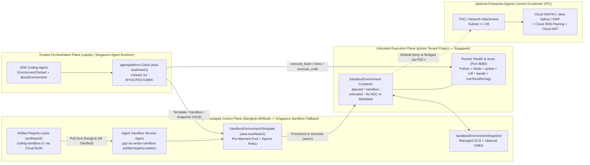

# Lab 2 — Custom Sandbox (BYOC), Lifecycle Management & Execution (`Scale Pillar`)

> **Pillar:** Scale (Managed Sandboxes, BYOC Custom Containers, Lifecycle CRUD/Pause/Resume/Snapshot, Multi-Path Execution, Credential & Egress Isolation)  
> **Duration:** 60 minutes (Full-Day Track) | 40 minutes (Half-Day Fast-Track)  
> **Antigravity Skill Companion:** [`.agents/skills/agent-platform-sandbox-byoc/SKILL.md`](../.agents/skills/agent-platform-sandbox-byoc/SKILL.md)  
> **Previous Lab:** [Lab 1: Setup & Build ADK Coding Agent](./01-LAB-SETUP-AND-BUILD-ADK.md) | **Next Lab:** [Lab 3: Managed Sessions, Memory Bank, Feedback Service & Runtime Telemetry](./03-LAB-SESSIONS-MEMORY-FEEDBACK.md)  
> **Files You Will Inspect & Edit:** `starter/sandbox_image/Dockerfile`, `starter/sandbox_image/runner.py`, `starter/coding_agent/tools/sandbox_lifecycle.py`, `starter/coding_agent/tools/sandbox_execution.py`, `starter/coding_agent/agent.py`

---

## Learning Objectives

By the end of Lab 2, you will:

1. Smoke-test the non-root BYOC runner locally in pure Python (`make test-sandbox-local` — **zero local Docker!**, checking `/health` `agy_cli_available`, `/exec`, `cwd` escape, and allowlisted per-invocation `env` rejection), build and push the **non-root Debian BYOC coding sandbox image** (`starter/sandbox_image/Dockerfile` with opt-in `/usr/local/bin/agy` via `ARG INSTALL_AGY_CLI=true` + `runner.py`) remotely via Cloud Build in **Bangkok (`asia-southeast3`)** into Artifact Registry (`make push-sandbox`), and grant **`roles/artifactregistry.reader`** to the **Agent Sandbox Service Agent** (`service-PROJECT_NUMBER@gcp-sa-vertex-sandbox.iam.gserviceaccount.com`) — or take the zero-build **`SANDBOX_MODE=shell`** fast-track in **Singapore (`asia-southeast1`)**.
2. Implement the 4 focused `# TODO(lab-2)` lifecycle hooks (`create_template`, `create_sandbox`, `pause_sandbox`, `snapshot_sandbox`) in [`starter/coding_agent/tools/sandbox_lifecycle.py`](../starter/coding_agent/tools/sandbox_lifecycle.py) — alongside pre-filled CRUD/query helpers (`get`, `list`, `update`, `resume`, `delete`) — to run the complete **`SandboxEnvironmentTemplate`, `SandboxEnvironment`, and `SandboxEnvironmentSnapshot`** lifecycles in **Singapore (`asia-southeast1`)**.
3. Implement the 2 focused `# TODO(lab-2)` execution hooks (`execute_byoc_command`, `AgentPlatformSandboxEnvironment.execute`) in [`starter/coding_agent/tools/sandbox_execution.py`](../starter/coding_agent/tools/sandbox_execution.py) — with supporting adapters (`execute_shell_command`, `execute_code_snippet`, `build_code_execution_executor`, and `AgentPlatformSandboxEnvironment`'s `initialize`/`read_file`/`write_file`) pre-filled — and wire `_build_remote_execution_components` in [`starter/coding_agent/agent.py`](../starter/coding_agent/agent.py) so ADK `EnvironmentToolset` operates transparently against a remote managed sandbox.
4. Verify **gVisor credential isolation** (zero ambient credentials, blocked metadata server `169.254.169.254:80`), design **PSC-I + Cloud NGFW / Secure Web Proxy egress allowlisting**, and account for **TTLs (7d/14d), cold-start latencies (2m vs. seconds), and Cloud Audit Log / `stdout` blind spots**.

---

## Quick-Run TL;DR (Classroom Fast Path)

- **Focused Exercises (High-Signal TODOs):** `sandbox_lifecycle.py` (`create_template`, `create_sandbox`, `pause_sandbox`, `snapshot_sandbox`), `sandbox_execution.py` (`execute_byoc_command`, `AgentPlatformSandboxEnvironment.execute`), and `agent.py` (`_build_remote_execution_components`) — *(CRUD `get`/`list`/`update`/`resume`/`delete` & supporting execution adapters pre-filled!)*
- **Key Commands (Zero Local Docker — Bangkok Build + Singapore Sandboxes):**
  ```bash
  make test-sandbox-local                                   # Pure-Python localhost runner.py smoke test (zero Docker!)
  make push-sandbox                                         # Remote Cloud Build (--region=asia-southeast3) -> AR (or SANDBOX_MODE=shell)
  make sandbox-lifecycle-demo                               # Template -> Sandbox -> Pause -> Resume -> Snapshot -> Delete (asia-southeast1)
  make verify-lab LAB=2
  ```
- **Antigravity AI-Assisted Mode (`.agents/skills/agent-platform-sandbox-byoc`):** *"Using `agent-platform-sandbox-byoc`, implement the `# TODO(lab-2)` lifecycle and execution functions in `starter/coding_agent/tools/` and `agent.py`, ensuring `BaseEnvironment` overrides accept keyword-only `*, ctx: Context | None = None`."*
- **Fell Behind? Instant Catch-Up:** `make fast-forward LAB=2` *(syncs only Lab 2 without spoiling Labs 3–8 TODOs).*

---

## Architecture: Trusted Orchestrator vs. Untrusted Sandbox



### Disambiguating Google Cloud's Three "Sandbox" Surfaces

Do not confuse these three distinct products when reading docs or designing architectures:

| Surface | Managed By | Key Distinguishing Characteristics | Covered In |
|---|---|---|---|
| **1. Agent Platform Scale Sandboxes** (`scale/sandbox`) | `agentplatform.Client.sandboxes.*` under a parent `ReasoningEngine` | gVisor containers: **Code Execution**, **Shell**, **Computer Use**, and **BYOC Custom Containers**. **No built-in domain allowlist field**—use PSC-I + Cloud NGFW/SWP for FQDN filtering. | **This Lab (Lab 2)** |
| **2. Managed Agents API Sandbox** (`build/managed-agents/sandbox-environment`, Pre-GA) | `google.genai` Agents/Interactions API (`global` only) | Built-in `antigravity-preview-05-2026` harness with a native network `allowlist`, direct Skill Registry mounts, and `env_id` sharing. Pre-GA (not for production/confidential data). | Reference contrast only |
| **3. Self-Hosted GKE Agent Sandbox** (`kubernetes-sigs/agent-sandbox`) | Kubernetes CRDs (`Sandbox`, `SandboxTemplate`, `SandboxWarmPool`, `PodSnapshot`) + `sandbox-router` (port `8888`) | Self-managed GKE clusters; supports GPUs/TPUs, `<1s` warm pools, microVMs/Kata, and Kubernetes `NetworkPolicy`. | [Lab 8](./08-ARCHITECTURE-AGENT-RUNTIME-VS-GKE.md) |

### Comparing the Four Agent Platform Scale Sandbox Types

| Sandbox Type | Template / Spec Key | Execution Path | Network Access | Snapshots | Max TTL |
|---|---|---|---|---|---|
| **Code Execution** | `spec={"code_execution_environment": {"code_language": "LANGUAGE_PYTHON"\|"LANGUAGE_JAVASCRIPT", "machine_config": ...}}` | `execute_code()` or ADK `AgentEngineSandboxCodeExecutor` | **None** (zero internet or VPC) | **Not supported** | Up to **14 days** (`execute_code` resets TTL) |
| **Shell Sandbox** | `spec={"shell_environment": {}}` or `DEFAULT_CONTAINER_CATEGORY_SHELL_SANDBOX` | `execute_bash()` -> container `/exec` (`appuser`, `/workspace`) | Off by default (`internet_access: False`) | **Supported** | Configurable (`config.ttl`; default **2h** if omitted, max 7d container) |
| **Computer Use** | `DEFAULT_CONTAINER_CATEGORY_COMPUTER_USE` | HTTP data plane (`generate_access_token` + `send_command`), CDP WebSocket (`generate_browser_ws_headers` + Playwright), VNC/noVNC | Off by default (`internet_access: False`) | **Supported** | Configurable (`config.ttl`; default **2h** if omitted) |
| **Custom Container (BYOC)** | `custom_container_environment` on `SandboxEnvironmentTemplate` | Declared TCP `ports` + container runner (`/exec`, WebSocket, PTY; optional PSC-E) | Off by default (`internet_access: False`); direct or PSC-I | **Supported** *(same server architecture, sandbox runtime version, and container `image_uri` required)* | Up to **7 days** (configurable via `config.ttl`; default **2h** if omitted) |

---

## Part A: Test, Build & Push the Non-Root BYOC Coding Sandbox (Zero Local Docker!)

> [!TIP]
> **Zero-Docker First-Class Workflow (3 Options — Local `docker` Is Strictly Optional!):**
> 1. **Local Pure-Python Runner Smoke Test (`make test-sandbox-local`):** Verifies `starter/sandbox_image/runner.py` (`GET /health` + `POST /exec`) directly on localhost using Python's standard library — **zero Docker daemon required!**
> 2. **Remote Cloud Build in Bangkok (`make push-sandbox`):** Submits `starter/sandbox_image/` to **Cloud Build in Bangkok (`--region=asia-southeast3`)** and pushes into **Bangkok Artifact Registry (`asia-southeast3-docker.pkg.dev/...`)** — zero local Docker! **Empirically verified:** Singapore BYOC Sandboxes (`asia-southeast1`, our fallback only because Managed Sandboxes are not yet launched in Bangkok) pull directly from Bangkok Artifact Registry (`asia-southeast3-docker.pkg.dev`) with zero issues — **no second Singapore AR repository is required**.
> 3. **Zero-Build Fast-Track (`SANDBOX_MODE=shell`):** Want to skip BYOC container builds entirely (e.g., on the Half-Day Fast-Track)? Keep **`SANDBOX_MODE=shell`** in `.env` — Google Cloud's managed gVisor **Shell Sandbox** in **Singapore (`asia-southeast1`)** runs immediately with zero container build or Artifact Registry setup!

### A.1 Inspect `starter/sandbox_image/` & Run the Zero-Docker Local Smoke Test

Per [Custom Containers (BYOC)](https://docs.cloud.google.com/gemini-enterprise-agent-platform/scale/sandbox/custom-containers), every BYOC sandbox image must satisfy three non-negotiable requirements:
1. **Linux-based OS** (e.g., Debian Bookworm slim or Ubuntu).
2. **Strictly non-root security:** Must **not** require `root` privileges, `sudo`, or restricted kernel capabilities—it executes inside a gVisor-isolated container.
3. **Compatible runner / entry point & declared TCP port:** Listens on a declared TCP port (`ports: [{"port": 8080, "protocol": "TCP"}]`) to accept execution requests.

> [!NOTE]
> **Runner Contract Transparency & Baked `/usr/local/bin/agy`:** Official `scale/sandbox/custom-containers` docs require *"a compatible runner or entry point"* and reference open-source architectures [AX](https://agentexecutor.io/) and [Substrate](https://github.com/agent-substrate/substrate), while `scale/sandbox/shell-sandbox-quickstart` documents the `/exec` endpoint returning `{"stdout", "stderr", "returncode", "duration_ms"}`. Official docs do not publish a verbatim custom Dockerfile wire spec; [`starter/sandbox_image/Dockerfile`](../starter/sandbox_image/Dockerfile) and [`starter/sandbox_image/runner.py`](../starter/sandbox_image/runner.py) implement an educational, non-root Debian Bookworm coding sandbox exposing `GET /health` and `POST /exec` on port `8080` aligned with that exact response schema—complete with `Python 3.11+`, `Node.js LTS`, `git`, `pytest`, `ruff`, `bandit`, `jq`, and opt-in **`/usr/local/bin/agy`** (`ARG INSTALL_AGY_CLI=true`), owned by `USER appuser` under `/workspace`.

#### Baked Antigravity (`agy`) Headless CLI & Allowlisted Per-Exec `env` Security Boundary

Inspect how `starter/sandbox_image/Dockerfile` and `starter/sandbox_image/runner.py` enable Lab 1 Part B's `AGY_EXECUTION_MODE=sandbox` **with zero local Docker** (built remotely in Bangkok Cloud Build via `make push-sandbox`) while preserving strict gVisor credential hygiene:

1. **Static Go `agy` Binary (`ARG INSTALL_AGY_CLI=true`):** `starter/sandbox_image/Dockerfile` bakes `/usr/local/bin/agy` cleanly at image build time (or set `--build-arg INSTALL_AGY_CLI=false` for air-gapped minimal images):
   ```dockerfile
   ARG INSTALL_AGY_CLI=true
   RUN if [ "${INSTALL_AGY_CLI}" = "true" ]; then \
         curl -fsSL https://antigravity.google/cli/install.sh -o /tmp/agy_install.sh \
         && bash /tmp/agy_install.sh --dir /usr/local/bin \
         && rm -f /tmp/agy_install.sh \
         && chmod 0755 /usr/local/bin/agy; \
       fi
   ```
2. **Capability Probe on `GET /health`:** `runner.py` returns `"agy_cli_available": shutil.which("agy") is not None` alongside container UID/workspace metadata so `AgyHeadlessHarness` (`AGY_EXECUTION_MODE=auto`) can detect cleanly whether the BYOC sandbox image includes `agy`.
3. **Strict Allowlisted Per-Invocation `env` on `POST /exec`:** `runner.py` optionally accepts `"env": dict[str, str]` restricted strictly to an explicit safe allowlist (`ALLOWED_EXEC_ENV_KEYS`):
   - `AGY_ADC_AUTH`
   - `AGY_CLI_DISABLE_AUTO_UPDATE`
   - `GOOGLE_CLOUD_PROJECT`
   - `GOOGLE_CLOUD_LOCATION`
   - `GOOGLE_CLOUD_QUOTA_PROJECT`
   - `GEMINI_API_KEY`
   - Any non-dict `env` payload or **any key outside `ALLOWED_EXEC_ENV_KEYS`** is immediately rejected with **HTTP 400**! Allowed keys are injected **strictly into that single child process's `env`** and are **NEVER written to disk, persisted to `/workspace`, or logged** by `runner.py`.

Verify the non-root directive, `INSTALL_AGY_CLI` build arg, and smoke-test `runner.py` locally with **zero Docker**:

```bash
# 1. Confirm non-root USER appuser, WORKDIR /workspace, ARG INSTALL_AGY_CLI, and EXPOSE 8080
grep -E "^(FROM|ARG|USER|WORKDIR|EXPOSE|ENTRYPOINT|CMD)" starter/sandbox_image/Dockerfile

# 2. Run pure-Python localhost smoke test against starter/sandbox_image/runner.py (ZERO Docker!)
#    Verifies GET /health (incl. agy_cli_available), POST /exec, cwd='/etc' -> 400, and disallowed env -> 400!
make test-sandbox-local
```

Confirm you see a non-root `USER appuser` (never `USER root`), `WORKDIR /workspace`, `EXPOSE 8080`, `agy_cli_available` in `/health`, and passing `/exec` + HTTP 400 assertions from `make test-sandbox-local`.

> [!WARNING]
> **Cloud Build Legacy Builder Gotcha (`COPY --chmod` vs. `RUN chmod`):**
> `gcloud builds submit --region=asia-southeast3 --tag=...` runs Cloud Build's **legacy Docker builder** (without BuildKit enabled). Using BuildKit-only syntax like `COPY --chown=root:root --chmod=0644 runner.py /opt/sandbox_runner/runner.py` fails the remote build with `the --chmod option requires BuildKit`. Always separate permissions into a standard `RUN chmod` step so the Dockerfile builds identically on Cloud Build and local Docker:
> ```dockerfile
> COPY --chown=root:root runner.py /opt/sandbox_runner/runner.py
> RUN chmod 0644 /opt/sandbox_runner/runner.py
> ```

### A.2 Create Bangkok Artifact Registry Repo & Push via Remote Cloud Build (`--region=asia-southeast3`)

```bash
source .env

# Aim for Bangkok (asia-southeast3) first for Cloud Build & Artifact Registry.
# Empirically verified: Singapore (asia-southeast1) BYOC Sandboxes pull cleanly from
# Bangkok Artifact Registry (`asia-southeast3-docker.pkg.dev`) — no second AR repo needed!
export AR_LOCATION="${AR_LOCATION:-asia-southeast3}"
export BUILD_LOCATION="${BUILD_LOCATION:-asia-southeast3}"

# 1. Create a unified Docker repository in Bangkok Artifact Registry (hosts both Lab 2 coding-sandbox and Lab 5 coding-agent images)
gcloud artifacts repositories create coding-agent-repo \
  --repository-format=docker \
  --location="$AR_LOCATION" \
  --description="BYOC Coding Sandbox and Agent Runtime images for Gemini Enterprise Agent Platform" \
  --project="$GOOGLE_CLOUD_PROJECT" || true

# 2. Define the canonical BYOC sandbox image URI (Bangkok default: asia-southeast3-docker.pkg.dev/...)
export SANDBOX_IMAGE_URI="${AR_LOCATION}-docker.pkg.dev/${GOOGLE_CLOUD_PROJECT}/coding-agent-repo/coding-sandbox:v1"
echo "SANDBOX_IMAGE_URI=$SANDBOX_IMAGE_URI"

# 3. Build and push remotely via Cloud Build in Bangkok (ZERO local Docker required!)
make push-sandbox
# Equivalent direct Cloud Build command:
# gcloud builds submit starter/sandbox_image \
#   --region="$BUILD_LOCATION" \
#   --tag="$SANDBOX_IMAGE_URI" \
#   --project="$GOOGLE_CLOUD_PROJECT"
```

> **Security Best Practice:** Enable [Artifact Registry Vulnerability Scanning](https://docs.cloud.google.com/artifact-registry/docs/analysis) on `coding-agent-repo` to scan OS and Python/Node dependencies before referencing the image URI in a `SandboxEnvironmentTemplate`. Managed Sandboxes do not run an in-guest IDS or automatic pre-deployment CVE scanner.

### A.3 Grant `roles/artifactregistry.reader` to the Agent Sandbox Service Agent (CRITICAL!)

> [!CAUTION]
> **Use `gcp-sa-vertex-sandbox`, NOT `gcp-sa-aiplatform-re`!**  
> `service-PROJECT_NUMBER@gcp-sa-aiplatform-re.iam.gserviceaccount.com` pulls **Agent Runtime** images (Lab 5).  
> `service-PROJECT_NUMBER@gcp-sa-vertex-sandbox.iam.gserviceaccount.com` pulls **BYOC Sandbox** images (Lab 2).

```bash
gcloud artifacts repositories add-iam-policy-binding coding-agent-repo \
  --location="${AR_LOCATION:-asia-southeast3}" \
  --project="$GOOGLE_CLOUD_PROJECT" \
  --member="serviceAccount:service-${GOOGLE_CLOUD_PROJECT_NUMBER}@gcp-sa-vertex-sandbox.iam.gserviceaccount.com" \
  --role="roles/artifactregistry.reader"
```

Update `.env` with your `SANDBOX_IMAGE_URI` value before proceeding to Part B (or skip straight to Part B with `SANDBOX_MODE=shell` for the zero-build fast-track).

---

## Part B: Implement `TODO(lab-2)` in `starter/coding_agent/tools/sandbox_lifecycle.py`

Open [`starter/coding_agent/tools/sandbox_lifecycle.py`](../starter/coding_agent/tools/sandbox_lifecycle.py). All CRUD/query helpers (`get`, `list`, `update`, `resume`, `delete` across templates, sandboxes, and snapshots) are **pre-filled**, so you focus strictly on the **4 `# TODO(lab-2)` lifecycle hooks** (`create_template`, `create_sandbox`, `pause_sandbox`, `snapshot_sandbox`) while reviewing the complete verified lifecycle across all three resources:

1. **Lightweight Standalone Agent Platform Instance (`ReasoningEngine`)**: Prerequisite for all Managed Sandboxes — created in **~3 seconds** via `client.runtimes.create()` with **zero code deployment**. This single lightweight backing instance powers **both Lab 2 Sandboxes and Lab 3 Managed Sessions / Memory Bank**, letting you finish building your entire agent locally before deploying ONCE in Lab 5!
2. **`SandboxEnvironmentTemplate`** (Create, Get, List, Update = Delete + Recreate, Delete).
3. **`SandboxEnvironment`** (Create, Get, List, Pause, Resume, Snapshot, Delete).
4. **`SandboxEnvironmentSnapshot`** (Create, Restore/Branch, Get, List, Delete).

> [!TIP]
> **One Lightweight Backing Instance Powers Labs 2 & 3 (Zero Code Deploy Required):**
> Calling `client.runtimes.create()` without a container or source spec provisions an empty parent `ReasoningEngine` in **~3 seconds**. Save the returned `instance_name` to `REASONING_ENGINE_NAME` (and its trailing numeric ID to `REASONING_ENGINE_ID`) in `.env` — it backs **both Lab 2 Managed Sandboxes and Lab 3 Managed Sessions / Memory Bank** while you keep iterating locally, so you only build and deploy your complete Coding Agent container **once** in [Lab 5](./05-LAB-DEPLOY-RUNTIME-TERRAFORM.md)!

### SDK Namespace & API Version Rules (Read Before Coding!)

> [!IMPORTANT]
> - **Always pass `http_options={"api_version": "v1beta1"}`** when initializing `agentplatform.Client` for BYOC `SandboxEnvironmentTemplate`, PSC-I/PSC-E networking, or CMEK parent instances.
> - **Always capture resource names dynamically** (`operation.response.name` or `item.name` from `.list(...)`). Never hardcode template or snapshot paths—official docs contain known copy-paste typos (e.g., PascalCase `SandboxEnvironmentTemplate` instead of `sandboxEnvironmentTemplates`, and a sandbox URI pasted as a snapshot URI).
> - **Prefer plain Python `dict` payloads** for `spec` and `config` to stay insulated from internal module changes (avoid `from agentplatform._genai import types`).
> - **Reuse templates!** Omitting `sandbox_environment_template` on `sandboxes.create()` auto-creates a new orphan template every time, and deleting a sandbox does **not** delete its template.

### Complete Lifecycle Reference Implementation (`TODO(lab-2)`)

#### 1. Client Init & Parent Instance Creation

```python
import agentplatform

client = agentplatform.Client(
    project=project_id,
    location=location,  # "asia-southeast1" (Singapore fallback — Managed Sandboxes are not yet in Bangkok asia-southeast3)
    http_options={"api_version": "v1beta1"},  # Required for BYOC templates, PSC, CMEK
)

# Lightweight standalone backing instance (~3 seconds, zero code deploy):
# Powers BOTH Lab 2 Managed Sandboxes and Lab 3 Managed Sessions / Memory Bank
# before you package and deploy the complete Coding Agent ONCE in Lab 5!
remote_agent = client.runtimes.create()
instance_name = remote_agent.api_resource.name
# Format: projects/{PROJECT_NUMBER_OR_ID}/locations/{LOCATION}/reasoningEngines/{INSTANCE_ID}
# Save `instance_name` as REASONING_ENGINE_NAME (and its trailing ID as REASONING_ENGINE_ID) in `.env`.
```

#### 2. `SandboxEnvironmentTemplate` Lifecycle (Create / Get / List / Update / Delete)

```python
# CREATE BYOC Template (triggers pre-warmed pool creation for faster subsequent startups)
byoc_tpl_op = client.sandboxes.templates.create(
    name=instance_name,
    display_name="byoc-coding-sandbox-template",
    config={
        "custom_container_environment": {
            "custom_container_spec": {
                "image_uri": image_uri,  # Bangkok AR: asia-southeast3-docker.pkg.dev/PROJECT/coding-agent-repo/coding-sandbox:v1 (verified with SG sandboxes!)
            },
            "resources": {
                "requests": {"cpu": "1", "memory": "1Gi"},
                "limits": {"cpu": "2", "memory": "2Gi"},
            },
            "ports": [
                {"port": 8080, "protocol": "TCP"},
            ],
        },
        "egress_control_config": {
            "internet_access": False,  # Secure default-deny; see Part D for PSC-I FQDN allowlisting
        },
    },
)
template_name = byoc_tpl_op.response.name  # Capture dynamically!

# LIST Templates
templates_resp = client.sandboxes.templates.list(name=instance_name)
for tpl in templates_resp.sandbox_environment_templates:
    print(tpl.name)

# GET Template
template_details = client.sandboxes.templates.get(name=template_name)

# UPDATE Template: No in-place SDK update method is documented.
# Official pattern (scale/sandbox/manage-templates): delete old template + create new template.
# NOTE: delete() returns an async LRO and fails if a warm pool or sandbox is still active —
# always wait for delete LROs to finish before tearing down parent/dependent resources!
client.sandboxes.templates.delete(name=template_name, config={"wait_for_completion": True})
```

#### 3. `SandboxEnvironment` Lifecycle (All 7 Operations)

```python
# 1. CREATE — From BYOC Template (or Shell spec={"shell_environment": {}}, or Snapshot)
create_op = client.sandboxes.create(
    name=instance_name,
    config={
        "sandbox_environment_template": template_name,
        "display_name": "coding-session-sandbox",
        "wait_for_completion": True,
        "ttl": "3600s",  # Always set explicit TTL (default 2h if omitted; max 7d BYOC / 14d code-exec)
    },
)
sandbox = create_op.response
sandbox_name = sandbox.name

# 2. LIST Sandboxes
for sb in client.sandboxes.list(name=instance_name):
    print(sb.name, sb.state)

# 3. GET Sandbox details (state enum, template link, optional PSC-E service_attachment)
sb_details = client.sandboxes.get(name=sandbox_name)
# States include: STATE_PROVISIONING, STATE_RUNNING, STATE_PAUSING, STATE_PAUSED, STATE_RESUMING, STATE_DELETED

# 4. PAUSE Sandbox (releases compute billing; preserves ID, disk state & PSC endpoint)
pause_op = client.sandboxes.pause(
    name=sandbox_name,
    config={"wait_for_completion": True},
)
assert str(pause_op.response.state).endswith("STATE_PAUSED")

# 5. RESUME Sandbox (only valid when STATE_PAUSED; calling on STATE_RUNNING raises FAILED_PRECONDITION)
resume_op = client.sandboxes.resume(
    name=sandbox_name,
    config={"wait_for_completion": True},
)
assert str(resume_op.response.state).endswith("STATE_RUNNING")

# 6. SNAPSHOT Sandbox (captures installed libs, disk & memory state -> managed GCS; NOT for Code Execution)
snap_display_name = "checkpoint-before-refactor"
snap_op = client.sandboxes.snapshots.create(
    source_sandbox_environment_name=sandbox_name,
    config={
        "display_name": snap_display_name,
        "ttl": "3600s",
        "wait_for_completion": True,
    },
)
# Capture snapshot_name safely from snap_op.response.name (or match display_name — never blindly index [0]!)
snapshot_name = getattr(getattr(snap_op, "response", None), "name", None)
if not snapshot_name:
    snapshots = client.sandboxes.snapshots.list(name=instance_name).sandbox_environment_snapshots
    matched = [s.name for s in snapshots if getattr(s, "display_name", "") == snap_display_name]
    if not matched:
        raise RuntimeError(f"Snapshot {snap_display_name!r} not found in {instance_name}")
    snapshot_name = matched[0]

# RESTORE / BRANCH a second sandbox from the snapshot in seconds
# Official constraints (scale/sandbox/manage-snapshots): fails if server architecture
# (amd64 vs arm64), sandbox runtime version, or container image URI differs!
branch_op = client.sandboxes.create(
    name=instance_name,
    config={
        "display_name": "coding-session-branch-b",
        "sandbox_environment_snapshot": snapshot_name,
    },
)

# 7. DELETE Snapshot, Sandboxes & Template — WAIT FOR EACH DELETE LRO TO COMPLETE!
# Deleting a sandbox does NOT delete its backing template, and firing async delete() calls
# without waiting can leave orphaned snapshots or templates behind when parent cleanup runs.
client.sandboxes.snapshots.delete(name=snapshot_name, config={"wait_for_completion": True})
client.sandboxes.delete(name=branch_op.response.name, config={"wait_for_completion": True})
client.sandboxes.delete(name=sandbox_name, config={"wait_for_completion": True})
client.sandboxes.templates.delete(name=template_name, config={"wait_for_completion": True})
```

> [!WARNING]
> **Avoid Orphaned Snapshots & Templates During Teardown (Async Delete LROs):**
> `sandboxes.delete()`, `sandboxes.snapshots.delete()`, and `sandboxes.templates.delete()` return asynchronous Long-Running Operations (LROs). Even if a `finally:` block logs `"Deleted snapshot"` / `"Deleted template"`, failing to wait for each delete LRO to reach completion causes parent template/instance teardown races and leaves orphaned snapshots or templates behind. Always wait for `delete_sandbox` → `delete_snapshot` → `delete_template` LROs in order (`config={"wait_for_completion": True}` or polling `op.done`), and verify zero leftovers with `uv run python -m coding_agent.tools.sandbox_lifecycle cleanup-all --include-templates`.

### Run the Lifecycle CLI Demo

Once you finish the `# TODO(lab-2)` blocks in `starter/coding_agent/tools/sandbox_lifecycle.py`, test the full lifecycle end-to-end:

```bash
# Run via Makefile (uses starter/ by default; or pass TRACK=solution to compare)
make sandbox-lifecycle-demo

# Or invoke the module CLI directly:
cd starter
uv run python -m coding_agent.tools.sandbox_lifecycle --help
uv run python -m coding_agent.tools.sandbox_lifecycle demo --mode shell --ttl 1800s
```

Observe the timing difference firsthand: creating a brand-new template/sandbox from a cold start can take **up to 2 minutes** (managed Shell sandboxes typically reach `STATE_RUNNING` in **~20 seconds**), whereas **pausing/resuming** or **restoring from a snapshot** completes in **seconds**.

---

## Part C: Implement `TODO(lab-2)` in `starter/coding_agent/tools/sandbox_execution.py`

Open [`starter/coding_agent/tools/sandbox_execution.py`](../starter/coding_agent/tools/sandbox_execution.py). Supporting execution adapters (`execute_shell_command`, `execute_code_snippet`, `build_code_execution_executor`, and `AgentPlatformSandboxEnvironment`'s `initialize`, `read_file`, and `write_file` helpers) are **pre-filled** so you focus strictly on the **2 `# TODO(lab-2)` execution hooks** (`execute_byoc_command` and `AgentPlatformSandboxEnvironment.execute`) — plus `_build_remote_execution_components` in [`starter/coding_agent/agent.py`](../starter/coding_agent/agent.py) (7 `# TODO(lab-2)` functions total across Lab 2) — while reviewing how all four execution paths work together.

### Path A: Managed Shell Sandbox (`execute_bash()` -> `/exec`)

> [!WARNING]
> **Verified Execution API Split:** Do **NOT** mix sandbox data-plane methods across sandbox categories!
> - **Shell Sandboxes (`shell_environment`)** use **`execute_bash()`** (targeting `/exec` with automatic IAM/ADC auth). Calling `execute_code()` or sending incompatible payloads fails.
> - **Code Execution Sandboxes (`code_execution_environment`)** use **`execute_code()`** (Python/JavaScript payloads).
> - **Computer Use Sandboxes (`DEFAULT_CONTAINER_CATEGORY_COMPUTER_USE`)** use the verified HTTP data-plane API **`client.sandboxes.generate_access_token(service_account_email=...)`** + **`client.sandboxes.send_command(http_method=..., path=..., access_token=..., request_dict=..., sandbox_environment=...)`** (targeting `/`, `/tabs`, `/cdp`, `/cdp_ws_endpoint` — see [Computer Use Quickstart](https://docs.cloud.google.com/gemini-enterprise-agent-platform/scale/sandbox/computer-use-quickstart)).

Key execution semantics from [Shell Sandbox Quickstart](https://docs.cloud.google.com/gemini-enterprise-agent-platform/scale/sandbox/shell-sandbox-quickstart):
- Authenticates automatically using your ADC/IAM caller identity (`aiplatform.sandboxEnvironments.execute`, included in `roles/aiplatform.user`)—**no service account key or signed JWT needed**.
- Runs as unprivileged user **`appuser`** (no `sudo`), default `cwd="/workspace"`.
- **Stateless per-call shell:** Every `execute_bash()` spawns a fresh shell; `cd` and `export VAR=...` do **not** persist across calls. Chain commands in one call (`cd /workspace/app && pytest -q`) or persist state to files under `/workspace`.

```python
result = client.sandboxes.execute_bash(
    name=sandbox_name,
    command="cd /workspace && whoami && pwd && pytest -q",
    cwd="/workspace",
    timeout=120,
)
# Exact return shape: {'stdout': '...', 'stderr': '...', 'returncode': 0, 'duration_ms': 14}
```

### Path B: BYOC Custom Container Execution (`/exec` Runner)

When targeting your custom BYOC container image from Part A:
- Your container exposes port `8080` (declared in `SandboxEnvironmentTemplate.config.custom_container_environment.ports`) running `runner.py`'s `POST /exec` endpoint.
- The parent agent authenticates over the sandbox data plane using IAM or short-lived JWT access tokens (`client.sandboxes.generate_access_token(service_account_email=...)`, audited as `AuthorizeSandboxEnvironmentAccess`, paired with `client.sandboxes.send_command(http_method=..., path=..., access_token=..., request_dict=..., sandbox_environment=...)` for HTTP runner endpoints)—or privately over a VPC **PSC-E** forwarding rule targeting `sandbox.connection_info.service_attachment`—and receives the same structured `{stdout, stderr, returncode, duration_ms}` payload.

### Path C: Code Execution Sandbox (`execute_code` & ADK `AgentEngineSandboxCodeExecutor`)

Use Code Execution sandboxes for pure Python or JavaScript data/math computation (sub-second create + execute, persistent in-memory state across calls, **100 MB** total file payload limit per request/response, **zero network**, **no `pip install`**, **no snapshots**, preinstalled scientific stack including `numpy`, `pandas`, `scipy`, `scikit-learn`, `matplotlib`, `pydantic`):

```python
import json
from google.adk.code_executors.agent_engine_sandbox_code_executor import (
    AgentEngineSandboxCodeExecutor,
)

# 1. Direct SDK execution (safe Chunk parsing — avoids broken b64decode snippet in quickstart doc!)
response = client.sandboxes.execute_code(
    name=code_sandbox_name,
    input_data={
        "code": 'with open("out.txt", "w") as f: f.write("ok")\nprint("done")',
        "files": [{"name": "input.txt", "content": b"hello\n"}],
    },
)
for chunk in response.outputs:
    if chunk.mime_type == "application/json":
        payload = json.loads(chunk.data.decode("utf-8"))  # {"msg_out": "...", "msg_err": "..."}
        print("stdout:", payload.get("msg_out"), "stderr:", payload.get("msg_err"))
    else:
        fname = (chunk.attributes or {}).get("file_name")
        print(f"output file={fname} mime={chunk.mime_type} bytes={len(chunk.data)}")

# 2. ADK Agent integration (ADK Python 2.0+)
# Pass EITHER sandbox_resource_name (existing) OR agent_engine_resource_name (auto-creates per session)
code_executor = AgentEngineSandboxCodeExecutor(
    agent_engine_resource_name=instance_name,
)
```

### Path D: Custom ADK `BaseEnvironment` -> `AgentPlatformSandboxEnvironment`

This is the architectural crown jewel of Lab 2: subclassing ADK's `BaseEnvironment` (ADK Python 2.0+) so `EnvironmentToolset` (`ReadFile`, `EditFile`, `WriteFile`, `Execute`) executes remotely inside a **per-session Managed Sandbox**!

> [!IMPORTANT]
> **Source-Verified `BaseEnvironment` Rules (`google/adk-python`):**
> 1. **`BaseEnvironment` has exactly 3 `@abstractmethod`s:** `execute`, `read_file`, and `write_file`. Do **NOT** invent an `edit_file` abstract override—`EditFileTool` builds surgical edits on top of `read_file` + `write_file`.
> 2. **Mandatory `*, ctx: Context | None = None` on all 5 hooks** (`initialize`, `execute`, `read_file`, `read_file_stream`, `write_file`). Omitting `ctx` triggers a `DeprecationWarning` and strips `ctx` so you cannot store the sandbox resource name in `ctx.state`!
> 3. **Return `EnvironmentScope.SESSION` from `scope` (and NEVER short-circuit on `self._is_initialized`):** `EnvironmentToolset` serializes `initialize()` per session while allowing concurrent initialization across different users/sessions, and calls `initialize(ctx=ctx)` **before every tool call**. Because a single `AgentPlatformSandboxEnvironment` instance serves multiple sessions, **NEVER** write `if self._is_initialized: return`—always check `ctx.state.get(self.STATE_KEY)` instead so each session provisions and reuses its own isolated sandbox!

```python
from pathlib import Path
from typing import TYPE_CHECKING, Literal
from typing_extensions import override

from google.adk.environment import BaseEnvironment, EnvironmentScope, ExecutionResult

if TYPE_CHECKING:
    from google.adk.agents.context import Context


class AgentPlatformSandboxEnvironment(BaseEnvironment):
    """ADK BaseEnvironment backed by a per-session Agent Platform Managed Sandbox."""

    STATE_KEY = "agent_platform:sandbox_name"

    def __init__(
        self,
        *,
        project_id: str,
        location: str,
        instance_name: str,
        template_name: str | None = None,
        sandbox_name: str | None = None,
        mode: Literal["shell", "byoc"] = "shell",
        working_dir: Path = Path("/workspace"),
        ttl: str = "3600s",
        service_account_email: str | None = None,
        runner_base_url: str | None = None,
    ) -> None:
        self._project_id = project_id
        self._location = location
        self._instance_name = instance_name
        self._template_name = template_name
        self._fixed_sandbox_name = sandbox_name
        self._mode = mode
        self._working_dir = working_dir
        self._ttl = ttl
        self._service_account_email = service_account_email
        self._runner_base_url = runner_base_url

    @property
    @override
    def scope(self) -> EnvironmentScope:
        return EnvironmentScope.SESSION

    @property
    @override
    def working_dir(self) -> Path | None:
        # Must return a fixed logical path (takes no ctx); /workspace is uniform per sandbox
        return self._working_dir

    @override
    async def initialize(self, *, ctx: Context | None = None) -> None:
        # CRITICAL: With EnvironmentScope.SESSION, NEVER short-circuit on
        # `if self._is_initialized: return` — one instance serves many sessions!
        # Always check `ctx.state.get(self.STATE_KEY)` first; if already set, reuse it,
        # otherwise resolve `resolved_parent = (_infer_parent_instance(self._template_name) if self._template_name else "") or self._instance_name or None`
        # so BYOC templates always target their owning parent ReasoningEngine (while shell mode
        # reuses the parent Agent Platform instance / deployed Agent Runtime), create the sandbox, and store its name in `ctx.state[self.STATE_KEY]`.
        if ctx is not None and ctx.state.get(self.STATE_KEY):
            return
        ...
        self._is_initialized = True

    @override
    async def execute(
        self, command: str, *, timeout: float | None = None, ctx: Context | None = None
    ) -> ExecutionResult:
        # Dispatch command to execute_bash() or BYOC /exec and map into ExecutionResult(exit_code, stdout, stderr, timed_out)
        # (Pre-filled companion helpers `execute_with_env(...)` and `check_byoc_health(...)` build on
        # `execute_byoc_command()` so Lab 1's `AgyHeadlessHarness` can probe `/health` and forward
        # allowlisted ephemeral env keys into BYOC `/exec` without modifying `BaseEnvironment.execute`!)
        ...

    @override
    async def read_file(self, path: Path, *, ctx: Context | None = None) -> bytes:
        # Read raw file bytes inside the sandbox (raise FileNotFoundError if absent)
        ...

    @override
    async def write_file(
        self, path: Path, content: str | bytes, *, ctx: Context | None = None
    ) -> None:
        # Create parent dirs automatically and write UTF-8 str or raw bytes safely (e.g., base64 payload)
        ...

    @override
    async def close(self) -> None:
        self._is_initialized = False
```

Now wire `AgentPlatformSandboxEnvironment` into [`starter/coding_agent/agent.py`](../starter/coding_agent/agent.py) under `TODO(lab-2)` when `SANDBOX_MODE` is `shell` or `byoc`—making sure to forward `template_name=(settings.sandbox_template_name or None) if settings.sandbox_mode == "byoc" else None` (so Lab 2's BYOC template in `.env` is never passed into `shell` mode) and only sending inline `spec={"shell_environment": {}}` when `self._template_name` is `None` (and attach `AgentEngineSandboxCodeExecutor` when `SANDBOX_MODE=code_execution`), update `.env` to `SANDBOX_MODE=shell`, and test your agent remotely!

---

## Part D: Security Boundaries, Egress Controls, TTLs & Observability Caveats

### D.1 Verify Credential & Identity Isolation Live

Run this isolation probe through your agent—or directly with the `sandbox_execution` CLI (`cd starter && uv run python -m coding_agent.tools.sandbox_execution probe-isolation --mode shell --sandbox-name "$SANDBOX_RESOURCE_NAME"`):

```bash
id && whoami && ls -la /workspace
# Verify Compute Engine metadata server (169.254.169.254) is completely unreachable:
curl -sS --max-time 3 -H "Metadata-Flavor: Google" \
  http://169.254.169.254/computeMetadata/v1/instance/service-accounts/default/token \
  || echo "PASS: Metadata server unreachable inside gVisor sandbox"
# Verify sudo is unavailable:
sudo -n true 2>&1 || echo "PASS: Non-root appuser cannot escalate"
```

| Identity Layer | Principal | Accessible Inside Sandbox? |
|---|---|---|
| **Parent Agent Runtime Identity** | Dedicated Custom Runtime SA (Lab 5 default) or SPIFFE `AGENT_IDENTITY` (`principal://agents.global.org-...`, Optional Lab 7) | **NEVER** — stays strictly in Agent Runtime |
| **Sandbox Service Agent** | `service-PROJECT_NUMBER@gcp-sa-vertex-sandbox.iam.gserviceaccount.com` | **NEVER** — control-plane image pulls only |
| **In-Sandbox Execution Identity** | Unprivileged `appuser` backed by tenant identity `sandbox-untrusted` (**0 IAM roles** on your project) | **Yes** — zero ADC, zero metadata server (`169.254.169.254:80`) |

> **Golden Architecture Rule:** Always perform authenticated Google Cloud API calls (GCS, BigQuery, Secret Manager, GitHub token exchange) in the **parent Agent Runtime**, and pass only the required data or a narrowly scoped short-lived token into the sandbox.

### D.2 Egress Controls, FQDN Allowlisting, VPC-SC & CMEK

There is **no built-in domain allowlist property** on `SandboxEnvironment` or `SandboxEnvironmentTemplate`. Choose your egress posture intentionally:

1. **Air-Gapped / Default-Deny (`egress_control_config: {"internet_access": False}`):** Recommended default for running local unit tests (`pytest`), linters (`ruff`), and SAST (`bandit`) when all dependencies are baked into your BYOC image.
2. **Direct Public Egress (`internet_access: True`, no `network_attachment`):** Grants unrestricted `0.0.0.0/0` public internet egress while blocking private RFC 1918 ranges (`10.0.0.0/8`, `172.16.0.0/12`, `192.168.0.0/16`) and link-local metadata (`169.254.0.0/16`). **Cannot restrict specific domains.**
3. **Enterprise FQDN / URL Allowlisting & Private Access via PSC-I:** Bridge all sandbox egress into your VPC by adding `customer_vpc_network` and `network_attachment` (minimum **`/28`** subnet) to `egress_control_config`, then enforce:
   - **Cloud NGFW** global network firewall policy (`--dest-fqdns=pypi.org,files.pythonhosted.org` at priority `1000`, followed by default-deny `0.0.0.0/0` at priority `65000` with `--enable-logging`).
   - **Secure Web Proxy (SWP)** for Layer 7 TLS inspection and URL-level allowlisting.
   - **Cloud DNS Peering** (`dns_peering_configs`) + private Cloud DNS zones (note: **public DNS forwarding is disabled** when bridged into your VPC to prevent DNS-tunnel data exfiltration).
   - **Cloud NAT** on the PSC subnet if internet egress is required (omit for private-only internal VPC/on-prem access).
   - *(Shared VPC note: If the network attachment lives in a host project, grant `roles/compute.networkUser` on the host project to **`service-PROJECT_NUMBER@gcp-sa-aiplatform.iam.gserviceaccount.com`**.)*
4. **Private Ingress (PSC-E):** Set `ingress_control_config.private_service_connect_config.enable_private_service_connect: True` on the template, then create a VPC forwarding rule targeting `sandbox.connection_info.service_attachment` (limit: **1 consumer project**, which must be the **same project** running the sandbox).
5. **VPC Service Controls & CMEK** *(deep-dive & hardening checklist in [Lab 7 (Optional): Enterprise Security & Governance Hardening](./07-LAB-OPTIONAL-SECURITY-AND-GOVERNANCE.md))*:
   - **VPC-SC:** Add `aiplatform.googleapis.com`, `storage.googleapis.com`, and `artifactregistry.googleapis.com` to Restricted Services **before** creating sandboxes; route `*.googleapis.com` and `pkg.dev` via `199.36.153.4/30`.
   - **CMEK:** Configured **only** when creating the parent `ReasoningEngine` (`encryption_spec.kms_key_name`, single-region key, immutable; grant `roles/cloudkms.cryptoKeyEncrypterDecrypter` to `gcp-sa-aiplatform-re`). Encrypts sandbox node boot disks (runtime files + paged memory) and the snapshot GCS bucket; does **not** encrypt resource metadata or Artifact Registry source images (configure CMEK on the AR repo separately).

### D.3 TTLs, Provisioning Latencies & Audit Log / `stdout` Caveats

| Dimension | Verified Behavior & Operational Impact |
|---|---|
| **Max & Default TTLs** | **2 hours default** when `ttl` is omitted; up to **7 days** max for BYOC custom container sandboxes; up to **14 days** max for Code Execution sandboxes (`execute_code` resets TTL). Always set an explicit `config.ttl` (e.g., `3600s`) so orphaned sandboxes auto-expire if an agent crashes. |
| **Provisioning Latency** | Cold start (unprovisioned template): **up to 2 minutes**. Warm / template-backed spin-up, resume from pause, or snapshot restore: **seconds** (~20s typical for Shell; `<1s` for Code Execution). |
| **Cloud Audit Logs (`aiplatform.googleapis.com`)** | `ADMIN_WRITE` lifecycle ops are always enabled. `ADMIN_READ` (`Get`/`List`) and `DATA_WRITE` (`ExecuteSandboxEnvironment`, `BidiExecuteSandboxEnvironment`, `AuthorizeSandboxEnvironmentAccess`, `ExecuteCode`) are **disabled by default**—enable both for enterprise audit! **VPC-SC caveat:** Request/response payloads are omitted from audit logs inside a VPC-SC perimeter. |
| **In-Container Blind Spot** | Cloud Audit Logs records only the outer API call—**NOT** child subprocesses, syscalls, file writes, or individual WebSocket/CDP/PTY stream frames. |
| **`stdout` / `stderr` Logging Gap (CRITICAL!)** | Automatic Cloud Logging (`reasoning_engine_stdout` / `reasoning_engine_stderr`) applies **only** to the parent `ReasoningEngine` and does **NOT** collect logs from child sandboxes! Your parent agent **must** inspect and log sandbox execution responses explicitly (which we wire into ADK callbacks in [Lab 3](./03-LAB-SESSIONS-MEMORY-FEEDBACK.md)). |

### D.4 Zero-Ambient-Credential Sandbox Boundary for `agy` Headless CLI

When combining Lab 1 Part B's **`AGENT_ARCHITECTURE=agy_harness`** with Lab 2's **gVisor BYOC Managed Sandbox**, choose one of these two enterprise-safe patterns based on your egress posture:

| Pattern | Egress Posture | Where `agy` Runs | Credential & Security Boundary |
|---|---|---|---|
| **Pattern 1 (Default Air-Gapped Recommended)** | `internet_access: False` (sandbox completely air-gapped) | Trusted **Agent Runtime (Lab 5)** via `AGY_EXECUTION_MODE=local` + `AGY_ADC_AUTH=true` on Custom SA (`coding-agent-runtime-sa`) | **Zero credentials ever enter the sandbox.** Untrusted `pytest`, `ruff`, and `bandit` commands run inside the air-gapped gVisor BYOC Sandbox; `agy` / Gemini 4 calls stay strictly inside the trusted Agent Runtime! |
| **Pattern 2 (In-Sandbox `agy` Harness)** | `internet_access: True` + **PSC-I + Cloud NGFW / SWP** allowlisting Gemini/Vertex endpoints | Inside **BYOC gVisor Sandbox** via `AGY_EXECUTION_MODE=sandbox` (`agy -p ... --output-format stream-json --dangerously-skip-permissions`) | Because gVisor sandboxes have **zero IAM roles** and **block `169.254.169.254`**, the parent Agent Runtime fetches a **scoped ephemeral credential / Secret Manager key** and passes it per-call inside `POST /exec`'s allowlisted `env` dict (injected only into that child process, never written to disk or logged). **NEVER** relay a developer's personal `agy` OAuth session! |

> [!TIP]
> **`AGY_EXECUTION_MODE=auto` Handles Air-Gapped Sandboxes Automatically:** When `SANDBOX_MODE=byoc`, `auto` checks `GET /health` for `agy_cli_available=True`; if the BYOC sandbox is air-gapped (`internet_access=False`) or `agy` is absent, it seamlessly runs `agy` locally in the trusted runtime (`AGY_ADC_AUTH=true`) or falls back to native ADK 2.0 `LlmAgent` + `EnvironmentToolset`!

---

## Part E: Lab 2 Verification Checkpoint & Cleanup

Run the Lab 2 automated checkpoint verifier from the repository root:

```bash
./scripts/verify_lab.sh 2
# Or via Makefile:
# make verify-lab LAB=2
```

**Checkpoint Pass Criteria:**
- [ ] `starter/sandbox_image/Dockerfile` sets a non-root `USER appuser`, bakes opt-in `/usr/local/bin/agy` (`ARG INSTALL_AGY_CLI=true`), uses Cloud Build-compatible `COPY --chown=root:root` + `RUN chmod 0644` (not BuildKit-only `--chmod`), passes `make test-sandbox-local` (zero local Docker! verifying `/health` `agy_cli_available`, `/exec`, `cwd='/etc'` -> 400, and disallowed `env` -> 400), and pushes cleanly to `coding-agent-repo` in Bangkok Artifact Registry (`asia-southeast3-docker.pkg.dev` — empirically verified with Singapore BYOC Sandboxes!) via `make push-sandbox` — OR you opted into the zero-build `SANDBOX_MODE=shell` fast-track in Singapore (`asia-southeast1`).
- [ ] `service-PROJECT_NUMBER@gcp-sa-vertex-sandbox.iam.gserviceaccount.com` holds `roles/artifactregistry.reader` on `coding-agent-repo`.
- [ ] `starter/coding_agent/tools/sandbox_lifecycle.py` has zero remaining `# TODO(lab-2)` markers, completes template/sandbox/snapshot lifecycle operations in Singapore (`asia-southeast1`), and waits for delete LROs to finish so zero snapshots or templates remain orphaned.
- [ ] `starter/coding_agent/tools/sandbox_execution.py` implements Shell `execute_bash`, BYOC `/exec`, `AgentEngineSandboxCodeExecutor`, and `AgentPlatformSandboxEnvironment(BaseEnvironment)` with `EnvironmentScope.SESSION` and `*, ctx: Context | None = None`.
- [ ] Metadata server probe inside the sandbox confirmed unreachable (`169.254.169.254:80` blocked).
- [ ] Temporary demo sandboxes deleted so no idle sandbox billing accumulates.

> **Time-Box Fallback:** If you fall behind or hit a Cloud Build/API snag, switch to `SANDBOX_MODE=shell` or compare/copy the verified reference files from [`solution/sandbox_image/`](../solution/sandbox_image/), [`solution/coding_agent/tools/sandbox_lifecycle.py`](../solution/coding_agent/tools/sandbox_lifecycle.py), and [`solution/coding_agent/tools/sandbox_execution.py`](../solution/coding_agent/tools/sandbox_execution.py).

---

## Next Lab

Now that your Coding Agent executes untrusted code inside a secure Managed Sandbox—and your lightweight standalone backing instance (`REASONING_ENGINE_NAME`) is ready—keep building locally by adding Managed Sessions, Memory Bank, Feedback, and runtime telemetry before deploying your complete agent once in Lab 5. Continue to **[Lab 3: Managed Sessions, Memory Bank, Feedback Service & Runtime Telemetry](./03-LAB-SESSIONS-MEMORY-FEEDBACK.md)**.

---

## Canonical References

- [Gemini Enterprise Agent Platform — Managed Sandboxes Overview](https://docs.cloud.google.com/gemini-enterprise-agent-platform/scale/sandbox)
- [Custom Containers (BYOC)](https://docs.cloud.google.com/gemini-enterprise-agent-platform/scale/sandbox/custom-containers)
- [Manage Sandboxes (Get, List, Pause, Resume, Delete, Audit Gaps)](https://docs.cloud.google.com/gemini-enterprise-agent-platform/scale/sandbox/manage-sandboxes)
- [Manage Sandbox Templates](https://docs.cloud.google.com/gemini-enterprise-agent-platform/scale/sandbox/manage-templates)
- [Manage Sandbox Snapshots](https://docs.cloud.google.com/gemini-enterprise-agent-platform/scale/sandbox/manage-snapshots)
- [Shell Sandbox Quickstart (`execute_bash` & `/exec`)](https://docs.cloud.google.com/gemini-enterprise-agent-platform/scale/sandbox/shell-sandbox-quickstart)
- [Code Execution Overview & Preinstalled Libraries](https://docs.cloud.google.com/gemini-enterprise-agent-platform/scale/sandbox/code-execution-overview)
- [Code Execution Quickstart (`execute_code`)](https://docs.cloud.google.com/gemini-enterprise-agent-platform/scale/sandbox/code-execution-quickstart)
- [Computer Use Sandbox (CDP / Playwright / VNC)](https://docs.cloud.google.com/gemini-enterprise-agent-platform/scale/sandbox/computer-use)
- [Computer Use Sandbox Quickstart (`generate_access_token`, `send_command` & 2h Default TTL)](https://docs.cloud.google.com/gemini-enterprise-agent-platform/scale/sandbox/computer-use-quickstart)
- [Configure VPC-SC, PSC-I Egress, Cloud NGFW & Secure Web Proxy](https://docs.cloud.google.com/gemini-enterprise-agent-platform/scale/sandbox/configure-vpc-sc)
- [Configure CMEK for Sandboxes](https://docs.cloud.google.com/gemini-enterprise-agent-platform/scale/sandbox/configure-cmek)
- [ADK Integration — `AgentEngineSandboxCodeExecutor`](https://adk.dev/integrations/code-exec-agent-runtime/)
- [ADK Integration — `EnvironmentToolset` & `BaseEnvironment`](https://adk.dev/integrations/environment-toolset/)
- [REST Reference — `sandboxEnvironments`](https://docs.cloud.google.com/gemini-enterprise-agent-platform/reference/rest/v1/projects.locations.reasoningEngines.sandboxEnvironments)
