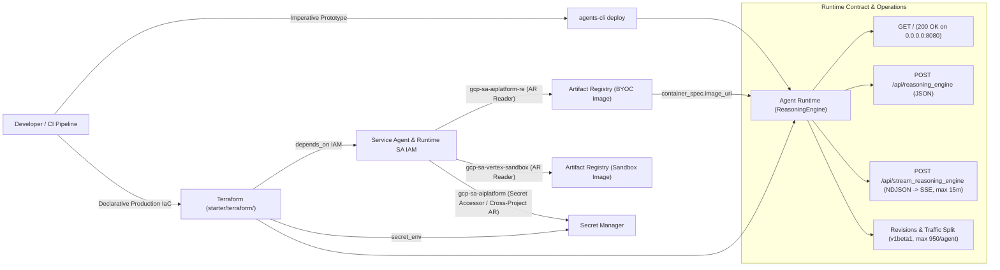

# Lab 3: Deploy & Manage the Coding Agent on Agent Runtime (CLI & Terraform)

> **Pillar:** Scale (Agent Runtime, Declarative IaC, Lifecycle & Traffic Management)  
> **Duration:** 50 minutes (Full-Day Track) | 30 minutes (Half-Day Fast-Track)  
> **Antigravity Skill Companion:** [`.agents/skills/agent-platform-runtime-and-state/SKILL.md`](../.agents/skills/agent-platform-runtime-and-state/SKILL.md) *(complements the built-in `google-agents-cli-deploy` skill)*  
> **Previous Lab:** [Lab 2: Custom Sandboxes & BYOC Execution](./02-LAB-CUSTOM-SANDBOX-BYOC.md) | **Next Lab:** [Lab 4: Managed Sessions, Memory Bank, Feedback & Telemetry](./04-LAB-SESSIONS-MEMORY-FEEDBACK.md)  
> **Files You Will Inspect & Edit:** `starter/Dockerfile`, `starter/main.py`, `starter/requirements.txt`, `starter/terraform/main.tf`, `starter/terraform/outputs.tf`, `starter/terraform/terraform.tfvars`

---

## Learning Objectives

By the end of this lab, you will be able to:

1. Deploy your ADK Coding Agent to **Gemini Enterprise Agent Platform (Agent Runtime)** using both imperative **`agents-cli deploy`** workflows and declarative **Terraform (`google_vertex_ai_reasoning_engine`)**.
2. Configure **BYOC prebuilt containers (`container_spec`)** and **Dockerfile builds (`source_code_spec` + empty `image_spec {}`)**, avoiding the root-of-tar archive failure mode.
3. Prevent `IMAGE_PULL_BACKOFF` and secret-fetch race conditions by binding IAM roles for the Google-managed service agents (`gcp-sa-aiplatform-re`, `gcp-sa-aiplatform`, and `gcp-sa-vertex-sandbox`) with explicit Terraform `depends_on` ordering.
4. Wire a **dedicated least-privilege runtime service account** (or **SPIFFE `AGENT_IDENTITY`**) and **Secret Manager** environment variables (`secret_env`).
5. Understand the **Agent Runtime HTTP/NDJSON contract** (`0.0.0.0:8080`, `GET /`, `/api/reasoning_engine`, `/api/stream_reasoning_engine`, `keep_alive_probe`) and container sizing constraints.
6. Operate deployed agents in production: CRUD management (`list`, `get`, `update`, `delete`), long-running async query jobs, **revisions & canary traffic splitting (`v1beta1`)**, revision garbage collection, and **emergency stop** playbooks.

---

## Half-Day Fast-Track Path

If you are running on the **3.5-hour Half-Day Fast-Track** (30 minutes):
- Complete **Part A** (dry-run & review `agents-cli deploy` flags), **Step B0** (complete `# TODO(lab-3)` in `starter/main.py` and build/push `AGENT_IMAGE_URI` via `make push-agent` — or copy `solution/main.py` and point `agent_image_uri` at your facilitator's pre-pushed image), and **Steps B1–B4** (implement `# TODO(lab-3)` in `starter/terraform/main.tf` and run `make tf-plan`).
- Kick off **one** live deployment (`make tf-apply` or `agents-cli deploy --no-wait`) and while it provisions (5–10 minutes), read **Part C (Runtime Contract)** and **Part D (Revisions, Traffic Splitting & Emergency Stop)**.
- Verify with `./scripts/verify_lab.sh 3`.

---

## Architecture Overview



---

## Prerequisites & Workspace Check

Confirm your shell environment and variables from Labs 1–2 are loaded:

```bash
source .env
gcloud config set project "${GOOGLE_CLOUD_PROJECT}"
terraform version   # Requires >= 1.5.0
agents-cli info
```

Verify the following values in `.env`:
- `GOOGLE_CLOUD_PROJECT` and `GOOGLE_CLOUD_PROJECT_NUMBER`
- `GOOGLE_CLOUD_LOCATION` (`us-central1` or `europe-west4`)
- `SANDBOX_IMAGE_URI` (`.../coding-agent-repo/coding-sandbox:v1`) and `SANDBOX_TEMPLATE_NAME` (from Lab 2)
- `AGENT_IMAGE_URI` (built and pushed to `coding-agent-repo/coding-agent:v1` in Step B0 below)

> [!IMPORTANT]
> **No `gcloud` Deploy Command for Agent Runtime:** Unlike Cloud Run, there is **no `gcloud` CLI command to deploy an Agent Runtime instance** (`gcloud ai reasoning-engines` only supports `describe` and `beta ... add-iam-policy-binding`). Deploy via **`agents-cli deploy`**, **Terraform (`google_vertex_ai_reasoning_engine`)**, or the **Python/REST SDK (`agentplatform.Client`)**.

> [!NOTE]
> **SDK Namespace Convention:** New workshop code standardizes on **`agentplatform.Client`** (`google-cloud-agentplatform>=2.0.1`, also provided by `google-cloud-aiplatform>=1.154.0`) and `from agentplatform.frameworks import AdkApp`. Legacy `vertexai.Client` / `from vertexai.agent_engines import AdkApp` examples still appear in some upstream docs (such as `package_spec` staging) and remain compatible.

---

## Part A: Rapid Imperative Deployment with `agents-cli deploy`

`agents-cli deploy` packages your ADK project, builds the container image (or deploys a prebuilt `--image`), injects secrets and environment variables, and provisions an Agent Runtime instance.

### Step A1: Understand the Critical Infra Ordering Rule

> [!CAUTION]
> **Terraform vs. Imperative Ordering Trap:** If you use `agents-cli infra single-project --apply` for Terraform-managed observability (prompt-response logging or `--bq-analytics`), you **MUST** run `agents-cli infra single-project --apply` **before** your first `agents-cli deploy`. Never apply Terraform *after* an imperative `agents-cli deploy` onto the same Agent Runtime resource, as state ownership conflicts will require deleting and recreating the engine. In this lab, we inspect `agents-cli deploy` with `--dry-run` first, then provision our production instance declaratively in **Part B** using `starter/terraform/`.

### Step A2: Dry-Run and Inspect `agents-cli deploy` Flags

Preview the exact build and deployment plan without mutating cloud resources:

```bash
cd starter
agents-cli deploy \
  --project "${GOOGLE_CLOUD_PROJECT}" \
  --region "${GOOGLE_CLOUD_LOCATION}" \
  --service-name "coding-agent-cli" \
  --cpu 2 \
  --memory 4Gi \
  --concurrency 5 \
  --min-instances 0 \
  --max-instances 10 \
  --env-vars "GOOGLE_CLOUD_AGENT_ENGINE_ENABLE_TELEMETRY=true,OTEL_SEMCONV_STABILITY_OPT_IN=gen_ai_latest_experimental,OTEL_INSTRUMENTATION_GENAI_CAPTURE_MESSAGE_CONTENT=EVENT_ONLY" \
  --dry-run
```

#### Key `agents-cli deploy` Flags & Gotchas

| Flag | Default / Behavior | Production Notes & Gotchas |
|---|---|---|
| `--cpu`, `--memory`, `--concurrency` | `--cpu 1 --memory 4Gi --concurrency 8` | Platform API defaults differ (`cpu=4`, `memory=4Gi`, `concurrency=9`, `min_instances=1`). Recommended concurrency: `2 * cpu + 1`. |
| `--min-instances`, `--max-instances` | `--min-instances 0 --max-instances 10` | Generated Terraform `service.tf` sets `min_instances = 1`. Platform hard bounds: `min_instances` `[0, 75]`, `max_instances` `[1, 1000]` (**`[1, 100]`** under VPC-SC or PSC-I). |
| `--secrets` / `--update-secrets` | Secret Manager bindings (`ENV=secret:version`) | **CRITICAL:** On Cloud Run `--secrets` appends, whereas on **Agent Runtime `--secrets` replaces the entire secrets map**! Always use `--update-secrets` for incremental changes. |
| `--agent-identity` / `--no-agent-identity` | Opts into/out of SPIFFE Agent Identity | When `--agent-identity` is enabled, `--service-account` is ignored. Required (and **immutable**) for Agent Gateway bindings and Semantic Governance (Lab 5). |
| `--agent-gateway-egress`, `--agent-gateway-ingress` | Binds Agent Gateway | Supported on Agent Runtime with `--agent-identity` only. |
| `--network-attachment`, `--dns-peering-*` | [Private Service Connect Interface (PSC-I)](https://docs.cloud.google.com/gemini-enterprise-agent-platform/scale/runtime/private-service-connect-interface) | Engines with PSC-I have **no default internet egress** even without VPC-SC (requires RFC 1918 proxy VM + Cloud NAT). |
| `--key` | CMEK KMS key | **Create-only** on Agent Runtime (immutable after creation; single-region only). |
| `--image` vs `--build-args` | Prebuilt image URI vs Dockerfile build args | Cannot combine `--image` with `--build-args`. |
| `--no-wait`, `--status`, `--list` | Async deploy + polling | **Workshop Tip:** Agent Runtime deployments typically take **5–10 minutes**. Always use `--no-wait` and poll with `agents-cli deploy --status` every ~60 seconds. |

#### Reserved & Auto-Injected Environment Variables

Never pass any of these **forbidden** environment variables in `--env-vars` or Terraform `deployment_spec.env`:
- `GOOGLE_CLOUD_PROJECT`, `GOOGLE_CLOUD_QUOTA_PROJECT`, `GOOGLE_CLOUD_LOCATION`
- `PORT`, `K_SERVICE`, `K_REVISION`, `K_CONFIGURATION`, `GOOGLE_APPLICATION_CREDENTIALS`
- Avoid custom variables starting with the prefix `GOOGLE_CLOUD_AGENT_ENGINE` (except documented platform flags like `GOOGLE_CLOUD_AGENT_ENGINE_ENABLE_TELEMETRY`).

Agent Runtime automatically injects `GOOGLE_CLOUD_PROJECT`, `GOOGLE_CLOUD_LOCATION`, and `GOOGLE_CLOUD_AGENT_ENGINE_ID` into your container at startup.

> [!TIP]
> **Deploying Any Lab 1 ADK Architecture Without Changing the Container Contract:**
> Because `starter/coding_agent/agent.py` resolves `root_agent` dynamically via `build_root_agent()` and exposes `app = App(...)` (with `ResumabilityConfig(is_resumable=True)` and `GlobalInstructionPlugin` across `collaborative`, `graph`, and `dynamic` modes), `main.py` forwards `coding_agent.agent.app` via `AdkApp(app=adk_app)` whenever the installed `AdkApp` signature supports `app=` (falling back cleanly to `AdkApp(agent=root_agent)` — plus `plugins=...` if supported — on older SDKs). That means you can switch your deployed Coding Agent between `simple` (default), `collaborative`, `graph`, and `dynamic` purely through environment variables — pass `AGENT_ARCHITECTURE`, `MAX_FIX_ROUNDS`, and `ENABLE_HITL_APPROVAL` via Terraform `deployment_spec.env` (or `agents-cli deploy --env-vars "AGENT_ARCHITECTURE=graph,MAX_FIX_ROUNDS=3,ENABLE_HITL_APPROVAL=false"`) with **zero changes** to `starter/Dockerfile`, `starter/main.py`, or the Agent Runtime HTTP/NDJSON contract! *(Note: if you pin an older SDK build whose `AdkApp` only accepts `agent=`, pass `plugins` explicitly on `AdkApp` when deploying remote HITL or collaborative workflows. Keep `AGENT_ARCHITECTURE=simple` as the default for Labs 3–6 unless you intentionally want to benchmark a multi-agent/graph revision via canary traffic splitting in Step D2.)*

*(Optional — if you want to deploy an imperative prototype engine right now before Part B, remove `--dry-run` and add `--no-wait`, then poll with `agents-cli deploy --status`. Otherwise proceed directly to Part B so Terraform owns the lifecycle cleanly.)*

---

## Part B: Declarative Production Deployment with Terraform (`starter/terraform/`)

Enterprise teams deploy Agent Runtime declaratively via Terraform so IAM bindings, Secret Manager versions, Artifact Registry permissions, and container specs move cleanly across dev, staging, and prod with zero drift.

### Step B0: Build & Push the Trusted Agent Runtime BYOC Container (`AGENT_IMAGE_URI`)

Before running `terraform plan` or `terraform apply` with `container_spec`, you must build and push the **Agent Runtime** container image (`coding-agent:v1`) into your unified `coding-agent-repo` Artifact Registry repository.

> [!IMPORTANT]
> **Two Completely Separate Images in `coding-agent-repo`:**
> - **Lab 2 Untrusted Sandbox (`starter/sandbox_image/` -> `coding-sandbox:v1`, `SANDBOX_IMAGE_URI`):** Runs untrusted LLM-generated commands via `/exec` inside gVisor with zero IAM roles. Pulled by **`gcp-sa-vertex-sandbox`**.
> - **Lab 3 Trusted Agent Runtime (`starter/Dockerfile`, `starter/main.py`, `starter/requirements.txt`, `starter/coding_agent/` -> `coding-agent:v1`, `AGENT_IMAGE_URI`):** Runs the trusted FastAPI/ADK HTTP server implementing `GET /`, `POST /api/reasoning_engine`, and `POST /api/stream_reasoning_engine` on `0.0.0.0:8080`. Pulled by **`gcp-sa-aiplatform-re`**.

1. Inspect the three runtime server files at the root of `starter/`:
   - [`starter/Dockerfile`](../starter/Dockerfile) — Non-root Python 3.11+ container packaging `main.py`, `requirements.txt`, and `coding_agent/`, starting Uvicorn on `0.0.0.0:8080`
   - [`starter/main.py`](../starter/main.py) — FastAPI/ADK HTTP adapter implementing `GET /` (`200 OK`), `POST /api/reasoning_engine` (JSON), and `POST /api/stream_reasoning_engine` (NDJSON) — contains **3 `# TODO(lab-3)` blocks** (`get_runtime_app()`, `query_endpoint()`, `stream_query_endpoint()`)
   - [`starter/requirements.txt`](../starter/requirements.txt) — Pinned runtime dependencies shared by both Option 1 (`container_spec`) and Option 2 (`source_code_spec`)

2. Complete the 3 `# TODO(lab-3)` blocks in [`starter/main.py`](../starter/main.py) **before** building the image (compare with [`solution/main.py`](../solution/main.py) if you get stuck):

   ```python
   @functools.lru_cache(maxsize=1)
   def get_runtime_app() -> Any:
       from coding_agent.agent import app as adk_app
       from coding_agent.agent import root_agent

       try:
           from agentplatform.frameworks import AdkApp
       except ImportError:
           from vertexai.agent_engines import AdkApp

       init_params = inspect.signature(AdkApp.__init__).parameters
       if "app" in init_params:
           runtime_app = AdkApp(app=adk_app)
       else:
           kwargs: dict[str, Any] = {"agent": root_agent}
           app_plugins = getattr(adk_app, "plugins", None)
           if app_plugins and "plugins" in init_params:
               kwargs["plugins"] = list(app_plugins)
           runtime_app = AdkApp(**kwargs)

       setup_fn = getattr(runtime_app, "set_up", None)
       if callable(setup_fn):
           setup_fn()
       return runtime_app


   @app.post("/api/reasoning_engine")
   async def query_endpoint(request: QueryRequest) -> responses.JSONResponse:
       runtime_app = get_runtime_app()
       method = _resolve_public_method(runtime_app, request.class_method)
       if method is None:
           return responses.JSONResponse(
               status_code=400,
               content={"error": f"Method {request.class_method!r} not found on agent"},
           )
       output = await _invoke_method(method, request.input or {})
       return responses.JSONResponse(content=encoders.jsonable_encoder({"output": output}))


   @app.post("/api/stream_reasoning_engine")
   async def stream_query_endpoint(request: QueryRequest) -> responses.StreamingResponse:
       runtime_app = get_runtime_app()
       method = _resolve_public_method(runtime_app, request.class_method)
       if method is None:
           return responses.StreamingResponse(
               content=iter([json.dumps({"error": f"Method {request.class_method!r} not found"}) + "\n"]),
               status_code=400,
               media_type="application/json",
           )
       output = await _invoke_method(method, request.input or {})
       return responses.StreamingResponse(
           content=_ndjson_stream(output),
           media_type="application/json",
       )
   ```

3. Build and push `AGENT_IMAGE_URI` to `coding-agent-repo` via Cloud Build (or `make push-agent`):

   ```bash
   source .env

   # Ensure coding-agent-repo exists (already created in Lab 2)
   gcloud artifacts repositories create coding-agent-repo \
     --repository-format=docker \
     --location="${GOOGLE_CLOUD_LOCATION}" \
     --project="${GOOGLE_CLOUD_PROJECT}" || true

   export AGENT_IMAGE_URI="${GOOGLE_CLOUD_LOCATION}-docker.pkg.dev/${GOOGLE_CLOUD_PROJECT}/coding-agent-repo/coding-agent:v1"
   echo "AGENT_IMAGE_URI=${AGENT_IMAGE_URI}"

   # Build and push the Agent Runtime BYOC image via Makefile:
   make push-agent
   # Equivalent direct Cloud Build command from the repository root:
   # gcloud builds submit starter --tag="${AGENT_IMAGE_URI}" --project="${GOOGLE_CLOUD_PROJECT}"
   ```

4. Save `AGENT_IMAGE_URI` into `.env` so `starter/terraform/terraform.tfvars` and downstream verification scripts pick it up automatically.

### Step B1: Inspect the Starter Terraform Layout

Review the files in `starter/terraform/`:
- [`starter/terraform/versions.tf`](../starter/terraform/versions.tf) — Terraform and Google provider constraints (`hashicorp/google >= 6.0.0` and `hashicorp/google-beta >= 6.0.0`, required for `spec.container_spec`; note upstream `use-terraform` docs still print `>= 5.28.0`)
- [`starter/terraform/variables.tf`](../starter/terraform/variables.tf) — Input variables (`project_id`, `project_number`, `location`, `repository_name`, `agent_image_uri`, `sandbox_image_uri`, `api_key_value`, etc.)
- [`starter/terraform/main.tf`](../starter/terraform/main.tf) — Service accounts, Secret Manager, dual service agent IAM bindings, and `google_vertex_ai_reasoning_engine` (contains `# TODO(lab-3)` markers)
- [`starter/terraform/outputs.tf`](../starter/terraform/outputs.tf) — Exports `reasoning_engine_id`, `reasoning_engine_resource_name`, and `agent_runtime_service_account`
- [`starter/terraform/terraform.tfvars.example`](../starter/terraform/terraform.tfvars.example) — Sample variables template

### Step B2: Understand the Service Agent IAM Matrix & `depends_on` Race Condition

> [!CAUTION]
> **Prevent `IMAGE_PULL_BACKOFF` and Secret-Fetch Races:** Container provisioning on Agent Runtime will race ahead of IAM propagation if you do not explicitly bind Google-managed service agents **and** list those IAM resources in `depends_on = [...]` on `google_vertex_ai_reasoning_engine`.

| Service Agent / Principal | Exact Email Format | Role Required | When Mandatory in `depends_on` |
|---|---|---|---|
| **Agent Runtime Service Agent** | `service-${var.project_number}@gcp-sa-aiplatform-re.iam.gserviceaccount.com` | `roles/artifactregistry.reader` | **Always** for BYOC `container_spec` pulling from same-project Artifact Registry. Also requires `roles/cloudkms.cryptoKeyEncrypterDecrypter` for CMEK and `roles/storage.objectCreator` for async query job output buckets. |
| **Agent Platform Service Agent** | `service-${var.project_number}@gcp-sa-aiplatform.iam.gserviceaccount.com` | `roles/secretmanager.secretAccessor` / `roles/artifactregistry.reader` / `roles/iam.serviceAccountTokenCreator` | Required when: (1) using `secret_env` with `identity_type = "AGENT_IDENTITY"`; (2) pulling a BYOC image from a **cross-project** Artifact Registry repo; (3) using a cross-project custom SA; or (4) binding a cross-project Agent Gateway. |
| **Agent Sandbox Service Agent** *(Lab 2)* | `service-${var.project_number}@gcp-sa-vertex-sandbox.iam.gserviceaccount.com` | `roles/artifactregistry.reader` | Required whenever the Coding Agent provisions BYOC Managed Sandboxes (`SandboxEnvironmentTemplate`). |
| **Dedicated Custom Runtime SA** | `${google_service_account.agent_runtime_sa.email}` | `roles/secretmanager.secretAccessor`, `roles/aiplatform.user`, `roles/logging.logWriter`, `roles/cloudtrace.agent`, `roles/telemetry.tracesWriter`, `roles/monitoring.metricWriter`, plus self `roles/iam.serviceAccountTokenCreator` (for BYOC `generate_access_token()`) | Required when attaching `service_account = ...` instead of `identity_type = "AGENT_IDENTITY"`. Deployer also needs `roles/iam.serviceAccountUser` on this SA. |

### Step B3: Complete `# TODO(lab-3)` in `starter/terraform/main.tf`

Open [`starter/terraform/main.tf`](../starter/terraform/main.tf) and complete the `# TODO(lab-3)` sections to match the verified production configuration below (compare with [`solution/terraform/main.tf`](../solution/terraform/main.tf) if you get stuck).

> [!WARNING]
> **Verified Terraform Schema Attribute (`region`, NOT `location`):** One upstream example in the official docs accidentally prints `location = var.location` on `google_vertex_ai_reasoning_engine`. The actual Terraform provider schema attribute is **`region = var.location`**. Always use `region`.

#### 1. Dedicated Runtime Service Account, Secret Manager & Service Agent IAM

```hcl
# Dedicated least-privilege Runtime Service Account
resource "google_service_account" "agent_runtime_sa" {
  account_id   = "coding-agent-runtime-sa"
  display_name = "Coding Agent Runtime Identity"
  project      = var.project_id
}

resource "google_project_iam_member" "runtime_sa_roles" {
  for_each = toset([
    "roles/aiplatform.user",
    "roles/logging.logWriter",
    "roles/cloudtrace.agent",
    "roles/telemetry.tracesWriter",
    "roles/monitoring.metricWriter",
  ])
  project = var.project_id
  role    = each.value
  member  = "serviceAccount:${google_service_account.agent_runtime_sa.email}"
}

# Allow runtime SA to call sandboxes.generate_access_token(service_account_email=...) in BYOC mode
resource "google_service_account_iam_member" "runtime_sa_self_token_creator" {
  service_account_id = google_service_account.agent_runtime_sa.name
  role               = "roles/iam.serviceAccountTokenCreator"
  member             = "serviceAccount:${google_service_account.agent_runtime_sa.email}"
}

# Secret Manager secret + version injected via deployment_spec.secret_env
resource "google_secret_manager_secret" "coding_agent_api_key" {
  secret_id = "coding-agent-api-key"
  project   = var.project_id
  replication {
    auto {}
  }
}

resource "google_secret_manager_secret_version" "coding_agent_api_key_v1" {
  secret      = google_secret_manager_secret.coding_agent_api_key.id
  secret_data = var.api_key_value
}

resource "google_secret_manager_secret_iam_member" "runtime_sa_secret_accessor" {
  secret_id = google_secret_manager_secret.coding_agent_api_key.id
  role      = "roles/secretmanager.secretAccessor"
  member    = "serviceAccount:${google_service_account.agent_runtime_sa.email}"
}

# SERVICE AGENT #1: Agent Runtime Service Agent (pulls BYOC container from AR)
resource "google_project_iam_member" "re_service_agent_ar_reader" {
  project = var.project_id
  role    = "roles/artifactregistry.reader"
  member  = "serviceAccount:service-${var.project_number}@gcp-sa-aiplatform-re.iam.gserviceaccount.com"
}

# SERVICE AGENT #2: Agent Platform Service Agent (required for secret_env with AGENT_IDENTITY / cross-project AR)
resource "google_secret_manager_secret_iam_member" "platform_service_agent_secret_accessor" {
  secret_id = google_secret_manager_secret.coding_agent_api_key.id
  role      = "roles/secretmanager.secretAccessor"
  member    = "serviceAccount:service-${var.project_number}@gcp-sa-aiplatform.iam.gserviceaccount.com"
}

# SERVICE AGENT #3: Agent Sandbox Service Agent (pulls BYOC sandbox image from Lab 2)
resource "google_project_iam_member" "sandbox_service_agent_ar_reader" {
  project = var.project_id
  role    = "roles/artifactregistry.reader"
  member  = "serviceAccount:service-${var.project_number}@gcp-sa-vertex-sandbox.iam.gserviceaccount.com"
}
```

#### 2. `google_vertex_ai_reasoning_engine` — Option 1: BYOC Prebuilt Container (`container_spec`)

Wire `class_methods`, `container_spec`, `deployment_spec` (with telemetry env vars and `secret_env`), `service_account` (or `identity_type = "AGENT_IDENTITY"`), and **`depends_on`**:

```hcl
locals {
  resolved_sandbox_mode = var.sandbox_mode != "" ? var.sandbox_mode : (var.sandbox_template_name != "" ? "byoc" : "shell")

  adk_class_methods = [
    { "name" = "get_session", "api_mode" = "" },
    { "name" = "list_sessions", "api_mode" = "" },
    { "name" = "create_session", "api_mode" = "" },
    { "name" = "delete_session", "api_mode" = "" },
    { "name" = "async_get_session", "api_mode" = "async" },
    { "name" = "async_list_sessions", "api_mode" = "async" },
    { "name" = "async_create_session", "api_mode" = "async" },
    { "name" = "async_delete_session", "api_mode" = "async" },
    { "name" = "async_add_session_to_memory", "api_mode" = "async" },
    { "name" = "async_search_memory", "api_mode" = "async" },
    { "name" = "stream_query", "api_mode" = "stream" },
    { "name" = "async_stream_query", "api_mode" = "async_stream" },
    { "name" = "streaming_agent_run_with_events", "api_mode" = "async_stream" }
  ]
}

resource "google_vertex_ai_reasoning_engine" "coding_agent" {
  display_name = "coding_agent_byoc_tf"
  description  = "Enterprise ADK Coding Agent deployed declaratively with Terraform BYOC container_spec"
  project      = var.project_id
  region       = var.location

  spec {
    agent_framework = "google-adk"
    # Pass ONLY the email (NOT a full projects/... URI).
    # For Lab 5 Semantic Governance & Agent Gateway, use provider = google-beta
    # and replace service_account with: identity_type = "AGENT_IDENTITY" (immutable!).
    service_account = google_service_account.agent_runtime_sa.email

    container_spec {
      image_uri = var.agent_image_uri
    }

    deployment_spec {
      env {
        name  = "GOOGLE_CLOUD_AGENT_ENGINE_ENABLE_TELEMETRY"
        value = "true"
      }
      env {
        name  = "OTEL_SEMCONV_STABILITY_OPT_IN"
        value = "gen_ai_latest_experimental"
      }
      env {
        name  = "OTEL_INSTRUMENTATION_GENAI_CAPTURE_MESSAGE_CONTENT"
        value = "EVENT_ONLY"
      }
      env {
        name  = "SANDBOX_MODE"
        value = local.resolved_sandbox_mode
      }
      env {
        name  = "SANDBOX_TEMPLATE_NAME"
        value = var.sandbox_template_name
      }
      env {
        name  = "SANDBOX_SERVICE_ACCOUNT_EMAIL"
        value = google_service_account.agent_runtime_sa.email
      }
      secret_env {
        name = "CODING_AGENT_API_KEY"
        secret_ref {
          secret  = google_secret_manager_secret.coding_agent_api_key.secret_id
          version = "latest"
        }
      }
    }

    class_methods = jsonencode(local.adk_class_methods)
  }

  # CRITICAL: Prevents IMAGE_PULL_BACKOFF and Secret Manager deploy-time races
  depends_on = [
    google_project_iam_member.re_service_agent_ar_reader,
    google_project_iam_member.sandbox_service_agent_ar_reader,
    google_project_iam_member.runtime_sa_roles,
    google_service_account_iam_member.runtime_sa_self_token_creator,
    google_secret_manager_secret_iam_member.runtime_sa_secret_accessor,
    google_secret_manager_secret_iam_member.platform_service_agent_secret_accessor,
    google_secret_manager_secret_version.coding_agent_api_key_v1,
  ]
}
```

> [!TIP]
> **Preparing for Lab 5 (SPIFFE `AGENT_IDENTITY` & Agent Gateway):** If you plan to bind an Agent Gateway or Semantic Governance Policy directly to this engine in Lab 5, switch the resource to `provider = google-beta`, remove `service_account`, and set `identity_type = "AGENT_IDENTITY"`. `identity_type` is **immutable** — you cannot patch an existing custom-SA engine to enable Agent Identity later.

#### 3. Option 2 (Alternative): Dockerfile Deployment (`source_code_spec` + Empty `image_spec {}`)

When you do not want a separate Artifact Registry push step in CI, Agent Runtime can build directly from a `.tar.gz` archive containing a `Dockerfile` (max **8 MB** archive, no GCS bucket required):

> [!CAUTION]
> **Root-of-Tar Archive Trap (Very Common Failure!):** `Dockerfile`, `main.py`, and `requirements.txt` **MUST** reside directly at the **root level** of the `.tar.gz` archive (`./Dockerfile`), **NOT** nested inside a top-level folder (`my-agent/Dockerfile`)! Cloud Build unpacks the tarball into the build workspace root and immediately fails if `./Dockerfile` is not found at level 0.
>
> Always `cd` into the directory before archiving:
> ```bash
> cd starter && tar -czvf terraform/coding_agent_source.tar.gz Dockerfile main.py requirements.txt coding_agent/
> # Verify root-level entries (must NOT show a leading folder prefix for Dockerfile):
> tar -tzvf terraform/coding_agent_source.tar.gz | head -n 5
> ```

```hcl
# Optional alternative to container_spec (documented in starter/terraform/main.tf)
# spec {
#   agent_framework = "google-adk"
#   source_code_spec {
#     inline_source {
#       source_archive = filebase64("${path.module}/coding_agent_source.tar.gz")
#     }
#     # Empty image_spec {} instructs Agent Runtime to build using ./Dockerfile
#     image_spec {}
#   }
#   class_methods = jsonencode(local.adk_class_methods)
# }
```

*(A third Terraform option, **`package_spec`**, uploads a `cloudpickle`-serialized `AdkApp` and `requirements.txt` to GCS via `pickle_object_gcs_uri` and `requirements_gcs_uri`. Prefer `container_spec` or `source_code_spec` + `image_spec {}` for deterministic enterprise builds and non-Python portability.)*

#### 4. Canonical `starter/terraform/outputs.tf` (`.id` vs. `.name` Trap!)

> [!CAUTION]
> **Verified `hashicorp/google` `.id` vs. `.name` Output Trap (and Upstream `element(..., -1)` Bug):** In the `google_vertex_ai_reasoning_engine` Terraform provider schema, **`.id`** returns the **full resource path** `projects/{PROJECT}/locations/{LOCATION}/reasoningEngines/{NUMERIC_ID}`, whereas **`.name`** returns only the **short numeric ID** (`use-terraform` docs accidentally swap those two descriptions!). Exporting `.name` as `reasoning_engine_resource_name` breaks downstream REST URLs (`https://.../${REASONING_ENGINE_NAME}`), Lab 4, and Lab 6. Also note that upstream [`agent-identity`](https://docs.cloud.google.com/gemini-enterprise-agent-platform/scale/runtime/agent-identity) docs show `element(split("/", ...id), -1)`, which fails at runtime because Terraform's `element()` rejects negative indices — always use `reverse(split("/", ...))[0]` in [`starter/terraform/outputs.tf`](../starter/terraform/outputs.tf):

```hcl
locals {
  reasoning_engine_short_id = reverse(split("/", google_vertex_ai_reasoning_engine.coding_agent.id))[0]
}

output "reasoning_engine_id" {
  value       = local.reasoning_engine_short_id
  description = "Short numeric ID of the deployed Agent Runtime instance"
}

output "reasoning_engine_resource_name" {
  value       = "projects/${var.project_id}/locations/${var.location}/reasoningEngines/${local.reasoning_engine_short_id}"
  description = "Canonical full resource name (projects/.../locations/.../reasoningEngines/ID)"
}

output "agent_runtime_service_account" {
  value       = google_service_account.agent_runtime_sa.email
  description = "Dedicated custom runtime service account email"
}
```

### Step B4: Plan, Apply, and Smoke-Test Your Deployed Agent

1. Create your `terraform.tfvars` from the template:

   ```bash
   cp starter/terraform/terraform.tfvars.example starter/terraform/terraform.tfvars
   # Edit starter/terraform/terraform.tfvars with your project_id, project_number,
   # location, agent_image_uri, sandbox_template_name, and a placeholder api_key_value
   ```

2. Format, validate, and plan:

   ```bash
   make tf-plan
   # Equivalent direct commands:
   # terraform -chdir=starter/terraform init
   # terraform -chdir=starter/terraform fmt -check
   # terraform -chdir=starter/terraform validate
   # terraform -chdir=starter/terraform plan
   ```

3. Apply the configuration (allow **5–10 minutes** for container provisioning):

   ```bash
   make tf-apply
   # Capture both the canonical full resource name and short numeric ID into your shell and .env:
   export REASONING_ENGINE_NAME="$(terraform -chdir=starter/terraform output -raw reasoning_engine_resource_name)"
   export REASONING_ENGINE_ID="$(terraform -chdir=starter/terraform output -raw reasoning_engine_id)"
   echo "Deployed: ${REASONING_ENGINE_NAME} (ID=${REASONING_ENGINE_ID})"
   ```

4. Run a streaming verification query over SSE:

   ```bash
   curl -X POST \
     -H "Authorization: Bearer $(gcloud auth print-access-token)" \
     -H "Content-Type: application/json; charset=utf-8" \
     -d '{
       "class_method": "async_stream_query",
       "input": {
         "user_id": "terraform_test_user",
         "message": "Summarize how you safely execute unit tests in a sandbox."
       }
     }' \
     "https://${GOOGLE_CLOUD_LOCATION}-aiplatform.googleapis.com/v1/projects/${GOOGLE_CLOUD_PROJECT}/locations/${GOOGLE_CLOUD_LOCATION}/reasoningEngines/${REASONING_ENGINE_ID}:streamQuery?alt=sse"
   ```

---

## Part C: The Agent Runtime Contract & Container Sizing

When deploying BYOC containers (`container_spec` or `Dockerfile`), Agent Runtime acts as a managed control plane routing requests to your container over HTTP. Your container **must** satisfy this contract:

| Contract Requirement | Specification |
|---|---|
| **Listening Address & Port** | Listen on **`0.0.0.0:8080`** (honoring `PORT` env var, default `8080`). |
| **Health Probe** | Answer `GET /` with **`HTTP 200 OK`**. |
| **Unary / Async Methods** (`api_mode`: `""` or `"async"`) | Routed to `POST /api/reasoning_engine` with JSON `{"class_method": "...", "input": {...}}`; return `200 OK` JSON `{"output": ...}`. |
| **Streaming Methods** (`api_mode`: `"stream"` or `"async_stream"`) | Routed to `POST /api/stream_reasoning_engine`; return `200 OK` **NDJSON** (`{"output": ...}\n` per chunk), which the control plane converts to SSE. **Maximum stream duration: 15 minutes.** |
| **Bidirectional Streaming** (`api_mode`: `"bidi_stream"`) | Routed to `POST /api/bidi_reasoning_engine` (requires `agent_server_mode: AgentServerMode.EXPERIMENTAL`; **maximum timeout: 10 minutes**). |
| **Keep-Alive Probe (Preview)** | Default idle scale-down is **15 minutes (`900s`)**. Configure `keep_alive_probe` (`GET http_get.path`, polled every **10s** with **1s** timeout; `2xx` = busy, non-`2xx` such as `412` or 3 consecutive timeouts = idle; `max_seconds` in `[900, 3600]`, disables CPU throttling while active). Do **not** use reserved ports `15000, 15001, 15006, 15007, 15020, 15021`. Managed `AdkApp` accepts only `"keep_alive_probe": {}` (`3600s`; custom fields return `400 FAILED_PRECONDITION`). |
| **Resource Limits & Scaling** | `cpu`: `1, 2, 4, 6, 8` (default `4`); `memory`: `1Gi`–`32Gi` (default `4Gi`); `min_instances`: `[0, 75]` (default `1`); `max_instances`: `[1, 1000]` (default `100`, capped at **`[1, 100]`** with VPC-SC or PSC-I); recommended `container_concurrency`: `2 * cpu + 1` (default `9`, or multiples of `9` such as `36` for async I/O-bound ADK — see [Optimize and Scale](https://docs.cloud.google.com/gemini-enterprise-agent-platform/scale/runtime/optimize-and-scale)). |
| **Agent Gateway BYOC CA Trust** | If binding a BYOC container to an Agent Gateway ([Agent Gateway Runtime Deploy](https://docs.cloud.google.com/gemini-enterprise-agent-platform/scale/runtime/agent-gateway-runtime-deploy)), bake `AGENT_GATEWAY_ROOT_CERTIFICATES` into `/usr/local/share/ca-certificates/agw-*.crt`, run `update-ca-certificates`, and set **`SSL_CERT_FILE`**, **`REQUESTS_CA_BUNDLE`**, **`GRPC_DEFAULT_SSL_ROOTS_FILE_PATH`**, and **`AGENT_GATEWAY_ROOT_CERT_302034098528`** to `/etc/ssl/certs/ca-certificates.crt`. |

---

## Part D: Managing Deployed Agents, Revisions, Traffic Splitting & Emergency Stop

### Step D1: Lifecycle CRUD Operations (`scale/runtime/manage-deployed-agents`)

Use `agentplatform.Client` (or equivalent REST `v1` endpoints under `https://LOCATION-aiplatform.googleapis.com/v1/projects/PROJECT_ID/locations/LOCATION/reasoningEngines`) to inspect, update, and clean up deployed engines:

```python
import os
import agentplatform

client = agentplatform.Client(
    project=os.environ["GOOGLE_CLOUD_PROJECT"],
    location=os.environ["GOOGLE_CLOUD_LOCATION"],
)

# 1. List deployed agents (filtered by display_name)
for engine in client.runtimes.list(
    config={"filter": 'display_name="coding_agent_byoc_tf"'}
):
    print(engine.api_resource.name, engine.api_resource.display_name)

# 2. Get a specific deployed agent and inspect its effective identity & schemas
runtime_name = os.environ["REASONING_ENGINE_NAME"]
deployed = client.runtimes.get(name=runtime_name)
print("Effective identity:", deployed.api_resource.spec.effective_identity)
print("Operations:", deployed.operation_schemas())

# 3. Update metadata or container spec (always pass `name=`, NOT `resource_name=`)
client.runtimes.update(
    name=runtime_name,
    config={"description": "Updated Coding Agent description via SDK"},
)
```

#### Long-Running Async Query Jobs (Up to 7 Days)

For coding tasks that exceed the **15-minute** `:streamQuery` limit (such as large multi-repository refactoring runs), engines created on or after **April 22, 2026** support async query jobs lasting up to **7 days**:

```python
# Prerequisite: grant service-PROJECT_NUMBER@gcp-sa-aiplatform-re.iam.gserviceaccount.com
# roles/storage.objectCreator on the output GCS bucket (+ roles/storage.objectViewer on
# the input bucket if separate — note: upstream `use-an-adk-agent` docs contain a typo
# naming a non-existent `roles/storage.objectReader`; the valid GCP IAM role is `objectViewer`).
job = client.runtimes.run_query_job(
    name=runtime_name,
    config={
        "query": '{"input":{"user_id":"ci-bot","message":"Audit all modules for unsafe subprocess usage"}}',
        "output_gcs_uri": f"gs://{os.environ['GOOGLE_CLOUD_PROJECT']}-agent-staging/jobs/audit-out.json",
    },
)
status = client.runtimes.check_query_job(
    name=job.name,
    config={"retrieve_result": True},
)
# Gotcha: Cancelled jobs complete with error code 1 (CANCELLED), which check_query_job
# reports as FAILED — inspect the error code to distinguish user cancellation from crash.
```

### Step D2: Revisions, Garbage Collection & Canary Traffic Splitting (`v1beta1`)

Every update to your Agent Runtime spec creates an immutable **Revision**. Use `v1beta1` to inspect revisions and roll out new coding-agent prompts or container tags safely via canary traffic splitting:

```python
import os
import agentplatform

client_beta = agentplatform.Client(
    project=os.environ["GOOGLE_CLOUD_PROJECT"],
    location=os.environ["GOOGLE_CLOUD_LOCATION"],
    http_options={"api_version": "v1beta1"},
)

runtime_name = os.environ["REASONING_ENGINE_NAME"]

# List revisions for this agent
revisions = list(client_beta.runtimes.revisions.list(name=runtime_name))
for rev in revisions:
    print(rev.name, getattr(rev, "state", "UNKNOWN"))
```

Split traffic (for example, **90% stable / 10% canary**) via `PATCH` on top-level `trafficConfig` (`?update_mask=traffic_config`) or the Python SDK `client_beta.runtimes.update(..., config={"traffic_config": ...})`:

```bash
curl -X PATCH \
  -H "Authorization: Bearer $(gcloud auth print-access-token)" \
  -H "Content-Type: application/json; charset=utf-8" \
  -d "{
    \"trafficConfig\": {
      \"trafficSplitManual\": {
        \"targets\": [
          {\"runtimeRevisionName\": \"${STABLE_REVISION_NAME}\", \"percent\": 90},
          {\"runtimeRevisionName\": \"${CANARY_REVISION_NAME}\", \"percent\": 10}
        ]
      }
    }
  }" \
  "https://${GOOGLE_CLOUD_LOCATION}-aiplatform.googleapis.com/v1beta1/${REASONING_ENGINE_NAME}?update_mask=traffic_config"
```

#### Critical Revision & Traffic Splitting Constraints

- **Hard Non-Adjustable Revision Limits:** Maximum **6,000 revisions per project per region** and **950 revisions per agent** (internal system limit).
- **Configure Revision Garbage Collection:** Set `revision_garbage_collection_strategy.keep_n_latest.max_revisions` (range `[1, 950]`, default **100** for new engines / **950** for existing engines). GC cleans up `ACTIVE` revisions receiving `0%` traffic during updates.
- **Traffic Split Rules:** Percentages must be integers summing to **100** across **`ACTIVE`** revisions only. Direct revision-targeted queries bypass traffic-splitting rules.
- **Agent Gateway Binding Gotcha:** Changing an Agent Gateway binding **irreversibly archives** all prior revisions and fails with `FAILED_PRECONDITION` if a manual traffic split is active (even 100% on the latest revision). Switch back to `trafficSplitAlwaysLatest: {}` before modifying gateway bindings.

### Step D3: Emergency Stop Playbook & Propagation SLAs

Know the exact blast-radius containment timeline before going to production:

| Containment Action | Propagation Time | Kills Active Streams / Containers? | Operational Notes |
|---|---|---|---|
| **Delete Runtime (`force=True`)** (`client.runtimes.delete(name=..., force=True)`) | **Seconds to a few minutes** | **Yes** (terminates containers, kills active streams, invalidates SPIFFE identity) | `force=True` is required if child sessions or memories exist. Manually remove defunct SPIFFE principals from IAM UAPs afterward. |
| **Traffic Rollback (`trafficSplitManual` -> 100% last-known-good)** | **Seconds to a few minutes** | New requests immediately shift; drains old revision | Best zero-downtime mitigation for prompt/tool regressions caught by Lab 6 Quality Alerts. |
| **IAM Deny / UAP `DENY` at Agent Gateway / Principal Access Boundary (PAB)** | **2–7+ minutes** (group / `principalSet` changes: **minutes to hours**) | **No** (affects new checks only; does **not** terminate open streams) | Always **pair** policy revocation with runtime deletion or traffic rerouting during an active incident. |

### Step D4: Production Quota Awareness (Preview for Lab 7)

Before moving past a single workshop user, keep these default per-project, per-region Agent Runtime quotas in mind (we derive full capacity math in [Lab 7](./07-ARCHITECTURE-AGENT-RUNTIME-VS-GKE.md)):
- **`Query` / `StreamQuery`:** **90 requests/min** (`aiplatform.googleapis.com/reasoning_engine_service_query_requests`)
- **Runtime Create/Update/Delete:** **10 requests/min**; **Max entities:** **100**
- **Concurrent `BidiStreamQuery`:** **10/min**
- *(Express Mode Free Tier drops these sharply to **10 query/min**, **10 entities**, and **1 concurrent bidi/min** — never benchmark load on Express Mode!)*

---

## Lab 3 Verification Checkpoint

Run the automated Lab 3 verification script to check HCL formatting, Terraform validation, required dual service agent `depends_on` bindings, and optional live endpoint health:

```bash
./scripts/verify_lab.sh 3
```

Expected pass criteria:
1. `terraform -chdir=starter/terraform fmt -check` and `terraform validate` pass cleanly.
2. Both `starter/main.py` and `starter/terraform/main.tf` contain zero remaining `# TODO(lab-3)` markers; `starter/terraform/main.tf` uses `region = var.location`, grants `roles/telemetry.tracesWriter` + self `roles/iam.serviceAccountTokenCreator` on the runtime SA, declares `roles/artifactregistry.reader` for `gcp-sa-aiplatform-re` and `gcp-sa-vertex-sandbox`, and lists IAM bindings inside `depends_on`.
3. *(If applied)* `REASONING_ENGINE_NAME` responds to `:streamQuery?alt=sse` with streamed output events.

Need a clean reference? Compare your files against [`solution/main.py`](../solution/main.py) and [`solution/terraform/`](../solution/terraform/).

---

## Canonical Reference Links

- **Deploy with Terraform:** https://docs.cloud.google.com/gemini-enterprise-agent-platform/scale/runtime/use-terraform
- **Manage Deployed Agents:** https://docs.cloud.google.com/gemini-enterprise-agent-platform/scale/runtime/manage-deployed-agents
- **Deploy an Agent (All 6 Methods):** https://docs.cloud.google.com/gemini-enterprise-agent-platform/scale/runtime/deploy-an-agent
- **Manage Revisions & Traffic Splitting:** https://docs.cloud.google.com/gemini-enterprise-agent-platform/scale/runtime/manage-revisions-and-traffic
- **Agent Runtime Contract & Keep-Alive Probes:** https://docs.cloud.google.com/gemini-enterprise-agent-platform/scale/runtime/runtime-contract
- **Optimize and Scale Agent Runtime (Concurrency & Cold Starts):** https://docs.cloud.google.com/gemini-enterprise-agent-platform/scale/runtime/optimize-and-scale
- **Private Service Connect Interface (PSC-I) for Agent Runtime:** https://docs.cloud.google.com/gemini-enterprise-agent-platform/scale/runtime/private-service-connect-interface
- **Deploy Runtime with Agent Gateway (BYOC CA Trust):** https://docs.cloud.google.com/gemini-enterprise-agent-platform/scale/runtime/agent-gateway-runtime-deploy
- **Agent Identity (SPIFFE):** https://docs.cloud.google.com/gemini-enterprise-agent-platform/scale/runtime/agent-identity
- **Agent Platform Quotas & Limits:** https://docs.cloud.google.com/gemini-enterprise-agent-platform/resources/agent-quotas
- **`google/agents-cli` Repository:** https://github.com/google/agents-cli
