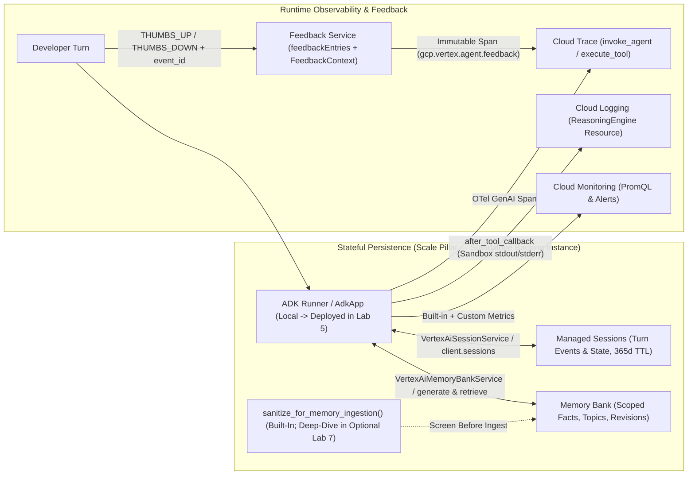

# Lab 3: Managed Sessions, Memory Bank, Feedback Service & Runtime Telemetry

> **Pillar:** Scale (Stateful Persistence, Long-Term Memory, Feedback & Observability)  
> **Duration:** 40 minutes (Full-Day Track) | 15 minutes (Half-Day Fast-Track — Instructor Live Demo & Code Walkthrough)  
> **Antigravity Skill Companion:** [`.agents/skills/agent-platform-runtime-and-state/SKILL.md`](../.agents/skills/agent-platform-runtime-and-state/SKILL.md) *(complements the built-in `google-agents-cli-observability` skill)*  
> **Files You Will Inspect & Edit:** [`starter/coding_agent/memory/session_manager.py`](../starter/coding_agent/memory/session_manager.py), [`starter/coding_agent/memory/memory_bank_manager.py`](../starter/coding_agent/memory/memory_bank_manager.py), [`starter/coding_agent/callbacks/telemetry_and_feedback.py`](../starter/coding_agent/callbacks/telemetry_and_feedback.py), [`starter/coding_agent/agent.py`](../starter/coding_agent/agent.py)  
> **Previous Lab:** [Lab 2: Custom Sandbox (BYOC), Lifecycle & Execution](./02-LAB-CUSTOM-SANDBOX-BYOC.md) | **Next Lab:** [Lab 4: Extend with Skill Registry & Agent Registry](./04-LAB-SKILLS-AND-AGENT-REGISTRY.md)

---

## Learning Objectives

By the end of this lab, you will be able to:

1. Persist multi-turn conversation history and session state across requests using **Managed Sessions** (`VertexAiSessionService` in ADK and the direct `agentplatform` `client.sessions` API) backed by Lab 2's standalone Agent Platform instance.
2. Provision and customize a **Memory Bank** with managed and custom coding-convention topics, TTL policies, incremental memory generation (`generate_memories` / `ingest_events`), scope-based and similarity retrieval, and revision rollbacks (using the built-in `sanitize_for_memory_ingestion()` safeguard).
3. Instrument the Coding Agent with **OpenTelemetry (OTel) Tracing**, **structured Cloud Logging** (mitigating the Managed Sandbox `stdout`/`stderr` logging blind spot from parent runtime callbacks), and **Cloud Monitoring** baselines — smoke-tested locally here and ready to correlate live once deployed in Lab 5.
4. Capture structured end-user ratings via the **Feedback Service** (`THUMBS_UP` / `THUMBS_DOWN`, standard labels, and durable `FeedbackContext` snapshots) linked directly to Managed Sessions and Cloud Trace spans (`gcp.vertex.agent.event_id`).

---

## Quick-Run TL;DR (Classroom Fast Path)

- **Focused Exercises (High-Signal TODOs):** `session_manager.py` (`build_adk_session_service`, `create_session`), `memory_bank_manager.py` (`build_adk_memory_service`, `generate_memories_from_session`, `retrieve_similar_memories`), `telemetry_and_feedback.py` (`after_tool_callback`, `submit_feedback`), and `agent.py` (`_build_optional_callbacks`) — *(CRUD & sanitizer helpers pre-filled!)*
- **Key Commands (Zero Local Docker — Reuses Lab 2 Standalone Instance in `asia-southeast1`):**
  ```bash
  (cd starter && uv run python -m coding_agent.memory.session_manager --offline-check)
  (cd starter && uv run python -m coding_agent.memory.memory_bank_manager --offline-check)
  (cd starter && uv run python -m coding_agent.callbacks.telemetry_and_feedback --offline-check)
  make verify-lab LAB=3
  ```
- **Antigravity AI-Assisted Mode (`.agents/skills/agent-platform-runtime-and-state`):** *"Using `agent-platform-runtime-and-state`, complete the `# TODO(lab-3)` functions across `session_manager.py`, `memory_bank_manager.py`, `telemetry_and_feedback.py`, and `agent.py` with `VertexAiSessionService`, Memory Bank similarity retrieval, and parent-runtime sandbox `stdout` logging."*
- **Fell Behind? Instant Catch-Up:** `make fast-forward LAB=3` *(syncs only Lab 3 without spoiling Labs 4–8 TODOs).*

---

## Half-Day Fast-Track Path (15-Minute Instructor Live Demo & Walkthrough)

In the **3.5-hour Half-Day Fast-Track**, Lab 3 is delivered as a **15-minute instructor-led live demo and code walkthrough** (no attendee coding required) so the room stays on schedule for hands-on Labs 4, 5, and 8:
- Watch the instructor run the verified reference demos from [`solution/coding_agent/memory/`](../solution/coding_agent/memory/) (`session_manager.py`, `memory_bank_manager.py`) and [`solution/coding_agent/callbacks/telemetry_and_feedback.py`](../solution/coding_agent/callbacks/telemetry_and_feedback.py) showing Managed Sessions, Memory Bank similarity retrieval, parent-runtime sandbox `stdout`/`stderr` structured logging, and Cloud Trace–linked `THUMBS_UP` feedback.
- *(Optional fast-forward if you want live Lab 3 state wired into your `starter/` before Lab 4)*: run **`make fast-forward LAB=3`** from the repository root *(syncs only Lab 3 into `starter/` without spoiling Labs 4–8 TODOs; see [FACILITATOR-GUIDE.md](./FACILITATOR-GUIDE.md#52-hard-cutover-checkpoints-when-to-switch-from-starter-to-solution) for full track cutover options)*.

---

## Architecture Overview



### Comparing the Three State & Signal Stores

| Store | Primary Purpose | Default TTL | Key Quotas (per project/region) | Cloud Logging Support |
|---|---|---|---|---|
| **Managed Sessions** | Per-conversation turn history, `state_delta`, and `raw_event` interoperability | **365 days** (configurable via `ttl` / `expire_time`) | **100** writes/min; **300** event appends/min | Parent runtime only *(not child Session APIs)* |
| **Memory Bank** | Extracted, consolidated long-term facts across sessions (e.g., repo coding standards) | **None** by default (revisions default **365 days**) | **100** writes/min; **300** reads/retrieves/min | Parent runtime only *(not child Memory Bank APIs)* |
| **Feedback Service** | Structured user ratings (`THUMBS_UP`/`THUMBS_DOWN`), labels, and durable `FeedbackContext` transcripts | Retained until deleted (exports **immutable** Trace span) | Uses Reasoning Engine control plane (`roles/aiplatform.user`) | Linked directly to **Cloud Trace** (`gcp.vertex.agent.event_id`) |

---

## Prerequisites & Mandatory Environment Flags

Ensure your environment variables (including Lab 2's lightweight standalone `REASONING_ENGINE_NAME` / `REASONING_ENGINE_ID`) and packages are set before running Lab 3 code:

```bash
source .env
export GOOGLE_GENAI_USE_ENTERPRISE="TRUE"   # MANDATORY for Feedback Service & ADK enterprise features
export GOOGLE_CLOUD_PROJECT="${GOOGLE_CLOUD_PROJECT}"
export GOOGLE_CLOUD_LOCATION="${GOOGLE_CLOUD_LOCATION:-asia-southeast1}"  # Singapore — nearest supported Agent Platform region
```

Verify required APIs are enabled:

```bash
gcloud services enable \
  aiplatform.googleapis.com \
  telemetry.googleapis.com \
  logging.googleapis.com \
  monitoring.googleapis.com \
  cloudtrace.googleapis.com \
  --project="${GOOGLE_CLOUD_PROJECT}"
```

> [!NOTE]
> **Reusing Lab 2's Standalone `REASONING_ENGINE_NAME` (Zero Code Deploy Required):**
> - Per the official [Managed Sessions](https://docs.cloud.google.com/gemini-enterprise-agent-platform/scale/sessions) and [Memory Bank](https://docs.cloud.google.com/gemini-enterprise-agent-platform/scale/memory-bank) documentation, both services run **standalone** on an empty parent `reasoningEngines` instance (`client.runtimes.create()` — ~3 seconds, **zero agent code deployment** required!). Reuse the `REASONING_ENGINE_NAME` you created in [Lab 2](./02-LAB-CUSTOM-SANDBOX-BYOC.md) right here (or create one if you haven't yet via `client.runtimes.create(config={"display_name": "Workshop State Store"})`).
> - **Telemetry & Feedback Lifecycle:** In Lab 3 you wire and smoke-test your OTel callbacks (`before_tool_callback` / `after_tool_callback`) and `FeedbackClient` against your local agent and standalone instance; they automatically correlate with live Cloud Trace spans, Cloud Logging, and Online Evaluation Monitors once you deploy the complete agent in [Lab 5](./05-LAB-DEPLOY-RUNTIME-TERRAFORM.md) and evaluate it in [Lab 6](./06-LAB-OPTIMIZE-EVAL-AND-ALERTS.md).
> - **Locations & Enterprise Encryption:** In our Bangkok/Singapore regional topology, Managed Sessions, Memory Bank, Feedback Service, and Agent Runtime all run cleanly in **Singapore (`GOOGLE_CLOUD_LOCATION=asia-southeast1`)** — all officially live with zero restrictions (not yet launched in Bangkok `asia-southeast3`). Sessions and Memory Bank also support multi-region (`us`, `eu`) and `global` *(exception: Memory Bank is NOT available in `asia-southeast2`, `australia-southeast2`, or `northamerica-northeast2`)*. For CMEK and VPC-SC hardening, see [Lab 7 (Optional): Enterprise Security & Governance Hardening](./07-LAB-OPTIONAL-SECURITY-AND-GOVERNANCE.md).

---

## Part A: Managed Sessions (`starter/coding_agent/memory/session_manager.py`)

Open [`starter/coding_agent/memory/session_manager.py`](../starter/coding_agent/memory/session_manager.py). Across Parts A–C, Lab 3 focuses on **8 high-signal `# TODO(lab-3)` functions** (2 in `session_manager.py`, 3 in `memory_bank_manager.py`, 2 in `telemetry_and_feedback.py`, and 1 in `agent.py`). Here in Part A, complete the **2 `# TODO(lab-3)` functions** — **`build_adk_session_service()`** and **`SessionLifecycleManager.create_session()`** — while the remaining CRUD/event helpers (`get_session()`, `list_sessions()`, `append_event()`/`append_text_event()`/`append_raw_event()`, `list_events()`, `delete_session()`) are **pre-filled**.

### Step A1: Implement `build_adk_session_service()` (ADK `VertexAiSessionService`)

ADK's `VertexAiSessionService` seamlessly persists conversation turns and `state_delta` updates into Managed Sessions while falling back to `InMemorySessionService` during offline local development:

```python
from google.adk.sessions import BaseSessionService, InMemorySessionService, VertexAiSessionService


def build_adk_session_service(
    project_id: str | None,
    location: str,
    agent_engine_id: str | None,
) -> BaseSessionService:
    """Return VertexAiSessionService when configured, else InMemorySessionService."""
    if project_id and agent_engine_id:
        return VertexAiSessionService(
            project=project_id,
            location=location,
            agent_engine_id=agent_engine_id,
        )
    return InMemorySessionService()
```

#### Key ADK Managed Sessions Rules & Gotchas

- **ID Limits:** `user_id` max **128 characters**. Custom `session_id`: if starting with a letter, up to **63 chars** `[a-z0-9-]` ending with a letter/digit; if starting with a digit, up to **9 chars** `[0-9]` with no leading zeros.
- **State Updates Outside the Runner:** Mutate persisted session state cleanly by appending a system `Event` with `EventActions(state_delta=...)`:

  ```python
  import time
  from google.adk.events import Event, EventActions

  state_event = Event(
      invocation_id="inv-repo-context-1",
      author="system",
      actions=EventActions(state_delta={"active_repo": "payments-service", "test_cmd": "pytest -q"}),
      timestamp=time.time(),
  )
  await session_service.append_event(session, state_event)
  ```

- **`adk web` Shell Gotcha:** When inspecting Managed Sessions locally with `adk web --session_service_uri=agentengine://${REASONING_ENGINE_ID}`, `adk web` **ignores `.env`** when `--session_service_uri` is set — always export `GOOGLE_CLOUD_PROJECT` and `GOOGLE_CLOUD_LOCATION` in your shell first!

> [!TIP]
> **Combining Agent Platform Services with Custom Enterprise Stores (Lab 1 Service Registration):**
> While this workshop uses Google-managed `VertexAiSessionService` and `VertexAiMemoryBankService` (invoked via `agentengine://`), teams migrating from existing internal databases or custom A2A task stores can plug in custom URI schemes (`mysession://`, `mymemory://`, `myartifact://`, `mytaskstore://`) using Lab 1's **ADK Python 2.0+ [Service Registration](https://adk.dev/agents/service-registration/)** templates ([`starter/services.yaml`](../starter/services.yaml) and [`starter/services.py`](../starter/services.py)). Remember that `services.py` overrides `services.yaml` on duplicate schemes, and per the [ADK 2.0 compatibility guide](https://adk.dev/2.0/), rigid custom SQL `BaseSessionService` schemas must add columns for ADK 2.0's `node_info` and `output` `Event` fields (JSON-blob stores require no schema changes).

### Step A2: Implement `SessionLifecycleManager.create_session()` (Direct `agentplatform` SDK)

For backend orchestrators, non-ADK microservices, or custom audit tooling, `SessionLifecycleManager` wraps `agentplatform.Client.sessions` directly. Complete `# TODO(lab-3)` in **`create_session()`** (`get_session()`, `list_sessions()`, `append_event()`, `list_events()`, and `delete_session()` are **pre-filled** and shown below for reference):

```python
import datetime
import agentplatform


class SessionLifecycleManager:
    def __init__(self, project_id: str, location: str, runtime_name: str) -> None:
        self._client = agentplatform.Client(project=project_id, location=location)
        self._runtime_name = runtime_name

    def create_session(
        self,
        user_id: str,
        session_id: str | None = None,
        ttl_days: int = 10,
    ) -> str:
        """Create a managed session and return its canonical resource name."""
        kwargs = {
            "name": self._runtime_name,
            "user_id": user_id,
            "config": {"ttl": f"{ttl_days * 24 * 60 * 60}s"},
        }
        if session_id:
            kwargs["session_id"] = session_id

        session_op = self._client.sessions.create(**kwargs)
        # Verified SDK gotcha: some SDK flows return an LRO (.response.name),
        # while others return the Session object directly (.name). Handle both!
        return session_op.response.name if hasattr(session_op, "response") else session_op.name

    def get_session(self, session_name: str, user_id: str):
        return self._client.sessions.get(name=session_name, user_id=user_id)

    def list_sessions(self, user_id: str) -> list:
        # Note: SDK defaults to create_time desc and does not expose order_by;
        # use REST GET .../sessions?orderBy=update_time for custom sort orders.
        return list(
            self._client.sessions.list(
                name=self._runtime_name,
                config={"filter": f"user_id={user_id}"},
            )
        )

    def append_text_event(
        self,
        session_name: str,
        author: str,
        invocation_id: str,
        text: str,
        role: str = "user",
    ):
        return self._client.sessions.events.append(
            name=session_name,
            author=author,
            invocation_id=invocation_id,
            timestamp=datetime.datetime.now(tz=datetime.UTC),
            config={"content": {"role": role, "parts": [{"text": text}]}},
        )

    def append_raw_event(
        self,
        session_name: str,
        author: str,
        invocation_id: str,
        raw_payload: dict,
    ):
        # Useful for cross-framework interoperability and preserving raw_event.id for Feedback linking
        return self._client.sessions.events.append(
            name=session_name,
            author=author,
            invocation_id=invocation_id,
            timestamp=datetime.datetime.now(tz=datetime.UTC),
            config={"raw_event": raw_payload},
        )

    def list_events(self, session_name: str) -> list:
        return list(self._client.sessions.events.list(name=session_name))

    def delete_session(self, session_name: str) -> None:
        self._client.sessions.delete(name=session_name)
```

> [!NOTE]
> **Verified Upstream Doc Bugs to Avoid:**
> 1. One ADK Managed Sessions doc snippet writes `client.runtimes.update(resource_name=...)` — the verified parameter name across the SDK is **`name=`**.
> 2. The REST tab for "Append an event to a session" in `sessions/manage-with-api` accidentally copy-pastes the `POST .../sessions` create payload — use `client.sessions.events.append(...)` in Python.

> [!NOTE]
> **Multi-Tenant Isolation, CMEK & VPC-SC (Optional Lab 7):** For multi-tenant `sessionUserId` IAM Conditions (`roles/aiplatform.sessionViewer` / `sessionEditor` / `sessionUser`), `ListSessions` proxy limits, and CMEK/VPC-SC encryption controls, see [Lab 7 (Optional): Enterprise Security & Governance Hardening](./07-LAB-OPTIONAL-SECURITY-AND-GOVERNANCE.md).

### Step A3: Test Managed Sessions via CLI Demo

```bash
cd starter
uv run python -m coding_agent.memory.session_manager --user-id workshop-dev --demo
```

---

## Part B: Memory Bank (`starter/coding_agent/memory/memory_bank_manager.py`)

Managed Sessions store *what happened in one chat*; **Memory Bank** distills and consolidates *what the Coding Agent should remember across future chats* (such as `"Always run pytest -q and ruff check before opening a PR"`).

Open [`starter/coding_agent/memory/memory_bank_manager.py`](../starter/coding_agent/memory/memory_bank_manager.py). Complete the **3 focused `# TODO(lab-3)` functions** here — **`build_adk_memory_service()`**, **`MemoryBankManager.generate_memories_from_session()`**, and **`MemoryBankManager.retrieve_similar_memories()`** — while the defense-in-depth sanitizer/ingestion helpers (`inspect_for_memory_poisoning()`, `sanitize_for_memory_ingestion()`, `filter_and_sanitize_events_for_memory()`, `persist_turn_to_memory_callback()`) and config/CRUD/revision/purge helpers (`create_memory_bank()`, `configure_memory_bank()`, `generate_memories_from_text()`, `retrieve_scope_memories()`, `list_revisions()`, `rollback_memory()`, `delete_memory()`, `purge_user_memories()`) are **pre-filled**.

### Step B1: Review Pre-Filled Memory Bank Topics, Models, Few-Shots & TTL

Key platform defaults and rules already wired into the pre-filled `MemoryBankManager.configure_memory_bank(...)` and `build_managed_semantic_memory_config(...)` helpers:
- **Generation LLM Default:** **`gemini-3.5-flash`** (effective June 29, 2026; older instances default to `gemini-2.5-flash`).
- **Embedding Model Default:** **`text-embedding-005`** (multilingual option: `gemini-embedding-2`, which ONLY accepts `global`, `us`, or `eu` in its model resource name — **NOT** regional paths like `asia-southeast1` or `us-central1`). **Critical:** The embedding model can **only be changed before storing the first memory**!
- **Verified SDK Config Key Divergence:**
  - `client.memory_banks.create(managed_semantic_memory_config={...})` uses **`"unstructured_memory_configs"`** and `"granular_ttl"` / `"memory_revision_default_ttl"`.
  - `client.runtimes.update(name=..., config={"context_spec": {"memory_bank_config": {...}}})` uses **`"customization_configs"`** (instead of `"unstructured_memory_configs"`).

```python
managed_semantic_memory_config = {
    "generation_config": {
        "model": f"projects/{project_id}/locations/global/publishers/google/models/gemini-3.5-flash"
    },
    "similarity_search_config": {
        "embedding_model": f"projects/{project_id}/locations/{location}/publishers/google/models/text-embedding-005"  # e.g., asia-southeast1 (Singapore)
    },
    "ttl_config": {
        "granular_ttl": {
            "create_ttl": f"{90 * 24 * 60 * 60}s",
            "generate_created_ttl": f"{90 * 24 * 60 * 60}s",
            "generate_updated_ttl": f"{90 * 24 * 60 * 60}s",
        },
        "memory_revision_default_ttl": f"{365 * 24 * 60 * 60}s",
    },
    "unstructured_memory_configs": [
        {
            "scope_keys": ["user_id"],
            "memory_topics": [
                {"managed_memory_topic": {"managed_topic_enum": "USER_PREFERENCES"}},
                {"managed_memory_topic": {"managed_topic_enum": "KEY_CONVERSATION_DETAILS"}},
                {"managed_memory_topic": {"managed_topic_enum": "EXPLICIT_INSTRUCTIONS"}},
                {
                    "custom_memory_topic": {
                        "label": "coding_conventions",
                        "description": (
                            "User-stated repository coding standards, test commands, "
                            "linting rules, and architectural constraints."
                        ),
                    }
                },
            ],
            "enable_third_person_memories": False,
            "generate_memories_examples": [
                {
                    "conversationSource": {
                        "events": [
                            {
                                "content": {
                                    "role": "user",
                                    "parts": [{"text": "Always run pytest -q and ruff check before committing."}],
                                }
                            }
                        ]
                    },
                    "generatedMemories": [
                        {"fact": "I prefer running pytest -q and ruff check before committing changes."}
                    ],
                },
                # Negative example (empty list) suppresses noisy conversational chitchat
                {
                    "conversationSource": {
                        "events": [
                            {"content": {"role": "user", "parts": [{"text": "Thanks, looks good!"}]}}
                        ]
                    },
                    "generatedMemories": [],
                },
            ],
        }
    ],
    "disable_memory_revisions": False,
}
```

### Step B2: Wire ADK `VertexAiMemoryBankService` & Retrieval Tools

1. Implement `build_adk_memory_service()`:

   ```python
   from google.adk.memory import BaseMemoryService, InMemoryMemoryService, VertexAiMemoryBankService


   def build_adk_memory_service(
       project_id: str | None,
       location: str,
       agent_engine_id: str | None,
   ) -> BaseMemoryService:
       if project_id and agent_engine_id:
           return VertexAiMemoryBankService(
               project=project_id,
               location=location,
               agent_engine_id=agent_engine_id,
           )
       return InMemoryMemoryService()
   ```

   - `VertexAiMemoryBankService` automatically scopes memories to `{"user_id": USER_ID, "app_name": APP_NAME}`.
   - In [`starter/coding_agent/memory/memory_bank_manager.py`](../starter/coding_agent/memory/memory_bank_manager.py), **`inspect_for_memory_poisoning()`**, **`sanitize_for_memory_ingestion()`**, **`filter_and_sanitize_events_for_memory()`**, and **`persist_turn_to_memory_callback()`** are **pre-filled out of the box** (zero `# TODO(lab-3)` stubs to complete — poisoned events are dropped without mutating live `session.events`). In Step C5, you will attach **`PreloadMemoryTool()`** (auto-injects relevant memories on every turn) or **`LoadMemoryTool()`** (model decides when to query memory) and wire the pre-filled `persist_turn_to_memory_callback` as `after_agent_callback` inside `_build_optional_callbacks()` in [`starter/coding_agent/agent.py`](../starter/coding_agent/agent.py):

   ```python
   from google.adk.agents.callback_context import CallbackContext


   async def persist_turn_to_memory_callback(
       callback_context: CallbackContext,
       *,
       wait_for_completion: bool = True,
       max_events: int = 5,
       sanitize: bool = True,
   ) -> None:
       events = getattr(callback_context.session, "events", None)
       if not events:
           return None

       # Guard against memory poisoning & secret leakage without mutating live session.events
       recent_events = list(events[-max_events:])
       if sanitize:
           recent_events = filter_and_sanitize_events_for_memory(recent_events)
       if not recent_events:
           return None

       # Uses streaming IngestEvents under the hood.
       # Omit wait_for_completion in production for low-latency async ingestion!
       if wait_for_completion:
           await callback_context.add_events_to_memory(
               events=recent_events,
               custom_metadata={"wait_for_completion": True},
           )
       else:
           await callback_context.add_events_to_memory(events=recent_events)
       return None
   ```

   > [!TIP]
   > **Pairing Multi-Regional (`us`/`eu`) or `global` Memory Bank with Regional (`asia-southeast1`) Agent Runtime:** Keep Memory Bank collocated in Singapore (`asia-southeast1`) for lowest latency, or pass a `memory_service_builder` callable to `AdkApp(agent=root_agent, memory_service_builder=...)` returning `VertexAiMemoryBankService(project=..., location="global", agent_engine_id=MEMORY_BANK_ID)` when sharing long-term memories across regions.

### Step B3: Implement `generate_memories_from_session()` & `retrieve_similar_memories()` (Plus Pre-Filled Helpers)

Complete the **2 `# TODO(lab-3)` methods** in `MemoryBankManager` — **`generate_memories_from_session()`** (via `vertex_session_source`) and **`retrieve_similar_memories()`** (via `similarity_search_params` + `resp.page`). The companion helpers shown below (`generate_memories_from_text`, `retrieve_scope_memories`, `list_revisions`, `rollback_memory`, and `purge_user_memories`) are **pre-filled** for reference and exercised by `--demo`:

- **Scope Rules:** Maximum **5 key-value pairs**, **no `*` characters**, immutable once created. Consolidation and retrieval match **exact scope** (key order does not matter).
- **Multimodal & Tool-Call Rule:** `memories.generate` extracts facts from text, `inline_data`, and `file_data` (images/audio/video), while **function calls and function responses are ignored**.
- **Avoid Direct `memories.create()` for Conversation Facts:** `memories.create()` bypasses extraction and consolidation and can introduce duplicate or conflicting memories — prefer `memories.generate()` or streaming `client.memory_banks.ingest_events(...)` (which buffers by `(scope, stream_id)`, deduplicates by `event_id`, auto-flushes after 24h, and uses `idle_duration` / `fixed_interval` multiples of 60s; note default merge strategy in `ingest_events` is `OVERWRITE` vs `MERGE` in `generate`).

```python
# 1. Generate memories from a Managed Session or inline direct_contents_source
def generate_memories_from_text(
    self,
    user_id: str,
    utterances: list[str],
    wait_for_completion: bool = True,
):
    sanitized = [self.sanitize_for_memory_ingestion(text) for text in utterances]
    events = [
        {"content": {"role": "user", "parts": [{"text": text}]}}
        for text in sanitized
        if text
    ]
    return self._client.memory_banks.memories.generate(
        name=self._memory_bank_name,
        direct_contents_source={"events": events},
        scope={"user_id": user_id},
        config={
            "wait_for_completion": wait_for_completion,  # Use False in production
            "metadata": {"source_app": {"string_value": "coding-agent"}},
            "metadata_merge_strategy": "MERGE",
            "allowed_topics": [
                {"managed_memory_topic": "USER_PREFERENCES"},
                {"custom_memory_topic_label": "coding_conventions"},
            ],
        },
    )


# 2. Scope-based Similarity Search (sorted by ascending Euclidean distance; default top_k=3)
def retrieve_similar_memories(self, user_id: str, query: str, top_k: int = 3) -> list[dict]:
    resp = self._client.memory_banks.memories.retrieve(
        name=self._memory_bank_name,
        scope={"user_id": user_id},
        similarity_search_params={"search_query": query, "top_k": top_k},
    )
    # Always read .page rather than eager list() on large collections
    return [
        {"distance": item.distance, "name": item.memory.name, "fact": item.memory.fact}
        for item in resp.page
    ]


# 3. Scope-based Full Retrieval with Metadata DNF filter_groups + EBNF filter
def retrieve_scope_memories(self, user_id: str, topic_label: str = "coding_conventions") -> list[dict]:
    resp = self._client.memory_banks.memories.retrieve(
        name=self._memory_bank_name,
        scope={"user_id": user_id},
        config={
            "filter_groups": [
                {"filters": [{"key": "source_app", "value": {"string_value": "coding-agent"}}]}
            ],
            "filter": f"topics.custom_memory_topic_label: {topic_label}",
        },
    )
    return [{"name": item.memory.name, "fact": item.memory.fact} for item in resp.page]


# 4. Revisions, Rollback & Dry-Run Purge
def list_revisions(self, memory_name: str) -> list:
    # Deleted memories retain revisions for up to 48 hours for forensic audit or rollback!
    return list(self._client.memory_banks.memories.revisions.list(name=memory_name))


def rollback_memory(self, memory_name: str, target_revision_id: str):
    return self._client.memory_banks.memories.rollback(
        name=memory_name,
        target_revision_id=target_revision_id,
    )


def purge_user_memories(self, user_id: str, force: bool = False) -> int:
    # force=False performs a dry-run returning purge_count without deleting
    op = self._client.memory_banks.memories.purge(
        name=self._memory_bank_name,
        filter=f'scope.user_id="{user_id}"',
        force=force,
        config={"wait_for_completion": True},
    )
    return getattr(op.response, "purge_count", 0)
```

> [!WARNING]
> **Cleanup Timing Gotcha:** Deleting a parent runtime or Memory Bank instance immediately after a turn can fail with `FAILED_PRECONDITION` while asynchronous memory generation finishes. Wait ~60 seconds and retry.

Run the Memory Bank CLI demo (or validate locally without GCP calls using `--offline-check`):

```bash
cd starter
uv run python -m coding_agent.memory.memory_bank_manager --offline-check
uv run python -m coding_agent.memory.memory_bank_manager --user-id workshop-dev --demo
```

> [!NOTE]
> **Memory Poisoning Defense, IAM Conditions & CMEK/VPC-SC (Optional Lab 7):** `sanitize_for_memory_ingestion()` is included out of the box in `memory_bank_manager.py` to keep Lab 3 fast and safe. For the full deep-dive on Memory Poisoning defense (Model Armor + red-teaming), exact-casing `aiplatform.googleapis.com/memoryScope` IAM Conditions, and CMEK/VPC-SC, see [Lab 7 (Optional): Enterprise Security & Governance Hardening](./07-LAB-OPTIONAL-SECURITY-AND-GOVERNANCE.md).

---

## Part C: OTel Tracing, Structured Logging, Monitoring & Feedback (`starter/coding_agent/callbacks/telemetry_and_feedback.py`)

Open [`starter/coding_agent/callbacks/telemetry_and_feedback.py`](../starter/coding_agent/callbacks/telemetry_and_feedback.py). Complete the **2 focused `# TODO(lab-3)` hooks** here — **`after_tool_callback()`** and **`FeedbackClient.submit_feedback()`** — while `build_reasoning_engine_logger()`, `before_tool_callback()`, `attach_context_snapshot()`, `get_context_snapshot()`, and `list_session_feedback()` are **pre-filled**. In Step C5, you will complete the 8th `# TODO(lab-3)` function, **`_build_optional_callbacks()`** in [`starter/coding_agent/agent.py`](../starter/coding_agent/agent.py).

### Step C1: OpenTelemetry (OTel) Tracing Configuration

Configure these **three** OpenTelemetry environment variables in `.env` (and inject them into your Terraform Agent Runtime deployment in [Lab 5](./05-LAB-DEPLOY-RUNTIME-TERRAFORM.md)):

```bash
GOOGLE_CLOUD_AGENT_ENGINE_ENABLE_TELEMETRY="true"
OTEL_SEMCONV_STABILITY_OPT_IN="gen_ai_latest_experimental"
OTEL_INSTRUMENTATION_GENAI_CAPTURE_MESSAGE_CONTENT="EVENT_ONLY"
```

> [!CAUTION]
> **Critical ADK Python OTel Gotchas:**
> 1. **Enum Values Only (Python vs. Go):** In ADK Python, `OTEL_INSTRUMENTATION_GENAI_CAPTURE_MESSAGE_CONTENT` accepts ONLY `NO_CONTENT`, `EVENT_ONLY`, `SPAN_ONLY`, or `SPAN_AND_EVENT`. Passing `"true"` is invalid and silently falls back to `NO_CONTENT`! *(In ADK Go, the opposite applies: boolean `"1"` / `"true"` only.)*
> 2. **Version Cutoffs:** Capturing `user.id` requires **ADK `>= 2.1`** (effective May 22, 2026); native OTel GenAI metrics require **ADK `>= 2.6.0`**.
> 3. **ADK Span Hierarchy:** Traces emit `invoke_workflow` -> `invoke_agent` -> `call_llm` (`generate_content`) and `execute_tool`.

### Step C2: Mitigating the Sandbox Logging Blind Spot with Structured Cloud Logging

> [!IMPORTANT]
> **Critical Platform Limitation (`scale/runtime/logging`):** Cloud Logging is bound to the `aiplatform.googleapis.com/ReasoningEngine` monitored resource (`reasoning_engine_stdout`, `reasoning_engine_stderr`, `reasoning_engine_build`) and is **NOT supported for child resources** — meaning Managed Sandbox `stdout`/`stderr`, Sessions, and Memory Bank do **not** auto-stream logs to Cloud Logging!

To preserve forensic auditability for every command executed inside a Managed Sandbox, `build_reasoning_engine_logger()` and `before_tool_callback()` are **pre-filled** in `starter/coding_agent/callbacks/telemetry_and_feedback.py`; implement `# TODO(lab-3)` in **`after_tool_callback()`** so the **parent Agent Runtime** emits structured JSON logs and OTel span attributes:

```python
import os
import time
import google.cloud.logging
from opentelemetry import trace


def build_reasoning_engine_logger(project_id: str, location: str, log_id: str = "coding-agent-tools"):
    logging_client = google.cloud.logging.Client(project=project_id)
    resource = google.cloud.logging.Resource(
        type="aiplatform.googleapis.com/ReasoningEngine",
        labels={
            "location": location,
            "resource_container": project_id,
            "reasoning_engine_id": os.environ.get("GOOGLE_CLOUD_AGENT_ENGINE_ID", "local-dev"),
        },
    )
    return logging_client.logger(name=log_id, resource=resource)
```

Inside `after_tool_callback`:
1. Compute `duration_ms` from the start timestamp stored in `tool_context.state` by `before_tool_callback`.
2. Attach OTel attributes (`coding_agent.tool.name`, `coding_agent.tool.duration_ms`, `coding_agent.sandbox.exit_code`) to `trace.get_current_span()`.
3. Call `logger.log_struct({...}, severity="INFO" if exit_code == 0 else "WARNING")` with truncated, secret-redacted `stdout` / `stderr` previews so sandbox execution outputs appear cleanly in Cloud Logging under `resource.type="aiplatform.googleapis.com/ReasoningEngine"`.

Query your structured logs from Cloud Logging *(live entries populate as soon as you deploy the runtime in [Lab 5](./05-LAB-DEPLOY-RUNTIME-TERRAFORM.md); smoke-test the callbacks locally now with `--offline-check` in Step C5)*:

```bash
gcloud logging read \
  'resource.type="aiplatform.googleapis.com/ReasoningEngine" AND resource.labels.reasoning_engine_id="'"${REASONING_ENGINE_ID}"'"' \
  --project="${GOOGLE_CLOUD_PROJECT}" \
  --limit=20 \
  --format="table(timestamp,severity,jsonPayload.event,jsonPayload.tool_name,jsonPayload.exit_code)"
```

*(HTTP access logs on Agent Runtime filter by endpoint: `POST /api/reasoning_engine`, `POST /api/stream_reasoning_engine`, `POST /api/bidi_reasoning_engine`.)*

### Step C3: Cloud Monitoring — Built-in Metrics, PromQL & Custom Metrics

Inspect the built-in **Agent Runtime Overview** dashboard (requires `roles/monitoring.viewer`, populated once deployed in [Lab 5](./05-LAB-DEPLOY-RUNTIME-TERRAFORM.md)) or query metrics in **Cloud Monitoring -> Metrics Explorer**:

- **Built-in Metrics (`aiplatform.googleapis.com/ReasoningEngine`):**
  - `aiplatform.googleapis.com/reasoning_engine/request_count` (`DELTA`, `INT64`; labels `response_code`, `response_code_class`)
  - `aiplatform.googleapis.com/reasoning_engine/request_latencies`
  - `aiplatform.googleapis.com/reasoning_engine/cpu/allocation_time`
  - `aiplatform.googleapis.com/reasoning_engine/memory/allocation_time`
  - Plus OTel GenAI semantic convention metrics when `GOOGLE_CLOUD_AGENT_ENGINE_ENABLE_TELEMETRY=true` on **ADK `>= 2.6.0`**.

- **Verified PromQL 500 Error-Rate Query (copy into Metrics Explorer -> PromQL tab):**

  ```promql
  sum_over_time(sum(rate(aiplatform_googleapis_com:reasoning_engine_request_count{monitored_resource='aiplatform.googleapis.com/ReasoningEngine', reasoning_engine_id='RESOURCE_ID', response_code='500'}[10m]))[10m:10m])
  /
  sum_over_time(sum(rate(aiplatform_googleapis_com:reasoning_engine_request_count{monitored_resource='aiplatform.googleapis.com/ReasoningEngine', reasoning_engine_id='RESOURCE_ID'}[10m]))[10m:10m])
  ```

- **Custom Metrics Monitored Resource Rule:**
  - **Log-based metrics** (e.g., `Logging/user/tool_calling_count` counting sandbox tool calls from your structured logs) stay attached to `aiplatform.googleapis.com/ReasoningEngine`.
  - **User-defined custom metrics** (e.g., `custom.googleapis.com/token_count`, `CUMULATIVE`, `INT64`) **MUST** use `monitoredResourceTypes: ["generic_node"]` — Cloud Monitoring rejects `aiplatform.googleapis.com/ReasoningEngine` for user-defined custom metric descriptors!
- **Recommended Latency Alert Baseline:** `Request Latency` (`aiplatform.googleapis.com/reasoning_engine/request_latencies`), `5min` rolling window, **99th percentile**, threshold **`5000ms`**. (In Lab 6, we extend alerting to **evaluation quality drops**!)

### Step C4: Implement `FeedbackClient.submit_feedback()` Linked to Sessions & Cloud Trace

Complete `# TODO(lab-3)` in **`FeedbackClient.submit_feedback()`** inside [`starter/coding_agent/callbacks/telemetry_and_feedback.py`](../starter/coding_agent/callbacks/telemetry_and_feedback.py) (`attach_context_snapshot()`, `get_context_snapshot()`, and `list_session_feedback()` are **pre-filled**) so end-user ratings attach directly to sessions and Cloud Trace spans:

- **IAM Role:** `roles/aiplatform.user` (the Reasoning Engine Service Agent already has access).
- **Trace & Console UI Linking Rule:** The `event_id` parameter **MUST** match the OTel span attribute **`gcp.vertex.agent.event_id`** (the UUID on the `generate_content` / `execute_tool` span, or `raw_event.id` in Managed Sessions) for the feedback badge to render in Console **Traces -> Sessions view / Traces view**.
- **Feedback Types:** `"THUMBS_UP"`, `"THUMBS_DOWN"`, `"FEEDBACK_TYPE_UNSPECIFIED"`.
- **Standard Labels:**
  - Positive: `accurate`, `complete`, `helpful`, `on_topic`, `fast`, `safe`, `factual`, `tool_success`
  - Negative: `inaccurate`, `incomplete`, `unhelpful`, `off_topic`, `too_slow`, `unsafe`, `hallucination`, `tool_error`

```python
import os
import agentplatform


class FeedbackClient:
    def __init__(self, project_id: str, location: str, runtime_name: str) -> None:
        os.environ["GOOGLE_GENAI_USE_ENTERPRISE"] = "TRUE"
        self._client = agentplatform.Client(project=project_id, location=location)
        self._runtime_name = runtime_name

    def submit_feedback(
        self,
        session_id: str,
        event_id: str,
        feedback_type: str,
        feedback_text: str,
        feedback_labels: list[str],
        user_id: str,
        source: str = "Workshop IDE",
        custom_metadata: dict[str, str] | None = None,
    ) -> str:
        """Create a feedback entry linked to session_id + gcp.vertex.agent.event_id."""
        op = self._client.feedback_entries.create(
            name=self._runtime_name,
            session_id=session_id,
            event_id=event_id,
            feedback_type=feedback_type,
            config={
                "feedback_text": feedback_text,
                "feedback_labels": feedback_labels,
                "user_id": user_id,
                "source": source,
                "custom_metadata": custom_metadata or {},
            },
        )
        return op.response.name  # .../feedbackEntries/FEEDBACK_ENTRY_ID

    def attach_context_snapshot(self, entry_name: str, context_events: list[dict]):
        """Preserve transcript context even if the original Managed Session expires."""
        # VERIFIED SDK PATH QUIRK:
        #   feedback_contexts.update() takes `name=entry_name` (.../feedbackEntries/ID),
        #   whereas feedback_contexts.get() takes `name=f"{entry_name}/feedbackContext"`.
        return self._client.feedback_entries.feedback_contexts.update(
            name=entry_name,
            context_events=context_events,
        )

    def get_context_snapshot(self, entry_name: str):
        return self._client.feedback_entries.feedback_contexts.get(
            name=f"{entry_name}/feedbackContext"
        )

    def list_session_feedback(self, session_id: str) -> list:
        return list(
            self._client.feedback_entries.list(
                name=self._runtime_name,
                config={
                    "filter": f'session_id="{session_id}"',
                    "order_by": "create_time desc",
                },
            )
        )
```

> [!NOTE]
> **Immutable Trace Spans & Duplicate Submissions:**
> - Creating a feedback entry exports an **immutable** Cloud Trace span `gcp.vertex.agent.feedback` (with attributes `gcp.vertex.agent.feedback.type`, `gen_ai.conversation_id`, `gcp.vertex.agent.event_id`, `gcp.vertex.agent.feedback.entry.name`, `gcp.vertex.agent.feedback.labels`). Updating or deleting the feedback entry later does **not** alter already-exported spans.
> - If multiple feedback entries are submitted for the same `(session_id, event_id)`, the Console UI displays only the **last received** entry.
> - Deleting a feedback entry automatically deletes its child `FeedbackContext`.

### Step C5: Wire Lab 3 Callbacks & Memory Tool into `starter/coding_agent/agent.py`

Open [`starter/coding_agent/agent.py`](../starter/coding_agent/agent.py) and complete `# TODO(lab-3)` inside `_build_optional_callbacks()` (compare with [`solution/coding_agent/agent.py`](../solution/coding_agent/agent.py)):
1. When `settings.enable_telemetry_callbacks` is `True`, attach `before_tool_callback` and `after_tool_callback` from `coding_agent.callbacks.telemetry_and_feedback`.
2. When `settings.enable_memory_bank` is `True`, append `PreloadMemoryTool()` to `callbacks["extra_tools"]` and wire `persist_turn_to_memory_callback` as `callbacks["after_agent_callback"]`.

You can run offline smoke checks on `session_manager` and `telemetry_and_feedback` directly (`cd starter && uv run python -m coding_agent.memory.session_manager --offline-check` and `uv run python -m coding_agent.callbacks.telemetry_and_feedback --offline-check`). Once you deploy your complete agent in [Lab 5](./05-LAB-DEPLOY-RUNTIME-TERRAFORM.md), these callbacks and `FeedbackClient` automatically correlate with live Cloud Trace spans and [Lab 6](./06-LAB-OPTIMIZE-EVAL-AND-ALERTS.md) Online Evaluation Monitors!

---

## Lab 3 Verification Checkpoint

Run the automated Lab 3 verification script:

```bash
./scripts/verify_lab.sh 3
# Or via Makefile:
# make verify-lab LAB=3
```

Expected pass criteria:
1. Zero `# TODO(lab-3)` markers remain in `starter/coding_agent/memory/session_manager.py`, `starter/coding_agent/memory/memory_bank_manager.py`, `starter/coding_agent/callbacks/telemetry_and_feedback.py`, and `starter/coding_agent/agent.py`.
2. All Python modules compile cleanly (`python3 -m py_compile`) and pass local unit/smoke checks (including the built-in `sanitize_for_memory_ingestion()` helper, `VertexAiSessionService` / `VertexAiMemoryBankService` builders, and telemetry callbacks).
3. *(Live GCP check)* A round-trip session event, Memory Bank similarity retrieval, structured sandbox log smoke check, and linked `THUMBS_UP` feedback entry succeed against your standalone `REASONING_ENGINE_NAME` (and correlate with live Cloud Trace spans once deployed in Lab 5).

Need a clean reference? Compare your code against [`solution/coding_agent/memory/`](../solution/coding_agent/memory/), [`solution/coding_agent/callbacks/telemetry_and_feedback.py`](../solution/coding_agent/callbacks/telemetry_and_feedback.py), and [`solution/coding_agent/agent.py`](../solution/coding_agent/agent.py).

---

## Next Lab

Your Coding Agent now persists conversations across turns, remembers developer coding conventions in Memory Bank, and captures sandbox telemetry and feedback. Next, add reusable domain skills and dynamic MCP/A2A discovery locally before deploying once in Lab 5. Continue to **[Lab 4: Extend with Skill Registry & Agent Registry](./04-LAB-SKILLS-AND-AGENT-REGISTRY.md)**.

---

## Canonical Reference Links

- **Managed Sessions Overview:** https://docs.cloud.google.com/gemini-enterprise-agent-platform/scale/sessions
  - Manage Sessions with ADK: https://docs.cloud.google.com/gemini-enterprise-agent-platform/scale/sessions/manage-with-adk
  - Manage Sessions with Direct API: https://docs.cloud.google.com/gemini-enterprise-agent-platform/scale/sessions/manage-with-api
  - Sessions IAM Conditions: https://docs.cloud.google.com/gemini-enterprise-agent-platform/scale/sessions/iam-conditions
- **Memory Bank Overview:** https://docs.cloud.google.com/gemini-enterprise-agent-platform/scale/memory-bank
  - Setup & Customization: https://docs.cloud.google.com/gemini-enterprise-agent-platform/scale/memory-bank/setup
  - Use Memory Bank with ADK: https://docs.cloud.google.com/gemini-enterprise-agent-platform/scale/memory-bank/use-with-adk
  - ADK Quickstart: https://docs.cloud.google.com/gemini-enterprise-agent-platform/scale/memory-bank/adk-quickstart
  - Direct API Quickstart: https://docs.cloud.google.com/gemini-enterprise-agent-platform/scale/memory-bank/api-quickstart
  - Generate Memories: https://docs.cloud.google.com/gemini-enterprise-agent-platform/scale/memory-bank/generate-memories
  - Fetch & Retrieve Memories: https://docs.cloud.google.com/gemini-enterprise-agent-platform/scale/memory-bank/fetch-memories
  - Streaming Event Ingestion: https://docs.cloud.google.com/gemini-enterprise-agent-platform/scale/memory-bank/ingest-events
  - Memory Revisions & Rollback: https://docs.cloud.google.com/gemini-enterprise-agent-platform/scale/memory-bank/revisions
  - Memory Bank IAM Conditions: https://docs.cloud.google.com/gemini-enterprise-agent-platform/scale/memory-bank/iam-conditions
- **Feedback Service Overview:** https://docs.cloud.google.com/gemini-enterprise-agent-platform/scale/feedback-service
  - Manage Feedback with SDK/API: https://docs.cloud.google.com/gemini-enterprise-agent-platform/scale/feedback-service/manage-with-sdk-or-api
  - View Feedback in UI: https://docs.cloud.google.com/gemini-enterprise-agent-platform/scale/feedback-service/view-with-ui
- **Agent Runtime Tracing:** https://docs.cloud.google.com/gemini-enterprise-agent-platform/scale/runtime/tracing
- **Agent Runtime Logging:** https://docs.cloud.google.com/gemini-enterprise-agent-platform/scale/runtime/logging
- **Agent Runtime Monitoring:** https://docs.cloud.google.com/gemini-enterprise-agent-platform/scale/runtime/monitoring
