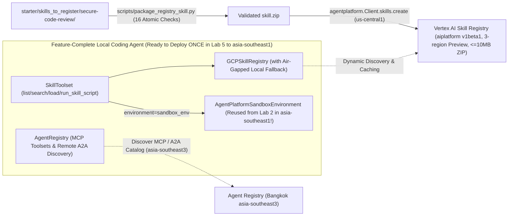

# Lab 4: Extend with Skill Registry & Agent Registry

> **Pillar:** Build & Extend (Vertex AI Skill Registry, Dynamic ADK `SkillToolset` & `AgentRegistry` MCP/A2A Discovery)  
> **Duration:** 40 minutes (Full-Day Track) | 30 minutes (Half-Day Fast-Track)  
> **Antigravity Skill Companion:** [`.agents/skills/agent-platform-governance-and-registries/SKILL.md`](../.agents/skills/agent-platform-governance-and-registries/SKILL.md) *(complements the built-in `google-agents-cli-publish` skill)*  
> **Files You Will Inspect & Edit:** [`starter/skills_to_register/secure-code-review/SKILL.md`](../starter/skills_to_register/secure-code-review/SKILL.md), [`starter/coding_agent/tools/registry_loader.py`](../starter/coding_agent/tools/registry_loader.py), [`starter/coding_agent/agent.py`](../starter/coding_agent/agent.py)  
> **Previous Lab:** [Lab 3: Managed Sessions, Memory Bank, Feedback Service & Runtime Telemetry](./03-LAB-SESSIONS-MEMORY-FEEDBACK.md) | **Next Lab:** [Lab 5: Deploy & Manage the Complete Coding Agent on Agent Runtime (CLI & Terraform)](./05-LAB-DEPLOY-RUNTIME-TERRAFORM.md)

---

## Learning Objectives

By the end of this lab, you will be able to:

1. Validate and package an enterprise coding skill (`starter/skills_to_register/secure-code-review/`) with `scripts/package_registry_skill.py` against **all 16 atomic Google Cloud Skill Registry ZIP and `SKILL.md` validation rules** prior to upload.
2. Publish `secure-code-review` to **Vertex AI Skill Registry (`aiplatform.googleapis.com/v1beta1`)**, handle the built-in `gcp-skill-registry` first-call async ingestion quirk, and verify semantic skill retrieval.
3. Implement `# TODO(lab-4)` in [`starter/coding_agent/tools/registry_loader.py`](../starter/coding_agent/tools/registry_loader.py) and [`starter/coding_agent/agent.py`](../starter/coding_agent/agent.py) to dynamically load skills via **`GCPSkillRegistry` + `SkillToolset(environment=sandbox_env)`** (reusing Lab 2's BYOC Managed Sandbox with air-gapped local fallback) and discover MCP servers & remote A2A agents via **`AgentRegistry`** (`google-adk[a2a,agent-identity,mcp]`).

---

## Quick-Run TL;DR (Classroom Fast Path)

- **Focused Exercises (High-Signal TODOs):** `registry_loader.py` (`build_skill_registry_toolset`, `build_agent_registry_integrations`, `create_skill`) and `agent.py` (`_build_optional_skill_toolset`) — *(search/list/update/auth helpers pre-filled!)*
- **Key Commands (Zero Local Docker — `us-central1` Skill Registry + `asia-southeast3` Agent Registry):**
  ```bash
  make package-skill                                        # Validates all 16 atomic Skill Registry ZIP/SKILL.md checks -> dist/secure-code-review.zip
  (cd starter && uv run python -m coding_agent.tools.registry_loader offline-check)
  (cd starter && uv run python -m coding_agent.tools.registry_loader list-skills --warmup)
  make verify-lab LAB=4
  ```
- **Antigravity AI-Assisted Mode (`.agents/skills/agent-platform-governance-and-registries`):** *"Using `agent-platform-governance-and-registries`, complete `# TODO(lab-4)` in `registry_loader.py` and `agent.py` to wire `GCPSkillRegistry` + `SkillToolset(environment=sandbox_env)` with air-gapped fallback and `AgentRegistry` MCP/A2A discovery."*
- **Fell Behind? Instant Catch-Up:** `make fast-forward LAB=4` *(syncs only Lab 4 without spoiling Labs 5–8 TODOs).*

---

## Half-Day Fast-Track Path (30 Minutes)

If you are running on the **3.5-hour Half-Day Fast-Track**, Lab 4 is already streamlined as a pure developer extensibility flow:
- Complete **Part A** (validate all 16 atomic checks and package `secure-code-review` via `make package-skill`).
- Complete **Part B** (publish to Vertex AI Skill Registry `v1beta1`, observe the `gcp-skill-registry` second-call quirk, and test semantic retrieval).
- Complete **Part C** (implement `# TODO(lab-4)` in `starter/coding_agent/tools/registry_loader.py` and `starter/coding_agent/agent.py`), then run `./scripts/verify_lab.sh 4`.

---

## Architecture Overview



> [!NOTE]
> **Verified Multi-Region Split — Vertex AI Skill Registry (`us-central1`) vs. Agent Registry (`asia-southeast3` Bangkok):**
> - **Vertex AI / Agent Platform Skill Registry (`aiplatform.googleapis.com/v1beta1`, Part B):** Developer-facing skill catalog via `agentplatform.Client.skills.*` (`<= 10 MB` ZIP, `<= 500 MB` unzipped; includes built-in `gcp-skill-registry`). Preview is **strictly 3 regions: `us-central1`, `europe-west4`, and `us-east5`** (not yet in `asia-southeast3` or `asia-southeast1`), so keep **`SKILL_REGISTRY_LOCATION=us-central1`** explicitly in `.env` while running Agent Runtime & Sandboxes in Singapore (`asia-southeast1`).
> - **Agent Registry Discovery & Standalone Skills (`agentregistry.googleapis.com`, Part C & Optional Lab 7):** Supports **`AGENT_REGISTRY_LOCATION=asia-southeast3` (Bangkok!)** directly for MCP server/A2A catalog discovery (`AgentRegistry` in Part C) and enterprise standalone skill governance (`gcloud agent-registry skills ...` adding automatic `private-*` prefixing, `<= 1 MB` ZIP limits, automated LLM security scanning `ENABLED_BLOCKING`, `Finding` triage, lifecycle states, and Custom Org Policies — see [Lab 7 (Optional): Enterprise Security & Governance Hardening](./07-LAB-OPTIONAL-SECURITY-AND-GOVERNANCE.md)).

---

## Part A: Validate & Package `secure-code-review` (`scripts/package_registry_skill.py`)

### Step A1: Inspect the Enterprise Skill Package

Examine the starter skill files your Coding Agent will load on demand when auditing pull requests:
- [`starter/skills_to_register/secure-code-review/SKILL.md`](../starter/skills_to_register/secure-code-review/SKILL.md)
- [`starter/skills_to_register/secure-code-review/references/owasp-checklist.md`](../starter/skills_to_register/secure-code-review/references/owasp-checklist.md)

### Step A2: Complete Skill Registry ZIP & `SKILL.md` Validation Checklist

Skill Registry validates uploaded ZIP payloads **asynchronously** during `CreateSkill` / `UpdateSkill` long-running operations (LROs). Catching violations locally before upload saves minutes of failed LRO debugging.

> [!NOTE]
> **Exact Validation Scope (16 Atomic Checks):** The official `build/skill-registry` documentation presents **12 top-level bullets**, where bullet #11 expands into **5 individual `SKILL.md` frontmatter and body checks** — **16 atomic validation checks** in total (11 ZIP-level + 5 `SKILL.md`-level). `scripts/package_registry_skill.py` enforces **every single one of these 16 atomic checks** locally before emitting a `.zip`!

| # | Scope | Validation Rule Enforced by Skill Registry & `package_registry_skill.py` |
|---|---|---|
| 1 | ZIP | Valid, non-corrupt ZIP archive with complete header metadata |
| 2 | ZIP | Archive is **not empty** |
| 3 | ZIP | Contains **at most 10,000 items** |
| 4 | ZIP | No file or folder name contains `..` (path traversal) or starts with `/` or `\` |
| 5 | ZIP | Contains **zero symbolic links** |
| 6 | ZIP | Contains **zero duplicate file or folder names** |
| 7 | ZIP | Total unzipped size **<= 500 MB** *(note: keep **<= 10 MB** total and **<= 1 MB** per file for Agent Registry scanning compatibility)* |
| 8 | ZIP | Compression ratio **<= 100** (zip-bomb protection) |
| 9 | ZIP | Directory nesting depth **<= 8 levels** |
| 10 | ZIP | Contains a **`SKILL.md`** file *(place directly at ZIP root for Agent Registry compatibility)* |
| 11 | ZIP | Compressed ZIP archive size **<= 10 MB** *(keep **<= 1 MB** for Agent Registry compatibility)* |
| 12 | `SKILL.md` | Contains valid **YAML frontmatter** AND non-empty **Markdown instruction body** |
| 13 | `SKILL.md` | Frontmatter **`name`**: required, **<= 64 chars**, lowercase `a-z`, digits `0-9`, hyphens `-` only; cannot start or end with `-` *(ADK local loader also rejects consecutive `--` and requires parent folder name == `name`)* |
| 14 | `SKILL.md` | Frontmatter **`description`**: required and **<= 1,024 chars** |
| 15 | `SKILL.md` | Frontmatter **`license`** (if present): **<= 1,024 chars** |
| 16 | `SKILL.md` | Markdown instruction body: **<= 500,000 chars** |

### Step A3: Run Pre-Upload Validation & Build the Archive

```bash
# 1. Dry-run validation against all rules (zero output written)
python3 scripts/package_registry_skill.py starter/skills_to_register/secure-code-review --dry-run

# 2. Build the validated skill ZIP into a local build directory (or run via Makefile)
make package-skill
```

Confirm all validation checks pass (`0 errors`) and note the generated `.zip` path (for example, `dist/secure-code-review.zip`).

---

## Part B: Publish to Vertex AI Skill Registry & Verify Semantic Retrieval

### Step B1: Publish `secure-code-review` to Vertex AI Skill Registry (`aiplatform.googleapis.com/v1beta1`)

Set your Skill Registry override region explicitly to **`us-central1`** (Vertex AI Skill Registry Preview is **strictly 3 regions**: `us-central1`, `europe-west4`, or `us-east5` — it is not yet launched in Bangkok `asia-southeast3` or Singapore `asia-southeast1`):

```bash
source .env
export SKILL_REGISTRY_LOCATION="${SKILL_REGISTRY_LOCATION:-us-central1}"
export SKILL_ID="secure-code-review"
```

> [!CAUTION]
> **Two Critical Skill Registry Quirks:**
> 1. **Built-in `gcp-skill-registry` First-Call Ingestion Quirk:** The Skill Registry begins ingesting the built-in `gcp-skill-registry` skill asynchronously **on your very first API call** to the service. Consequently, **your first `list()` response will NOT include `gcp-skill-registry`** — issue a **second** `list()` call to see it appear! Built-in `gcp-*` skills cannot be deleted.
> 2. **`SKILL_ID` Immutability & Reuse Lockout:** `SKILL_ID` (1–63 chars `[a-z0-9-]`, starts with a letter, ends with letter/digit, cannot start with `gcp-`) becomes the skill's folder name when attached to an agent. Official docs warn that deleting a skill reserves its `SKILL_ID` for **at least 24 hours** (and Create docs warn permanently reserved) — **never delete and immediately recreate with the same `SKILL_ID` during a workshop!** (If you need a fresh ID during testing, append a suffix like `secure-code-review-v2`.)

Publish and inspect via Python (`agentplatform.Client.skills`, provided by `google-cloud-aiplatform`):

```python
import os
import agentplatform

client = agentplatform.Client(
    project=os.environ["GOOGLE_CLOUD_PROJECT"],
    location=os.environ.get("SKILL_REGISTRY_LOCATION", "us-central1"),
)

# 1. Trigger first-call listing (initiates async ingestion of built-in gcp-skill-registry)
first_list = [s.name for s in client.skills.list()]
print("Call #1 skills (gcp-skill-registry not yet present on first project call):", first_list)

# 2. Upload validated skill
# SDK version note:
#   google-cloud-aiplatform >= 1.154.0 accepts skill_id as a top-level argument.
#   google-cloud-aiplatform < 1.154.0 passes {"skill_id": ..., "local_path": ...} inside config={}.
skill = client.skills.create(
    skill_id="secure-code-review",
    display_name="Secure Code Review",
    description="Enterprise OWASP static security audit checklist for Python and TypeScript PRs.",
    config={"local_path": "starter/skills_to_register/secure-code-review"},
)
print("Created skill:", skill.name)

# 3. Second list call — built-in gcp-skill-registry now appears alongside your skill
second_list = [s.name for s in client.skills.list()]
print("Call #2 skills:", second_list)

# 4. Semantic retrieval check
retrieved = client.skills.retrieve(query="audit Python code for OWASP injection flaws", config={"top_k": 3})
for item in retrieved.retrieved_skills:
    print(item.skill_name, "->", item.description)
```

*(Equivalent REST `v1beta1` upload: `POST https://${SKILL_REGISTRY_LOCATION}-aiplatform.googleapis.com/v1beta1/projects/${GOOGLE_CLOUD_PROJECT}/locations/${SKILL_REGISTRY_LOCATION}/skills?skillId=${SKILL_ID}` with JSON body `{"displayName": "...", "description": "...", "zippedFilesystem": "$(base64 -w 0 -i dist/secure-code-review.zip)"}`, then poll the returned LRO via `GET .../operations/OPERATION_ID`. Read-only IAM role: `roles/aiplatform.viewer`.)*

### Step B2: Smoke-Test Semantic Retrieval via `registry_loader.py` CLI

Once you complete `SkillRegistryPublisher.create_skill()` in Part C below (`list_skills()`, `update_skill()`, and `search_skills()` are already pre-filled), you can publish, list (with `--warmup` for the `gcp-skill-registry` quirk), and search skills directly from the CLI:

```bash
cd starter
uv run python -m coding_agent.tools.registry_loader list-skills --warmup
uv run python -m coding_agent.tools.registry_loader search-skills \
  --query "audit Python code for OWASP injection flaws" \
  --top-k 3
```

> [!NOTE]
> **Agent Registry Standalone Skill Scanning (`ENABLED_BLOCKING`) & Lifecycle Governance (Optional Lab 7):** Ready to enforce automated LLM security scanning (`ENABLED_BLOCKING`), `Finding` triage, `private-*` revision promotion (`DRAFT` -> `ACTIVE` -> `DEPRECATED` -> `DECOMMISSIONED`), and Custom Org Policies blocking `scanningConfig.policy == "DISABLED"`? That enterprise governance workflow lives in [Lab 7 (Optional): Enterprise Security & Governance Hardening](./07-LAB-OPTIONAL-SECURITY-AND-GOVERNANCE.md).

---

## Part C: Dynamic ADK Consumption (`starter/coding_agent/tools/registry_loader.py`)

Open [`starter/coding_agent/tools/registry_loader.py`](../starter/coding_agent/tools/registry_loader.py) and complete the **3 `# TODO(lab-4)` functions**: **`build_skill_registry_toolset()`**, **`build_agent_registry_integrations()`**, and **`SkillRegistryPublisher.create_skill()`**. Supporting helpers — **`GoogleApiAuth.auth_flow()`**, **`list_skills()`**, **`update_skill()`**, and **`search_skills()`** — are **pre-filled** out of the box (and in Step C3 below you will also complete `_build_optional_skill_toolset()` in [`starter/coding_agent/agent.py`](../starter/coding_agent/agent.py)).

### Step C1: Mandatory ADK Extras (`ImportError` Trap!)

> [!CAUTION]
> **Mandatory Install Extra for `AgentRegistry`:** `google.adk.integrations.agent_registry` imports `a2a-sdk` and the Agent Identity auth provider at **module scope**. Importing `AgentRegistry` on bare `pip install google-adk` immediately raises **`ImportError`**! Always install:
> ```bash
> pip install --upgrade "google-adk[a2a,agent-identity,mcp]>=2.0.0"
> # Minimum required for AgentRegistry without MCP: "google-adk[a2a,agent-identity]>=2.0.0"
> ```

### Step C2: Implement `build_skill_registry_toolset()` (`GCPSkillRegistry` + `SkillToolset(environment=sandbox_env)`)

`SkillToolset` (ADK Python 2.0+) implements **3-level Progressive Disclosure** (L1 metadata -> L2 `SKILL.md` instructions via `load_skill` -> L3 `references/`/`assets/`/`scripts/` via `load_skill_resource` and `run_skill_script`), exposing up to 6 built-in tools: `list_skills`, `search_skills` (added when `registry=` is supplied), `load_skill`, `unload_skill`, `load_skill_resource`, and `run_skill_script`.

Key verified rules to implement in `build_skill_registry_toolset()`:
1. **Keyword-Only Constructor:** `GCPSkillRegistry(project_id=..., location=...)` (ADK Python 2.0+; falls back to `GOOGLE_CLOUD_PROJECT` / `GOOGLE_CLOUD_LOCATION` and raises `ValueError` if missing).
2. **Endpoint & Seamless Local Fallback:** Latest `google/adk-python` `main` (`gcp_skill_registry.py`) calls `https://agentregistry.googleapis.com/v1alpha` (overridable via `AGENT_REGISTRY_ENDPOINT`) and automatically strips `x-goog-*` headers across 302 GCS signed-URL redirects. Passing `local_skill_dirs=[...secure-code-review]` ensures `secure-code-review` is always available locally out of the box (and automatically pulls remote Agent Registry revisions once promoted in [Lab 7 (Optional)](./07-LAB-OPTIONAL-SECURITY-AND-GOVERNANCE.md)).
3. **Reuse Lab 2's BYOC Sandbox (`environment=sandbox_env`):** Passing your active `AgentPlatformSandboxEnvironment` from Lab 2 directly into `SkillToolset(environment=active_environment)` guarantees that `run_skill_script` executes inside the exact same gVisor-isolated BYOC sandbox as `EnvironmentToolset`!
4. **Collision Prevention & Session Caching:** Local skills in `skills=[...]` automatically shadow registry skills with identical names; `load_skill` caches unpacked skill instructions in session state (`_adk_activated_skill_{agent_name}`).
5. **Mutual Exclusivity:** `SkillToolset` accepts **`environment=`** OR **`code_executor=`**, **never both** (passing both raises `ValueError`!).
6. **CRITICAL Sandbox Egress Fallback:** If your Coding Agent runs inside an isolated network or air-gapped sandbox without outbound HTTPS egress to Google APIs, remote registry calls fail — wrap `GCPSkillRegistry` initialization so the toolset gracefully falls back to locally bundled skills (`load_skill_from_dir(...)`)!

```python
import logging
from pathlib import Path
from google.adk.environment import BaseEnvironment
from google.adk.skills import load_skill_from_dir
from google.adk.tools.skill_toolset import (
    SkillDiscoveryMode,
    SkillLifecycleConfig,
    SkillLifecycleMode,
    SkillToolset,
)

logger = logging.getLogger(__name__)


def build_skill_registry_toolset(
    project_id: str | None,
    location: str | None,
    local_skill_dirs: list[Path] | None = None,
    environment: BaseEnvironment | None = None,
    enable_remote_registry: bool = True,
) -> SkillToolset:
    """Build SkillToolset backed by GCPSkillRegistry with offline sandbox fallback."""
    local_skills = [load_skill_from_dir(d) for d in (local_skill_dirs or []) if d.exists()]
    registry = None

    if enable_remote_registry and project_id and location:
        try:
            from google.adk.integrations.skill_registry import GCPSkillRegistry

            registry = GCPSkillRegistry(project_id=project_id, location=location)
        except Exception as exc:
            # Isolated sandboxes without outbound Google API egress fall back to local skills
            logger.warning("GCPSkillRegistry unavailable (%s); falling back to local skills only.", exc)

    return SkillToolset(
        skills=local_skills,
        registry=registry,
        environment=environment,  # Do NOT also pass code_executor= (mutually exclusive!)
        discovery_mode=SkillDiscoveryMode.LAZY,
        lifecycle_config=SkillLifecycleConfig(
            default_mode=SkillLifecycleMode.BOUNDED,
            max_active_skills=5,
        ),
    )
```

### Step C3: Implement `build_agent_registry_integrations()` (`AgentRegistry` in Bangkok `asia-southeast3` + Auth Providers)

`AgentRegistry` (ADK Python 2.0+) discovers registered A2A sub-agents, MCP servers, and endpoints in your primary Bangkok region (**`AGENT_REGISTRY_LOCATION=asia-southeast3`**) using either short relative names (`"agents/AGENT_ID"`, `"mcpServers/SERVER_ID"`) or full resource names. Wire all **three verified authentication patterns** cleanly:

```python
import google.auth
import httpx
from google.auth.transport.requests import Request
from google.adk.auth.credential_manager import CredentialManager
from google.adk.integrations.agent_identity import GcpAuthProvider
from google.adk.integrations.agent_registry import AgentRegistry


class GoogleApiAuth(httpx.Auth):
    """OAuth 2.0 Bearer + X-Goog-User-Project auth for *.googleapis.com A2A endpoints."""

    def __init__(self, quota_project_id: str) -> None:
        self._quota_project_id = quota_project_id
        self._creds, _ = google.auth.default(
            scopes=["https://www.googleapis.com/auth/cloud-platform"]
        )

    def auth_flow(self, request: httpx.Request):
        if not self._creds.valid:
            self._creds.refresh(Request())
        request.headers["Authorization"] = f"Bearer {self._creds.token}"
        request.headers["X-Goog-User-Project"] = self._quota_project_id
        yield request


def build_agent_registry_integrations(
    project_id: str,
    location: str = "asia-southeast3",  # Bangkok primary region (AGENT_REGISTRY_LOCATION)
    mcp_server_name: str | None = None,
    remote_a2a_agent_name: str | None = None,
    continue_uri: str | None = None,
    header_provider=None,
) -> dict:
    """Register GcpAuthProvider and resolve governed MCP toolsets / remote A2A agents."""
    # Pattern 1: Register Auth Manager provider for 2LO, API Key & 3LO bindings.
    # On Agent Runtime, AgentRegistry automatically re-resolves bindings via
    # bindings:fetchAvailable and strips deployer credentials on pickle!
    CredentialManager.register_auth_provider(GcpAuthProvider())

    registry = AgentRegistry(
        project_id=project_id,
        location=location,
        # Pattern 2: Custom MCP headers ONLY (never applied to RemoteA2aAgent!)
        header_provider=header_provider,
    )

    result: dict = {"registry": registry, "mcp_toolset": None, "remote_agent": None}

    if mcp_server_name:
        # For 3LO user-delegated consent, pass continue_uri so clients handle adk_request_credential
        result["mcp_toolset"] = registry.get_mcp_toolset(
            mcp_server_name,
            continue_uri=continue_uri,
        )

    if remote_a2a_agent_name:
        # Pattern 3: httpx.Auth is required for RemoteA2aAgent without Auth Manager binding.
        # NOTE: For Cloud Run (*.run.app) or IAP A2A endpoints, attach an OIDC ID token
        # (google.oauth2.id_token.fetch_id_token(Request(), audience)), NOT an OAuth access token!
        httpx_client = httpx.AsyncClient(
            auth=GoogleApiAuth(project_id),
            timeout=httpx.Timeout(60.0),
        )
        result["remote_agent"] = registry.get_remote_a2a_agent(
            remote_a2a_agent_name,
            httpx_client=httpx_client,
            continue_uri=continue_uri,
        )

    return result
```

> [!WARNING]
> **Single-Parent Reuse Gotcha for `RemoteA2aAgent`:** An ADK `RemoteA2aAgent` instance can only have **one parent orchestrator** at a time. Fetch it once at startup and call **`remote_agent.clone()`** whenever attaching it to multiple `LlmAgent(sub_agents=[remote_agent.clone()])` instances!

Complete `# TODO(lab-4)` inside `_build_optional_skill_toolset()` in [`starter/coding_agent/agent.py`](../starter/coding_agent/agent.py) to wire your `build_skill_registry_toolset()` helper (when `ENABLE_SKILL_REGISTRY=true`) with `environment=active_environment` so the Coding Agent discovers `secure-code-review` dynamically on demand and executes any skill scripts inside Lab 2's sandbox.

Test your local fallback and Agent Registry catalog discovery offline/live:

```bash
cd starter
uv run python -m coding_agent.tools.registry_loader offline-check
# Optional live MCP/A2A catalog discovery against Agent Registry:
# uv run python -m coding_agent.tools.registry_loader discover-agent-registry
```

> [!NOTE]
> **Semantic Governance (NLC Policies), Model Armor & SPIFFE `AGENT_IDENTITY` (Optional Lab 7):** Want to enforce runtime Natural Language Constraints blocking unsafe `load_skill` / `run_skill_script` calls in tainted sessions, attach Model Armor filters, and upgrade from a Custom SA to immutable SPIFFE `AGENT_IDENTITY` + Agent Gateway? We keep Lab 4 friction-free for rapid developer iteration and cover the full enterprise governance stack in **[Lab 7 (Optional): Enterprise Security & Governance Hardening](./07-LAB-OPTIONAL-SECURITY-AND-GOVERNANCE.md)**!

---

> [!TIP]
> **Feature-Complete Milestone!** `coding_agent/` is now **100% feature-complete locally** (**ADK 2.0 + BYOC Sandbox + Sessions/Memory/Telemetry + Skills & Agent Registry**) — ready to package and deploy **ONCE** in Lab 5!

## Lab 4 Verification Checkpoint

Run both the Skill Registry package validator and the automated Lab 4 verifier:

```bash
python3 scripts/package_registry_skill.py starter/skills_to_register/secure-code-review --dry-run
./scripts/verify_lab.sh 4
# Or via Makefile:
# make verify-lab LAB=4
```

Expected pass criteria:
1. `starter/skills_to_register/secure-code-review/` passes all 16 atomic Skill Registry ZIP and `SKILL.md` validation rules (`0 errors`).
2. Zero `# TODO(lab-4)` markers remain in `starter/coding_agent/tools/registry_loader.py` and `starter/coding_agent/agent.py`, and Python AST + import checks pass (with `google-adk[a2a,agent-identity,mcp]` installed).
3. `build_skill_registry_toolset()` shares Lab 2's `environment=` cleanly and falls back to local skills when remote registry access is disabled/offline, and `build_agent_registry_integrations()` wires `GcpAuthProvider` + `GoogleApiAuth` (`X-Goog-User-Project`).
4. *(Live GCP check)* `secure-code-review` is published in Vertex AI Skill Registry (`v1beta1`), listed alongside built-in `gcp-skill-registry` on the second call, and returned by semantic retrieval.

Need a clean reference? Compare your code against [`solution/coding_agent/tools/registry_loader.py`](../solution/coding_agent/tools/registry_loader.py) and [`solution/coding_agent/agent.py`](../solution/coding_agent/agent.py).

---

## Next Lab

Your `coding_agent/` package is now 100% feature-complete locally across Labs 1–4. Time to build your trusted runtime container image once and ship the entire Coding Agent declaratively with Terraform! Continue to **[Lab 5: Deploy & Manage the Complete Coding Agent on Agent Runtime (CLI & Terraform)](./05-LAB-DEPLOY-RUNTIME-TERRAFORM.md)**.

---

## Canonical Reference Links

- **Vertex AI / Agent Platform Skill Registry Overview & Validation Rules:** https://docs.cloud.google.com/gemini-enterprise-agent-platform/build/skill-registry
  - Create & Manage Skills (Python, Node.js, REST): https://docs.cloud.google.com/gemini-enterprise-agent-platform/build/skill-registry/create-manage
- **Agent Registry Discovery & Auth:**
  - Agent Registry Overview & Setup: https://docs.cloud.google.com/agent-registry/overview
  - Skills Architecture: https://docs.cloud.google.com/agent-registry/skills-architecture
  - Authenticate ADK Toolsets & Auth Manager: https://docs.cloud.google.com/agent-registry/authenticate-toolsets
  - Resolve Endpoints & Orchestrators (`GoogleApiAuth` / OIDC / `.clone()`): https://docs.cloud.google.com/agent-registry/resolve-endpoints-and-build-orchestrators
- **ADK Integrations:**
  - ADK `SkillToolset`: https://adk.dev/skills/
  - ADK `GCPSkillRegistry`: https://adk.dev/integrations/skills-registry/
  - ADK `AgentRegistry`: https://adk.dev/integrations/agent-registry/
- **Enterprise Governance Deep-Dive (Agent Registry Scanning, NLC Semantic Governance, Model Armor & SPIFFE):** See [Lab 7 (Optional): Enterprise Security & Governance Hardening](./07-LAB-OPTIONAL-SECURITY-AND-GOVERNANCE.md).
