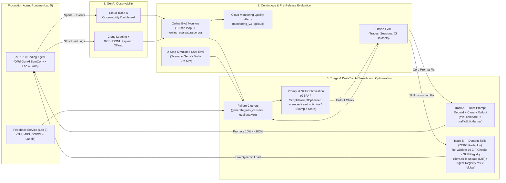

# Lab 6: Optimize Pillar — Observability, Offline/Simulated/Online Evaluation, Quality Alerts & Optimization Flywheel

> **Pillar:** Optimize (`Observability` → `Offline & Simulated Eval` → `Failure Clustering` → `Online Monitors & Quality Alerts` → `Prompt & Example Optimization`)  
> **Duration:** 40 minutes (Full-Day Track) | 15 minutes (Half-Day Fast-Track — Instructor Live Demo & Walkthrough)  
> **Antigravity Skill Companion:** [`.agents/skills/agent-platform-optimize-and-eval/SKILL.md`](../.agents/skills/agent-platform-optimize-and-eval/SKILL.md)  
> **Previous Lab:** [Lab 5: Deploy & Manage the Complete Coding Agent on Agent Runtime (CLI & Terraform)](./05-LAB-DEPLOY-RUNTIME-TERRAFORM.md) | **Next Lab:** [Lab 7 (Optional): Enterprise Security & Governance Hardening](./07-LAB-OPTIONAL-SECURITY-AND-GOVERNANCE.md) *(or skip directly to [Lab 8: Agent Runtime vs. Self-Hosted GKE](./08-ARCHITECTURE-AGENT-RUNTIME-VS-GKE.md))*  
> **Working Files:** [`starter/eval/`](../starter/eval/) | **Reference Solution:** [`solution/eval/`](../solution/eval/)

---

## Learning Objectives

By the end of this lab, you will close the production quality flywheel for your Coding Agent on **Gemini Enterprise Agent Platform**:

1. **Instrument & Inspect GenAI Observability** using OpenTelemetry GenAI Semantic Conventions (`v1.37.0+`), navigate the Observability Dashboard & Trace/Session views, and verify multimodal GCS payload offloading.
2. **Run Offline Evaluations** over traces, sessions, and canonical split single-turn and multi-turn JSON test suites (`starter/eval/run_offline_eval.py` and `agents-cli eval`), contrasting **trace vs. session** grading and applying predefined adaptive rubrics, multi-turn trajectory/tool metrics, and custom Python/LLM metrics.
3. **Run 2-Step Simulated User Evaluations** (`starter/eval/run_simulated_eval.py` and `agents-cli eval dataset synthesize`) to stress-test multi-turn debugging, tool errors, and prompt-injection refusal personas before touching production traffic.
4. **Diagnose Failure Clusters** using **Automatic Loss Analysis** in the Cloud Console (`view-results`), `vertexai.evals` (`client.evals.generate_loss_clusters`), and `agents-cli eval analyze` across the official 13-pattern Task Success and Tool Use taxonomies.
5. **Configure Online Evaluation Monitors & Quality Alerts** (`starter/eval/setup_online_monitor.py` and `starter/eval/setup_quality_alerts.py` via `google.cloud.monitoring_v3` and `gcloud monitoring policies create`) to catch production quality drift automatically.
6. **Close the Dual-Track Optimization Flywheel** (`starter/eval/optimize_prompt.py`, `adk optimize`, `agents-cli eval optimize`, and Example Store): promote **root prompt fixes** with a **canary traffic split** (`v1beta1` `trafficSplitManual`), and close the **domain skill loop** with **zero agent container rebuild** by hot-updating Vertex AI Skill Registry (`client.skills.update` with a skill directory path) or promoting an immutable **Agent Registry `rev-2` skill revision** (`gcloud alpha agent-registry skills update ... --default-revision` in `global`, with 1-command rollback to `rev-1`).

---

## Quick-Run TL;DR (Classroom Fast Path)

- **Focused Exercises (High-Signal TODOs):** `run_offline_eval.py` (`evaluate_split_datasets`, `run_loss_clustering`), `run_simulated_eval.py` (`generate_scenarios`, `run_user_simulation`), `setup_online_monitor.py` (`validate_otel_prerequisites`), `setup_quality_alerts.py` (`build_alert_policy_dict`), and `optimize_prompt.py` (`run_prompt_optimization`, `publish_updated_skill`) — *(client/metrics/feedback setup helpers pre-filled!)*
- **Key Commands (Zero Local Docker — `EVAL_LOCATION=global` + `asia-southeast1` Runtime):**
  ```bash
  make eval-offline                                         # Split single-turn & multi-turn JSON eval + global loss clustering
  make eval-simulated                                       # 2-step simulated user personas (--count 5 --max-turns 5)
  (cd starter && uv run python eval/setup_quality_alerts.py --dry-run && uv run python eval/optimize_prompt.py --iterations 2 --batch-size 4)
  make verify-lab LAB=6
  ```
- **Antigravity AI-Assisted Mode (`.agents/skills/agent-platform-optimize-and-eval`):** *"Using `agent-platform-optimize-and-eval`, implement the `# TODO(lab-6)` functions in `starter/eval/` keeping `EVAL_LOCATION=global` for `generate_loss_clusters`, strict single/multi-turn dataset separation, and `monitoring_v3` `online_evaluator/scores` alerts."*
- **Fell Behind? Instant Catch-Up:** `make fast-forward LAB=6` *(syncs only Lab 6 without spoiling Lab 8 TODOs).*

---

## Half-Day Fast-Track Path (15-Minute Instructor Live Demo & Walkthrough)

In the **3.5-hour Half-Day Fast-Track**, Lab 6 is delivered as a **15-minute instructor-led live demo and code walkthrough** (no attendee coding required) so the session reserves 25 full minutes for the [Lab 8](./08-ARCHITECTURE-AGENT-RUNTIME-VS-GKE.md) architecture briefing (skipping [Optional Lab 7](./07-LAB-OPTIONAL-SECURITY-AND-GOVERNANCE.md) cleanly):
- Watch the instructor showcase the pre-warmed **Online Evaluation Monitor** & **Observability Dashboard** (Part 1 & Part 5), run the split JSON offline evaluation (`coding_agent_single_turn.json` vs. `coding_agent_multi_turn.json`) and `global` loss-cluster analysis (Parts 2–4), inspect the `monitoring_v3` Quality Alert policy (Part 5.2), and preview a bounded `optimize_prompt.py` diff across both root prompts (canary rollout) and skills (zero-redeploy Skill Registry hot-update) in Part 6.
- All reference scripts remain available in [`solution/eval/`](../solution/eval/) for self-paced post-workshop execution.

---

## Architecture: The Production Optimize Flywheel



---

## Prerequisites & Environment Check

Before starting Lab 6, verify that:
- You completed [Lab 3](./03-LAB-SESSIONS-MEMORY-FEEDBACK.md) (OTel telemetry callbacks & Feedback Service), [Lab 4](./04-LAB-SKILLS-AND-AGENT-REGISTRY.md) (Skill Registry & Agent Registry), and [Lab 5](./05-LAB-DEPLOY-RUNTIME-TERRAFORM.md) (deployed Agent Runtime with telemetry enabled) — or switched to [`solution/`](../solution/).
- Your shell environment is loaded from `.env` (with `REASONING_ENGINE_NAME` pointing to your Lab 5 Terraform-deployed runtime for unified Trace + Online Eval correlation) and evaluation dependencies are installed:

```bash
set -a && source .env && set +a

# Verify required GCP APIs for OTel, Cloud Trace, Cloud Logging, GCS offload & Evaluation
gcloud services enable \
  aiplatform.googleapis.com \
  telemetry.googleapis.com \
  cloudtrace.googleapis.com \
  logging.googleapis.com \
  monitoring.googleapis.com \
  storage-component.googleapis.com \
  --project="${GOOGLE_CLOUD_PROJECT}"

# Install evaluation & monitoring Python extras (if not already synced via uv)
cd starter && uv sync
# Equivalent pip packages verified across docs:
# pip install "google-cloud-aiplatform[adk,evaluation]" google-cloud-monitoring "google-adk>=2.0.0"
```

> [!IMPORTANT]
> **Bangkok-First Regional Strategy — Why Eval Uses `EVAL_LOCATION=global` & Runtime Falls Back to `asia-southeast1`:**
> We default to **Bangkok (`asia-southeast3`)** wherever supported, fall back to **Singapore (`asia-southeast1`)** only for Agent Platform Runtime/Sandboxes (not yet launched in Bangkok), and use **`global`** here because Managed Gen AI Evaluation Service supports **14 US/EU regions + `global`**:
> - **US (7):** `us-central1`, `us-east1`, `us-east4`, `us-east5`, `us-south1`, `us-west1`, `us-west4`
> - **Europe (7):** `europe-central2`, `europe-north1`, `europe-southwest1`, `europe-west1`, `europe-west4`, `europe-west8`, `europe-west9`
> - **Global (1):** **`global`** *(GCP-mandated APAC-ready location AND default for `agents-cli eval run/grade/submit`; `generate_loss_clusters` / `agents-cli eval analyze` are **`global`-only**!)*
>
> Calling the evaluation service with `asia-southeast1` or `asia-southeast3` returns `400 FAILED_PRECONDITION: Unsupported region for Vertex Evaluation Service`. Keeping **`EVAL_LOCATION=global`** alongside **`GOOGLE_CLOUD_LOCATION=asia-southeast1`** in `.env` means:
> 1. Offline eval (`make eval-offline`), 2-step simulated user eval (`make eval-simulated`), and `generate_loss_clusters` all work seamlessly from APAC in the **same `global` client** with zero `Unsupported region` errors!
> 2. `setup_online_monitor.py --verify-runtime` inspects your deployed `ReasoningEngine` in **`GOOGLE_CLOUD_LOCATION=asia-southeast1`** (Singapore fallback) while validating evaluation configuration against **`EVAL_LOCATION=global`** — avoiding both "Unsupported region" and "ReasoningEngine not found in global" errors.
>
> *(If your organization has strict regional data residency outside these 14 regions + `global`, run local custom Python metrics — `custom_function`, `execution: local` — in `agents-cli eval` to grade in-process.)*

> [!NOTE]
> **SDK Namespace Migration (`agentplatform.Client` vs. `vertexai.Client`):**
> On `google-cloud-agentplatform==2.10.0` / `google-cloud-aiplatform==2.10.0`, instantiating legacy `vertexai.Client(...)` emits `FutureWarning: The vertexai.Client class is deprecated. Please use agentplatform.Client instead.` Prefer **`agentplatform.Client(project=..., location="global")`** (with a clean fallback to `vertexai.Client` only on older builds) for evaluation, runtime management, sandboxes, sessions, memory bank, and feedback alike.

---

## Part 1: GenAI OTel Observability, Dashboard Inspection & Multimodal GCS Offload (6 min)

### 1.1 Verify Mandatory OpenTelemetry GenAI Telemetry Signals

Both **Offline Evaluation of production traces/sessions** and **Online Evaluation Monitors** require your deployed agent to emit **OpenTelemetry Semantic Conventions for Generative AI (`v1.37.0+`)** signals:

1. **Invoke agent span attributes:**
   - `gen_ai.agent.name` — unique agent identifier
   - `gen_ai.agent.description` — brief summary of agent purpose
   - `gen_ai.conversation.id` — session identifier stitching multi-turn traces
2. **Inference event attributes** (`gen_ai.client.inference.operation.details`):
   - `gen_ai.input.messages` — user prompts
   - `gen_ai.output.messages` — generated agent responses
   - `gen_ai.system_instructions` — system prompt instructions
   - `gen_ai.tool.definitions` — declared tool schemas

Verify these three OpenTelemetry environment variables are set on your Agent Runtime deployment:

```python
env_vars = {
    # Traces, logs, and OTel GenAI metrics (requires ADK >= 2.6.0 for GenAI metrics)
    "GOOGLE_CLOUD_AGENT_ENGINE_ENABLE_TELEMETRY": "true",
    # Opt into OTel GenAI semantic conventions v1.37+
    "OTEL_SEMCONV_STABILITY_OPT_IN": "gen_ai_latest_experimental",
    # Capture prompts, responses & user.id as Cloud Logging events (ADK >= 2.1 for user.id effective May 22, 2026)
    "OTEL_INSTRUMENTATION_GENAI_CAPTURE_MESSAGE_CONTENT": "EVENT_ONLY",
}
```

> [!CAUTION]
> **ADK Python vs. ADK Go `OTEL_INSTRUMENTATION_GENAI_CAPTURE_MESSAGE_CONTENT` Gotcha:**
> - **ADK Python** accepts **enum strings ONLY**: `NO_CONTENT`, `EVENT_ONLY`, `SPAN_ONLY`, or `SPAN_AND_EVENT`. Passing `true` or `false` is invalid and silently falls back to `NO_CONTENT` (breaking Online Evaluation!).
> - **ADK Go** accepts **booleans ONLY** (`"1"` or `"true"`). Passing Python enum strings like `EVENT_ONLY` elides all prompt content.
> - Also note: if you deploy via `agents-cli infra single-project --apply`, Terraform enables GCS/BigQuery completion uploads (`OTEL_INSTRUMENTATION_GENAI_COMPLETION_HOOK=upload` + `LOGS_BUCKET_NAME`) independently of `OTEL_INSTRUMENTATION_GENAI_CAPTURE_MESSAGE_CONTENT` (which defaults to `NO_CONTENT`).

### 1.2 Inspect the Observability Dashboard & Trace Views

1. Open **Google Cloud Console** → **Agent Platform** → **Agent Registry** → select your Coding Agent → **Observability** tab (`https://console.cloud.google.com/agent-platform/agent-registry/agents`):
   - **Overview:** Active sessions, average turns, invocations, input/output token counts, traffic volume, p50/p95/p99 latency, and error rates.
   - **Evaluation:** Time-series scores emitted by Online Monitors (we will populate this in Part 5).
   - **Models:** Per-model p95 latency, call volume, error rates, quota failures (`429`), and token breakdown.
   - **Tools:** Per-tool p95 latency, call count, failure rate, and frequency of turns where no tool was called.
   - **Usage & Logs:** Container CPU/memory allocation alongside live `reasoning_engine_stdout`/`stderr` streams.
   - **Topology tab:** Dependency graph of inbound/outbound calls (note: MCP servers registered in Agent Registry are shared resources and do not display direct edges).
2. Click the **Traces** tab and toggle between all three views:
   - **Session view:** Multi-turn coding conversations grouped by `gen_ai.conversation.id` (left panel lists constituent traces).
   - **Trace view:** Single-request execution DAG showing the ADK span hierarchy:
     ```text
     invoke_workflow
       └── invoke_agent
             ├── call_llm
             │     └── generate_content
             └── execute_tool  (e.g., Execute / ReadFile / load_skill)
     ```
   - **Span view:** Individual span timings, tool arguments, and natively emitted **Model Armor** policy interception spans (requires zero custom instrumentation).
3. *(Optional)* Toggle telemetry settings directly from **Deployments → Telemetry configuration → Configure** (requires Vertex AI SDK `>= 1.126.1`).

### 1.3 Production Pattern: Multimodal / Large Payload GCS Offloading

For coding agents that inspect large repository diffs, logs, screenshots, or binary artifacts that exceed Cloud Logging entry size limits, offload prompt/response payloads to Cloud Storage as JSONL while keeping spans lean (`NO_CONTENT`):

```bash
# Optional production configuration (requires google-adk>=2.0.0,
# opentelemetry-instrumentation-google-genai>=0.4b0, and pinned fsspec[gcs]==2025.10.0)
OTEL_SEMCONV_STABILITY_OPT_IN='gen_ai_latest_experimental'
OTEL_INSTRUMENTATION_GENAI_UPLOAD_FORMAT='jsonl'
OTEL_INSTRUMENTATION_GENAI_COMPLETION_HOOK='upload'
OTEL_INSTRUMENTATION_GENAI_UPLOAD_BASE_PATH="gs://${EVAL_GCS_BUCKET}/otel-completions"
OTEL_INSTRUMENTATION_GENAI_CAPTURE_MESSAGE_CONTENT='NO_CONTENT'
GOOGLE_CLOUD_AGENT_ENGINE_ENABLE_TELEMETRY='true'
```

The Agent Platform Trace Details UI automatically stitches trace spans with `gen_ai.input.messages_ref`, `gen_ai.output.messages_ref`, and `gen_ai.system_instructions_ref` GCS pointers from `labels."event.name"="gen_ai.client.inference.operation.details"`. Grant the **agent runtime service account** `roles/storage.objectUser` on the bucket plus `roles/logging.logWriter`, `roles/monitoring.metricWriter`, and `roles/telemetry.tracesWriter` on the project; grant engineers viewing traces `roles/cloudtrace.user`, `roles/logging.viewer`, and `roles/storage.objectViewer`.

> [!NOTE]
> **SecOps Audit Retention, SIEM Export & Anomaly Detection (Optional Lab 7):** For tamper-evident WORM audit log buckets (`--locked`, 365–3,650d retention), dual-attributed `is_agentic=true` SIEM Pub/Sub export sinks, and out-of-band **Agent Anomaly Detection (`AGENT_SESSION_ANOMALY` → Security Command Center)**, see [Lab 7 (Optional): Enterprise Security & Governance Hardening](./07-LAB-OPTIONAL-SECURITY-AND-GOVERNANCE.md).

---

## Part 2: Offline Evaluation — Traces vs. Sessions, Split JSON Datasets & CI Gates (9 min)

### 2.1 Traces vs. Sessions & Choosing the Right Metrics

| Evaluation Target | Unit Graded | Best Used For | Required Metric Class |
|---|---|---|---|
| **Trace** | Single execution path (prompt → tool calls → response) | Latency/tool regressions, hallucination checks, single-turn coding tasks | Single-turn metrics (`FINAL_RESPONSE_QUALITY`, `TOOL_USE_QUALITY`, `HALLUCINATION`, `SAFETY`) |
| **Session** | Entire multi-turn user–agent conversation | Context retention, iterative debugging, multi-step goal completion | **ONLY** the 3 multi-turn metrics (`MULTI_TURN_TASK_SUCCESS`, `MULTI_TURN_TOOL_USE_QUALITY`, `MULTI_TURN_TRAJECTORY_QUALITY`) |

> [!CAUTION]
> **Multi-Turn HTTP 400 Trap:** Only the three **`multi_turn_*`** metrics accept multi-turn traces/sessions. Passing single-turn metrics like `final_response_quality` or `tool_use_quality` against multi-turn traces fails with **HTTP 400**. Likewise, `final_response_match` requires a ground-truth `reference`, `grounding` requires `context`, and `final_response_reference_free` requires `rubric_groups`.

#### Predefined Agent Metrics Reference

| Metric | Category | Python SDK (`vertexai.types.RubricMetric`) | `agents-cli` Metric Name | What It Grades |
|---|---|---|---|---|
| **Agent Final Response Quality** | Adaptive rubric *(recommended)* | `FINAL_RESPONSE_QUALITY` | `final_response_quality` | Dynamically generates pass/fail unit-test rubrics from instructions, tools & prompt. |
| **Agent Tool Use Quality** | Adaptive rubric | `TOOL_USE_QUALITY` | `tool_use_quality` | Tool selection, argument accuracy, and invocation order. |
| **Agent Hallucination** | Static rubric | `HALLUCINATION` | `hallucination` | Extracts atomic claims and checks grounding in intermediate tool outputs. |
| **Safety** | Static rubric | `SAFETY(version="v1")` | `safety` | PII, hate speech, dangerous content, harassment (**pin `v1`** so `1.0` = safe / `0.0` = unsafe; `safety_v3` inverts polarity to `1.0` = violated). |
| **Multi-Turn Task Success** | Adaptive rubric | `MULTI_TURN_TASK_SUCCESS` | `multi_turn_task_success` | Reference-free end-to-end goal completion (*whether* solved). |
| **Multi-Turn Tool Use Quality** | Adaptive rubric | `MULTI_TURN_TOOL_USE_QUALITY` | `multi_turn_tool_use_quality` | Multi-turn tool choice, parameter correctness, and timing. |
| **Multi-Turn Trajectory Quality** | Adaptive rubric | `MULTI_TURN_TRAJECTORY_QUALITY` | `multi_turn_trajectory_quality` | Reasoning efficiency and logical sequence (*how* solved). |

### 2.2 Inspect the Split JSON Datasets & Implement `starter/eval/run_offline_eval.py`

Per the canonical [`agents-cli` Evaluation Dataset Schema](https://raw.githubusercontent.com/google/agents-cli/main/skills/google-agents-cli-eval/references/dataset_schema.md), `agents-cli eval` expects canonical JSON files (`{"eval_cases": [...]}` in `.json`), and metrics apply uniformly to every case in a dataset—meaning **any** multi-turn case mixed into a single-turn dataset causes single-turn metrics to fail with **HTTP 400** (`Single-turn metric '<name>_v1' received agent_eval_data with N turns`).

Therefore, our 8 coding-agent evaluation cases are **explicitly split** into two canonical JSON datasets (plus a combined JSONL source and declarative `agents-cli` config):
- **[`starter/eval/datasets/coding_agent_single_turn.json`](../starter/eval/datasets/coding_agent_single_turn.json)** (`{"eval_cases": [...]}` with `prompt` / `responses`): unit-test generation, bug fixing, Skill Registry security audit, sandbox command execution, and out-of-scope refusal — graded with `final_response_quality,tool_use_quality,hallucination,safety` (note: this file intentionally includes pre-recorded `responses` so `run_offline_eval.py` can grade offline immediately without live inference, while `agents-cli eval run` / `eval generate` invokes the live agent from each case's `prompt` and carries `reference` + `rubric_groups` onto the generated traces).
- **[`starter/eval/datasets/coding_agent_multi_turn.json`](../starter/eval/datasets/coding_agent_multi_turn.json)** (`{"eval_cases": [...]}` with `agent_data.turns`): complete pre-recorded 2-turn traces covering multi-turn debugging, tainted-session prompt-injection refusal, and memory recall — graded directly via `eval grade --traces` (or `run_offline_eval.py`) using **strictly** `multi_turn_task_success,multi_turn_tool_use_quality,multi_turn_trajectory_quality`.
- **[`starter/eval/datasets/coding_agent_eval.jsonl`](../starter/eval/datasets/coding_agent_eval.jsonl)**: Combined 8-case JSONL dataset automatically partitioned by `run_offline_eval.py --jsonl-dataset` into single-turn vs. multi-turn suites before calling the API.
- **[`starter/eval/eval_config.yaml`](../starter/eval/eval_config.yaml)**: Declarative `agents-cli eval --config` configuration selecting metrics and custom criteria cleanly.

Open [`starter/eval/run_offline_eval.py`](../starter/eval/run_offline_eval.py). Setup helpers **`build_eval_client()`** (initializing `agentplatform.Client` — with fallback to `vertexai.Client` — targeting `EVAL_LOCATION`, default **`global`**, which is APAC-ready and compatible with `generate_loss_clusters` in the same client; US/EU cohorts can alternatively use `us-central1` or `europe-west4`) and **`register_custom_coding_metrics()`** (registering custom LLM metric `coding_rigor_rubric` via `types.LLMMetric` and custom Code metric `multi_turn_has_turns` via `types.CodeExecutionMetric`) are **pre-filled** out of the box (shown below for reference). Complete the **2 `# TODO(lab-6)` functions** in **`evaluate_split_datasets()`** and **`run_loss_clustering()`**:

1. *(Pre-filled helper reference — `build_eval_client()` & `register_custom_coding_metrics()`)* **Initialize `agentplatform.Client` (avoiding the `vertexai.Client` `FutureWarning`) and register custom LLM (`types.LLMMetric`) / Code (`types.CodeExecutionMetric`) metrics via `client.evals.create_evaluation_metric(...)`:**
   ```python
   import agentplatform
   from vertexai import types

   client = agentplatform.Client(project=project_id, location=location)

   coding_rigor_metric = types.LLMMetric(
       name="coding_rigor_rubric",
       prompt_template=(
           "Grade whether the coding agent verified its code changes by executing tests "
           "and avoided inventing unverified file paths or outputs. Return JSON with "
           '{"score": <0.0-1.0>, "explanation": "<reason>"}.'
       ),
       result_parsing_function="""
   import json
   def parse_results(responses):
       parsed = json.loads(responses[0])
       return {
           "score": float(parsed.get("score", 0.0)),
           "explanation": parsed.get("explanation", ""),
       }
   """,
   )
   metric_path = client.evals.create_evaluation_metric(metric=coding_rigor_metric)

   verify_turns_metric = types.CodeExecutionMetric(
       name="multi_turn_has_turns",
       custom_function="""
   def evaluate(instance: dict) -> float:
       agent_data = instance.get("agent_eval_data", {})
       turns = agent_data.get("turns", [])
       return 1.0 if turns else 0.0
   """,
   )
   code_metric_path = client.evals.create_evaluation_metric(metric=verify_turns_metric)
   ```
2. **Implement `# TODO(lab-6)` in `evaluate_split_datasets()` and `run_loss_clustering()`:** Run `client.evals.evaluate(...)` separately for single-turn and multi-turn datasets:
   - **Live trace inference (`--run-inference` or trace-populated cases):** Use the 4 predefined agent metrics (`FINAL_RESPONSE_QUALITY`, `TOOL_USE_QUALITY`, `HALLUCINATION`, `SAFETY(version="v1")`).
   - **Static prompt/response single-turn datasets (default offline check):** Use the clean static metric set **`GENERAL_QUALITY`**, **`FINAL_RESPONSE_MATCH`**, and **`SAFETY(version="v1")`** — avoid running `FINAL_RESPONSE_REFERENCE_FREE` on static cases lacking pre-generated `rubric_groups` (such as `sandbox_command_execution`), where the evaluator can return `400 INVALID_ARGUMENT: Rubric results could not be reliably computed`.
   - **Multi-turn session datasets:** Use strictly the 3 `multi_turn_*` metrics (`MULTI_TURN_TASK_SUCCESS`, `MULTI_TURN_TOOL_USE_QUALITY`, `MULTI_TURN_TRAJECTORY_QUALITY`), and wire `run_loss_clustering()` (`location="global"`) for failure clustering in Part 4:
   ```python
   eval_result = client.evals.evaluate(
       dataset=eval_dataset,
       metrics=[
           types.RubricMetric.FINAL_RESPONSE_QUALITY,
           types.RubricMetric.TOOL_USE_QUALITY,
           types.RubricMetric.HALLUCINATION,
           types.RubricMetric.SAFETY(version="v1"),
       ],
   )
   ```
   *(SDK Gotcha: Always pass **`dataset=`** to `client.evals.evaluate(...)` — **do NOT copy** the `traces=` keyword shown in high-level `evaluate-agents.md` overview snippets. Per the authoritative `vertexai._genai.evals.Evals.evaluate()` signature in `google-cloud-aiplatform`, `traces=` is an upstream documentation typo and raises `TypeError`. Also note that `client.evals.run_inference(agent=..., src=...)` requires a typed `types.EvaluationDataset`, `DataFrame`, or path string — never a raw Python `dict` — and keep single-turn and multi-turn metric sets strictly separated.)*

Run your offline evaluation script (or via the root `Makefile`):

```bash
# Run via Makefile from the repository root (runs both split single-turn and multi-turn suites)
make eval-offline

# Or run directly inside starter/ on the single-turn or multi-turn dataset:
cd starter && uv run python eval/run_offline_eval.py \
  --single-turn-dataset eval/datasets/coding_agent_single_turn.json \
  --multi-turn-dataset eval/datasets/coding_agent_multi_turn.json
```

### 2.3 Run Offline CI Quality Gates with `agents-cli eval`

In CI/CD pipelines, `agents-cli eval` executes generate → grade → threshold gating (exiting with status `1` if any threshold is missed or any case errors). Always run **single-turn** and **multi-turn** datasets as separate passes with matching metric sets:

```bash
# Run all `agents-cli eval` commands from inside starter/ (or solution/),
# where `agents-cli-manifest.yaml` configures `agent_directory: coding_agent`:
cd starter

# List all built-in metrics supported by agents-cli
agents-cli eval metric list

# 1. Single-turn suite: generate + grade with CI gate threshold
#    (`eval run` invokes the live agent from each case's `prompt` and carries `reference` + `rubric_groups` onto generated traces;
#    the file's pre-recorded `responses` let `run_offline_eval.py` grade offline immediately without live inference.)
agents-cli eval run \
  --dataset eval/datasets/coding_agent_single_turn.json \
  --metrics final_response_quality,tool_use_quality,hallucination,safety \
  --fail-under final_response_quality=0.8 \
  --output artifacts/grade_results_single_turn/

# 2. Multi-turn suite (pre-recorded traces): grade directly with `eval grade --traces`
#    and strictly `multi_turn_*` metrics (never `eval run --dataset` on complete traces!)
agents-cli eval grade \
  --traces eval/datasets/coding_agent_multi_turn.json \
  --metrics multi_turn_task_success,multi_turn_tool_use_quality,multi_turn_trajectory_quality \
  --fail-under multi_turn_task_success=0.8 \
  --output artifacts/grade_results_multi_turn/

# Decoupled workflow: generate traces once, re-grade repeatedly with eval_config.yaml and custom QPS/region
agents-cli eval generate --dataset eval/datasets/coding_agent_single_turn.json -o artifacts/traces/
agents-cli eval grade --traces artifacts/traces/ --config eval/eval_config.yaml --qps 5 --region "${EVAL_LOCATION:-global}"

# Optional: Cloud-side batch evaluation against your deployed ReasoningEngine in Singapore (asia-southeast1)
# Note: use EVAL_LOCATION=global for the evaluation service region while REASONING_ENGINE_NAME points to asia-southeast1!
agents-cli eval submit \
  --dataset eval/datasets/coding_agent_single_turn.json \
  --dest "gs://${EVAL_GCS_BUCKET}/eval-runs" \
  --resource-name "${REASONING_ENGINE_NAME}" \
  --region "${EVAL_LOCATION:-global}"
```

> [!NOTE]
> **Pre-Recorded Multi-Turn Traces (`eval grade --traces`) vs. Live Generation (`eval generate` / `eval dataset synthesize`):**
> `agents-cli eval run` runs live inference (`eval generate`) followed by grading (`eval grade`). For SSE live inference, `agent_data` cases must be in **continuation form ending in a trailing `"user"` turn** (do not pre-author final agent replies for live inference). Because `coding_agent_multi_turn.json` contains **complete pre-recorded 2-turn traces** (with tool calls and final model replies), grade it directly via `agents-cli eval grade --traces`. To generate fresh live multi-turn traces from your running agent instead, either author continuation-form cases for `agents-cli eval generate` or run `agents-cli eval dataset synthesize` (which outputs complete traces ready for `eval grade --traces`, see Part 3).

### 2.4 Console Offline Evaluation of Live Production Traces & Sessions

You can also evaluate historical production traffic without writing a dataset:
- **Path A (Batch from Registry):** Open **Agent Platform → Agents → Evaluation** (`https://console.cloud.google.com/agent-platform/agent-evaluation`) → **New evaluation** → select **Traces** or **Sessions** tab → filter by **Version** or `"Last 2 weeks"` → select rows → **Continue** → set **Output private data path** (`gs://${EVAL_GCS_BUCKET}/eval-outputs`) → review metrics (4 core metrics pre-selected) → **Evaluate agent**.
- **Path B (Ad-hoc Single Trace/Session):** Open **Deployments** (`https://console.cloud.google.com/agent-platform/runtimes`) → select your agent → **Traces** tab → click a row → open the **Evaluation** tab in the Details pane → click **Evaluate**.

---

## Part 3: Simulated User Evaluation — 2-Step Personas & Adversarial Stress Testing (6 min)

Static single-turn datasets miss emergent failures that only appear when a developer replies with follow-up error tracebacks, changes requirements mid-conversation, or embeds adversarial instructions inside pasted logs.

The **2-Step User Simulation** workflow solves this:
- **Stage 1 — Generate Scenarios:** Inspects your agent's `instruction` and `tools` via `types.evals.AgentInfo.load_from_agent(agent=...)` and synthesizes eval cases containing a **Starting Prompt** and a hidden **Conversation Plan**.
- **Stage 2 — Simulate Sessions:** A **User Simulator LLM** roleplays multi-turn exchanges against your Coding Agent up to `max_turn` (default `5`), emitting canonical multi-turn traces ready for `multi_turn_*` grading.
- **Environment Simulation:** Optionally intercept specific tools to inject mocked responses, HTTP `503` outages, or latency spikes without hitting live backends.

### 3.1 Implement & Run `starter/eval/run_simulated_eval.py`

Open [`starter/eval/run_simulated_eval.py`](../starter/eval/run_simulated_eval.py) and complete the **2 `# TODO(lab-6)` functions** (`generate_scenarios()` and `run_user_simulation()`; downstream `grade_simulated_traces()` and `cluster_simulation_failures()` helpers are **pre-filled**):

```python
import agentplatform
from vertexai import types
from coding_agent.agent import root_agent

client = agentplatform.Client(project=project_id, location=location)

# Step 1: Extract AgentInfo and synthesize multi-turn coding/adversarial personas
agent_info = types.evals.AgentInfo.load_from_agent(agent=root_agent)
scenario_dataset = client.evals.generate_conversation_scenarios(
    agent_info=agent_info,
    config={
        "count": 5,
        "generation_instruction": (
            "Generate multi-turn scenarios where a developer asks the coding agent to "
            "debug a failing pytest suite, run a security audit using registered skills, "
            "or handle an untrusted PR comment attempting prompt injection."
        ),
        "environment_context": (
            "Python 3.12 repository inside /workspace with pytest, ruff, and bandit installed. "
            "Sandbox has no outbound internet access."
        ),
    },
)

# Step 2: Execute multi-turn user simulation (capped at max_turn=5 to prevent infinite loops)
simulated_traces = client.evals.run_inference(
    agent=root_agent,
    src=scenario_dataset,
    config={
        "user_simulator_config": {
            "max_turn": 5,
        }
    },
)

# Grade simulated multi-turn traces strictly with multi_turn_* metrics!
sim_eval_result = client.evals.evaluate(
    dataset=simulated_traces,
    metrics=[
        types.RubricMetric.MULTI_TURN_TASK_SUCCESS,
        types.RubricMetric.MULTI_TURN_TOOL_USE_QUALITY,
        types.RubricMetric.MULTI_TURN_TRAJECTORY_QUALITY,
    ],
)
```

Execute the simulation:

```bash
# Run via Makefile
make eval-simulated

# Or directly via uv
cd starter && uv run python eval/run_simulated_eval.py --count 5 --max-turns 5
```

### 3.2 Alternative: `agents-cli eval dataset synthesize` & Console Simulation

```bash
# Experimental (ADK Python ONLY — override GOOGLE_CLOUD_LOCATION to EVAL_LOCATION=global because
# `eval dataset synthesize` uses GOOGLE_CLOUD_LOCATION rather than a `--region` flag!)
GOOGLE_CLOUD_LOCATION="${EVAL_LOCATION:-global}" agents-cli eval dataset synthesize \
  --count 6 \
  --instruction "Developer asks coding agent to fix failing unit tests and then changes constraints mid-session." \
  --environment-context "Python 3.12 repo inside /workspace with pytest and ruff." \
  -o artifacts/traces/synth_traces.json

# Because synthesize already produces simulated traces, skip `eval generate` and grade directly:
agents-cli eval grade \
  --traces artifacts/traces/synth_traces.json \
  --region "${EVAL_LOCATION:-global}" \
  --metrics multi_turn_task_success,multi_turn_tool_use_quality,multi_turn_trajectory_quality
```

- **Console Path:** Open **Agent Platform → Agents → Evaluation** → **New evaluation** → **Simulate sessions** (requires an immutable agent version snapshot registered in Agent Registry) → enter **Generation instruction** → review/edit the generated scenarios table → configure **Max Turn** (`5`), **Model Name**, and **Model Configuration** → run simulation.

---

## Part 4: View Results & Automatic Failure Clustering (5 min)

Raw aggregate averages hide systemic engineering bugs (for example, a 0.78 Task Success score might be 100% caused by a single tool-parameter ambiguity). Use the **3-Level Diagnostic Model** from `view-results`:

1. **Aggregate Trends (`Deployments → Agent → Dashboard → Evaluation`):** Track metric scores across revisions and time windows.
2. **Evaluations Report & Failure Clusters (`Evaluation → Evaluations` tab → select run):** Inspect summary scores, per-case adaptive rubric `Pass`/`Fail` rationales, and **Automatic Loss Analysis (Failure Clusters)**.
3. **Trace Drill-Down (`Deployments → Agent → Traces`):** Click any failing row to jump straight to the exact turn, prompt, and tool call.

### 4.1 Programmatic & CLI Failure Clustering

> [!IMPORTANT]
> **Two Mandatory `generate_loss_clusters` API Requirements ([`vertexai._genai.evals.Evals`](https://docs.cloud.google.com/python/docs/reference/vertexai/latest/vertexai._genai.evals.Evals)):**
> 1. **`location="global"` ONLY:** The `GenerateLossClusters` API is **only available in the `global` region** — calling it on a regional `Client(location="us-central1")` fails at runtime!
> 2. **Explicit `metric=` for Multi-Metric Results:** Auto-inference only works when `eval_result` contains a single metric. Because `sim_eval_result` contains **3 metrics** (`MULTI_TURN_TASK_SUCCESS`, `MULTI_TURN_TOOL_USE_QUALITY`, `MULTI_TURN_TRAJECTORY_QUALITY`), you **MUST** pass `metric=` explicitly!

In `starter/eval/run_offline_eval.py` (`# TODO(lab-6)` in `run_loss_clustering()`) — and already pre-filled in `starter/eval/run_simulated_eval.py` (`cluster_simulation_failures()`) — Automatic Loss Analysis runs over your evaluation result using a **`global`** client and an explicit **`metric=`**:

```python
import agentplatform
from vertexai import types

# Interactive summary table + expandable per-case rubric verdicts (Colab/Jupyter)
sim_eval_result.show()

# Automatic Loss Analysis MUST use location="global" AND an explicit metric= for multi-metric results
global_client = agentplatform.Client(project=project_id, location="global")
loss_clusters = global_client.evals.generate_loss_clusters(
    eval_result=sim_eval_result,
    metric=types.RubricMetric.MULTI_TURN_TASK_SUCCESS,  # Or MULTI_TURN_TOOL_USE_QUALITY
)
loss_clusters.show()
```

Or run failure clustering from the CLI (Experimental, **`global` region only**, works best with `10+` failing cases):

```bash
agents-cli eval analyze \
  --eval-result artifacts/grade_results/results_latest.json \
  --metric multi_turn_task_success   # or multi_turn_tool_use_quality
```

### 4.2 Official Failure Taxonomies & Failure-to-Fix Quick Map

Automatic Loss Analysis classifies failures into two verified 13-pattern taxonomies:

| Taxonomy (`view-results`) | Categories & Verified Loss Patterns (13 each) |
|---|---|
| **`multi_turn_task_success_v1`** | **Hallucination:** `Hallucination of Action`, `Hallucination of Missing Information`, `Hallucination of Tool or Capability` · **Instruction Following:** `Constraint Violation`, `Futile Action (Under-Punting)`, `Incomplete Execution`, `Over-Punting` · **Tool Calling:** `Incorrect Tool Selection`, `Semantically Incorrect Tool Parameters`, `Syntactically Incorrect Tool Call` · **Tool Output Handling:** `Incorrect Tool Output Processing` · **Tool Quality:** `Insufficient Tool Output`, `Tool Failure` |
| **`multi_turn_tool_use_quality_v1`** | **Hallucination:** `Hallucination of Parameter Value`, `Hallucination of Tool` · **Tool Calling:** `Failure to Set Parameter`, `Incorrect Parameter Data Type`, `Incorrect Parameter Mapping`, `Incorrect Parameter Value`, `Incorrect Tool Selection`, `Invalid Tool Call Syntax`, `Non-Existent Parameter`, `Omission of Required Tool Call`, `Under-Punting` · **Tool Response:** `Irrelevant Tool Response`, `Tool Error` |

#### 7-Step Triage Loop & Failure-to-Fix Map

1. Check summary metrics (find lowest score) → 2. Inspect per-case failures → 3. Read Failure Clusters → 4. Drill into exact Trace → 5. Classify root cause (prompt vs. tool vs. data) → 6. Apply targeted fix → 7. Re-run and diff with `agents-cli eval compare` (always preserving a **holdout slice** to prevent overfitting).

| Observed Symptom / Low Metric | Targeted Engineering Fix |
|---|---|
| Low `multi_turn_task_success` (`Incomplete Execution`, `Hallucination of Action`) | Tighten orchestration steps in system instructions; require calling `Execute` (`pytest`) before reporting success. |
| Low `multi_turn_trajectory_quality` | Clarify tool ordering and eliminate redundant `ReadFile` / `Execute` loops. |
| Low `multi_turn_tool_use_quality` (`Incorrect Parameter Mapping`, `Omission of Required Tool Call`) | Rewrite tool docstrings & parameter schemas; set `tool_config` (`mode="ANY"`) if thinking mode skips required tool calls. |
| Low `hallucination` (`Hallucination of Missing Information`) | Constrain instructions to cite only verified tool outputs; check whether sandbox tools truncate output (`max_output_chars`). |
| Domain skill gap (`Constraint Violation`, missed OWASP check, missing `file:line` citation in `secure-code-review`) | Optimize `skills_to_register/secure-code-review/SKILL.md` (manually or via `GEPARootAgentOptimizer`), re-validate 16 ZIP checks, and hot-update **Skill Registry (`client.skills.update` with directory path)** or promote an immutable **Agent Registry `rev-2` revision** (`gcloud alpha agent-registry skills --location=global`) — **zero agent container rebuild required** (Section 6.4). |
| Flaky / noisy judge scores | Pin agent `temperature=0` or enable multi-sample judge voting (`judge_model_sampling_count: 3`). **Never** lower thresholds or delete flaky cases. |

---

## Part 5: Online Evaluation Monitors & Quality Alerts (8 min)

Offline tests validate known scenarios; **Online Evaluation Monitors** continuously sample live production traces on a **~10-minute loop** (`Query` Cloud Trace/Logging → `Evaluate` with selected metrics → `Report` logs + Cloud Monitoring metrics) so you catch silent prompt drift, upstream model updates, or broken tools in production.

### 5.1 Configure Online Evaluation Monitors (`starter/eval/setup_online_monitor.py`)

> [!IMPORTANT]
> **Programmatic SDK Status (Verified Honesty):**
> The official `evaluate-online` documentation currently configures `OnlineEvaluator` resources via the **Google Cloud Console** (no verified Python SDK `create_online_monitor()` signature is published in the docs). Therefore, [`starter/eval/setup_online_monitor.py`](../starter/eval/setup_online_monitor.py) programmatically validates your OTel telemetry env vars, verifies your deployed `ReasoningEngine`, outputs the exact monitor specification (sampling percentage, max samples/run, filter criteria, metrics), and prints ready-to-paste Logs Explorer diagnostic queries.

Complete `# TODO(lab-6)` in **`validate_otel_prerequisites()`** inside [`starter/eval/setup_online_monitor.py`](../starter/eval/setup_online_monitor.py) (`build_online_monitor_spec()` and `verify_deployed_runtime()` are **pre-filled**) and run it:

```bash
cd starter && uv run python eval/setup_online_monitor.py
# Optional flags: add --strict-env (exit non-zero if OTel vars or EVAL_LOCATION=global are invalid)
# and/or --verify-runtime (verifies your live ReasoningEngine in GOOGLE_CLOUD_LOCATION=asia-southeast1
# while validating eval config against EVAL_LOCATION=global — zero region mismatch!)
```

Then create the Online Monitor in the Console (**2 minutes**):

1. Open **Agent Platform → Agents → Evaluation** (`https://console.cloud.google.com/agent-platform/agent-evaluation`) → **Online monitors** tab → click **New monitor**.
2. **Filter Traces:** Select your deployed **Agent engine** → choose **All traces** or add filter criteria (e.g., `Duration > 2`) → click **Initial Inspection** (**Last 1 day**) to verify live OTel traces match.
3. **Select Metrics:** Choose **Task Success**, **Tool Use Quality**, **Hallucination**, and **Safety** (plus any custom metrics registered in Part 2).
4. **Sampling & Cost Cap:** Set **Sampling percentage** (e.g., `20%` in production, `100%` during this workshop) and **Max samples per run** (e.g., `25`) to bound evaluation spend.
5. Click **Create**.

> [!WARNING]
> **Two Critical Online Monitor Operational Gotchas:**
> 1. **First-Monitor Transient `"Failed"` (`"permission denied"`):** The very first Online Monitor created in a GCP project frequently transitions to **Failed** (`"permission denied"`) while project-level service account (**P4SA**) IAM propagates. **Do not delete or panic**—it retries automatically on its 10-minute schedule and turns **Active**. Only troubleshoot IAM if it remains **Failed** after **30 minutes**.
> 2. **P4SA Security Boundary:** Because Online Monitors execute under the project-level P4SA, any user allowed to create an `OnlineEvaluator` can attach it to **any agent in the same project**. Restrict Online Monitor creation strictly to platform administrators.

Verify monitor execution in **Logs Explorer** using the verified filter templates:
```text
resource.labels.online_evaluator="projects/${GOOGLE_CLOUD_PROJECT}/locations/${EVAL_LOCATION:-global}/onlineEvaluators/YOUR_MONITOR_ID"
# Or filter by agent or specific trace:
labels.reasoning_engine_id="${REASONING_ENGINE_ID}"
labels.trace="YOUR_TRACE_ID"
```

### 5.2 Create Cloud Monitoring Quality Alerts (`starter/eval/setup_quality_alerts.py` & `gcloud`)

Online Monitors export two verified Cloud Monitoring metric descriptors under monitored resource `aiplatform.googleapis.com/OnlineEvaluator`:
- **`aiplatform.googleapis.com/online_evaluator/scores`** (`DELTA`, `DISTRIBUTION`; labels: `agent_resource_name`, `evaluation_metric_name`, `runtime_revision_id`)
- **`aiplatform.googleapis.com/online_evaluator/evaluations_count`** (`DELTA`, `INT64`; labels: `agent_resource_name`, `evaluation_metric_name`, `evaluation_status`, `runtime_revision_id`)

Open [`starter/eval/setup_quality_alerts.py`](../starter/eval/setup_quality_alerts.py) and complete `# TODO(lab-6)` in **`build_alert_policy_dict()`** using `google.cloud.monitoring_v3` (`create_alert_policy()` is **pre-filled**):

> [!CAUTION]
> **Two Verified Cloud Monitoring HTTP 400 Traps on `online_evaluator/scores`:**
> 1. **Mandatory `resource.type` Restriction:** Omitting `resource.type="aiplatform.googleapis.com/OnlineEvaluator"` from the filter fails with HTTP 400 (`must specify a restriction on "resource.type" in the filter`).
> 2. **DELTA / DISTRIBUTION Rejects `ALIGN_MEAN`:** Because `aiplatform.googleapis.com/online_evaluator/scores` has metric kind `DELTA` and value type `DISTRIBUTION`, passing `ALIGN_MEAN` fails with HTTP 400 (`The aligner cannot be applied to metrics with kind DELTA and value type DISTRIBUTION`). Always use **`ALIGN_PERCENTILE_50`** (or `ALIGN_DELTA` + `REDUCE_PERCENTILE_50`)!

```python
from google.cloud import monitoring_v3

client = monitoring_v3.AlertPolicyServiceClient()
project_name = f"projects/{project_id}"

policy = {
    "display_name": "Coding Agent Quality Drift — Task Success",
    "conditions": [
        {
            "display_name": "Online Task Success (p50) < 0.80",
            "condition_threshold": {
                "filter": (
                    'resource.type="aiplatform.googleapis.com/OnlineEvaluator"'
                    ' AND metric.type="aiplatform.googleapis.com/online_evaluator/scores"'
                    ' AND metric.labels.evaluation_metric_name="task_success"'
                    f' AND metric.labels.agent_resource_name="{reasoning_engine_name}"'
                ),
                "comparison": monitoring_v3.ComparisonType.COMPARISON_LT,
                "threshold_value": 0.80,
                "duration": {"seconds": 1800},
                "aggregations": [
                    {
                        "alignment_period": {"seconds": 60},
                        # CRITICAL: DELTA/DISTRIBUTION rejects ALIGN_MEAN (HTTP 400); use ALIGN_PERCENTILE_50!
                        "per_series_aligner": monitoring_v3.Aggregation.Aligner.ALIGN_PERCENTILE_50,
                    }
                ],
            },
        }
    ],
    "combiner": monitoring_v3.AlertPolicy.ConditionCombinerType.OR,
    "enabled": True,
}

response = client.create_alert_policy(name=project_name, alert_policy=policy)
print(f"Created alerting policy: {response.name}")
```

Run the script (use `--dry-run` first to inspect the policy payload and print the equivalent `gcloud` YAML):

```bash
cd starter && uv run python eval/setup_quality_alerts.py --dry-run
# Create the live Cloud Monitoring alerting policy:
cd starter && uv run python eval/setup_quality_alerts.py
```

#### Equivalent `gcloud` CLI Deployment (`policy.yaml`)

```yaml
# policy.yaml — alerts if median (p50) Task Success drops below 0.80 for 30 minutes
displayName: "Low Task Success Score"
conditions:
- displayName: "Task Success (p50) < 0.8"
  conditionThreshold:
    filter: >
      resource.type="aiplatform.googleapis.com/OnlineEvaluator"
      AND metric.type="aiplatform.googleapis.com/online_evaluator/scores"
      AND metric.labels.evaluation_metric_name="task_success"
    comparison: COMPARISON_LT
    thresholdValue: 0.8
    duration: 1800s
    aggregations:
    - alignmentPeriod: 60s
      perSeriesAligner: ALIGN_PERCENTILE_50
combiner: OR
enabled: true
# Omit notificationChannels (or uncheck "Use notification channels" in Console)
# to record incidents quietly in Monitoring > Alerting without paging during workshops.
```

```bash
gcloud monitoring policies create --policy-from-file="policy.yaml" --project="${GOOGLE_CLOUD_PROJECT}"
```

*(Console alternative: open **Online monitors → More options → Create alerting policy** or **Deployments → Agent → Dashboard → Evaluation → Recommended Alerts**, and review active incidents under `https://console.cloud.google.com/monitoring/alerting` — every incident preserves `agent_resource_name`, `evaluation_metric_name`, and `runtime_revision_id` for immediate drill-down.)*

---

## Part 6: Close the Optimization Flywheel & Canary Rollout (6 min)

Now feed your **Failure Clusters** (Part 4) and **Feedback Service** negative entries (Lab 3: `THUMBS_DOWN` with labels like `inaccurate`, `hallucination`, `tool_error`) into automated prompt/skill optimization (spanning both root instructions and Lab 4 `SkillToolset` skills).

### 6.1 Choosing the Right Optimization Strategy (`google-adk>=2.0.0`)

| Strategy / Class | Scope Optimized | Algorithm & Config | Best For |
|---|---|---|---|
| **`GEPARootAgentPromptOptimizer`** *(default for `adk optimize`)* | Root agent `instruction` ONLY | GEPA Pareto-frontier evolutionary reflection (default 10K thinking budget, `max_metric_calls=100`, `reflection_minibatch_size=3`) | Prompt-only failures with clear rubric criteria |
| **`GEPARootAgentOptimizer`** | Root agent `instruction` **AND** `SkillToolset` skill instructions | GEPA Pareto-frontier reflection (`ThinkingLevel.HIGH`) | Coding agents whose failures span root instructions + loaded skills |
| **`SimplePromptOptimizer`** | Root agent `instruction` ONLY (non-mutating) | 4-stage async loop: **Execute → Evaluate → Critique → Rewrite** (`gemini-2.5-flash`, `num_iterations`, `batch_size`) | Fast, predictable workshop/CI iteration |
| **Example Store** *(Preview)* | Dynamic few-shot examples (no weights or code redeploy) | Cosine similarity retrieval (optional tool-name filter); max **50** stores/region/project | Rapidly fixing recurring tool-call formatting errors without redeploying |

### 6.2 Implement & Run `starter/eval/optimize_prompt.py` + `agents-cli eval optimize`

Open [`starter/eval/optimize_prompt.py`](../starter/eval/optimize_prompt.py). Setup helpers **`fetch_negative_feedback()`** (pulling recent `THUMBS_DOWN` entries from the Feedback Service via `client.feedback_entries.list(parent=runtime_name, ...)` — note `parent=`, **not** `name=`, in `agentplatform==2.10.0`), **`_attach_local_skill_for_gepa()`** (loading local skills via `from google.adk.skills import load_skill_from_dir` for `GEPARootAgentOptimizer`), **`_extract_optimized_skills()`** (preserving original YAML frontmatter), and **`build_adk_sampler_and_optimizer()`** (wiring `LocalEvalSampler`, `LocalEvalSetsManager`, and `SimplePromptOptimizer` / `GEPARootAgentPromptOptimizer` / `GEPARootAgentOptimizer`) are **pre-filled** out of the box. Complete the **2 `# TODO(lab-6)` functions**:
1. **`run_prompt_optimization()`:** Verify `root_agent`'s instruction via `_extract_root_instruction()`, attach your local skill directory (`--skill-dir skills_to_register/secure-code-review`) via `_attach_local_skill_for_gepa()` when `--optimizer gepa-skills` is chosen, invoke `build_adk_sampler_and_optimizer()` and await `optimizer.optimize(target_agent, sampler)` without mutating your original `root_agent`, extract frontmatter-preserved skill instructions via `_extract_optimized_skills()`, and return unified diffs so `main()` writes candidate outputs to `artifacts/optimized_instruction.txt` and `artifacts/optimized_skills/secure-code-review/SKILL.md`.
2. **`publish_updated_skill()` (`--publish-skill`):** Re-validate all 16 atomic Skill Registry rules via `scripts/package_registry_skill.py` and hot-update Vertex AI Skill Registry via `client.skills.update(...)` passing the **validated skill directory path** (`str(skill_dir.resolve())` — **never** the `.zip` path!) with zero agent container rebuild.

> [!IMPORTANT]
> **Two Source-Verified ADK `GEPARootAgentOptimizer` Gotchas:**
> 1. **Local `SkillToolset.skills` Required During Optimization:** `GEPARootAgentOptimizer` reads `tool.skills` (`list(self._skills.values())`), which only contains **local in-memory skills** — NOT skills fetched lazily from a remote `GCPSkillRegistry`. Always load your local skill source folder (`load_skill_from_dir(skill_dir)`) onto the cloned candidate agent when running `--optimizer gepa-skills`, then publish the winning update back to Skill Registry / Agent Registry (Section 6.4).
> 2. **Preserve YAML Frontmatter (`R12–R15`):** `GEPARootAgentOptimizer` optimizes only `skill.instructions` (the Markdown body below `--- ... ---`). Always re-attach the original YAML frontmatter (`name`, `description`, `license`) before saving `SKILL.md`, otherwise `scripts/package_registry_skill.py` will reject the bundle.

```bash
# Track A — Fast root-prompt optimization pass (small iteration count to save tokens/time)
cd starter && uv run python eval/optimize_prompt.py --iterations 2 --batch-size 4

# Track B — Co-optimize root prompt + local secure-code-review SKILL.md via GEPARootAgentOptimizer
cd starter && uv run python eval/optimize_prompt.py \
  --optimizer gepa-skills \
  --skill-dir skills_to_register/secure-code-review \
  --iterations 2 --batch-size 4
```

You can also invoke ADK's native CLI (`adk optimize`, backed by [`starter/coding_agent/train_eval_set.evalset.json`](../starter/coding_agent/train_eval_set.evalset.json) and [`starter/eval/sampler_config.json`](../starter/eval/sampler_config.json)) or `agents-cli`'s GEPA optimizer directly:

```json
// starter/eval/sampler_config.json (references starter/coding_agent/train_eval_set.evalset.json)
{
  "eval_config": {
    "criteria": {
      "response_match_score": 0.75
    }
  },
  "app_name": "coding_agent",
  "train_eval_set": "train_eval_set"
}
```

```bash
# Run from inside starter/ (or solution/) where agents-cli-manifest.yaml resides:
cd starter

# Option A: ADK CLI (`AGENT_MODULE_FILE_PATH` must be a directory exposing `agent.root_agent`
# and containing `train_eval_set.evalset.json`)
adk optimize coding_agent \
  --sampler_config_file_path eval/sampler_config.json \
  --print_detailed_results \
  --log_level INFO

# Option B: agents-cli GEPA Optimizer (Experimental, ADK Python ONLY)
# Guardrail: Keep a holdout slice, iterate manually first, and run at most ONE final optimize pass
# because GEPA executes many LLM reflection calls (can take minutes to hours on large datasets).
agents-cli eval optimize \
  --dataset eval/datasets/coding_agent_single_turn.json \
  --target-metric final_response_quality
```

> [!NOTE]
> `evaluate-agents` also introduces a preview Vertex AI client helper (`client.optimizer.optimize(targets=["system_prompt"], benchmark=eval_result, tests=eval_dataset)`). Because availability varies across `google-cloud-aiplatform` builds, our starter code defaults to ADK's verified `SimplePromptOptimizer` / `GEPARootAgentPromptOptimizer` (`google.adk.optimization.*`).

### 6.3 Validate Against Holdout & Execute a Canary Rollout

Never push an auto-optimized prompt straight to 100% of users:

1. **Diff Before vs. After on your Holdout Dataset:**
   ```bash
   agents-cli eval compare \
     artifacts/grade_results/results_before.json \
     artifacts/grade_results/results_after.json
   ```
2. **Deploy a New Revision & Split 10% Canary Traffic (`v1beta1` `trafficSplitManual`):**
   ```bash
   # After updating starter/coding_agent/agent.py and deploying the new revision:
   curl -X PATCH \
     -H "Authorization: Bearer $(gcloud auth print-access-token)" \
     -H "Content-Type: application/json" \
     "https://${GOOGLE_CLOUD_LOCATION}-aiplatform.googleapis.com/v1beta1/${REASONING_ENGINE_NAME}?update_mask=traffic_config" \
     -d '{
       "trafficConfig": {
         "trafficSplitManual": {
           "targets": [
             {"runtimeRevisionName": "'"${STABLE_REVISION_NAME}"'", "percent": 90},
             {"runtimeRevisionName": "'"${CANARY_REVISION_NAME}"'", "percent": 10}
           ]
         }
       }
     }'
   ```
3. **Compare `runtime_revision_id` in Online Monitor Dashboards:** Watch `aiplatform.googleapis.com/online_evaluator/scores` segmented by `runtime_revision_id`. If your Quality Alert fires on the canary revision, roll back 100% traffic to `${STABLE_REVISION_NAME}` in seconds; otherwise promote the canary to 100% (or restore `trafficSplitAlwaysLatest: {}` — required before changing any Agent Gateway binding!).

### 6.4 Close the Skill Optimization Loop: Hot-Update Skill Registry & Promote Agent Registry Revisions (Zero Container Rebuild)

When Failure Clusters or `THUMBS_DOWN` feedback point to a **domain skill gap** (for example, `secure-code-review` missed an OWASP check or omitted `file:line` citations), externalized skills give you a major operational advantage over root-prompt edits: **you do NOT need to rebuild or redeploy the Agent Runtime container!** Because `GCPSkillRegistry` + `SkillToolset` (Lab 4) fetches skills dynamically at runtime, updating the skill in the registry upgrades live agent behavior immediately.

1. **Review the Candidate Diff, Copy Approved Changes & Re-Validate All 16 ZIP Rules:**
   ```bash
   # Inspect the frontmatter-preserved diff generated by --optimizer gepa-skills
   # (or apply your targeted manual edit directly to starter/skills_to_register/secure-code-review/SKILL.md)
   diff -u starter/skills_to_register/secure-code-review/SKILL.md \
     starter/artifacts/optimized_skills/secure-code-review/SKILL.md || true

   # Copy approved edits into the source skill, re-run holdout eval (`agents-cli eval compare`),
   # then validate all 16 atomic Skill Registry rules and rebuild the ZIP:
   python3 scripts/package_registry_skill.py \
     starter/skills_to_register/secure-code-review \
     --output dist/secure-code-review.zip
   ```

2. **Path B1 (Core Lab 4 — Zero Redeploy): Hot-Update Vertex AI Skill Registry (`client.skills.update`):**
   Use our CLI helper (`--publish-skill --dry-run` first to verify all 16 rules offline, then live):
   ```bash
   # Safe offline dry-run (validates all 16 atomic rules without network calls)
   cd starter && uv run python eval/optimize_prompt.py \
     --publish-skill \
     --skill-dir skills_to_register/secure-code-review \
     --skill-id secure-code-review \
     --dry-run

   # Live hot-update into Vertex AI Skill Registry (ZERO agent container rebuild!)
   cd starter && uv run python eval/optimize_prompt.py \
     --publish-skill \
     --skill-dir skills_to_register/secure-code-review \
     --skill-id secure-code-review
   ```
   Under the hood, `publish_updated_skill()` invokes the verified `agentplatform` SDK `UpdateSkill` LRO (or REST `PATCH .../v1beta1/projects/${GOOGLE_CLOUD_PROJECT}/locations/${SKILL_REGISTRY_LOCATION}/skills/secure-code-review?updateMask=displayName,description,zippedFilesystem`). **CRITICAL:** `agentplatform==2.10.0` (`get_zipped_filesystem_payload`) zips `local_path` internally and raises `ValueError: Path is not a directory` if given a `.zip` file — always pass the validated skill **directory**:
   ```python
   import agentplatform

   client = agentplatform.Client(project=project_id, location=skill_registry_location)
   updated = client.skills.update(
       name=f"projects/{project_id}/locations/{skill_registry_location}/skills/secure-code-review",
       config={
           "display_name": "Secure Code Review",
           "description": "Enterprise OWASP static security audit workflow (updated via Lab 6 eval flywheel).",
           "local_path": "skills_to_register/secure-code-review",  # DIRECTORY path only (never .zip!)
       },
   )
   print("Updated skill:", updated.name)
   ```

3. **Path B2 (Governed / Optional Lab 7 — Immutable Revisions & Instant Rollback): Promote `rev-2` in Agent Registry (`--location=global`):**
   If your enterprise registers standalone skills in **Agent Registry** (see [Optional Lab 7 Part A](./07-LAB-OPTIONAL-SECURITY-AND-GOVERNANCE.md#part-a-standalone-skill-security-scanning--lifecycle-governance-agentregistrygoogleapiscomv1)), use **`gcloud alpha agent-registry skills`** with **`--location=global`** (A2A/MCP stays in Bangkok `asia-southeast3`, while standalone skills run in `global`), publish an immutable **`rev-2`** revision (avoid 2-char `v2`), wait for automated `ENABLED_BLOCKING` security scanning to complete, and then flip `--default-revision`.
   > **Pending-Scan Timing Rule:** Under `ENABLED_BLOCKING`, immediately running `skills update --default-revision=.../revisions/rev-2` right after `revisions create rev-2` returns **`FAILED_PRECONDITION: cannot set default revision to a revision with pending scan results when scanning policy is ENABLED_BLOCKING`**. Poll `revisions describe rev-2` until `scanResult.scanState` is `SUCCEEDED` with zero findings before promoting — or create workshop demo skills with `--scanning-policy=enabled-nonblocking` to skip the blocking wait.
   ```bash
   export AGENT_REGISTRY_SKILLS_LOCATION="${AGENT_REGISTRY_SKILLS_LOCATION:-global}"

   # 1. Upload immutable rev-2 skill revision (triggers async LLM security scan under ENABLED_BLOCKING)
   gcloud alpha agent-registry skills revisions create rev-2 \
     --skill=private-secure-code-review \
     --project="${GOOGLE_CLOUD_PROJECT}" \
     --location="${AGENT_REGISTRY_SKILLS_LOCATION}" \
     --payload="dist/secure-code-review.zip"

   # 2. Poll scan status until scanResult.scanState == SUCCEEDED with zero findings
   #    (Calling `skills update --default-revision` while the scan is still pending fails with:
   #     FAILED_PRECONDITION: cannot set default revision to a revision with pending scan results
   #     when scanning policy is ENABLED_BLOCKING. Use --scanning-policy=enabled-nonblocking on
   #     `skills create` for rapid workshop demos.)
   gcloud alpha agent-registry skills revisions describe rev-2 \
     --skill=private-secure-code-review \
     --project="${GOOGLE_CLOUD_PROJECT}" \
     --location="${AGENT_REGISTRY_SKILLS_LOCATION}"

   # 3. Promote rev-2 as the default serving revision (zero agent container rebuild!)
   gcloud alpha agent-registry skills update private-secure-code-review \
     --project="${GOOGLE_CLOUD_PROJECT}" \
     --location="${AGENT_REGISTRY_SKILLS_LOCATION}" \
     --default-revision="projects/${GOOGLE_CLOUD_PROJECT}/locations/${AGENT_REGISTRY_SKILLS_LOCATION}/skills/private-secure-code-review/revisions/rev-2"

   # 4. Watch Online Monitor scores (`aiplatform.googleapis.com/online_evaluator/scores`);
   #    if Quality Alerts fire after promotion, roll back to rev-1 in one command:
   # gcloud alpha agent-registry skills update private-secure-code-review \
   #   --project="${GOOGLE_CLOUD_PROJECT}" \
   #   --location="${AGENT_REGISTRY_SKILLS_LOCATION}" \
   #   --default-revision="projects/${GOOGLE_CLOUD_PROJECT}/locations/${AGENT_REGISTRY_SKILLS_LOCATION}/skills/private-secure-code-review/revisions/rev-1"
   #
   # 5. Teardown rule: delete child revisions (`revisions delete rev-2`, `rev-1`) BEFORE `skills delete`!
   ```

---

## Lab 6 Verification Checkpoint

Run the automated Lab 6 verification script from the repository root:

```bash
./scripts/verify_lab.sh 6
# Or via Makefile:
# make verify-lab LAB=6
```

Confirm all six checkpoints pass before choosing your next track:
- [ ] **Observability:** `GOOGLE_CLOUD_AGENT_ENGINE_ENABLE_TELEMETRY=true`, `OTEL_SEMCONV_STABILITY_OPT_IN=gen_ai_latest_experimental`, and `OTEL_INSTRUMENTATION_GENAI_CAPTURE_MESSAGE_CONTENT=EVENT_ONLY` are verified, and traces appear in the **Observability → Traces** tab.
- [ ] **Offline Eval:** `starter/eval/run_offline_eval.py` parses cleanly and grades single-turn vs. multi-turn cases without mixing incompatible metrics.
- [ ] **Simulated Eval & Loss Clustering:** `starter/eval/run_simulated_eval.py` completes 2-step scenario synthesis + multi-turn simulation and produces loss cluster diagnostics.
- [ ] **Online Monitor & Quality Alerts:** Online Monitor configuration is validated (and created in Console), and `starter/eval/setup_quality_alerts.py` emits/creates a valid `aiplatform.googleapis.com/online_evaluator/scores` alert policy.
- [ ] **Root Prompt Optimization Flywheel:** `starter/eval/optimize_prompt.py` produces a candidate instruction diff ready for `agents-cli eval compare` and canary rollout.
- [ ] **Skill Optimization & Registry Hot-Update Loop:** `starter/eval/optimize_prompt.py` supports `--optimizer gepa-skills` (loading local `SkillToolset.skills` with preserved YAML frontmatter) and `--publish-skill --dry-run` (`client.skills.update` with directory `local_path` + `gcloud alpha agent-registry skills` `rev-2`/`rev-1` rollout/rollback commands in `global`).

> **Time-Box Fallback:** If you hit rate limits or run short on time, inspect or run the complete reference scripts directly from [`solution/eval/`](../solution/eval/) (`run_offline_eval.py`, `run_simulated_eval.py`, `setup_online_monitor.py`, `setup_quality_alerts.py`, `optimize_prompt.py`).

---

## Canonical Reference Documentation

### All 8 Optimize Pillar Canonical URLs
1. **Observability Overview:** https://docs.cloud.google.com/gemini-enterprise-agent-platform/optimize/observability/overview
2. **Agent Evaluation Overview:** https://docs.cloud.google.com/gemini-enterprise-agent-platform/optimize/evaluation/agent-evaluation
3. **Online Evaluation Monitors:** https://docs.cloud.google.com/gemini-enterprise-agent-platform/optimize/evaluation/evaluate-online
4. **Offline Evaluation (Traces & Sessions):** https://docs.cloud.google.com/gemini-enterprise-agent-platform/optimize/evaluation/evaluate-offline
5. **Simulated User Evaluation:** https://docs.cloud.google.com/gemini-enterprise-agent-platform/optimize/evaluation/evaluate-simulated
6. **View Results & Failure Clustering:** https://docs.cloud.google.com/gemini-enterprise-agent-platform/optimize/evaluation/view-results
7. **Quality Alerts:** https://docs.cloud.google.com/gemini-enterprise-agent-platform/optimize/evaluation/quality-alerts
8. **Optimize Agent:** https://docs.cloud.google.com/gemini-enterprise-agent-platform/optimize/evaluation/optimize-agent

### Additional Verified Technical References
- **Traces & Session Views:** https://docs.cloud.google.com/gemini-enterprise-agent-platform/optimize/observability/traces
- **Manage Evaluation Metrics:** https://docs.cloud.google.com/gemini-enterprise-agent-platform/optimize/evaluation/manage-metrics
- **Evaluate Agents Workflow:** https://docs.cloud.google.com/gemini-enterprise-agent-platform/optimize/evaluation/evaluate-agents
- **Gen AI Evaluation Service Overview & Regions:** https://docs.cloud.google.com/gemini-enterprise-agent-platform/models/evaluation-overview
- **Example Store Overview:** https://docs.cloud.google.com/gemini-enterprise-agent-platform/optimize/example-store/overview
- **Multimodal Prompt/Response GCS Collection:** https://docs.cloud.google.com/stackdriver/docs/instrumentation/collect-view-multimodal-prompts-responses
- **Cloud Monitoring `online_evaluator/*` Metrics:** https://docs.cloud.google.com/monitoring/api/metrics_gcp_a_b
- **ADK Agent Optimization (`adk optimize`):** https://adk.dev/optimize/
- **Create & Update Skills in Skill Registry (`UpdateSkill`):** https://docs.cloud.google.com/gemini-enterprise-agent-platform/build/skill-registry/create-manage
- **Manage Skill Revisions in Agent Registry (`revisions create`):** https://docs.cloud.google.com/agent-registry/manage-skill-revisions
- **Manage Skills & Default Revision Promotion in Agent Registry (`skills update --default-revision`):** https://docs.cloud.google.com/agent-registry/manage-skills
- **Python SDK Reference (`vertexai._genai.evals.Evals` / `generate_loss_clusters`):** https://docs.cloud.google.com/python/docs/reference/vertexai/latest/vertexai._genai.evals.Evals
- **`google/agents-cli` Canonical Eval Dataset Schema (`dataset_schema.md`):** https://raw.githubusercontent.com/google/agents-cli/main/skills/google-agents-cli-eval/references/dataset_schema.md
- **`google/agents-cli` Evaluation & Observability:** https://github.com/google/agents-cli

---

## Next Lab

Choose your path based on your schedule and enterprise security goals:

- **Full-Day / Security Track:** [Lab 7 (Optional): Enterprise Security & Governance Hardening](./07-LAB-OPTIONAL-SECURITY-AND-GOVERNANCE.md) — Add Agent Registry `ENABLED_BLOCKING` skill scanning (`gcloud alpha agent-registry skills --location=global`, while A2A/MCP stays in Bangkok `asia-southeast3`), Semantic Governance NLC policies & Model Armor, SPIFFE `AGENT_IDENTITY` + Agent Gateway Terraform upgrade (Singapore `asia-southeast1` fallback), multi-tenant Session/Memory IAM Conditions, CMEK/VPC-SC, and WORM/SIEM/SCC SecOps.
- **Short on Time / Half-Day Fast-Track (Skip Lab 7 cleanly):** [Lab 8: Architecture & Limitations Deep-Dive — Agent Runtime vs. Self-Hosted GKE](./08-ARCHITECTURE-AGENT-RUNTIME-VS-GKE.md) — Skipping Optional Lab 7 leaves Labs 1–6 100% working and green!

> [!TIP]
> **Post-Workshop Cleanup:** Complete [Optional Lab 7](./07-LAB-OPTIONAL-SECURITY-AND-GOVERNANCE.md) and [Lab 8](./08-ARCHITECTURE-AGENT-RUNTIME-VS-GKE.md) first while your deployed runtime is active. When you are completely finished with the workshop, run **`make cleanup`** (backed by `scripts/cleanup_workshop.sh`) from the repository root to safely tear down sandboxes, templates, alert policies, and Agent Runtime instances so no idle charges accrue!
