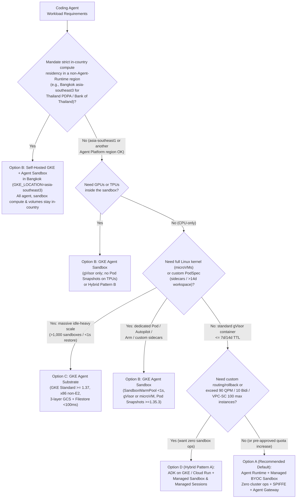

# Lab 8: Agent Runtime vs. Self-Hosted GKE

In this final lab, you'll complete a self-hosted GKE Agent Sandbox overlay (verified completely offline with no live cluster) and map out when to stay on managed Agent Runtime vs. move to GKE or a hybrid setup. If you're only here for the architecture briefing, jump straight to [Choosing Your Deployment Architecture](#choosing-your-deployment-architecture).

**Duration:** 30 min (Full-Day Track) | 25 min (Half-Day Architecture Briefing)  
**Navigation:** [Lab 6: Optimize, Evaluate & Alert](./06-LAB-OPTIMIZE-EVAL-AND-ALERTS.md) · [Lab 7 (Optional): Security & Governance](./07-LAB-OPTIONAL-SECURITY-AND-GOVERNANCE.md) · [Workshop Overview](./00-WORKSHOP-OVERVIEW.md) · [Facilitator Guide](./FACILITATOR-GUIDE.md)

## Files You Will Edit (Optional GKE Hands-On — No Live Cluster Required)

| Step | File | Where to edit | What you're adding |
|---|---|---|---|
| 1 | [`starter/gke_reference/rbac.yaml`](../starter/gke_reference/rbac.yaml) | `Role.rules` (`# TODO(lab-8)`) | Second RBAC rule for core API group `agents.x-k8s.io` (`sandboxes`) |
| 2 | [`starter/gke_reference/sandbox_template.yaml`](../starter/gke_reference/sandbox_template.yaml) | `spec.podTemplate.spec` & `resources` (`# TODO(lab-8)`) | `secure-sandbox-policy` VAP hardening and explicit CPU/memory `limits` |
| 3 | [`starter/gke_reference/sandbox_warmpool.yaml`](../starter/gke_reference/sandbox_warmpool.yaml) | `spec.replicas` (`# TODO(lab-8)`) | Set `replicas: 2` for `< 1s` warm-pool claims |
| 4 | [`starter/gke_reference/gke_agent_example.py`](../starter/gke_reference/gke_agent_example.py) | `build_gke_code_executor()`, `build_gke_coding_agent()`, `run_warmpool_sdk_smoke_test()` (`# TODO(lab-8)`) | Wire ADK `GkeCodeExecutor`, Gemini 4 `LlmAgent`, and `k8s-agent-sandbox` warm-pool SDK |

**Already built for you (no edits needed):** `GkeSandboxSettings`, `run_direct_sandbox_execution()`, and the CLI `--mode` runner in `gke_agent_example.py`, plus the `ServiceAccount`, `RoleBinding`, `extensions.agents.x-k8s.io` RBAC rules, and base gVisor `SandboxTemplate` scaffolding.

**Fell behind or want AI help?** Use [`.agents/skills/agent-runtime-vs-gke-architecture/SKILL.md`](../.agents/skills/agent-runtime-vs-gke-architecture/SKILL.md) in Antigravity, or run `make fast-forward LAB=8` to sync all four files from [`solution/gke_reference/`](../solution/gke_reference/).

---

## Step 1: Add the Core Agent Sandbox RBAC Rule

**File:** [`starter/gke_reference/rbac.yaml`](../starter/gke_reference/rbac.yaml) (`Role` -> `rules`, `# TODO(lab-8)`)

Kubernetes SIG Apps `agent-sandbox` (`v1.0.6`, `v1beta1`) splits its CRDs across two API groups: `extensions.agents.x-k8s.io` for `sandboxclaims`, `sandboxtemplates`, and `sandboxwarmpools`, and `agents.x-k8s.io` for `sandboxes`. The starter manifest already grants the `extensions.agents.x-k8s.io` rules, so you need to add the second rule for `agents.x-k8s.io` so ADK `GkeCodeExecutor(executor_type="sandbox")` can watch and clean up underlying `Sandbox` objects.

- Uncomment and finish the `# TODO(lab-8)` rule under `Role.rules` with `apiGroups: [agents.x-k8s.io]`, `resources: [sandboxes]`, and `verbs: [create, get, list, watch, delete]`.
- Delete the `# TODO(lab-8)` comment when done.
- Remember for live deploys: `adk deploy gke` defaults to the `default/default` KSA, which returns `403 PERMISSION_DENIED` on Vertex AI calls until bound via Workload Identity Federation (WIF) to `roles/aiplatform.user`. Prefer this dedicated `coding-agent-orchestrator-sa` in production.

<details>
<summary>Stuck? Peek at the code</summary>

```yaml
  # Core Agent Sandbox CRD (`agents.x-k8s.io/v1beta1`):
  # Required alongside `sandboxclaims` so `GkeCodeExecutor(executor_type="sandbox")`
  # can inspect readiness and clean up underlying `Sandbox` resources.
  - apiGroups:
      - agents.x-k8s.io
    resources:
      - sandboxes
    verbs:
      - create
      - get
      - list
      - watch
      - delete
```

</details>

**Check it works:**

```bash
grep -A9 "agents.x-k8s.io" starter/gke_reference/rbac.yaml
```

You should see rules for both `extensions.agents.x-k8s.io` and `agents.x-k8s.io`, with zero `TODO(lab-8)` lines remaining.

---

## Step 2: Harden the SandboxTemplate for VAP Compliance

**File:** [`starter/gke_reference/sandbox_template.yaml`](../starter/gke_reference/sandbox_template.yaml) (`spec.podTemplate.spec` and `containers[0].resources`, two `# TODO(lab-8)` markers)

GKE Agent Sandbox ships an optional `secure-sandbox-policy` ValidatingAdmissionPolicy (VAP) that rejects insecure sandbox pods at admission time. You'll add the pod and container hardening fields VAP requires. Using a `SandboxTemplate` (instead of a bare `Sandbox`) also tells the controller to create a managed `NetworkPolicy` automatically, allowing ingress only from `app: sandbox-router` and blocking RFC 1918, CoreDNS, and `169.254.0.0/16` metadata egress.

- Under `spec.podTemplate.spec` (right below `runtimeClassName: gvisor`), add `automountServiceAccountToken: false` and a pod-level `securityContext` with `runAsNonRoot: true` and `runAsUser: 1000`.
- Under the `python-runtime` container, add `resources.limits` (`cpu: "500m"`, `memory: "1Gi"`) and a container-level `securityContext` with `allowPrivilegeEscalation: false` and `capabilities.drop: [ALL]`.
- Production namespace note: this workshop keeps manifests in `agent-sandbox-system` for compact demos, but `secure-sandbox-policy` skips controller system namespaces by default. Deploy templates into a dedicated workload namespace like `coding-sandboxes` in production.

<details>
<summary>Stuck? Peek at the code</summary>

```yaml
    spec:
      runtimeClassName: gvisor
      automountServiceAccountToken: false
      securityContext:
        runAsNonRoot: true
        runAsUser: 1000
      nodeSelector:
        sandbox.gke.io/runtime: gvisor
      tolerations:
        - key: "sandbox.gke.io/runtime"
          value: "gvisor"
          effect: "NoSchedule"
      containers:
        - name: python-runtime
          image: registry.k8s.io/agent-sandbox/python-runtime-sandbox:v0.1.0
          ports:
            - containerPort: 8888
          readinessProbe:
            httpGet:
              path: "/"
              port: 8888
            initialDelaySeconds: 0
            periodSeconds: 1
          resources:
            requests:
              cpu: "250m"
              memory: "512Mi"
            limits:
              cpu: "500m"
              memory: "1Gi"
          securityContext:
            allowPrivilegeEscalation: false
            capabilities:
              drop:
                - ALL
      restartPolicy: OnFailure
```

</details>

**Check it works:**

```bash
python3 - << 'EOF'
import yaml
spec = yaml.safe_load(open("starter/gke_reference/sandbox_template.yaml"))["spec"]["podTemplate"]["spec"]
c0 = spec["containers"][0]
print(spec["runtimeClassName"], spec["automountServiceAccountToken"], spec["securityContext"], c0["resources"]["limits"], c0["securityContext"])
EOF
```

Expected output prints `gvisor False {'runAsNonRoot': True, 'runAsUser': 1000} {'cpu': '500m', 'memory': '1Gi'} {'allowPrivilegeEscalation': False, 'capabilities': {'drop': ['ALL']}}`.

---

## Step 3: Scale the SandboxWarmPool to 2 Replicas

**File:** [`starter/gke_reference/sandbox_warmpool.yaml`](../starter/gke_reference/sandbox_warmpool.yaml) (`spec.replicas`, `# TODO(lab-8)`)

Cold sandbox pods take seconds to schedule (or minutes if Autopilot has to scale up a node). A `SandboxWarmPool` keeps initialized gVisor pods waiting so incoming `SandboxClaim` requests bind in under a second.

- Update `spec.replicas` from `1` to `2`, verify `sandboxTemplateRef.name` is `coding-sandbox-template`, and remove the `# TODO(lab-8)` comment.
- Keep two operational details in mind on live clusters: claiming before warm-pool replicas are `Ready` falls back to cold pod creation, and every pod in a single warm pool shares the same KSA/WIF identity bound at pod creation (split tenants across separate warm pools if needed). Inspect `metadata.ownerReferences[*].kind` on `Sandbox` objects to tell idle (`SandboxWarmPool`) from claimed (`SandboxClaim`) pods.

<details>
<summary>Stuck? Peek at the code</summary>

```yaml
spec:
  replicas: 2
  sandboxTemplateRef:
    # Must match `metadata.name` of the `SandboxTemplate` in the same namespace.
    name: coding-sandbox-template
```

</details>

**Check it works:**

```bash
grep -A3 "^spec:" starter/gke_reference/sandbox_warmpool.yaml
```

Expected output shows `replicas: 2` and `name: coding-sandbox-template`.

---

## Step 4: Wire `GkeCodeExecutor`, Gemini 4 `LlmAgent`, and the WarmPool SDK

**File:** [`starter/gke_reference/gke_agent_example.py`](../starter/gke_reference/gke_agent_example.py) (`build_gke_code_executor()`, `build_gke_coding_agent()`, `run_warmpool_sdk_smoke_test()`, three `# TODO(lab-8)` blocks)

This script swaps Lab 2's managed `AgentEngineSandboxCodeExecutor` for ADK's `GkeCodeExecutor` and also shows how to claim a warm-pool pod directly with the standalone `k8s-agent-sandbox==1.0.6` Python SDK.

- **`build_gke_code_executor(settings)`:** Import `GkeCodeExecutor` from `google.adk.code_executors` and instantiate it with `namespace=settings.namespace`, `executor_type="sandbox"`, `sandbox_template=settings.sandbox_template`, plus optional `sandbox_gateway_name`, `kubeconfig_path`, and `kubeconfig_context` when truthy.
- **`build_gke_coding_agent(settings)`:** Add `import inspect` (at the top of the file or inside the function), check `inspect.signature(genai.Client.__init__).parameters` to pick `"enterprise"` vs. `"vertexai"`, pass `client_kwargs` into `Gemini(model=settings.model_name, ...)` so `gemini-4-hydrogen` routes to `settings.model_location` (`global` by default, or `gemini-4-argon` on `asia-southeast1`), and return `LlmAgent(name="gke_sandbox_coding_agent", model=gemini_model, instruction=GKE_SYSTEM_INSTRUCTION, code_executor=build_gke_code_executor(settings))`.
- **`run_warmpool_sdk_smoke_test(settings, command)`:** Create `SandboxClient(connection_config=SandboxLocalTunnelConnectionConfig(), cleanup=True)`, call `client.create_sandbox(warmpool=settings.warmpool, namespace=settings.namespace)`, run `sandbox.commands.run(command)`, and return `str(result.stdout)`.

> [!WARNING]
> **SDK Version Skew (`google-adk==2.15.0` vs. `k8s-agent-sandbox==1.0.6`):** In `google-adk==2.15.0`, `GkeCodeExecutor._execute_in_sandbox()` still calls the pre-1.0 `k8s-agent-sandbox` context-manager API (`with SandboxClient(template_name=...) as sandbox:`), which breaks if `k8s-agent-sandbox==1.0.6` is installed in the same virtualenv. Keep ADK `GkeCodeExecutor` and standalone `k8s-agent-sandbox==1.0.6` in separate virtual environments until ADK migrates to v1.x.

<details>
<summary>Stuck? Peek at the code</summary>

```python
# Add `import inspect` to the top-level imports alongside `import argparse`.

def build_gke_code_executor(settings: GkeSandboxSettings) -> Any:
    try:
        from google.adk.code_executors import GkeCodeExecutor
    except ImportError as exc:
        raise ImportError(
            "ADK GKE Code Executor requires `pip install \"google-adk[extensions]\"`."
        ) from exc

    kwargs: dict[str, Any] = {
        "namespace": settings.namespace,
        "executor_type": "sandbox",
        "sandbox_template": settings.sandbox_template,
    }
    if settings.sandbox_gateway_name:
        kwargs["sandbox_gateway_name"] = settings.sandbox_gateway_name
    if settings.kubeconfig_path:
        kwargs["kubeconfig_path"] = settings.kubeconfig_path
    if settings.kubeconfig_context:
        kwargs["kubeconfig_context"] = settings.kubeconfig_context

    return GkeCodeExecutor(**kwargs)


def build_gke_coding_agent(settings: GkeSandboxSettings) -> Any:
    try:
        from google import genai
        from google.adk.agents import LlmAgent
        from google.adk.models import Gemini
    except ImportError as exc:
        raise ImportError(
            "ADK LlmAgent requires `pip install \"google-adk[extensions]\"`."
        ) from exc

    try:
        params = inspect.signature(genai.Client.__init__).parameters
    except (TypeError, ValueError):
        params = {}
    auth_key = "enterprise" if "enterprise" in params else "vertexai"

    client_kwargs: dict[str, Any] = {
        auth_key: True,
        "location": settings.model_location,
    }
    project = (
        settings.google_cloud_project
        or os.environ.get("GOOGLE_CLOUD_PROJECT", "").strip()
        or None
    )
    if project:
        client_kwargs["project"] = project

    gemini_kwargs: dict[str, Any] = {"model": settings.model_name}
    model_fields = getattr(Gemini, "model_fields", None)
    if model_fields is None or "client_kwargs" in model_fields:
        gemini_kwargs["client_kwargs"] = client_kwargs
    gemini_model = Gemini(**gemini_kwargs)

    executor = build_gke_code_executor(settings)
    return LlmAgent(
        name="gke_sandbox_coding_agent",
        model=gemini_model,
        instruction=GKE_SYSTEM_INSTRUCTION,
        code_executor=executor,
    )


def run_warmpool_sdk_smoke_test(
    settings: GkeSandboxSettings,
    command: str = "echo 'Hello from GKE Agent Sandbox WarmPool!'",
) -> str:
    try:
        from k8s_agent_sandbox import SandboxClient
        from k8s_agent_sandbox.models import SandboxLocalTunnelConnectionConfig
    except ImportError as exc:
        raise ImportError(
            "Standalone GKE Sandbox client requires `pip install k8s-agent-sandbox==1.0.6`."
        ) from exc

    client = SandboxClient(
        connection_config=SandboxLocalTunnelConnectionConfig(),
        cleanup=True,
    )
    sandbox = client.create_sandbox(
        warmpool=settings.warmpool,
        namespace=settings.namespace,
    )
    result = sandbox.commands.run(command)
    return str(result.stdout)
```

</details>

**Check it works:**

```bash
python3 starter/gke_reference/gke_agent_example.py --mode inspect
```

Expected output prints JSON containing `"namespace": "agent-sandbox-system"`, `"sandbox_template": "coding-sandbox-template"`, `"warmpool": "coding-sandbox-warmpool"`, `"model_name": "gemini-4-hydrogen"`, and `"model_location": "global"`.

---

## Step 5: Lab 8 Checkpoint

Run the offline verifier from the repository root (zero live GKE cluster required):

```bash
make verify-lab LAB=8
# Or verify the reference solution manifests directly:
make verify-lab LAB=8 TRACK=solution
```

Expected output: `PASS=12 | FAIL=0 | WARN=0` across Python syntax, zero `TODO(lab-8)` markers, `gemini-4-hydrogen` default, dual API-group RBAC, `secure-sandbox-policy` VAP pod hardening, warm-pool template matching, and `--mode inspect`.

---

## Choosing Your Deployment Architecture

Before taking a coding agent to production, pick among four deployment topologies based on your residency, hardware, scale, and ops capacity:

1. **Option A: Agent Runtime + Managed BYOC Sandbox (Recommended Default):** Serverless `ReasoningEngine` containers plus Google-managed gVisor sandboxes. You get zero cluster or CRD upgrades, native SPIFFE Agent Identity (24h X.509 mTLS), Google-managed Agent Gateway, Semantic Governance, 3LO Auth Manager, Managed Sessions/Memory Bank, and `publish gemini`. Hard limits: CPU-only (no GPUs/TPUs), gVisor only (no microVMs), 7-day BYOC / 14-day Code Exec TTLs, up to 2-minute cold sandbox starts, no built-in FQDN allowlist on Scale Sandboxes (needs PSC-I + Cloud NGFW/SWP), no auto-collected sandbox stdout/stderr, and default regional quotas (`90 QPM`, `10 Bidi/min`, `950` non-adjustable revisions/agent).
2. **Option B: Self-Hosted GKE + GKE Agent Sandbox (`kubernetes-sigs/agent-sandbox` `v1.0.6`):** Your ADK agent runs on GKE and claims one dedicated Kubernetes Pod per sandbox (`v1beta1` CRDs). Gives you strict in-country compute residency in any GKE region, full `PodSpec` control, `< 1s` warm-pool claims, gVisor or Cloud Hypervisor microVMs (or self-managed Kata without a Google SLA), GPUs/TPUs (gVisor only), GKE Pod Snapshots (`>= 1.35.3-gke.1234000`), Hyperdisk/Filestore volumes, and no Agent Platform QPM or revision caps. Trade-offs: you own cluster/controller upgrades, `sandbox-router` HA, VAP/WIF/NetworkPolicy config, and Dataplane V2 limits.
3. **Option C: Self-Hosted GKE + GKE Agent Substrate (`agent-substrate/substrate`):** Built for high-density intermittent CPU agents. Multiplexes many lightweight Actor sessions onto shared pre-warmed Worker Pods (`WorkerPool`) using a control plane outside `kube-apiserver` and `etcd`. Scales to millions of suspended actors with `< 1s` 3-layer GCS checkpoint restore, `< 100 ms` Filestore agent volume re-attach, and out-of-sandbox Envoy credential injection. Trade-offs: GKE Standard `>= 1.37` only (no Autopilot or Extended release channel), x86 CPU only (min `c3-standard-4`, no E2, no Arm, no GPUs/TPUs), 5 Linux kernel sysctls above ~800 sandboxes/node, and highest Day-2 ops ownership.
4. **Option D: Hybrid Topologies and Progressive Graduation (`agents-cli`):** Mix managed control-plane services with self-hosted compute without rewriting your ADK code:
   - **Hybrid A (GKE or Cloud Run orchestrator -> Managed Sandbox & State):** Escape the `90 QPM` / `10 Bidi/min` runtime cap or run custom WebSockets and `kubectl rollout undo`, while keeping a minimal `ReasoningEngine` strictly for Managed Sandboxes, Managed Sessions, and Memory Bank.
   - **Hybrid B (Agent Runtime orchestrator -> GKE Sandbox or Substrate):** Keep SPIFFE identity, Agent Gateway, Semantic Governance, and `publish gemini` on Agent Runtime, and call GKE sandboxes over PSC-I + GKE Gateway API whenever a job needs GPUs/TPUs, microVMs, >14d workspaces, or >1,000 sandboxes.
   - **Hybrid C (Dual-Tier GKE):** Run Agent Sandbox on a gVisor GPU/TPU node pool alongside Agent Substrate on separate non-gVisor x86 node pools in the same Standard `>= 1.37` cluster (never put the `sandbox.gke.io/runtime` taint on Substrate worker pools).
   - **Hybrid D (`agents-cli` Progressive Graduation):** Prototype locally, ship Day-1 to `agent_runtime` (or `cloud_run`), and graduate to `gke` (`agents-cli scaffold enhance -d gke`) while keeping the same ADK agent, evals, and `--session-type agent_platform_sessions`.



> [!IMPORTANT]
> **Bangkok (`asia-southeast3`) In-Country Residency Trigger (Thailand PDPA & Bank of Thailand):** Managed Agent Runtime and Managed Sandboxes currently run in Singapore (`asia-southeast1`), not Bangkok (`asia-southeast3`). If Thailand PDPA or Bank of Thailand (BoT) rules forbid executing proprietary code or mounting repositories outside Thailand, deploy **Self-Hosted GKE + GKE Agent Sandbox directly in Bangkok (`GKE_LOCATION=asia-southeast3`)**. Your ADK orchestrator, gVisor/microVM sandboxes, Artifact Registry images, Cloud Build jobs, Secret Manager secrets, and Hyperdisk/Filestore volumes all stay inside Thailand, and your identical ADK 2.0 code can move to managed Agent Runtime once it launches in Bangkok.

### Six Questions to Sign Off Before Production

- [ ] **Residency:** Does compliance allow Agent Runtime in `asia-southeast1`, or do Thailand PDPA / BoT mandates require GKE in `asia-southeast3`?
- [ ] **Quotas:** Did you size peak QPM (`U * X * 1.5`) and session event appends/min (`U * X * Y * 1.5`) against Agent Platform's `90 QPM` and `300 appends/min` defaults?
- [ ] **Compute & TTL:** Do tasks fit CPU-only gVisor containers and 7d/14d TTLs, or do they need GPUs/TPUs, microVMs, or >14d workspaces on GKE?
- [ ] **Egress & Logs:** If Managed Sandboxes reach package registries or internal APIs, did you budget for PSC-I (`>= /28`) + Cloud NGFW/SWP + Cloud DNS peering, plus parent-agent logging of sandbox `stdout`/`stderr`?
- [ ] **GKE Scale Limits:** On GKE, did you account for Dataplane V2 limits (cluster-create-only, HTTP keep-alives to curb `anetd` CPU, `260k` Service map, `1,000`-node `CiliumNetworkPolicy` limit), `FQDNNetworkPolicy` (`50` IPs/policy), and Pod Snapshot prerequisites (`>= 1.35.3-gke.1234000`, gVisor, non-E2 for `whole-pod`, `--soft-delete-duration=0d`)?
- [ ] **Hybrid TCO:** Would a hybrid split (Agent Runtime orchestrator + GKE GPU/microVM sandbox, or GKE orchestrator + Managed Sandbox/Sessions) beat an all-or-nothing choice?

---

## Optional Reference & Deep Dive

<details>
<summary>14-Dimension Comparison & Limitations Matrix (All 4 Options)</summary>

| # | Dimension | Option A: Agent Runtime + Managed Sandbox | Option B: GKE + GKE Agent Sandbox (`v1.0.6`) | Option C: GKE + GKE Agent Substrate | Option D: `agents-cli` (`v1.15.0`) Orchestrator |
|---|---|---|---|---|---|
| **1** | **Orchestration Unit, Density & Control Plane** | Serverless `ReasoningEngine` (`min_instances` `[0, 75]` default `1`; `max_instances` `[1, 1000]` default `100`, capped at `[1, 100]` with VPC-SC or PSC-I; `container_concurrency` default `9`, recommended `2*cpu+1` or multiples of `9` like `36`) + gVisor `SandboxEnvironment` in managed tenant projects (OSS: AX & Substrate). | 1 dedicated Pod per sandbox (`Sandbox` CRD `agents.x-k8s.io/v1beta1`). Routed through `agent-sandbox-controller`, `kube-apiserver`, and `etcd`; bounded by K8s scheduling throughput. Full `PodSpec` control. | Decoupled Actor sessions multiplexed onto shared pre-warmed `WorkerPool` Pods via `ate-api-server` + privileged `atelet` DaemonSet outside `kube-apiserver`/`etcd`. Scales to millions of actors; min `c3-standard-4` nodes; `> ~800` concurrent sandboxes/node needs 5 sysctls (`net.ipv4.neigh.default.gc_thresh1=4096`, `gc_thresh2=16384`, `gc_thresh3=32768`, `fs.inotify.max_user_instances=65536`, `fs.inotify.max_user_watches=1048576`). | Multi-target scaffold, eval, Terraform, deploy & publish CLI (`-d agent_runtime \| cloud_run \| gke`); generates ~60 files (`app/`, `deployment/terraform/`, `tests/eval/`, `tests/load_test/`). Deploys agent containers only; does not install GKE sandbox CRDs or Managed Sandboxes. |
| **2** | **Provisioning & Warm-Pool Latency** | Runtime cold start ~4.7s vs. warm ~0.4s (`min_instances=1`; `min_instances=10` drops avg cold start to ~1.4s). Managed Sandbox cold start up to 2 min; warm template, resume, or snapshot restore in seconds; Shell sandbox `STATE_RUNNING` ~20s; Code Exec create + execute `< 1s`. | `SandboxWarmPool` CRD (per `SandboxTemplate` & image): `< 1s` claim. Falls back to cold Pod creation if claimed before `Ready` (Autopilot scale-up can take minutes). gVisor start `< 100 ms`; microVM 1–2s. | Shared `WorkerPool` across multiple `ActorTemplate`s & images. 3-layer GCS checkpoint restore in `< 1s` (matching HW/runtime/image). Filestore agent volume re-attach `< 100 ms`. | Imperative `agents-cli deploy` on `agent_runtime` takes 5–10 min (use `--no-wait` + `--status`). Defaults to `--min-instances 0`; generated Terraform `service.tf` pins `min_instances = 1`. |
| **3** | **TTL, Session Lifetime, Idle Suspension & Billing** | Hard Sandbox TTLs: 7 days (BYOC / Shell), 14 days (Code Exec; `execute_code` resets TTL). `pause()`/`resume()` releases compute while keeping ID, PSC endpoint & disk. Runtime idle scale-down 900s (15 min), extendable via `keep_alive_probe` up to 3600s (disables CPU throttling, billed continuously). `:streamQuery` max 15 min; `:bidi_reasoning_engine` max 10 min; `:asyncQuery` up to 7 days. Managed Sessions default TTL: 365 days. | No hard platform TTL. Setting `spec.operatingMode: Suspended` deletes the Pod while keeping CRD & PVCs (in-memory & rootfs state are lost unless a Pod Snapshot finishes first). Controller does not auto-detect idle agents. | No hard platform TTL (days/weeks across millions of suspended actors). Suspending checkpoints memory/rootfs/volumes to GCS and drops Worker CPU & RAM to zero. Open network connections (DB, MCP) are not preserved across suspend/resume. | Auto-wires `VertexAiSessionService` on `agent_runtime`; on `cloud_run`/`gke`, supports `--session-type agent_platform_sessions`, Cloud SQL, or in-memory. Cloud Run `--timeout` up to `3600s` (default `300s`). |
| **4** | **Snapshots, Checkpointing & Portability** | `SandboxEnvironmentSnapshot` (configurable `ttl`) saves packages, disk & memory to managed GCS (inherits CMEK); supports branching. Unsupported on Code Exec. Restore fails if CPU arch, runtime version, or `image_uri` changed. | GKE Pod Snapshots (`podsnapshot.gke.io/v1`): requires GKE `>= 1.35.3-gke.1234000` (`--enable-pod-snapshots`), gVisor only, no TPUs, no GCS FUSE sidecar. `whole-pod` forbids E2; `rootfs-only` (`>= 1.35.3-gke.1031000`) restores across machine families including E2. GPU checkpointing via `cuda-checkpoint` (A100/H100/RTX PRO 6000 single-GPU & L4 `g2-standard-*` multi-GPU; no MIG). Restore ~3–5s. Hyperdisk supports CSI snapshots; Filestore does not. | Built-in 3-layer GCS checkpoints (gVisor and microVMs) with graceful downgrade: (1) memory + rootfs + volumes (`< 1s` on match), (2) rootfs + volumes (if HW/runtime changed), (3) volumes-only (if image updated). External Filestore agent volumes persist outside snapshot. | No native snapshot CLI verbs; versioned via container images, Git, and Terraform state. |
| **5** | **Cluster Requirements, Machine Families & Accelerators** | CPU-only (no GPUs/TPUs). Runtime `resource_limits`: `cpu` in `{1, 2, 4, 6, 8}` (default `4`), `memory` `1Gi..32Gi` (default `4Gi`). Code Exec: 2 vCPU / 1.5 GB RAM or `MACHINE_CONFIG_VCPU4_RAM4GIB` (4 vCPU / 4 GB); max 100 MB payload; fixed preinstalled libraries (no `pip install`). | Any supported GKE version (Standard and Autopilot); `>= 1.35.3-gke.1234000` for Pod Snapshots. x86 & Arm (gVisor). GPUs & TPUs on gVisor only (no TPUs with Pod Snapshots). `whole-pod` snapshots & microVMs forbid E2 (use N2, C3, C4, N4). | GKE Standard ONLY `>= 1.37` (no Autopilot, no Extended release channel). x86 CPU only (min `c3-standard-4`; no Arm, no E2/mixed-CPU, uniform family per `ActorTemplate`). No GPUs or TPUs. | `--cpu` (`1`), `--memory` (`4Gi`), `--min-instances` (`0`), `--max-instances` (`10`), `--concurrency` (`8`) work on `agent_runtime` & `cloud_run`; all sizing flags rejected on `gke` (configured via Terraform + HPA). |
| **6** | **Kernel Isolation Runtimes** | Managed gVisor only (non-root Linux container, Linux syscall subset). No microVM or Kata. | gVisor (`runtimeClassName: gvisor`, `cos_containerd`, `< 100 ms`, Standard & Autopilot) or Cloud Hypervisor microVMs (`runtimeClassName: microvm`, Standard + `--enable-nested-virtualization`, 1–2s start, 250 mCPU + 130 MiB/Pod overhead, full Linux kernel). Self-managed Kata has no Google SLA. `secure-sandbox-policy` VAP enforces `gvisor` and rejects `microvm` / `istio-init` `NET_ADMIN`/`NET_RAW` unless edited. | gVisor or Cloud Hypervisor microVMs inside `WorkerPool` Pods (`cos_containerd` only; microVMs need x86 nested virt or bare metal + `<snapshot-bucket>-assets`). Never enable GKE Sandbox on Substrate worker pools (`sandbox.gke.io/runtime` taint blocks `WorkerPool` Pods). | Deploys standard containers; does not emit `runtimeClassName: gvisor`/`microvm` or VAP manifests on GKE. |
| **7** | **Networking, Egress Control, VPC-SC & Dataplane V2** | Code Exec: zero internet/VPC. BYOC/Shell: `internet_access: False` default (`True` allows `0.0.0.0/0`, blocks RFC 1918 & `169.254.0.0/16`). No native domain allowlist on Scale Sandboxes (contrast: Pre-GA Managed Agents API has native `allowlist`); use PSC-I (`>= /28`) + Cloud NGFW (`--dest-fqdns` + deny `0.0.0.0/0`) or SWP + Cloud DNS peering. Private ingress: PSC-E (max 1 consumer project, same project). VPC-SC (`199.36.153.4/30`, caps `max_instances` at `100`). Managed Agent Gateway governs up to 5,000 Registry resources (VPC-SC requires gateways created after Sept 8, 2026). | `Sandbox Router` + managed default-deny `NetworkPolicy` per `SandboxTemplate` (ingress only from `app: sandbox-router`; egress allows public internet, blocks RFC 1918, CoreDNS & `169.254.0.0/16`). L7 `FQDNNetworkPolicy` (Dataplane V2 + `kube-dns`/Cloud DNS, max 50 resolved IPs/policy, must list all domain aliases queried directly by Pods, no Cloud Service Mesh, no ClusterIP/Headless targets). Dataplane V2 limits: cluster-create-only; `anetd` can use 2–3 vCPUs/node under rapid TCP churn (use keep-alives) + 0.25% node RAM; 260,000 Service map entries; `CiliumNetworkPolicy` caps clusters at 1,000 nodes (use `CiliumClusterwideNetworkPolicy` up to 5,000); drops fragmented ICMP; conflicts with third-party eBPF tools. Dual-stack IPv6 without IPv6 NAT can stall 2 min (`NODE_OPTIONS="--dns-result-order=ipv4first --no-network-family-autoselection"`). | Built-in Envoy ingress/egress gateways with per-actor mTLS tunnels. Default-deny to other actors, K8s control plane, metadata server & internet; blocks non-DNS UDP, raw TCP & WebSockets. Native `EgressPolicy` filters by FQDN or wildcard hostname only (no IPs/CIDRs). Avoids per-actor K8s `NetworkPolicy` churn. | `--network-attachment`, `--dns-peering-*`, `--agent-gateway-{egress,ingress}`, and `--agent-gateway` CA bundle work on `agent_runtime` only. `--iap` & `--ingress` work on `cloud_run` only. GKE networking lives in Terraform. |
| **8** | **Identity, Credentials & Secrets** | Split trust: Parent `ReasoningEngine` uses SPIFFE Agent Identity (24h X.509 mTLS+DPoP+CAA; auto-granted `agentContextEditor` & `agentDefaultAccess`; immutable; 3LO dual-attribution via Auth Manager) or custom SA. In-sandbox: unprivileged user, zero ADC, no metadata server, no `sudo`, no IAM roles. 3 service agents (`gcp-sa-vertex-sandbox`, `gcp-sa-aiplatform-re`, `gcp-sa-aiplatform`). | Pod KSA via WIF or Agent Identity (Preview) bound at Pod creation, so all Pods in a `SandboxWarmPool` share one identity. Auto `NetworkPolicy` blocks `169.254.169.254` and VAP sets `automountServiceAccountToken: false` (customize to use WIF). `adk deploy gke` uses `default/default` KSA (`403` unless bound to `roles/aiplatform.user`). | Per-actor SPIFFE X.509 cert & JWT. Out-of-sandbox credential injection at Envoy egress gateway replaces placeholders with K8s `Secret` or Secret Manager values over mTLS (secrets never enter sandbox). WIF only for worker infra (`ate-snapshot-transfer` GSA). | Defaults to Agent Identity on `agent_runtime` & `cloud_run` (irreversible on Cloud Run; rejected on `gke`). Scaffolds `app_sa` + `cicd_runner_sa`. `--secrets` on `agent_runtime`/`cloud_run`; on `gke`, grant `roles/secretmanager.secretAccessor` in Terraform. |
| **9** | **Workspace Storage & CMEK** | Ephemeral sandbox disk + managed GCS for pause/snapshot; Code Exec 100 MB cap. CMEK: single-region KMS key immutable at parent `ReasoningEngine` create (`gcp-sa-aiplatform-re` needs `cryptoKeyEncrypterDecrypter`); encrypts boot disk & snapshot bucket (not metadata, env vars, or AR images). Standalone Sessions/Memory Bank support regional + `us`/`eu` CMEK (none on `global`). | Hyperdisk Balanced (RWO: 4 GiB–64 TiB [`128 TiB` C4], 128 disks/node, 2,400 MiB/s, 3k–160k IOPS, scale-up only, CSI snapshots), Hyperdisk ML (ROX: up to 2,500 instances/vol), Filestore Multishares Enterprise (RWX: 1–10 TiB inst, 10 GiB–1 TiB/share, 80 shares & 20k conns/inst, 120 MiB/s & 12k R/4k W IOPS/TiB, ~6m create, sub-sec mount, no per-share CSI snapshots). Full customer CMEK. | GCS Snapshot bucket + `<bucket>-assets` bucket (microVM kernel/rootfs). Filestore agent volumes (`CSIDriverConfig` `ate.dev/v1alpha1`, `filestore.csi.storage.gke.io`, per-actor exclusive volume deleted with actor, `< 100 ms` re-attach; no automated snapshots/cloning/tiering). No Hyperdisk per-actor CSI volumes. | `--key` sets CMEK on dev `agent_runtime` create only (staging/prod via Terraform); `agents-cli infra single-project --apply` creates GCS & BQ dataset (must run before first deploy). |
| **10** | **Observability, Logging & Audit Blind Spots** | Parent `ReasoningEngine` auto-collects `reasoning_engine_stdout`/`stderr`, Cloud Trace, Monitoring, `is_agentic=true` dual-attribution, Model Armor spans, Agent Anomaly Detection (`AGENT_SESSION_ANOMALY` -> SCC), Online Monitors. Blind spots: (1) auto stdout/stderr does NOT collect Managed Sandbox, Sessions, Memory Bank, or Example Store logs; (2) Audit Logs do NOT capture guest subprocesses, syscalls, file writes, or WS/CDP/PTY frames; (3) VPC-SC omits payloads from `DATA_WRITE` audit logs. | GKE Cloud Logging captures Pod `stdout`/`stderr` automatically. Managed Prometheus (`PodMonitoring` scraping `/metrics:8080` -> `agent_sandbox_build_info`, `agent_sandboxes`, `agent_sandbox_claim_controller_startup_latency_ms`; `namespace` renamed to `exported_namespace`). Cloud Trace via OTel + Agent Anomaly Detection (`GKE_WORKLOAD`, ADK `>= 2.1.0`). Guest syscall auditing needs custom eBPF/guest tooling. | GKE Cloud Logging + Managed OpenTelemetry for GKE (collector connectors unsupported; collector memory cache scales linearly with Pod count; TLS unsupported). Per-actor SPIFFE cert/JWT gives per-actor egress attribution at Envoy gateway. | Scaffolds 3 tiers: Cloud Trace, GCS/BQ completions (Python ADK/Claude only), `--bq-analytics`. Python OTel requires enum (`EVENT_ONLY`); Go requires boolean (`"1"`/`"true"`). |
| **11** | **Hard Quotas & System Limits** | Regional quotas/project: Query/StreamQuery `90 QPM`; Bidi `10/min`; resources `100` regional (+`100` non-regional); writes `10/min`; Code Exec `1,000` exec/min, `1,000` entities, `500` writes/min; Sessions `100` writes/min, `300` appends/min; Memory Bank `100` writes / `300` reads per min; A2A `60` post / `600` get per min; Example Store `50`/region. Non-adjustable: `6,000` revisions/project/region & `950` revisions/agent (auto-GC `100` new / `950` existing). Express Mode: `10` resources, `10` QPM, `1` bidi/min. | No Agent Platform QPM/entity/revision caps. Bounded by GCE/GKE quotas, `kube-apiserver`/`etcd`, Hyperdisk (`128` disks/node), Filestore (`80` shares/inst, `20k` conns), Dataplane V2 (`400k` Pods, `260k` Service entries, `1,000`-node `CiliumNetworkPolicy` cap), `FQDNNetworkPolicy` (`50` IPs/policy). | Bypasses `kube-apiserver`/`etcd` Pod limits for millions of suspended actors. Bounded by GCE/GKE node quotas (min `c3-standard-4`), GCS/Filestore throughput, and `> ~800` sandboxes/node sysctls. | Inherits target quotas + GenAI Eval Service 14 US/EU regions + `global` (`eval analyze` `global`-only; `--qps 15` default). |
| **12** | **Runtime Contract, DX, Rollback & Emergency Stop** | Strict HTTP contract: `0.0.0.0:8080`, `GET /` `200 OK`, `POST /api/reasoning_engine`, `/api/stream_reasoning_engine`, `/api/bidi_reasoning_engine`; reserved keep-alive ports `15000,15001,15006,15007,15020,15021`; inline archive max 8 MB. No `gcloud` deploy CLI; no Terraform resource for Managed Sandboxes. Rollback via `v1beta1` `trafficSplitManual` (Gateway binding change archives prior revisions). Emergency stop: `runtimes.delete(..., force=True)` (seconds–few min) vs. UAP/IAM `DENY` (2–7+ min; leaves open streams alive). | Any port/protocol/UI (`--with_ui`, LoadBalancer, Gateway API). Rollback: `kubectl rollout undo`. `adk deploy gke` (Python only, default `ClusterIP`; Go manual via `gcloud`+`kubectl`; Python SQLite `.dockerignore` readonly gotcha). Standalone `k8s-agent-sandbox==1.0.6` or `GkeCodeExecutor` (do not mix in one venv on ADK 2.15.0). Uninstall gotcha: never `kubectl delete -f sandbox-with-extensions.yaml` on a shared cluster. | Managed via `kubectl ate` + K8s CRDs (`WorkerPool`, `CSIDriverConfig` `ate.dev/v1alpha1`). Cloud Shell install blocked (5 GB disk limit). No `adk deploy` integration. | Unified DX (`create`, `scaffold enhance`, `playground`, `eval`, `infra`, `deploy`, `publish`). Target asymmetries: no revision rollback on `agent_runtime`; cannot switch existing `agent_runtime` between source & `--image`; cannot run `infra single-project` after imperative `deploy`; `publish gemini` supports ADK on `agent_runtime` vs. A2A-only on Cloud Run/GKE. |
| **13** | **Ops Burden, Support/SLA & Cost / TCO** | Lowest ops burden; full Google SLA (GA). Serverless billing (vCPU-hr + memory-hr; zero idle bill at `min_instances=0`; keep-alive or `min_instances>=1` incurs standby cost). Managed Sandbox bills active compute + lower paused rate + GCS snapshots. | Medium–High ops burden (cluster, controller upgrades where `v1.0.0` broke `v1alpha1`, `sandbox-router` HA, VAP, NetworkPolicies, `PodMonitoring`). Zero OSS license fee; pay GKE compute (including warm-pool standby Pods) + Hyperdisk/Filestore + GCS snapshots (set `--soft-delete-duration=0d`). Kata has no Google SLA. | Highest ops burden (Standard `>= 1.37`, uniform pools, nested-virt/bare-metal, `> 800`/node sysctls, `ate-api-server`/`atelet`, Filestore CSI, Envoy gateway). Zero OSS license fee; best TCO at massive scale / high idle ratio. | Free OSS CLI (`uv tool install google-agents-cli`). Lowers Day-0/Day-2 engineering effort via generated Terraform, load tests, and CI eval gates. |
| **14** | **Hybrid & Migration Patterns** | Pattern A: Managed Sandboxes work from local, Cloud Run, or GKE via a minimal parent `ReasoningEngine`. Pattern B: Agent Runtime calls GKE sandboxes over PSC-I + GKE Gateway API. | Pattern C: Dual-tier GKE (Agent Sandbox gVisor GPU/TPU pool + Substrate non-gVisor pool on Standard `>= 1.37`). Pattern D: Use `--session-type agent_platform_sessions`, Memory Bank & Agent Anomaly Detection from GKE. | Pattern C + burst graduation from Managed Sandboxes once passing `1,000` sandboxes/region or needing `< 1s` cross-version restore with Filestore agent volumes. | Progressive graduation: `playground` + `eval run` -> `agent_runtime` / `cloud_run` -> `agents-cli scaffold enhance -d gke` with identical ADK code and Managed Sessions. |

</details>

<details>
<summary>Agent Platform Quotas & 250-Developer Sizing Math</summary>

Default regional quotas are sized for pilots. Production coding agents hit `90 QPM` and `300 session event appends/min` quickly unless you request quota increases before launch.

| Quota / Limit (per Project per Region) | Production Default | Express Mode | Adjustable? | Cloud Quotas Metric |
|---|---:|---:|---|---|
| `Query` / `StreamQuery` per min | **90** | 10 | Yes | `aiplatform.googleapis.com/reasoning_engine_service_query_requests` |
| Concurrent `BidiStreamQuery` per min | **10** | 1 | Yes | `aiplatform.googleapis.com/reasoning_engine_service_concurrent_query_requests` |
| Runtime writes (create/update/delete) per min | **10** | 10 | Yes | `aiplatform.googleapis.com/reasoning_engine_service_write_requests` |
| Max Agent Platform resources (regional) | **100** | 10 | Yes | `aiplatform.googleapis.com/reasoning_engine_service_entities` |
| Code Execution sandbox execute reqs / min | **1,000** | N/A | Yes | `aiplatform.googleapis.com/sandbox_environment_execute_requests` |
| Code Execution sandbox entities / region | **1,000** | N/A | Yes | `aiplatform.googleapis.com/sandbox_environment_entities` |
| Code Execution sandbox write reqs / min | **500** | N/A | Yes | `aiplatform.googleapis.com/sandbox_environment_write_requests` |
| Session event appends / min | **300** | 30 | Yes | `aiplatform.googleapis.com/session_event_append_requests` |
| Session writes / min | **100** | 10 | Yes | `aiplatform.googleapis.com/session_write_requests` |
| Memory Bank writes / reads per min | **100 / 300** | 10 / 10 | Yes | `aiplatform.googleapis.com/memory_bank_{write,read}_requests` |
| A2A Agent `POST` / `GET` per min | **60 / 600** | N/A | Yes | `aiplatform.googleapis.com/a2a_agent_{post,get}_requests` |
| Max revisions per project per region | **6,000** | N/A | **NO** | `aiplatform.googleapis.com/agent_engine_revisions_per_project_per_region` |
| Max revisions per agent (hidden from UI) | **950** | N/A | **NO** | `aiplatform.googleapis.com/agent_engine_revisions_per_agent` |

**Worked Sizing Example (250 Concurrent Developers):**
Assume `U = 250` peak concurrent developers, `X = 2` requests/user/min, and `Y = 12` session events/request (multi-tool chain: user turn -> LLM -> `ReadFile` -> result -> LLM -> `EditFile` -> result -> LLM -> `Execute` (`pytest`) -> result -> LLM -> reply). Applying the official 50% spike buffer (`* 1.5`):

1. **Peak QPM:** `250 * 2 * 1.5 = 750 QPM` (`reasoning_engine_service_query_requests`, 8.3x the 90 QPM default).
2. **Peak Session Event Appends/min:** `500 * 12 * 1.5 = 9,000/min` (`session_event_append_requests`, 30x the 300/min default).
3. **Peak Session Writes/min:** `<= 500 * 1.5 = 750/min` (`session_write_requests`, 7.5x the 100/min default).
4. **Async Container Concurrency:** Agent Runtime runs 9 worker processes per container (`concurrency / 9` per process). Under 300 concurrent requests (`min_instances=10`), raising `container_concurrency` from `9` to `36` drops max latency from `60s` to `~7s` (watch container memory because RAM scales linearly with concurrency).

</details>

<details>
<summary>Kernel Isolation Runtimes: gVisor vs. Cloud Hypervisor MicroVMs vs. Kata Containers</summary>

| Feature | gVisor (`runtimeClassName: gvisor`) | Cloud Hypervisor MicroVMs (`runtimeClassName: microvm`) | Self-Managed Kata Containers |
|---|---|---|---|
| **Isolation Mechanism** | User-space kernel filtering a subset of Linux syscalls | Hardware virtualization with dedicated guest Linux kernel (full syscalls) | Self-installed OSS VM container runtime on GKE Standard |
| **Start Latency** | `< 100 ms` | 1–2 seconds | Customer-managed |
| **Per-Pod Overhead** | Dynamic, low base RAM | GKE Sandbox: fixed 250 mCPU + 130 MiB/Pod · Substrate: per-actor VMM RAM | Customer-managed |
| **GKE Modes & OS** | Standard (`--sandbox=type=gvisor`) & Autopilot; `cos_containerd` only | Standard only (no Autopilot); `--enable-nested-virtualization` or x86 bare metal; `cos_containerd` or Ubuntu | Standard only (manual) |
| **Machine Families** | Most x86, Arm & accelerators (Pod Snapshots / Substrate forbid E2 & Arm) | x86 with nested virt (`C3`, `C4`, `N2`, `N4`) & bare metal; no E2, no Arm | Customer-managed |
| **GPUs / TPUs** | Supported in Agent Sandbox (gVisor only); not in Substrate; no TPUs with Pod Snapshots | Not supported | N/A |
| **Google Support & SLA** | Full GKE Support & SLA | Full GKE Support & SLA | No Google support or SLA |
| **VAP Policy Gotcha** | Allowed by `secure-sandbox-policy` | Rejected by default `secure-sandbox-policy` (`runtimeClassName == gvisor`) | Rejected unless VAP edited |

</details>

<details>
<summary>GKE Pod Snapshots & Storage Engineering Notes</summary>

- **Prerequisites & Scopes:** GKE Pod Snapshots (`~3–5s` restore with background memory streaming) require GKE `>= 1.35.3-gke.1234000` (`--enable-pod-snapshots`, Rapid channel), `gVisor` only, no TPUs, and no GCS FUSE CSI sidecar.
  - Default **`whole-pod`** scope captures process memory + rootfs and requires matching machine series, CPU vendor, and `CPUID` flags (forbids E2; on Autopilot, define a custom `ComputeClass` like `non-e2-class` with `machineFamily: n2`/`c3`, `activeMigration.optimizeRulePriority: false`, `whenUnsatisfiable: DoNotScaleUp`).
  - **`rootfs-only`** scope (`>= 1.35.3-gke.1031000`) restores across machine families including E2 while keeping compatible images and node versions.
- **GPU Checkpointing (`cuda-checkpoint`):** Writes GPU state into Pod process memory during snapshot (size Pod memory limits accordingly and measure readiness with TTFT / readiness probes). Supported machine types: `a2-highgpu-1g` (A100-40GB), `a2-ultragpu-1g` (A100-80GB), `a3-highgpu-1g` (H100-80GB), `g4-standard-48` (RTX PRO 6000), and single- or multi-GPU L4 `g2-standard-*` (`4, 8, 12, 16, 32, 48, 96`; multi-GPU only on L4; no MIG).
- **Lifecycle, Billing & IAM Traps:** Always wait for `PodSnapshot` `condition=Ready` before setting `Sandbox` `spec.operatingMode: Suspended`, or resume cold-starts from scratch. Create the snapshot bucket with `--uniform-bucket-level-access --enable-hierarchical-namespace --soft-delete-duration=0d` (otherwise soft-deleted temp chunks get billed), grant `service-${PROJECT_NUMBER}@container-engine-robot.iam.gserviceaccount.com` `roles/storage.objectUser`, and note custom role `podSnapshotGcsReadWriter` has a 37-day deletion cooldown.
- **Storage Picks:** Use **Hyperdisk Balanced** (RWO, 4 GiB–64 TiB, 128 disks/node, CSI `VolumeSnapshot`) for single-agent workspaces, **Hyperdisk ML** (ROX, up to 2,500 instances/vol) for read-only weights/datasets, **Filestore Multishares Enterprise** (RWX, 1–10 TiB, 80 shares/instance, sub-second mount, no CSI snapshots) for shared workspaces, and **Filestore agent volumes** (`< 100 ms` re-attach) for Agent Substrate actors.

</details>

<details>
<summary>Optional: Deploying and Safely Tearing Down on a Live GKE Cluster</summary>

If you have a live GKE cluster with a gVisor node pool (`--sandbox=type=gvisor`), such as in Bangkok (`GKE_LOCATION=asia-southeast3`), deploy the completed overlay like this:

```bash
# export GKE_LOCATION="${GKE_LOCATION:-asia-southeast3}"
# gcloud container clusters get-credentials coding-agent-gke --region="${GKE_LOCATION}" --project="${GOOGLE_CLOUD_PROJECT}"

# 1. Install Kubernetes SIG Apps agent-sandbox v1.0.6 (CRDs + controller + sandbox-router)
export AGENT_SANDBOX_VERSION="v1.0.6"
kubectl apply -f \
  "https://github.com/kubernetes-sigs/agent-sandbox/releases/download/${AGENT_SANDBOX_VERSION}/sandbox-with-extensions.yaml"

kubectl wait --for=condition=Available deployment/agent-sandbox-controller \
  -n agent-sandbox-system --timeout=120s

# 2. Apply workshop RBAC, SandboxTemplate, and SandboxWarmPool
kubectl apply -f solution/gke_reference/rbac.yaml
kubectl apply -f solution/gke_reference/sandbox_template.yaml
kubectl apply -f solution/gke_reference/sandbox_warmpool.yaml

# 3. Verify warm-pool readiness (<1s claim path)
kubectl get sandboxwarmpool,sandbox -n agent-sandbox-system
```

> [!CAUTION]
> **Safe Teardown Warning:** Delete only your namespace manifests (`kubectl delete -f solution/gke_reference/`). **Never run `kubectl delete -f sandbox-with-extensions.yaml` on a shared cluster** — it deletes the CRDs themselves and cascading-deletes every `Sandbox`, `SandboxTemplate`, `SandboxClaim`, and `SandboxWarmPool` across all namespaces.

</details>

<details>
<summary>Canonical Reference Documentation</summary>

- **Agent Platform:** [Quotas & System Limits](https://docs.cloud.google.com/gemini-enterprise-agent-platform/resources/agent-quotas) · [Optimize & Scale](https://docs.cloud.google.com/gemini-enterprise-agent-platform/scale/runtime/optimize-and-scale) · [Managed Sandbox Overview](https://docs.cloud.google.com/gemini-enterprise-agent-platform/scale/sandbox)
- **GKE Agent Sandbox:** [Concepts](https://docs.cloud.google.com/kubernetes-engine/docs/concepts/machine-learning/agent-sandbox) · [Install (`v1.0.6`)](https://docs.cloud.google.com/kubernetes-engine/docs/how-to/how-install-agent-sandbox) · [Usage Guide](https://docs.cloud.google.com/kubernetes-engine/docs/how-to/agent-sandbox) · [Storage (Hyperdisk & Filestore)](https://docs.cloud.google.com/kubernetes-engine/docs/concepts/machine-learning/agent-sandbox-storage) · [Agent Workloads](https://docs.cloud.google.com/kubernetes-engine/docs/concepts/machine-learning/agent-workloads)
- **GKE Pod Snapshots & Networking:** [Pod Snapshots Concepts](https://docs.cloud.google.com/kubernetes-engine/docs/concepts/pod-snapshots) · [Agent Sandbox Pod Snapshots](https://docs.cloud.google.com/kubernetes-engine/docs/how-to/agent-sandbox-pod-snapshots) · [Dataplane V2](https://docs.cloud.google.com/kubernetes-engine/docs/concepts/dataplane-v2) · [`FQDNNetworkPolicy`](https://docs.cloud.google.com/kubernetes-engine/docs/how-to/fqdn-network-policies)
- **GKE Agent Substrate:** [About Agent Substrate](https://docs.cloud.google.com/kubernetes-engine/ai-ml/about-agent-substrate) · [Install Substrate](https://docs.cloud.google.com/kubernetes-engine/ai-ml/install-overview-substrate) · [Filestore for Agent Substrate](https://docs.cloud.google.com/filestore/docs/agent-substrate)
- **ADK & CLI:** [ADK `GkeCodeExecutor`](https://adk.dev/integrations/gke-code-executor/) · [ADK Deploy to GKE](https://adk.dev/deploy/gke/) · [`google/agents-cli`](https://github.com/google/agents-cli)

</details>
