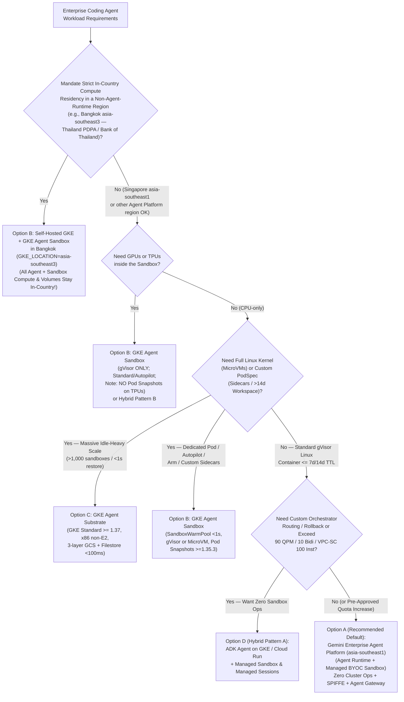

# Lab 8: Architecture & Limitations Deep-Dive — Gemini Enterprise Agent Platform vs. Self-Hosted GKE

> **Track:** Executive & Principal Engineering Architecture Deep-Dive + GKE Reference Overlay Walkthrough  
> **Duration:** 30 minutes (Full-Day Track) | 25 minutes (Half-Day Executive Briefing & Decision Tree)  
> **Antigravity Skill Companion:** [`.agents/skills/agent-runtime-vs-gke-architecture/SKILL.md`](../.agents/skills/agent-runtime-vs-gke-architecture/SKILL.md)  
> **Previous Lab:** [Lab 6: Optimize, Evaluate, Alert & Close the Flywheel](./06-LAB-OPTIMIZE-EVAL-AND-ALERTS.md) *(or [Lab 7 (Optional): Enterprise Security & Governance Hardening](./07-LAB-OPTIONAL-SECURITY-AND-GOVERNANCE.md))* | **Related:** [Facilitator Guide](./FACILITATOR-GUIDE.md)  
> **GKE Reference Manifests:** [`starter/gke_reference/`](../starter/gke_reference/) | **Reference Solution:** [`solution/gke_reference/`](../solution/gke_reference/)

---

## Learning Objectives

In Labs 1–6 you built, sandboxed, persisted state for, extended with registries, deployed, and evaluated a Coding Agent — and optionally hardened it with enterprise governance and SecOps controls in Lab 7 — on **Gemini Enterprise Agent Platform (Agent Runtime + Managed BYOC Sandbox)**. Before committing an enterprise architecture to production, Principal Architects and Platform Engineering Leads must know **exactly where the managed serverless platform shines, where its hard limits sit, and when to run self-hosted on GKE or adopt a hybrid topology**.

By the end of this module, you will be able to:
1. Evaluate all **four production deployment options** (Agent Platform Managed, GKE Agent Sandbox, GKE Agent Substrate, and `agents-cli` Hybrid/Multi-Target).
2. Defend build-vs-buy trade-offs using the verified **14-Dimension Comparison & Limitations Matrix** (exact numbers for TTLs, cold starts, GPUs/TPUs, Pod Snapshots, Dataplane V2 limits, SPIFFE/WIF identity, audit blind spots, and quotas).
3. Calculate production **Agent Platform QPM, Session Event, and Async Concurrency sizing** before launch to avoid `429 RESOURCE_EXHAUSTED` incidents.
4. Walk through (and optionally deploy) the Kubernetes CRDs and ADK `GkeCodeExecutor` code in [`starter/gke_reference/`](../starter/gke_reference/).

---

## Quick-Run TL;DR (Classroom Fast Path)

- **Focused Exercises (High-Signal TODOs):** Optional GKE comparison overlay in `starter/gke_reference/gke_agent_example.py` (`build_gke_code_executor`, `build_gke_coding_agent`, `run_warmpool_sdk_smoke_test`) + `rbac.yaml` / `sandbox_template.yaml` / `sandbox_warmpool.yaml` *(architecture review & manifest walkthrough require zero live GKE cluster!)*.
- **Key Commands (Zero Local Docker — Optional GKE Cluster in Bangkok `asia-southeast3`):**
  ```bash
  make verify-lab LAB=8                                     # Validate starter/gke_reference/ YAML + Python TODOs locally
  make verify-lab LAB=8 TRACK=solution                      # Inspect/verify complete GKE Agent Sandbox overlay directly
  kubectl apply -f solution/gke_reference/                  # Optional (only if a GKE gVisor cluster is provisioned)
  ```
- **Antigravity AI-Assisted Mode (`.agents/skills/agent-runtime-vs-gke-architecture`):** *"Using `agent-runtime-vs-gke-architecture`, complete the `# TODO(lab-8)` VAP hardening in `starter/gke_reference/` and evaluate whether our workload belongs on Agent Runtime (`asia-southeast1`) or Self-Hosted GKE (`asia-southeast3`)."*
- **Fell Behind? Instant Catch-Up:** `make fast-forward LAB=8` *(syncs only Lab 8 `gke_reference/` files from `solution/`).*

---

## 1. The Four Production Architecture Options

### Option A — Gemini Enterprise Agent Platform (Agent Runtime + Managed BYOC Sandbox)
- **What it is:** Fully serverless `ReasoningEngine` container instances paired with Google-managed, **gVisor-isolated** `SandboxEnvironment` / `SandboxEnvironmentTemplate` / `SandboxEnvironmentSnapshot` containers running in Google-managed tenant projects (built on open-source [AX](https://agentexecutor.io/) and [Substrate](https://github.com/agent-substrate/substrate)).
- **Strengths:** Zero cluster/node-pool/controller operations, native **SPIFFE Agent Identity** (24h auto-rotated X.509 mTLS + DPoP + CAA), Google-managed **Agent Gateway**, **Semantic Governance Policies**, **3LO OAuth** via Auth Manager, **Managed Sessions / Memory Bank / Feedback / Online Eval**, and `publish gemini`.
- **Hard Boundaries:** CPU-only (no GPUs/TPUs), gVisor only (no microVMs), **7-day BYOC / 14-day Code Exec** sandbox TTL, up to **2-minute** cold sandbox provisioning, **no built-in FQDN allowlist** on Scale Sandboxes (requires PSC-I + NGFW/SWP), **no auto-collected sandbox stdout/stderr** in Cloud Logging, and regional quotas (`90 QPM` default, `10 Bidi/min`, `950` non-adjustable revisions/agent).

### Option B — Self-Hosted ADK Agent on GKE + GKE Agent Sandbox (`kubernetes-sigs/agent-sandbox`)
- **What it is:** Your ADK agent runs on GKE (deployed via `adk deploy gke`, Terraform, or `agents-cli`) and spawns **1 dedicated Kubernetes Pod per agent sandbox** using Kubernetes SIG Apps `agent-sandbox` (`v1.0.6`, `v1beta1` CRDs: `Sandbox`, `SandboxTemplate`, `SandboxClaim`, `SandboxWarmPool`), `GkeCodeExecutor(executor_type="sandbox")`, or the `k8s-agent-sandbox==1.0.6` Python SDK.
- **Strengths:** **Strict in-country compute residency in any GKE region — including Bangkok (`asia-southeast3`) for Thailand PDPA & Bank of Thailand (BoT) regulated workloads prior to Agent Runtime launching locally in Bangkok!** Full Kubernetes `PodSpec` control (sidecars, `initContainers`, custom ports/protocols, `kubectl rollout undo`), **`< 1s`** warm-pool claims (`SandboxWarmPool`), **gVisor**, **Cloud Hypervisor microVMs** (full Linux kernel), or **self-managed Kata Containers** (no Google SLA), **GPUs & TPUs** (gVisor only), **GKE Pod Snapshots** (`podsnapshot.gke.io/v1`), Hyperdisk / Filestore RWX storage, and **no Agent Platform 90 QPM / 100 entity / 950 revision caps**.
- **Hard Boundaries:** You own cluster/controller upgrades (`v1.0.0` removed `v1alpha1`), `sandbox-router` HA, `secure-sandbox-policy` VAP, WIF/NetworkPolicy customization, **GKE Dataplane V2** constraints (`anetd` up to 2–3 vCPUs/node under rapid TCP churn, 260,000-entry Service map, 1,000-node cap with `CiliumNetworkPolicy` CRDs, cluster-create-only), and Pod Snapshot prerequisites (GKE `>= 1.35.3-gke.1234000`, gVisor only, non-E2 nodes for `whole-pod` scope, no TPUs).

### Option C — Self-Hosted GKE + GKE Agent Substrate (`agent-substrate/substrate`)
- **What it is:** GKE's **recommended default architecture for high-density intermittent CPU agents**. Decouples lightweight **Actor** sessions from Kubernetes Pods by multiplexing many actors onto a shared pool of pre-warmed **Worker** Pods (`WorkerPool` CRD) orchestrated by a dedicated control plane (`ate-api-server` + privileged `atelet` DaemonSet) and database **outside `kube-apiserver` and `etcd`**.
- **Strengths:** Scales to **tens to millions of suspended actors** without hitting `etcd` Pod ceilings or per-Pod `NetworkPolicy` churn; **< 1s** 3-layer automatic GCS checkpoint restore (gracefully downgrading across hardware/runtime/image updates on **both gVisor and microVMs**); **< 100 ms** Filestore agent volume re-attach; per-actor **SPIFFE X.509/JWT** with **out-of-sandbox Envoy credential injection** (secrets never enter the sandbox).
- **Hard Boundaries:** **GKE Standard ONLY `>= 1.37`** (no Autopilot, no Extended release channel), **x86 CPU only** (minimum **`c3-standard-4`** nodes; no Arm, no E2/mixed-CPU, **no GPUs or TPUs**), `> ~800` concurrent sandboxes/node requires 5 Linux kernel sysctls (`net.ipv4.neigh.default.gc_thresh1=4096`, `gc_thresh2=16384`, `gc_thresh3=32768`, `fs.inotify.max_user_instances=65536`, `fs.inotify.max_user_watches=1048576` — see [Install Agent Substrate](https://docs.cloud.google.com/kubernetes-engine/ai-ml/install-overview-substrate)), Cloud Shell cannot install it (5 GB disk limit), and highest Day-2 operational ownership.

### Option D — Hybrid & Progressive Graduation Patterns via `agents-cli` (`agent_runtime`, `cloud_run`, `gke`)
- **What it is:** Mixing the best managed control-plane capabilities with self-hosted compute/sandboxes—or graduating progressively across targets using `agents-cli` (`-d agent_runtime | cloud_run | gke`) without rewriting your ADK agent code:
  - **Hybrid Pattern A (Self-Hosted Orchestrator → Managed Sandbox & Managed State):** Run your ADK agent on **GKE or Cloud Run** (for custom UI/WebSockets, `kubectl rollout undo`, or escaping the `90 QPM` / `10 Bidi/min` runtime cap) while keeping a minimal parent `ReasoningEngine` instance strictly to call **Managed Sandboxes**, **Managed Sessions** (`VertexAiSessionService`), and **Memory Bank**.
  - **Hybrid Pattern B (Agent Runtime Orchestrator → GKE Sandbox / Substrate):** Keep your orchestrator on **Agent Runtime** for SPIFFE Agent Identity, Google-managed Agent Gateway, Semantic Governance, 3LO OAuth, and `publish gemini`, and call **GKE Agent Sandbox or Agent Substrate** over **PSC-I + GKE Gateway API** (`SandboxGatewayConnectionConfig`) whenever a task needs GPUs/TPUs, full-kernel microVMs, >14d workspaces, or >1,000 sandboxes.
  - **Hybrid Pattern C (Dual-Tier GKE):** Run **GKE Agent Sandbox** on a GKE Sandbox (`gVisor`) node pool for GPU/TPU or custom-PodSpec workloads alongside **GKE Agent Substrate** on separate non-GKE-Sandbox x86 node pools in the same GKE Standard `>= 1.37` cluster. *(Never enable GKE Sandbox on Substrate worker node pools—the `sandbox.gke.io/runtime` taint blocks `WorkerPool` Pods!)*
  - **Hybrid Pattern D (`agents-cli` Progressive Graduation):** Prototype locally (`agents-cli playground` + `eval run`) → ship Day-1 to `agent_runtime` (or `cloud_run` for IAP/Eventarc) → graduate to `gke` (`agents-cli scaffold enhance -d gke`) when scale or hardware limits demand it, keeping identical ADK code, eval datasets, and `--session-type agent_platform_sessions`.

---

## 2. Executive Decision Flowchart



> [!IMPORTANT]
> **Real-World APAC Residency Trigger — Bangkok (`asia-southeast3`) for Thailand PDPA & Bank of Thailand (BoT):**
> While **Singapore (`asia-southeast1`)** is the nearest officially supported region for managed **Agent Runtime** and **Managed Sandboxes**, regulated financial institutions, telecoms, and public-sector teams in Thailand subject to **Thailand PDPA** or **Bank of Thailand (BoT)** strict in-country compute and workspace-data residency rules often cannot execute proprietary source code or hold customer-adjacent repositories outside Thailand. **Self-Hosted GKE + GKE Agent Sandbox in Bangkok (`GKE_LOCATION=asia-southeast3`)** gives those teams an immediate, fully supported production path — keeping ADK orchestrators, gVisor/microVM sandboxes, Artifact Registry images (`asia-southeast3-docker.pkg.dev`), Cloud Build (`asia-southeast3`), Secret Manager, and Hyperdisk/Filestore volumes 100% inside Bangkok (`asia-southeast3`) until managed Agent Runtime launches locally in Bangkok! Once Agent Runtime arrives in `asia-southeast3`, identical ADK 2.0 code migrates smoothly back to managed serverless if desired.

---

## 3. Authoritative 14-Dimension Verified Comparison & Limitations Matrix

Every figure, CRD API version, quota metric, IAM role, and operational caveat below is verified directly against official Google Cloud documentation.

| # | Dimension | **Option A: Agent Runtime + Managed Sandbox** | **Option B: Self-Hosted GKE + GKE Agent Sandbox (`v1.0.6`)** | **Option C: Self-Hosted GKE + GKE Agent Substrate** | **Option D: `agents-cli` (`v1.15.0`) Orchestrator** |
|---|---|---|---|---|---|
| **1** | **Orchestration Unit, Density & Control Plane** | Serverless `ReasoningEngine` instances (`min_instances` `[0, 75]`, default `1`; `max_instances` `[1, 1000]`, default `100`, **capped at `[1, 100]` with VPC-SC or PSC-I**; `container_concurrency` default `9`, recommended `2*cpu+1` or multiples of `9` like `36` for async ADK) + gVisor `SandboxEnvironment` containers in Google-managed tenant projects (OSS: AX & Substrate). | **1 dedicated Kubernetes Pod per agent** (`Sandbox` CRD `agents.x-k8s.io/v1beta1`). Goes through `agent-sandbox-controller`, `kube-apiserver`, and `etcd`; bounded by K8s Pod scheduling throughput & cluster Pod limits. Full `PodSpec` (sidecars, `initContainers`, `kubectl`, RBAC). | Decoupled **Actor** sessions multiplexed onto shared pre-warmed **Worker** Pods (`WorkerPool` CRD) across multiple `ActorTemplate`s. Dedicated control plane (`ate-api-server`, privileged `atelet` DaemonSet) & DB **outside `kube-apiserver`/`etcd`** — tens to millions of agents; minimum **`c3-standard-4`** nodes; **`> ~800` concurrent sandboxes/node** requires 5 sysctls (`net.ipv4.neigh.default.gc_thresh1=4096`, `gc_thresh2=16384`, `gc_thresh3=32768`, `fs.inotify.max_user_instances=65536`, `fs.inotify.max_user_watches=1048576`). | Multi-target scaffold, eval, Terraform, deploy & publish CLI (`-d agent_runtime \| cloud_run \| gke`); generates ~60 files (`app/`, `deployment/terraform/`, `tests/eval/`, `tests/load_test/`). Deploys agent containers only—does **not** install GKE Agent Sandbox/Substrate CRDs or Managed Sandboxes. |
| **2** | **Provisioning & Warm-Pool Latency** | **Runtime:** cold start ~**4.7s** vs. warm ~**0.4s** (300 concurrent reqs, `min_instances=1`; `min_instances=10` cuts avg cold start to ~**1.4s**). **Managed Sandbox:** cold start **up to 2 minutes**; warm template spin-up, resume from pause, or snapshot restore in **seconds**; Shell sandbox `STATE_RUNNING` ~**20s**; Code Exec create + execute **`< 1s`**. | **`SandboxWarmPool` CRD** (dedicated per `SandboxTemplate` & image): **`< 1 second`** claim assignment. Falls back to cold Pod creation if claimed before pool replicas are `Ready` (Autopilot node scale-up can take minutes). gVisor start **`< 100 ms`**; microVM **1–2s**; direct `Sandbox` incurs multi-second Pod + disk attach. | Shared `WorkerPool` across multiple `ActorTemplate`s & images. Restores suspended Actor from 3-layer GCS checkpoint in **`< 1 second`** (matching HW/runtime/image). Filestore agent volume re-attach in **`< 100 ms`**. | Imperative `agents-cli deploy` on `agent_runtime` takes **5–10 minutes** (use `--no-wait` + `--status`). Defaults to `--min-instances 0` (dev scale-to-zero) while generated Terraform `service.tf` pins `min_instances = 1` for warm prod. |
| **3** | **TTL, Session Lifetime, Idle Suspension & Billing** | **Hard Sandbox TTLs:** up to **7 days** (BYOC / Shell) and up to **14 days** (Code Exec; `execute_code` resets TTL). `pause()`/`resume()` releases compute while keeping ID, PSC endpoint & disk. **Runtime idle scale-down:** **900s (15 min)** default; extendable via `keep_alive_probe` (Preview) up to **3600s (1 hr)** (disables CPU throttling → billed continuously). `:streamQuery` max **15 min**; `:bidi_reasoning_engine` max **10 min**; `:asyncQuery` job up to **7 days** (engines created Apr 22, 2026+). Managed Sessions default TTL: **365 days**. | **No hard platform TTL** (persists while cluster/PVCs/snapshots exist). Setting `spec.operatingMode: Suspended` **deletes the Pod** while preserving `Sandbox` CRD & PVCs (**in-memory & rootfs state are LOST unless a Pod Snapshot completes first**). Controller does **not** detect idle agents; app must trigger suspend. | **No hard platform TTL** (days/weeks across millions of suspended actors). Suspending an idle Actor checkpoints memory/rootfs/volumes to GCS and drops Worker CPU & RAM to zero. **Open network connections** (DB, MCP) are **NOT preserved** across suspend/resume—app must reconnect. | Auto-wires `VertexAiSessionService` on `agent_runtime`; on `cloud_run`/`gke`, supports `--session-type agent_platform_sessions`, Cloud SQL, or in-memory (dev). Cloud Run `--timeout` up to `3600s` (default `300s`). |
| **4** | **Snapshots, Checkpointing & Portability** | `SandboxEnvironmentSnapshot` (configurable `ttl`) saves packages, disk & memory to managed GCS (inherits parent CMEK); supports branching multiple sandboxes from one snapshot. **Unsupported on Code Exec sandboxes.** **Strict restore constraint:** fails if CPU arch (`amd64` vs `arm64`), runtime version (cluster upgrade), or `image_uri` changed. | **GKE Pod Snapshots** (`podsnapshot.gke.io/v1`: `PodSnapshotStorageConfig`, `PodSnapshotPolicy`, `PodSnapshotManualTrigger`, `PodSnapshot`) — **hard prereqs:** GKE **`>= 1.35.3-gke.1234000`** (`--enable-pod-snapshots`, Standard & Autopilot), **gVisor ONLY** (no microVMs), **NO TPUs**, no Cloud Storage FUSE CSI sidecar. Default `whole-pod` scope forbids E2 (needs matching CPU series/vendor/`CPUID`); **`rootfs-only` (file system) scope** (`>= 1.35.3-gke.1031000`) restores across machine families including E2. Supports **GPU checkpointing via NVIDIA `cuda-checkpoint`** (A100/H100/RTX PRO 6000 single-GPU & L4 `g2-standard-*` multi-GPU; no MIG). Restore takes **~3–5s** (with background memory streaming). Wait for `condition=Ready` before suspending. Hyperdisk supports CSI `VolumeSnapshot` (Filestore does not). | Built-in **3-layer automatic GCS checkpoints** (works on **both gVisor and microVMs**) with graceful downgrade: (1) Memory + rootfs + volumes (**`< 1s`** if HW/runtime/image match), (2) rootfs + volumes (if HW/runtime changed), (3) volumes-only (if `ActorTemplate` image updated). External Filestore agent volumes persist outside snapshot. | No native snapshot/checkpoint CLI verbs; versioned via container images, Git, and Terraform state. |
| **5** | **Cluster Requirements, Machine Families & Accelerators (GPU / TPU)** | **CPU-only serverless — NO GPUs or TPUs.** Runtime `resource_limits`: `cpu` in `{1, 2, 4, 6, 8}` (default `4`), `memory` in `1Gi..32Gi` (default `4Gi`). Code Exec sandbox: default **2 vCPU / 1.5 GB RAM** or `MACHINE_CONFIG_VCPU4_RAM4GIB` (**4 vCPU / 4 GB RAM**); max **100 MB** file payload per req/resp; fixed preinstalled libraries (no `pip install`). | **Any supported GKE version** (Standard **and** Autopilot); **`>= 1.35.3-gke.1234000`** for Pod Snapshots. **x86 & Arm** supported (gVisor). **GPUs & TPUs supported ONLY with `gVisor`** (NOT microVMs; **TPUs NOT supported with Pod Snapshots**). Basic Sandbox allows `e2-standard-2`, but **`whole-pod` Pod Snapshots & microVMs forbid E2** (use N2, C3, C4, N4; `rootfs-only` snapshots support E2). | **GKE Standard ONLY `>= 1.37`** (control plane & node pools). **Autopilot NOT supported** (privileged `atelet` DaemonSet; nested-virt/bare-metal microVMs). **Extended release channel NOT supported** by installer. **x86 CPU only** (minimum **`c3-standard-4`**; no Arm), **NO E2 / mixed-CPU**, uniform VM family per `ActorTemplate`. **NO GPUs or TPUs**. | `--cpu` (default `1`), `--memory` (`4Gi`), `--min-instances` (`0`), `--max-instances` (`10`), `--concurrency` (`8`) work on `agent_runtime` & `cloud_run`; **all sizing flags rejected on `gke`** (configured via Terraform + HPA in `deployment/terraform/`). |
| **6** | **Kernel Isolation Runtimes (gVisor, MicroVMs, Kata)** | Google-managed **gVisor** isolation only (Linux syscall subset; BYOC must be non-root Linux container without privileged syscalls). No microVM or Kata option. | **`gVisor`** (`runtimeClassName: gvisor`, `cos_containerd` only, `< 100 ms` start, Standard & Autopilot) OR **Cloud Hypervisor microVMs** (`runtimeClassName: microvm`, Standard only + `--enable-nested-virtualization`, `cos_containerd`/Ubuntu, **1–2s** start, fixed **250 mCPU + 130 MiB/Pod** overhead, full Linux kernel). Also supports **self-managed Kata Containers** (**NO Google support or SLA**). **VAP Gotcha:** `secure-sandbox-policy` enforces `runtimeClassName == gvisor` (rejects microVMs & Istio/Envoy `istio-init` `NET_ADMIN`/`NET_RAW` unless edited). | **gVisor** or **Cloud Hypervisor microVMs** managed *inside* `WorkerPool` Pods (`cos_containerd` only; microVMs require x86 nested virt or x86 bare metal + `<snapshot-bucket>-assets`). **CRITICAL:** Never enable GKE Sandbox on Substrate worker node pools (`sandbox.gke.io/runtime` taint blocks `WorkerPool` Pods). | Deploys standard containers (`Dockerfile` / `--image`); does **not** emit `runtimeClassName: gvisor`/`microvm` or VAP security manifests on GKE. |
| **7** | **Networking, Egress Control, VPC-SC & Dataplane V2 Limits** | Code Exec: **zero internet/VPC**. BYOC/Shell: `internet_access: False` default (`True` = unrestricted `0.0.0.0/0`, blocks RFC 1918 & `169.254.0.0/16`). **No native domain allowlist** on Scale Sandboxes *(contrast: Pre-GA Managed Agents API has native `allowlist`)*. FQDN/URL filtering requires **PSC-I (`network_attachment`, min `/28` subnet) + Cloud NGFW (`--dest-fqdns` + deny `0.0.0.0/0`) or Secure Web Proxy + Cloud DNS peering** (public DNS forwarding disabled). Private ingress: **PSC-E** (max **1** consumer project, same project). VPC-SC (`199.36.153.4/30`, caps runtime `max_instances` at `100`; PSC-I immutable). Managed Agent Gateway governs up to **5,000** Registry resources (`AGENT_TO_ANYWHERE` default-deny; VPC-SC requires gateways created after Sept 8, 2026). | `Sandbox Router` (`agent-sandbox-system`) + auto-generated default-deny `NetworkPolicy` (`networkPolicyManagement: Managed`) **per `SandboxTemplate` ONLY** (NOT direct `Sandbox`): ingress only from `app: sandbox-router`, egress allows public internet while blocking RFC 1918, CoreDNS & `169.254.0.0/16`. Standard L4 `NetworkPolicy` + L7 **[`FQDNNetworkPolicy`](https://docs.cloud.google.com/kubernetes-engine/docs/how-to/fqdn-network-policies)** *(GKE Dataplane V2 + `kube-dns`/Cloud DNS, max **50 resolved IPs/policy**, **must list all domain aliases queried directly by Pods [upstream CNAME chains are followed automatically]**, no Cloud Service Mesh, no ClusterIP/Headless targets)*. **[GKE Dataplane V2](https://docs.cloud.google.com/kubernetes-engine/docs/concepts/dataplane-v2) Operational Limits:** Cluster-create-only (cannot upgrade existing clusters); `anetd` (Cilium/eBPF) can consume **2–3 vCPUs/node** under rapid TCP connection open/close churn (use HTTP keep-alives & pooling) and reserves **0.25%** of node RAM for eBPF maps; **260,000**-entry Service map; `CiliumNetworkPolicy` CRD caps clusters at **1,000 nodes** (use `CiliumClusterwideNetworkPolicy` up to 5,000); drops fragmented ICMP; conflicts with third-party eBPF tools (e.g., Retina). **Dual-Stack IPv6 Gotcha:** up to **2-min** timeout without IPv6 NAT (`NODE_OPTIONS="--dns-result-order=ipv4first --no-network-family-autoselection"`). Self-managed Agent Gateway on GKE (Gateway API + ambient + SWP). | Built-in **Envoy ingress/egress gateways** with per-actor mTLS tunnels. Default-deny to other actors, K8s control plane, GCE metadata server & internet; blocks non-DNS UDP, raw TCP & WebSockets. Native `EgressPolicy` filters HTTP/HTTPS/TLS by **FQDN or wildcard hostname only** (**IPs/CIDRs NOT supported**). Avoids per-actor K8s `NetworkPolicy` and Pod-churn overhead because Actors share Worker Pods. | `--network-attachment`, `--dns-peering-*`, `--agent-gateway-{egress,ingress}`, and `--agent-gateway` Dockerfile CA bundle (`AGENT_GATEWAY_ROOT_CERTIFICATES`) work on **`agent_runtime` ONLY**. `--iap` & `--ingress` work on **`cloud_run` ONLY**. GKE networking managed in Terraform. |
| **8** | **Identity, Credentials & Secrets** | **Strict Split Trust:** Parent `ReasoningEngine` uses **SPIFFE Agent Identity** (`principal://agents.global.org-ORG_ID.system.id.goog/...`, 24h auto-rotated X.509 mTLS+DPoP+CAA; auto-granted `roles/aiplatform.agentContextEditor` & `roles/aiplatform.agentDefaultAccess`; immutable; 3LO dual-attribution via Auth Manager) OR custom SA. **In-Sandbox:** unprivileged `sandbox-untrusted`/`appuser`, **ZERO ambient credentials, NO ADC, NO metadata server (`169.254.169.254:80`), NO `sudo`, NO project IAM roles**. 3 distinct service agents (`gcp-sa-vertex-sandbox`, `gcp-sa-aiplatform-re`, `gcp-sa-aiplatform`). | Pod KSA via **Workload Identity Federation for GKE (WIF)** or **Agent Identity (Preview)** — bound at Pod creation, so **all Pods in a `SandboxWarmPool` share one identity** (isolate tenants via separate warm pools or direct `Sandbox`). **WIF Gotcha:** auto-generated `NetworkPolicy` blocks `169.254.169.254` AND VAP enforces `automountServiceAccountToken: false` — customize NetworkPolicy to enable WIF. `adk deploy gke` uses `default/default` KSA (`403` unless bound to `roles/aiplatform.user`). | Per-actor **SPIFFE X.509 certificate & JWT**. Built-in **out-of-sandbox credential injection** at Envoy egress gateway (replaces placeholder headers with K8s `Secret` or Secret Manager secrets over mTLS—secrets never enter sandbox). WIF only for worker infra (`ate-snapshot-transfer` GSA impersonated by `ate-api-server` KSA via `roles/iam.serviceAccountTokenCreator` → GKE nodes need no bucket access). | Defaults to **Agent Identity** on `agent_runtime` & `cloud_run` (irreversible on Cloud Run; `--agent-identity` rejected on `gke`). Scaffolds `app_sa` + `cicd_runner_sa` (GitHub Actions WIF). `--secrets` on `agent_runtime`/`cloud_run`; on `gke`, grant `roles/secretmanager.secretAccessor` in Terraform. |
| **9** | **Workspace Storage & CMEK** | Ephemeral sandbox disk + managed GCS for pause/snapshot state; Code Exec **100 MB** payload cap. **CMEK:** single-region KMS key immutable at parent `ReasoningEngine` create (`gcp-sa-aiplatform-re` needs `roles/cloudkms.cryptoKeyEncrypterDecrypter`); encrypts node boot disk/rootfs & snapshot bucket (NOT metadata, env vars, or AR images). Standalone Sessions/Memory Bank support regional + multi-regional CMEK (`us`/`eu`; none on `global`). | **Hyperdisk Balanced** (RWO: **4 GiB–64 TiB** [`128 TiB` C4], max **128 disks/node**, **2,400 MiB/s**, **3k–160k IOPS**, multi-sec attach, scale-up only, CSI snapshots) / **Hyperdisk ML** (ROX: up to **2,500 instances**/vol) / **Filestore Multishares Enterprise** (RWX: **1–10 TiB** inst, **10 GiB–1 TiB**/share, max **80 shares** & **20k conns**/inst, **120 MiB/s** & **12k R/4k W IOPS per TiB**, ~**6m** inst create, sub-sec NFS mount, no per-share CSI snapshots). Full customer CMEK on disks/GCS/etcd. | GCS **Snapshot bucket** + **`<bucket>-assets`** bucket (microVM kernel/rootfs). **Filestore agent volumes** (Allowlisted GA / Preview CSI: `CSIDriverConfig` `ate.dev/v1alpha1`, `StorageClass` `filestore.csi.storage.gke.io`, per-actor exclusive volume deleted with actor, **`< 100 ms`** re-attach; no automated snapshots/cloning/tiering). Hyperdisk NOT used for per-actor CSI volumes. | `--key` sets CMEK on dev `agent_runtime` create only (staging/prod via Terraform); `agents-cli infra single-project --apply` provisions GCS prompt-response bucket & BQ dataset (must run *before* first deploy). |
| **10** | **Observability, Logging & Audit Blind Spots** | Parent `ReasoningEngine` auto-collects `reasoning_engine_stdout`/`stderr`, Cloud Trace, Monitoring, dual-attribution `is_agentic=true`, native Model Armor trace spans, Agent Anomaly Detection (`AGENT_SESSION_ANOMALY` → SCC), and Online Monitors. **CRITICAL BLIND SPOTS:** (1) Automatic `reasoning_engine_stdout`/`stderr` does **NOT** collect Managed Sandbox, Sessions, Memory Bank, or Example Store logs—parent agent must log sandbox output; (2) Cloud Audit Logs do **NOT** log guest child subprocesses, syscalls, file writes, or WS/CDP/PTY frames; (3) **VPC-SC omits request/response payloads** from `DATA_WRITE` audit logs. | Native GKE Cloud Logging captures Pod `stdout`/`stderr` automatically. Managed Prometheus (`PodMonitoring` scraping `/metrics:8080` → `agent_sandbox_build_info`, `agent_sandboxes`, `agent_sandbox_claim_controller_startup_latency_ms`; Prometheus `namespace` label renamed to **`exported_namespace`**). Cloud Trace via OTel + **Agent Anomaly Detection** (`GKE_WORKLOAD`, ADK Python `>= 2.1.0`). Guest syscall auditing still requires custom eBPF/guest tooling. | GKE Cloud Logging + **Managed OpenTelemetry for GKE** (documented limits: **collector connectors unsupported** → external proxy meter needed for benchmarks; **collector memory cache scales linearly with Pod count**; **TLS unsupported**). Per-actor SPIFFE cert/JWT enables per-actor egress attribution at Envoy gateway. | Scaffolds 3 additive tiers: (1) Cloud Trace (always on), (2) GCS/BQ completions (Terraform default On; Python ADK/Claude only; independent of `OTEL_INSTRUMENTATION_GENAI_CAPTURE_MESSAGE_CONTENT`), (3) `--bq-analytics`. **Python vs. Go OTel Gotcha:** Python requires enum (`EVENT_ONLY`), Go requires boolean (`"1"`/`"true"`). |
| **11** | **Hard Quotas, System Limits & Express Mode** | **Regional Quotas (project/region):** `Query`/`StreamQuery` **90 QPM**; Concurrent `BidiStreamQuery` **10/min**; Max resources **100** regional (+ **100** non-regional); Runtime writes **10/min**; Code Exec Sandbox **1,000 execute/min**, **1,000 entities/region**, **500 writes/min**; Sessions **100 writes/min**, **300 appends/min**; Memory Bank **100 writes/min**, **300 reads/min**; A2A **60 post/min**, **600 get/min**; Example Store **50/region**. **Non-adjustable system limits:** **6,000 revisions/project/region** & **950 revisions/agent** (auto-GC default `100` new / `950` existing). **Express Mode:** **10** resources, **10** write/min, **10** query/min, **1** bidi/min, **10** session write/min, **30** appends/min, **10** memory R/W per min. | **No Agent Platform 90 QPM / 100 entity / 950 revision caps.** Bounded by GCE/GKE quotas, `kube-apiserver`/`etcd` throughput, **Hyperdisk (128 disks/node)**, **Filestore (80 shares/instance, 20k connections)**, **Dataplane V2 (400k Pods, 260k Service map entries, 1,000-node cap with `CiliumNetworkPolicy`)**, and **`FQDNNetworkPolicy` (50 IPs/policy)**. | Bypasses `kube-apiserver`/`etcd` Pod limits to scale to **millions of suspended actors**. Bounded by GCE/GKE node quotas (min **`c3-standard-4`**), GCS/Filestore throughput, and **`> ~800` concurrent sandboxes/node** kernel sysctl limits (`gc_thresh1/2/3`, `inotify`). | Inherits target quotas + GenAI Eval Service 14 US/EU regions + `global` (`eval analyze` `global`-only; `--qps 15` default). |
| **12** | **Runtime Contract, DX, Rollback & Emergency Stop** | Strict HTTP contract: `0.0.0.0:8080`, `GET /` `200 OK`, `POST /api/reasoning_engine`, `/api/stream_reasoning_engine`, `/api/bidi_reasoning_engine`; reserved keep-alive ports `15000,15001,15006,15007,15020,15021`; inline archive max **8 MB**. **No `gcloud` CLI** for deploy (**no Terraform resource for Managed Sandboxes**). Traffic split/rollback via `v1beta1` `trafficSplitManual` (Gateway binding change irreversibly archives prior revisions!). **Emergency Stop:** `runtimes.delete(..., force=True)` (seconds–few min) vs. UAP/IAM `DENY` (**2–7+ min**; `principalSet` min–hours; leaves open streams alive). | Any port/protocol/UI (`--with_ui`, LoadBalancer, Gateway API). Rollback: `kubectl rollout undo`. `adk deploy gke` (Python only, default `ClusterIP`; Go manual via `gcloud`+`kubectl`, `/api` prefix & `camelCase` vs Python `snake_case`; Python SQLite `.dockerignore` readonly gotcha). `k8s-agent-sandbox==1.0.6` SDK + `GkeCodeExecutor` (`google-adk[extensions]>=2.0.0`, ADK Python 2.0+). **Uninstall Gotcha:** `kubectl delete -f sandbox-with-extensions.yaml` cascading-deletes all CRDs & sandboxes across all namespaces! | Managed via `kubectl ate` (`create atespace`, `actor-template`, `create/suspend/resume actor`) + K8s CRDs (`WorkerPool`, `CSIDriverConfig` `ate.dev/v1alpha1`). **Cloud Shell install blocked** (5 GB disk limit). No `adk deploy` CLI integration. | Unified DX (`create`, `scaffold enhance`, `playground`, `eval`, `infra`, `deploy`, `publish`). **Target Asymmetries:** no revision rollback on `agent_runtime` (must redeploy; use `gcloud run services update-traffic` on Cloud Run / `kubectl rollout undo` on GKE); cannot switch existing `agent_runtime` between source & `--image`; cannot run `infra single-project` *after* imperative `deploy`; `publish gemini` supports ADK on `agent_runtime` vs. A2A-only on Cloud Run/GKE. |
| **13** | **Ops Burden, Support/SLA & Cost / TCO** | **Lowest Ops Burden** — zero cluster, node pool, controller, or CRD upgrades; full Google SLA (GA features). **Serverless TCO:** vCPU-hr + memory-hr; **not billed when idle (`min_instances=0`)** *(keep-alive probe disables CPU throttling → billed continuously; `min_instances>=1` incurs standby cost)*. Managed Sandbox bills active compute + reduced cost in `STATE_PAUSED` + GCS snapshot storage. | **Medium–High Ops Burden** — own cluster/node pools, controller upgrades (`v1.0.0` broke `v1alpha1`), `sandbox-router` HA/TLS, VAP, custom NetworkPolicies, `PodMonitoring`. **Zero OSS license fee**; pay GKE compute (including `SandboxWarmPool` standby Pods) + Hyperdisk/Filestore + GCS snapshots (**set `--soft-delete-duration=0d`** to avoid temp-file billing!). **Kata Containers has NO Google support/SLA.** | **Highest Ops Burden** — GKE Standard `>= 1.37`, uniform VM node pools, nested-virt/bare-metal sizing, `> 800`/node sysctl tuning, `ate-api-server`/`atelet` ops, Filestore CSI overlay, Envoy egress gateway. **Zero OSS license fee**; **best TCO at high idle-ratio / massive scale** (shared `WorkerPool` + zero idle CPU/RAM while suspended in GCS/Filestore). | **Free OSS CLI** (`uv tool install google-agents-cli`). Minimizes Day-0/Day-2 engineering TCO via generated Terraform (`single-project` + `cicd`), load tests, and CI eval gates across all 3 targets. |
| **14** | **Hybrid & Migration Patterns** | **Pattern A:** Scale Sandboxes work from **local, Cloud Run, or GKE** via a minimal parent `ReasoningEngine`.<br>**Pattern B:** Keep Agent Runtime for SPIFFE, Agent Gateway, 3LO & `publish gemini`; call GKE sandboxes over PSC-I + GKE Gateway API for GPUs/TPUs, microVMs, or >14d workspaces. | **Pattern C:** Dual-tier GKE (Agent Sandbox `gVisor` GPU/TPU pool + Agent Substrate non-GKE-Sandbox pool on Standard `>= 1.37`).<br>**Pattern D:** Use `--session-type agent_platform_sessions` (`VertexAiSessionService`), Memory Bank & Agent Anomaly Detection (`GKE_WORKLOAD`) from GKE. | **Pattern C** + **Burst Graduation:** Start on Agent Runtime + Managed Sandbox; graduate execution plane to Agent Substrate when exceeding `1,000` sandboxes/region, needing `< 1s` cross-version restore, or high idle-to-active ratios with Filestore agent volumes. | **Progressive Graduation:** Prototype (`playground` + `eval run`) → ship fast to `agent_runtime` (or `cloud_run`) → graduate to `gke` (`agents-cli scaffold enhance -d gke`) while keeping ADK code, evals & Managed Sessions intact. |

---

## 4. Deep-Dive Engineering Sections

### 4.1 Agent Platform Quota & Concurrency Sizing Math (Preventing `429` Outages)

Default regional quotas on Gemini Enterprise Agent Platform are sized for development and pilots—**production coding agents WILL hit `90 QPM` and `300 session event appends/min` immediately unless pre-sized**.

#### Verified Production Quotas (`resources/agent-quotas`, per Project per Region)

| Quota / Limit | Production Default | Express Mode (Free Tier) | Adjustable? | Cloud Quotas Metric |
|---|---:|---:|---|---|
| `Query` / `StreamQuery` per min | **90** | 10 | Yes | `aiplatform.googleapis.com/reasoning_engine_service_query_requests` |
| Concurrent `BidiStreamQuery` per min | **10** | 1 | Yes | `aiplatform.googleapis.com/reasoning_engine_service_concurrent_query_requests` |
| Runtime writes (create/update/delete) per min | **10** | 10 | Yes | `aiplatform.googleapis.com/reasoning_engine_service_write_requests` |
| Max Agent Platform resources (regional) | **100** | 10 | Yes | `aiplatform.googleapis.com/reasoning_engine_service_entities` |
| Code Execution sandbox execute reqs / min | **1,000** | — | Yes | `aiplatform.googleapis.com/sandbox_environment_execute_requests` |
| Code Execution sandbox entities / region | **1,000** | — | Yes | `aiplatform.googleapis.com/sandbox_environment_entities` |
| Code Execution sandbox write reqs / min | **500** | — | Yes | `aiplatform.googleapis.com/sandbox_environment_write_requests` |
| Session event appends / min | **300** | 30 | Yes | `aiplatform.googleapis.com/session_event_append_requests` |
| Session writes / min | **100** | 10 | Yes | `aiplatform.googleapis.com/session_write_requests` |
| Memory Bank writes / reads per min | **100 / 300** | 10 / 10 | Yes | `aiplatform.googleapis.com/memory_bank_{write,read}_requests` |
| A2A Agent `POST` / `GET` per min | **60 / 600** | — | Yes | `aiplatform.googleapis.com/a2a_agent_{post,get}_requests` |
| Max revisions per project per region | **6,000** | — | **NO** | `aiplatform.googleapis.com/agent_engine_revisions_per_project_per_region` |
| Max revisions per agent *(hidden from UI)* | **950** | — | **NO** | `aiplatform.googleapis.com/agent_engine_revisions_per_agent` |

#### Worked Production Sizing Calculation (250 Concurrent Developers)

Let:
- `U = 250` peak concurrent developers
- `X = 2` average requests/user/minute
- `Y = 12` average session events/request (multi-tool coding chain: user turn → LLM call → `ReadFile` → tool result → LLM call → `EditFile` → tool result → LLM call → `Execute` (`pytest`) → tool result → LLM call → final response)

Compute with the official **50% spike buffer (`* 1.5`)**:
1. **Peak QPM:** `U * X * 1.5 = 250 * 2 * 1.5 = 750 QPM` (`reasoning_engine_service_query_requests` — **8.3× above the 90 QPM default**).
2. **Peak Session Event Appends/min:** `(U * X) * Y * 1.5 = 500 * 12 * 1.5 = 9,000/min` (`session_event_append_requests` — **30× above the 300/min default**).
3. **Peak Session Writes/min:** `<= 500 * 1.5 = 750/min` (`session_write_requests` — **7.5× above the 100/min default**).
4. **Async Container Concurrency ([Optimize and Scale](https://docs.cloud.google.com/gemini-enterprise-agent-platform/scale/runtime/optimize-and-scale)):** Agent Runtime runs **9** worker processes per container (`concurrency / 9` concurrent requests per process). Under 300 concurrent requests (`min_instances=10`), raising `container_concurrency` from the default `9` to `36` drops max latency from **60s → ~7s** (monitor container memory to avoid OOM as concurrency scales linearly with RAM).

---

### 4.2 GKE Kernel Isolation Runtimes: gVisor vs. Cloud Hypervisor MicroVMs vs. Kata Containers

| Feature | **gVisor** (`runtimeClassName: gvisor`) | **Cloud Hypervisor MicroVMs** (`runtimeClassName: microvm`) | **Self-Managed Kata Containers** |
|---|---|---|---|
| **Isolation Mechanism** | User-space kernel intercepting/filtering a subset of Linux syscalls | Hardware virtualization with dedicated guest Linux kernel (full syscall compatibility) | Self-installed OSS VM container runtime on GKE Standard nodes |
| **Start Latency** | **`< 100 ms`** | **1–2 seconds** | Customer-managed |
| **Per-Pod Overhead** | Dynamic overhead, low base RAM | **GKE Sandbox:** fixed **250 mCPU + 130 MiB/Pod** · **Substrate:** per-actor VMM RAM | Customer-managed |
| **GKE Modes & OS** | Standard (`--sandbox=type=gvisor`) & **Autopilot**; `cos_containerd` only | **Standard only** (no Autopilot); `--enable-nested-virtualization` or x86 bare metal (Substrate); `cos_containerd` or Ubuntu | Standard only (manual) |
| **Machine Families** | Most x86, Arm & accelerators (**Pod Snapshots / Substrate forbid E2 & Arm**) | x86 supporting nested virt (`C3`, `C4`, `N2`, `N4`, etc.) & bare metal; **no E2, no Arm** | Customer-managed |
| **GPUs / TPUs** | Supported in Agent Sandbox (`gVisor` only); **NOT** in Substrate; **TPUs unsupported with Pod Snapshots** | **Not supported** | N/A |
| **Google Support & SLA** | Full GKE Support & SLA | Full GKE Support & SLA | **NOT a Google Cloud product — NO Google support or SLA** |
| **VAP Policy Gotcha** | Allowed by `secure-sandbox-policy` | **Rejected** by default `secure-sandbox-policy` (enforces `runtimeClassName == gvisor`) | Rejected unless VAP edited |

---

### 4.3 GKE Pod Snapshots & Storage Engineering Caveats

If you choose **Option B (GKE Agent Sandbox)** and need suspend/resume that preserves in-memory and rootfs state (`~3–5s` kernel restore with background memory streaming — see [GKE Pod Snapshots Concepts](https://docs.cloud.google.com/kubernetes-engine/docs/concepts/pod-snapshots)):
- **Hard Prerequisites & Snapshot Scopes (`whole-pod` vs. `rootfs-only`):**
  - Requires GKE **`>= 1.35.3-gke.1234000`** (`--enable-pod-snapshots`, Rapid channel), **`gVisor` ONLY**, **NO TPUs**, and **NO Cloud Storage FUSE CSI sidecar**.
  - **Default `whole-pod` scope:** Captures process memory + rootfs, requiring the target node to match machine series, CPU vendor, and `CPUID` flags (**NO E2 machine types** — on Autopilot, define a custom `ComputeClass` e.g. `non-e2-class` with `machineFamily: n2` / `c3`, `activeMigration.optimizeRulePriority: false`, `whenUnsatisfiable: DoNotScaleUp`).
  - **`rootfs-only` (file system) scope (`>= 1.35.3-gke.1031000`):** Skips process memory and distilled Pod spec hash matching, enabling restore across **different machine families (including E2)** while keeping compatible container images and node versions.
- **GPU Checkpointing (`cuda-checkpoint`):** Pod Snapshots support GPU workloads using NVIDIA's **`cuda-checkpoint`** tool, which writes GPU state into Pod process memory during snapshot and reverses it on restore (increase Pod memory limits accordingly, and measure readiness via TTFT / readiness probes since GPU state streams asynchronously in the background). Supported GPU machine types: **`a2-highgpu-1g`** (A100-40GB), **`a2-ultragpu-1g`** (A100-80GB), **`a3-highgpu-1g`** (H100-80GB), **`g4-standard-48`** (RTX PRO 6000), and single- or multi-GPU L4 **`g2-standard-*`** (`4, 8, 12, 16, 32, 48, 96`; multi-GPU Pods are supported **only** on L4 `g2-standard-*`; **Multi-Instance GPU [MIG] is NOT supported**).
- **Lifecycle Synchronization Rule:** Always wait for `PodSnapshot` `condition=Ready` before patching `Sandbox` `spec.operatingMode: Suspended`—otherwise the next resume cold-starts from scratch!
- **GCS Billing & IAM Traps:**
  - Create the snapshot bucket with `--uniform-bucket-level-access --enable-hierarchical-namespace --soft-delete-duration=0d` (omitting `--soft-delete-duration=0d` bills soft-deleted temporary snapshot chunks!).
  - Grant **`service-${PROJECT_NUMBER}@container-engine-robot.iam.gserviceaccount.com`** `roles/storage.objectUser` on the bucket, and note that custom IAM role `podSnapshotGcsReadWriter` carries a **37-day deletion cooldown** before the role ID can be reused.
- **Storage Decision Rule:** Use **Hyperdisk Balanced** (RWO, 4 GiB–64 TiB, 128 disks/node, CSI `VolumeSnapshot`) for single-agent isolated workspaces; **Hyperdisk ML** (ROX, up to 2,500 instances/vol) for read-only model weights/datasets; **Filestore Multishares Enterprise** (RWX, 1–10 TiB, 80 shares/instance, sub-second NFS mount, no CSI snapshots) for collaborative multi-agent workspaces; and **Filestore agent volumes** (`< 100 ms` re-attach) for high-churn **Agent Substrate** actors.

---

## 5. Walkthrough of `starter/gke_reference/` (GKE Agent Sandbox Overlay)

Open the four comparison-track files under [`starter/gke_reference/`](../starter/gke_reference/). Each `starter/gke_reference/` file includes an optional hands-on **`# TODO(lab-8)`** hardening/wiring exercise (complete, ready-to-apply manifests and Python implementation live in [`solution/gke_reference/`](../solution/gke_reference/)):

1. **[`starter/gke_reference/sandbox_template.yaml`](../starter/gke_reference/sandbox_template.yaml)** (`extensions.agents.x-k8s.io/v1beta1`, `kind: SandboxTemplate`):
   - Complete `# TODO(lab-8)` to enforce `secure-sandbox-policy` VAP compliance: `runtimeClassName: gvisor`, `automountServiceAccountToken: false`, `securityContext.runAsNonRoot: true`, `capabilities.drop: ["ALL"]`, explicit CPU/memory `limits`, and `nodeSelector` + `tolerations` for `sandbox.gke.io/runtime: gvisor`.
   - Because it uses `SandboxTemplate` (not a bare `Sandbox`), the controller automatically creates a managed `NetworkPolicy` (`networkPolicyManagement: Managed`) allowing ingress **only** from `app: sandbox-router` in `agent-sandbox-system` and blocking RFC 1918, CoreDNS, and `169.254.0.0/16` metadata egress.
2. **[`starter/gke_reference/sandbox_warmpool.yaml`](../starter/gke_reference/sandbox_warmpool.yaml)** (`extensions.agents.x-k8s.io/v1beta1`, `kind: SandboxWarmPool`):
   - Complete `# TODO(lab-8)` to set warm-pool `replicas: 2` referencing your `SandboxTemplate` (`coding-sandbox-template`) for **`< 1s`** `SandboxClaim` assignment.
   - *(Operational check: verify `metadata.ownerReferences[*].kind` on `Sandbox` objects—`SandboxWarmPool` = idle/unclaimed; `SandboxClaim` = claimed/in-use. Claiming before warm-pool replicas are `Ready` falls back to cold Pod creation!)*
3. **[`starter/gke_reference/rbac.yaml`](../starter/gke_reference/rbac.yaml)** (`Role` & `RoleBinding`):
   - Complete `# TODO(lab-8)` to grant your ADK orchestrator's Kubernetes Service Account `create, get, watch, delete` across BOTH **distinct Agent Sandbox API groups**: **`extensions.agents.x-k8s.io`** for `sandboxclaims` (and `sandboxtemplates` / `sandboxwarmpools`) AND **`agents.x-k8s.io`** for `sandboxes` (the exact RBAC required by `GkeCodeExecutor(executor_type="sandbox")`).
   - *(Remember: `adk deploy gke` defaults to `default/default` KSA—bind it via WIF to `roles/aiplatform.user` or specify a dedicated KSA to avoid `403 PERMISSION_DENIED`.)*
4. **[`starter/gke_reference/gke_agent_example.py`](../starter/gke_reference/gke_agent_example.py)**:
   - Complete `# TODO(lab-8)` (`build_gke_code_executor`, `build_gke_coding_agent`, `run_warmpool_sdk_smoke_test`) to swap Agent Platform's `AgentEngineSandboxCodeExecutor` for ADK's **`GkeCodeExecutor`** (`pip install "google-adk[extensions]>=2.0.0"`, ADK Python 2.0+):
     ```python
     from google.adk.agents import LlmAgent
     from google.adk.code_executors import GkeCodeExecutor

     executor = GkeCodeExecutor(
         namespace="agent-sandbox-system",
         executor_type="sandbox",
         sandbox_template="coding-sandbox-template",
         sandbox_gateway_name="coding-sandbox-gateway",  # optional for external LB access
     )
     gke_coding_agent = LlmAgent(
         name="gke_sandbox_coding_agent",
         model="gemini-2.5-flash",
         instruction="Write and execute code inside the GKE gVisor sandbox.",
         code_executor=executor,
     )
     ```
   - Also illustrates the standalone **`k8s-agent-sandbox==1.0.6`** Python SDK (`SandboxClient` with `SandboxLocalTunnelConnectionConfig` for dev `kubectl port-forward`, `SandboxDirectConnectionConfig` for in-cluster Router access, and `SandboxGatewayConnectionConfig` for external GKE Gateway API access).

### Optional Hands-On Deployment Commands (GKE Cluster Required — e.g., Bangkok `asia-southeast3`)

If your facilitator provisioned a GKE demo cluster with a gVisor node pool (`--sandbox=type=gvisor`) — for example in **Bangkok (`GKE_LOCATION=asia-southeast3`)** for strict Thailand PDPA / Bank of Thailand compute residency — you can deploy the reference overlay directly:

```bash
# Example cluster credentials target (Bangkok primary GKE region):
# export GKE_LOCATION="${GKE_LOCATION:-asia-southeast3}"
# gcloud container clusters get-credentials coding-agent-gke --region="${GKE_LOCATION}" --project="${GOOGLE_CLOUD_PROJECT}"

# 1. Install Kubernetes SIG Apps agent-sandbox v1.0.6 (CRDs + controller + sandbox-router)
export AGENT_SANDBOX_VERSION="v1.0.6"
kubectl apply -f \
  "https://github.com/kubernetes-sigs/agent-sandbox/releases/download/${AGENT_SANDBOX_VERSION}/sandbox-with-extensions.yaml"

kubectl wait --for=condition=Available deployment/agent-sandbox-controller \
  -n agent-sandbox-system --timeout=120s

# 2. Apply our workshop SandboxTemplate, SandboxWarmPool, and RBAC manifests
kubectl apply -f solution/gke_reference/rbac.yaml
kubectl apply -f solution/gke_reference/sandbox_template.yaml
kubectl apply -f solution/gke_reference/sandbox_warmpool.yaml

# 3. Verify warm-pool readiness (<1s claim path)
kubectl get sandboxwarmpool,sandbox -n agent-sandbox-system
```

> [!CAUTION]
> **Safe Teardown Warning:** Delete ONLY your namespace resources (`kubectl delete -f solution/gke_reference/`). **NEVER run `kubectl delete -f sandbox-with-extensions.yaml` on a shared cluster**—it deletes the CRDs themselves and **cascading-deletes every `Sandbox`, `SandboxTemplate`, `SandboxClaim`, and `SandboxWarmPool` across ALL namespaces**!

---

## Architecture Review Checkpoint

Before wrapping up the workshop, confirm your architecture team can answer these six design questions for your own enterprise workload:
- [ ] **Regional & Regulatory Residency:** Does your compliance posture permit running Agent Runtime & Managed Sandboxes in **Singapore (`asia-southeast1`)**, or do **Thailand PDPA / Bank of Thailand** (or equivalent local) mandates require running **Self-Hosted GKE + GKE Agent Sandbox directly in Bangkok (`asia-southeast3`)** until Agent Runtime launches locally?
- [ ] Have we calculated `U * X * 1.5` QPM and `Peak QPM * Y * 1.5` session event appends/min against Agent Platform's `90 QPM` / `300 appends/min` defaults?
- [ ] Do our coding workloads stay within CPU-only gVisor containers and 7-day BYOC / 14-day Code Exec TTLs—or do they require GPUs/TPUs, full-kernel microVMs, or >14d workspaces on GKE?
- [ ] If using Managed Sandboxes with external package registries or internal APIs, have we budgeted for PSC-I (`network_attachment` >= `/28`) + Cloud NGFW/SWP + Cloud DNS peering AND parent-agent logging of sandbox `stdout`/`stderr`?
- [ ] If choosing GKE Agent Sandbox at scale, have we planned for GKE Dataplane V2 constraints (cluster-create-only, HTTP keep-alives/pooling to bound `anetd` CPU under rapid TCP churn, `260,000`-entry Service map, `1,000`-node `CiliumNetworkPolicy` limit), `FQDNNetworkPolicy` direct-alias rules (`50` IPs/policy), and Pod Snapshot prerequisites (`>= 1.35.3-gke.1234000`, gVisor, non-E2 for `whole-pod` or `>= 1.35.3-gke.1031000` for `rootfs-only`, `--soft-delete-duration=0d`)?
- [ ] Does a **Hybrid Pattern** (e.g., Agent Runtime orchestrator + GKE GPU/microVM sandbox, OR GKE orchestrator + Managed Sandbox/Sessions) deliver lower TCO than an all-or-nothing choice?

*(Optional automated check — if you completed the `# TODO(lab-8)` exercises in `starter/gke_reference/`, validate them with `./scripts/verify_lab.sh 8` or `make verify-lab LAB=8`; verify the reference manifests directly with `./scripts/verify_lab.sh 8 --track solution`.)*

---

## Canonical Reference Documentation

- **Agent Platform Quotas & System Limits:** https://docs.cloud.google.com/gemini-enterprise-agent-platform/resources/agent-quotas
- **Agent Platform Optimize & Scale (Concurrency & Cold Starts):** https://docs.cloud.google.com/gemini-enterprise-agent-platform/scale/runtime/optimize-and-scale
- **Agent Platform Managed Sandbox Overview:** https://docs.cloud.google.com/gemini-enterprise-agent-platform/scale/sandbox
- **GKE Agent Sandbox Concepts:** https://docs.cloud.google.com/kubernetes-engine/docs/concepts/machine-learning/agent-sandbox
- **Install GKE Agent Sandbox (`v1.0.6`):** https://docs.cloud.google.com/kubernetes-engine/docs/how-to/how-install-agent-sandbox
- **Use GKE Agent Sandbox:** https://docs.cloud.google.com/kubernetes-engine/docs/how-to/agent-sandbox
- **GKE Pod Snapshots Concepts (`whole-pod`, `rootfs-only` & GPU `cuda-checkpoint`):** https://docs.cloud.google.com/kubernetes-engine/docs/concepts/pod-snapshots
- **GKE Agent Sandbox Pod Snapshots How-To:** https://docs.cloud.google.com/kubernetes-engine/docs/how-to/agent-sandbox-pod-snapshots
- **GKE Dataplane V2 Concepts & Technical Specifications:** https://docs.cloud.google.com/kubernetes-engine/docs/concepts/dataplane-v2
- **GKE `FQDNNetworkPolicy` How-To (CNAME Chasing & IP Limits):** https://docs.cloud.google.com/kubernetes-engine/docs/how-to/fqdn-network-policies
- **GKE Agent Sandbox Storage (Hyperdisk & Filestore):** https://docs.cloud.google.com/kubernetes-engine/docs/concepts/machine-learning/agent-sandbox-storage
- **GKE Agent Workloads Overview:** https://docs.cloud.google.com/kubernetes-engine/docs/concepts/machine-learning/agent-workloads
- **About GKE Agent Substrate:** https://docs.cloud.google.com/kubernetes-engine/ai-ml/about-agent-substrate
- **Install GKE Agent Substrate (`c3-standard-4` & Kernel Sysctls):** https://docs.cloud.google.com/kubernetes-engine/ai-ml/install-overview-substrate
- **Filestore for Agent Substrate:** https://docs.cloud.google.com/filestore/docs/agent-substrate
- **ADK `GkeCodeExecutor` Integration:** https://adk.dev/integrations/gke-code-executor/
- **ADK Deploy to GKE:** https://adk.dev/deploy/gke/
- **`google/agents-cli` Multi-Target Deployment:** https://github.com/google/agents-cli

---

**Related:** [Workshop Overview](./00-WORKSHOP-OVERVIEW.md) | [Facilitator Guide & Instructor Runbook](./FACILITATOR-GUIDE.md)
